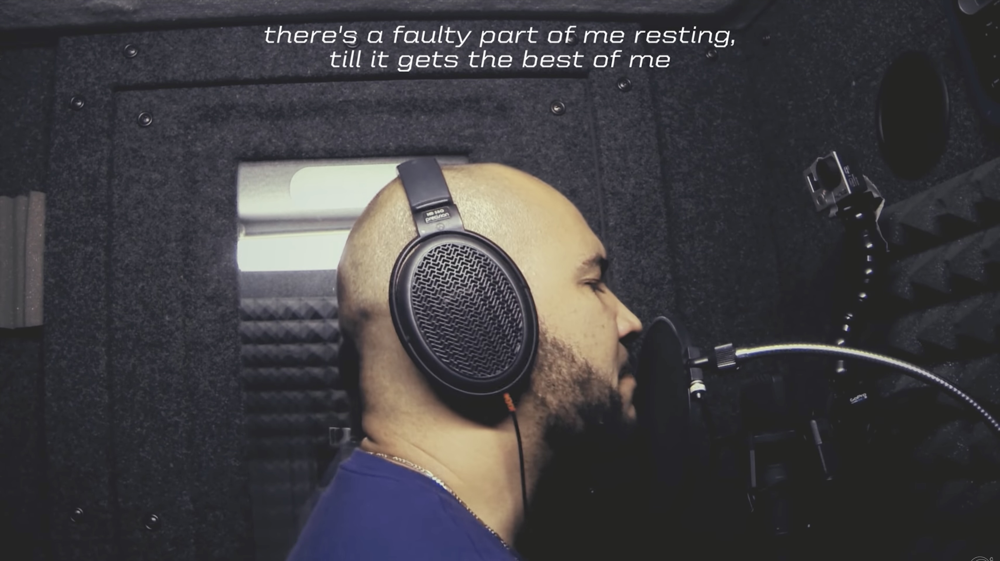
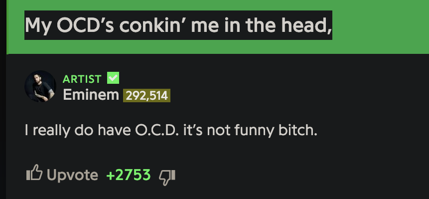
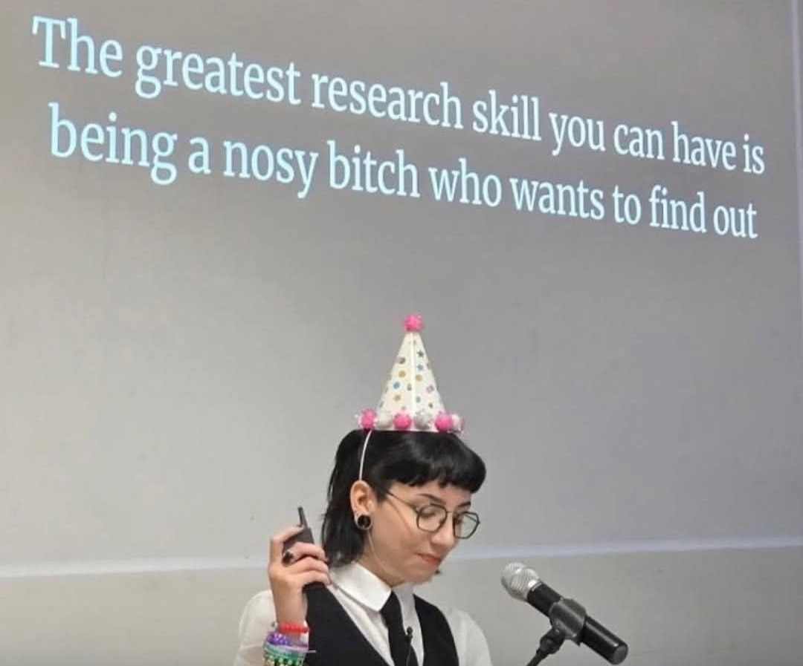
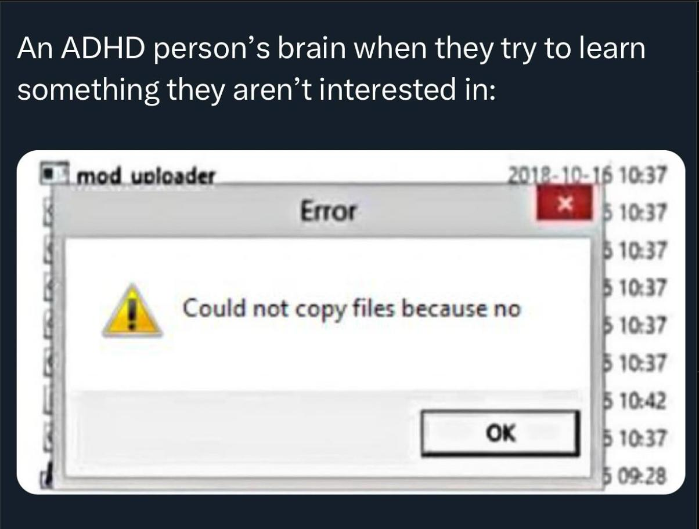
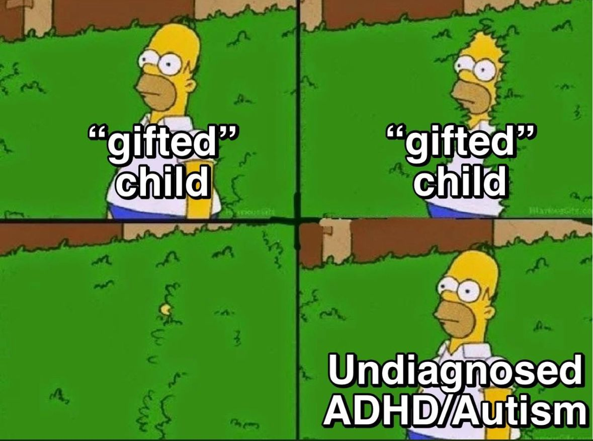
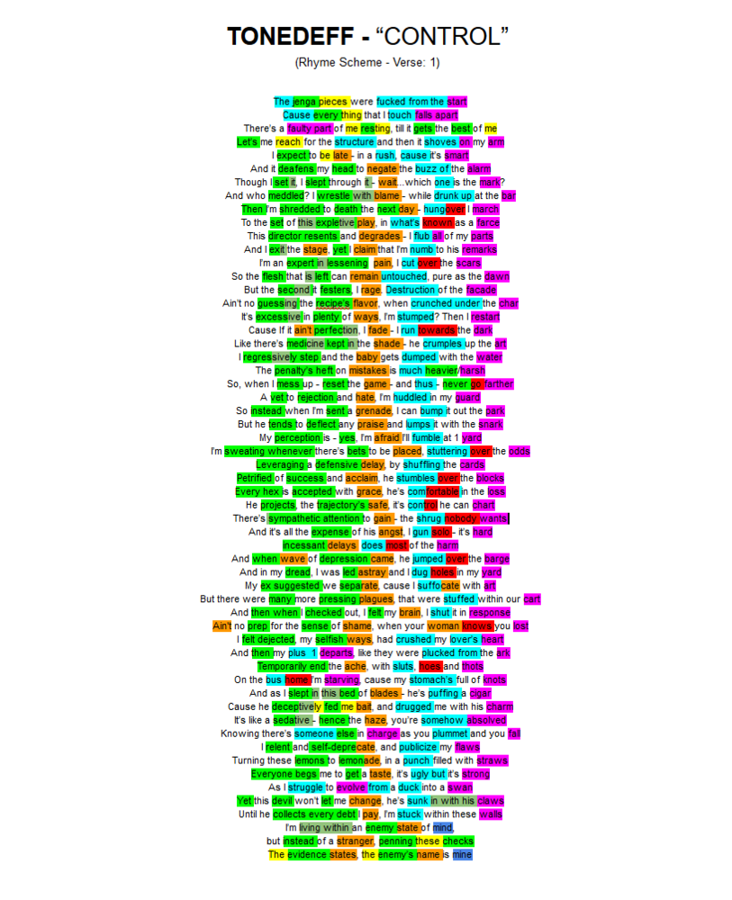
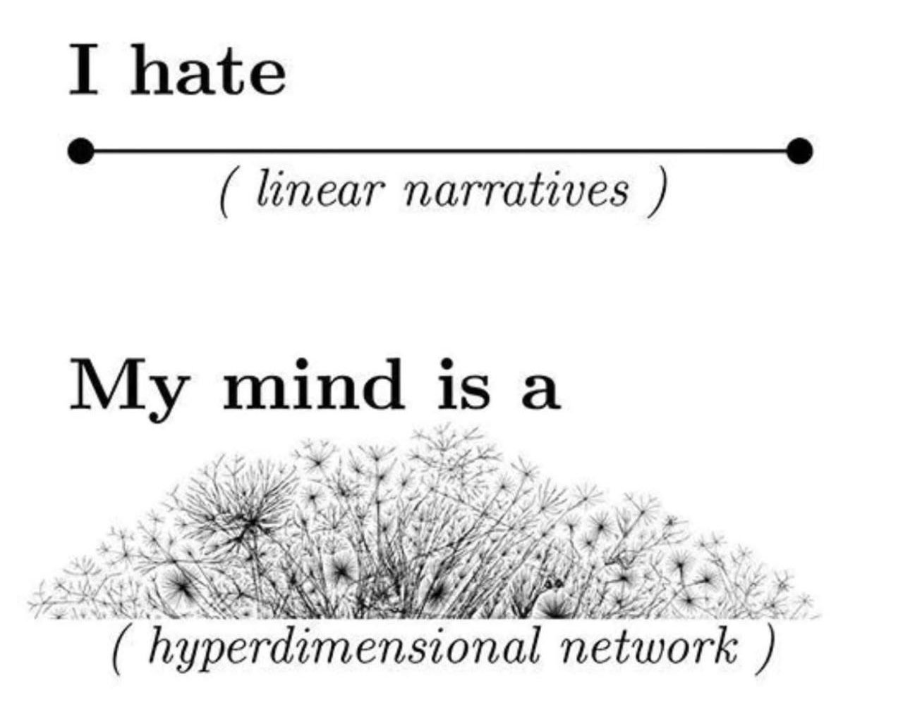

Hi, Sasha!

In this year's edition of my "birthday text about music" column, it's once again not only about music. This post is also about neurodivergence, such as attention deficit disorder.

So what is it like to live, and what kind of songs come out, when your brain doesn't work like most people's?

All along I've felt that the rappers I love have something in common. Now I think they might all get similar diagnoses. And maybe I would too, which is why I love their music. And why I can tell you something "from the inside".

Some disclaimer is needed, naturally:

> Here it's important to keep in mind that I'm not an expert. Don't make confident diagnoses based on this text; for that, it's better to see a specialist.

And specialists, for that matter, don't understand everything either. Humanity simply hasn't properly figured out how the brain works yet. Even the terminology is tricky, so in places I treat it loosely.

Hence, while science can't fully explain the subject, I think even information from less competent people is useful. People like me and rappers!

---

## That's how it starts

And what can people from hip-hop tell us about mental health problems, in a genre where a typical hit sounds like "my problem is choosing between a Lambo and a Ferrari"? Why study the subject through them? Well, to start with the obvious: rappers differ, and some don't rap about Lamborghinis at all.

Perhaps more importantly, **a typical rapper's main subject is himself**. These endless autobiographies can be tiring. But when you want to understand "what it's like to live with a particular mental trait", it's actually very useful when a person describes it in detail. Even if they don't know its "proper" name themselves.

https://www.youtube.com/watch?v=gYMkEMCHtJ4

Pretty much from the very beginning, hip-hop has rapped about mental health (in the broad sense). The important early hit «The Message» (1982) is a song about life in a troubled place: broken glass and rats all around, and no money to get out. And already there the chorus, *"Don't push me, cause I'm close to the edge / I'm trying not to lose my head"*, mentions not just life's hardships but their effect on the mind.

Years later, **Geto Boys** developed the theme in great detail in their biggest hit, «Mind Playing Tricks on Me» (1991). It's entirely about how life in the ghetto causes mental struggles: insomnia, anxiety, suicidal thoughts. And the song's very title stresses that a person doesn't fully understand or control their own brain.

https://www.youtube.com/watch?v=IJtHdkyo0hc

By the time people started paying more attention to therapy, there was only more of this. The British rapper **Dave**'s album «Psychodrama» is framed as a therapy session, **Logic** named his hit «1-800-273-8255» after the number of a suicide prevention hotline, and I've already [written](../nf-en/) about the rapper **NF** and his depression.

In what follows, I'll focus on things like ADHD and OCD, which affect what a person focuses on. I think they shape songs even when the song itself is about something else entirely.

---

## May I have your attention, please?

Remember my [post](../eminem-en/) about **Eminem**? There I mentioned in passing that his obsession with rhymes and sound looks like obsessive-compulsive disorder. But back then it sounded like a figure of speech.

Then I later discovered that on Genius he himself had annotated his own line about OCD:

Hmm, this may explain a lot, about Eminem and not only him.

Driven by OCD, people may endlessly wash their hands or arrange things at home symmetrically. They know it's pointless. But they CAN'T NOT do it.

And I've long loved rappers who arrange their sound echoes with about the same care. Eminem is far from the only one. For example, how long does **Horus**, a Russian rapper, work out a chain like «страничках / спич / напичкан / дичь / притчей / типичны / лично / тепличных»?

https://www.youtube.com/watch?v=H6p9l4e9HHU

Young rappers: do they simply decide "hip-hop loves rhymes, so I'll pile them on as much as I can"? Or does their brain constantly try to arrange words in the best possible way anyway, and that's why they end up in hip-hop?

What the most stubborn ones also add are self-imposed constraints. **Dyadya Zhenya**, a Russian rapper, managed to write impressive songs without using the letter "r" in his lyrics at all. It's said to be because he can't roll his r's. But I think it was also a choice like the writer Sergei Dovlatov's rule of "never starting the words in a sentence with the same letter".

https://www.youtube.com/watch?v=emVLcD5qJro

Imposing a constraint on yourself is also an interesting OCD-style challenge. Can you write a good battle text without swearing? What if you weave your best thoughts together with lines by Joseph Brodsky? Can you build a whole song out of lines from different characters so that they add up to the hero's biography? What, chickened out? Not man enough?

Someone will say: "This is all empty word-juggling that can go on forever and has no value. As if, since childhood, songwriters spent sleepless shifts sorting sounds, selecting the snappiest, scraping the barrel, striving for superstardom, sharpening skills, staging showdowns, while listeners, for their part, sank into stupefied slumber... you get the idea, right? You can churn out lyrics like that by the mile, and they'll quickly stop inspiring anyone."

Holy moly, but why treat this as the only criterion, cut off from everything else? I think this "OCD approach" shines when it's not all there is. When rhymes strengthen an already interesting song instead of being the only thing in it. That's when they can help a rapper become famous. And if this approach really is tied to how the brain works, then a rapper with OCD has an advantage over others.

It might seem that "for them the disorder turns out to be not a curse but a blessing". But I think it will still be a curse too. If you can arrange sounds with amazing harmony but CAN'T NOT do it, you're not fully in control of your life. And it would be naive to assume it will show only in your writing and leave the rest of your life untouched.

Not long ago, Eminem himself talked about this in the little-noticed song «[Legacy](https://www.youtube.com/watch?v=64jjsEtvkdM)». Roughly: my brain doesn't work like everyone else's, and at school it made life miserable, but without it I couldn't connect words so cleverly, and in the end I wouldn't have succeeded.

Gift and curse can be one and the same, and his song «Not Afraid» has wordplay about exactly that: *"Like a 'fuck you' for Christmas, his gift is a curse"*.

---

## Attention is all you need

You'll find more than OCD in hip-hop. ADHD became a song title for [Kendrick Lamar](https://www.youtube.com/watch?v=QjlFqgRbICY) back in 2011, and in 2025 for the newcomer [Madk1d](https://www.youtube.com/watch?v=fdpjNzyyVJU) (and outside hip-hop, for the French multi-instrumentalist [Igorrr](https://www.youtube.com/watch?v=TGIvO4eh190)). But **Joyner Lucas** went furthest of all. First he named his whole debut album after his diagnosis, «ADHD» (2020). And now, in 2025, he has released a sequel, «ADHD 2». Here's the main song from the first album:

https://www.youtube.com/watch?v=vpNUzNBw6FI

Of note is how the genre is handled already in the intro: a minute and a half of non-stop rapping gradually grows tenser until it reaches an "explosion"; who else does that? But ADHD itself comes in with the main part of the video, where even the visuals are meant to "show the world through Joyner's eyes". The hero is filmed with no cuts at all, yet the context keeps switching and the camera never stops moving. Watching "[how they even filmed it](https://www.youtube.com/watch?v=UEhd1ZFpf7Y)" is interesting too.

Unlike what some might assume, Joyner is no "soy snowflake" whom many would tell "you've invented diagnoses for yourself, you should just man up". In many ways he's precisely a "manly rapper" proclaiming how tough he is. But he's just as direct in proclaiming: "I have ADHD, it's not made up, it really affects my life, and you have no idea what it's like to be me".

- He has songs on these albums on "ordinary" topics like money, but the main theme runs through them like a dotted line. For example, in the videos for songs from «ADHD 2» he raps now about [being unable to fall asleep](https://www.youtube.com/watch?v=y-YAnyGzJY8) without background noise, now about [anxiety getting the better of him](https://www.youtube.com/watch?v=jnVfHe-nR_c).
- And on a song with Logic, he [added](https://genius.com/17236252) a sample with background information about how only boys used to be considered prone to ADHD, "because they're seen as loud and rowdy".
- Playfully, he [showed](https://genius.com/Joyner-lucas-chris-skit-lyrics) the typical attitude of the people around him in a skit where Chris Tucker calls him, roughly: "Dude, how long are you going to drag out the album? Stop using your ADHD as an excuse. My mom has ADHD too, and she never used it as an excuse to be lazy."

Predictably, Eminem invited Joyner to do a [duet](https://www.youtube.com/watch?v=mvSItvjFE1c), and it makes sense that they connected: for example, both sometimes switch to ultra-fast rapping, and my question above, "who else raises the tension in a rap for a minute and a half straight", [wasn't rhetorical](https://youtu.be/it_04dk_97E?si=JVMvOqNf7A9Qf0Ia&t=140). Doing that takes long rehearsals of fast verses. People usually find such a monotonous activity rather boring...

...in all but one case: when the person is fixated on it. And interestingly, ADHD, like OCD, is quite capable of "fixation".

Naturally, "a person with attention deficit disorder" sounds as if they never focus on anything. But in fact it's sometimes the opposite: ADHD can involve hyperfocus, when attention can concentrate on a seemingly boring topic very intensely and for a long time, in a way other people couldn't manage. This can help with research, for example.

Exactly where does the "deficit" come from, then? The difficulty isn't a "lack of attention" but trouble steering it. It's as if the brain "decides for itself" what to focus on. And switching it to "what's needed" is harder than for other people.

Someone with ADHD who gets hooked on something can reach amazing heights in it. But at the same time they may fail at things that seem simple to everyone around them.

So for a rapper, ADHD, like OCD, can turn out to be a blessing and a curse at once. It makes life very hard, but it's also what sets you apart from others.

His song «ADHD» is a vivid example: Joyner talks about both sides there. He starts with *"It kinda feels like I'm dying on the inside"*, but soon moves on to *"Maybe I'm just everything that you're missing"*.

---

## The way I am

Experience has made me familiar with some of the feelings Joyner describes. And although I don't write hip-hop myself, I too sometimes polish my texts endlessly, making a mountain of edits even after publishing. And I can get stuck on a sudden topic "until I've properly figured it out" (like [the music of Sudan](../sudan-en/), yep). Meanwhile, with other topics that would be more useful, I sometimes feel like this:

A diagnosis of ADHD is something I've long suspected for myself, but I've had different answers from different specialists, so I don't claim anything with certainty. One doctor at a supposedly reputable clinic even told me: "What ADHD? That's the Americans stuffing kids with Ritalin because of their made-up notions, and then those kids shoot up schools."

Linking school shootings to Ritalin is a [myth](https://www.fox10phoenix.com/news/nra-links-school-violence-to-ritalin-but-experts-deny-link) invented by the National Rifle Association on the principle of "don't take our guns away, let's ban something else". That's when I felt what nonsense even "distinguished specialists" can sometimes talk, and from the rapper Logic's [line](https://genius.com/37969960) *"killing them with no Ritalin"* I sensed that he had run into this myth too.

Through looking into the subject, though, I've come to some general conclusions that I'm more sure of than any specific diagnosis. Right now the internet looks as if half the people are declaring "we all have ADHD", and the other half "you're all just lazy and invented an excuse". What can I say about it in general?

### 1.

Honestly, we have to admit: we simply understand very little about this yet. Science hasn't properly figured out how attention and motivation work. For example, speaking of "laziness", what scientific term even corresponds to that everyday notion?

Surely our ideas will expand a lot. Maybe concepts like "ADHD" will come to sound the way "the vapors" sounds now: people said that about everything until they figured things out properly. And today's internet arguments about these concepts will sound like cavemen arguing whether "the Earth is round or square", with both sides agreeing that "obviously, it's flat".

Ultimately, don't cling too much to specific terms like "ADHD"; they will be revised. It's better to look at the bigger picture:

### 2.

Concentration, I assume, is affected by differences in how people's brains work. Roughly speaking, their brains produce different amounts of neurotransmitters (that's a simplification, but it's a handy way to picture the situation). And these differences can be either innate or acquired.

Clearly, people differ in other parameters too, like height and weight, and everyone understands that. And everyone knows that tall people have a built-in advantage in basketball. But neurotransmitters aren't visible "from the outside". And people wrongly assume that in situations like "taking a test" or "remembering to start the washing machine", everyone is on equal terms. That said, the opposite mistakes, with false diagnoses, surely happen too.

*Some neurodivergent people will recognize themselves in this situation*

### 3.

Even so, the mere fact of differences doesn't mean "we're off the hook, we have ADHD and nothing depends on us, so we won't make any effort".

Short people are unlikely to make the NBA. But at the backyard level, you can win at basketball by training more than others. Likewise, with an unusual way of concentrating, some things aren't worth taking on, and others are, but you have to be ready for extra difficulty.

Someone who says "I have ADHD, so I'll put in even more effort to get such-and-such result" isn't taking "the lazy person's position" but the opposite.

### 4.

Although such things cause a lot of difficulties, in some places they can play to your advantage. Short people have a harder time in basketball, but they have an edge in horse racing. And there are hypotheses that ADHD or autism correlate with programming. Lots of people would like to "get into IT" but quickly give up, while others love to code. What sets the latter apart?

To put it cautiously: I don't consider neurodivergence the only factor, but it's unlikely to have played no part. So it turns out it gave people an advantage that others envy. As with some rappers, it became a blessing. It's no accident that some neurodivergent people were called "gifted" at school (sometimes with "but lazy" added).

Whatever the case, as with rappers, **even a blessing will still be a curse too**. If you get hooked on some well-paid tasks, that doesn't mean every task in life will be like that. And when you face the others, you'll still be banging your head against the wall.

> One analogy I've come across: **ADHD is like your brain being a powerful supercar, but you're a passenger in it**.

Revs up like nothing else can. But you don't really decide which way it goes. It's as if you have superpowers but no full control over them.

---

## He's lost control again

Keeping all that in mind, here's the culmination of everything above: a song by the little-known rapper **Tonedeff**, «Control», from the album «Polymer» (2016), which I listened to more than anything else this past year.

A little over a year ago I was googling the rhyme schemes of some songs (a nerdy pastime in itself, of course), stumbled on this by chance and was floored:

Note: all the places in the verse that sound alike are marked in different colors. And when I saw this coloring (before I'd heard the song, read the words closely or knew anything about the artist), I immediately felt: OH WOW, HOW STUBBORN AND OBSESSED HE IS.

Don't expect strict rhymes here, these are sound echoes, but... for dozens of lines in a row, the lyrics were written so that their beginnings, middles and endings all echo each other. It's as if Tonedeff took one long phonetic phrase and found 50 different ways in a row to fill it with meaningful content on a particular theme.

Ever heard other rappers do this? I don't remember it even from Eminem.

Viewed as a whole, the approach feels like a careful game of Jenga. The author seems to pile suitable lines on top of each other, testing how many he can stack before the result stops being a meaningful monologue and collapses into a heap of random sound-alikes with no content.

Even more so when I later heard the song:

https://www.youtube.com/watch?v=cbJvZOilfiM

- Runtime: TEN MINUTES.
- You couldn't tell by ear how many tracks it's assembled from, but it's a huge number: in a [documentary](https://youtu.be/jDKIWvFyE_o?si=e8EerYnQoAEoVzcD&t=5432), Tonedeff shows them and says mixing the song took him NINE MONTHS.
- The music uses a "wall of sound": Tonedeff was inspired by the concept and listened to a lot, from Phil Spector's productions to My Bloody Valentine and Sigur Rós, to bring the approach into hip-hop. The song closes the album, and this "wall" in its second half is the climax of the whole preceding hour.
- He both raps fast and sings in it, performing everything himself rather than bringing someone in for backing vocals.

It's the most meticulous work, especially for a little-known rapper with minimal budgets who does almost everything alone. He even shot and edited the documentary about himself, and the result looks like the work of professional directors. He seems to reach in every direction at once, and wants to do something great in each.

Now, you might think that a person with such a meticulous approach would have everything under control in life too. But if you listen closely, it's the other way around. «Control» is a song precisely about lacking control over yourself. He uses the Jenga metaphor himself... but in the sense of "everything I touch falls apart".

Going further, in the second verse he says it outright, roughly: my own brain turns out to be my enemy; it seizes power, and I have to fight it for control of myself. And with two sides at war inside me, I can't tell **who I am in my own body: the parasite or the host?**

---

Even so, "lazy" is absolutely not the word for the author of such a carefully crafted song. And at the same time, it's a song about missed alarms and broken promises, about alcohol abuse and a broken marriage, about how you can be a procrastinator and a perfectionist at once.

Looking to prove something to everyone with "unusual clever solutions" on his debut album, Tonedeff found the hip-hop audience didn't appreciate it, and popularity never came. And on «Polymer» he went all-in on perfectionism simply for its own sake. He understood that few would even notice all this fine craftsmanship and realize how much effort went into it. But the people this kind of music suits, who did notice «Control», rate it highly. Including me.

Some of why I love it is simply that it's a good song. Some of it is how carefully the sound echoes are crafted. And some of it is that in places I recognize myself in it.

Every bit of this is familiar to me: both the trouble with self-control and the lyrical nerdiness. If my self-control were better, I'd have published this text exactly on your birthday instead of blowing the deadline. And if not for the nerdiness, I wouldn't have spent so many hours trying to polish its wording. For example, I wouldn't have bothered to make the first letters of the paragraphs (not counting subheadings) spell out a phrase together. My brain decided it would be more interesting that way, and that it had to be done. (In this English version, the phrase is in English too.)
