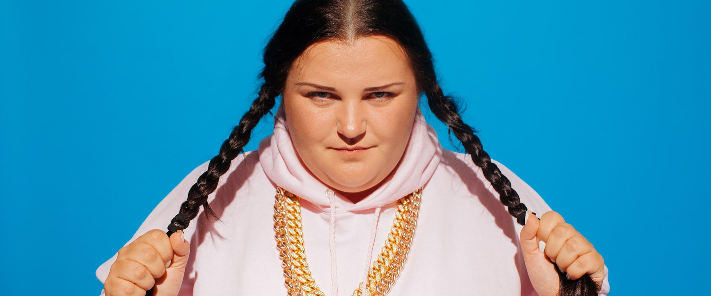

A year ago, at your previous birthday in 2018, I played a couple of songs by the rapper **Alyona Alyona**, who had only just become known: at the time, she had all of two music videos.

And now I feel that over the past year she managed first to become the most interesting thing happening in music for me, and then to stop being it. So I wanted to write a post: a lot has already been written about her, but the pieces I read seemed to miss something important. (Except for her episode of «[Vpiska](https://www.youtube.com/watch?v=YFcTpQYYQLY)», a Russian YouTube interview show, which is wonderful.)

Conversations about Alyona usually start with her gender, her figure, her background and her language. I want to start differently: first of all, her music is simply very powerful hip-hop, regardless of any context. Technical and varied flow, well-judged switches to singing, good beats, and, even more importantly, a personal charisma you can feel in the songs themselves, so the visuals aren't even necessary. You can have no idea who's performing or what the artist looks like, and it will still hit. I once rapped one of her songs at a party at a developer conference, after which a speaker from Spain asked me how to find the original on Spotify: he didn't know a single word of the lyrics and hadn't even heard Alyona's own voice, but the song is so powerful in itself that it broke through every cultural barrier.

So all the praise that follows, where the context does come in, comes with no allowances whatsoever: Alyona isn't "cool for a woman in a traditionally male genre", she's just cool.

As for the context, here's what I find interesting. James Murphy of LCD Soundsystem was once described as an "unlikely frontman" (not a young, slim heartthrob but more of a teddy bear: not that we mind, but it's unexpected for someone like that to lead a band). Well, that's nothing compared to how unlikely Alyona was as a new hip-hop star.

- First, in the post-Soviet world, women's hip-hop is extremely scarce and sad.
- Second, hip-hop in Ukrainian had never become popular in Russia.
- Third, hip-hop is very often aggressive, and Alyona (a former kindergarten teacher) is an incredibly kind person.
- Fourth, even when hip-hop isn't angry and battle-minded, swearing seemed an inseparable part of it, and Alyona doesn't have that either.
- Fifth, she lived in a small town, so she made her music far from the capital's studios and producers.
- Sixth, she only made her name at 27: with 17-year-old rappers, flaws can look like "well, they'll learn", but here they would rather have prompted "who do you think you are".
- And of course, in a society dominated by conventional ideas of female beauty, where popular artists usually fit them, Alyona's build breaks all the rules too.

In short, each of these factors on its own looks like it lowers the chances of success, and when they all come together, it reads like a description of anti-success.

And when her very first video, «Рибки» ("Little Fish"), came out, deliberately garish, the reaction in the comments on The Flow, a Russian hip-hop site, was by and large to treat it as a meme. A fat kindergarten teacher from a Ukrainian small town has put out a hip-hop video where she rides a jet ski in a swimsuit? Well, let's have some fun, and tomorrow we'll move on to something else; maybe a budgie will record some hip-hop. Hmm, by the way, the teacher's flow is not bad at all, surprisingly.

https://www.youtube.com/watch?v=6lJETYWNT9U

But when the second video came out, the reaction was different: now it was no longer seen as a curiosity, and people wrote in all seriousness that it was better than 90% of Russian-language hip-hop. The commenters were themselves stunned by the cognitive dissonance this caused them, but they couldn't help giving her her due.

What's especially interesting is that there was no negative reaction at all. I remember someone's words (not verbatim): "All this time, while the Flow comments hated on even the most acclaimed people, from Kendrick Lamar to Oxxxymiron, I wondered: what would a rapper have to be like for nobody here to find fault with them? Okay, now I know, thanks."

The YouTube comments are similarly blissful, with everyone writing about how great she is (and that's despite what Russian internet users usually write about plus-size women).

Then came the album **«Пушка»** (*Pushka*: "cannon", and also slang for "a banger"), and it turned out to be a banger indeed. I played it on repeat and learned a couple of songs by heart (even though I don't know Ukrainian, so at first I wasn't even sure what they were about). The album showed that the success of the first videos wasn't an accident, and added a lot to them. And everything that had seemed to count "against" her turned into strengths: we'd already heard more than enough aggressive, male, Russian-language hip-hop, and against that background, positive, female, Ukrainian-language hip-hop sounds very fresh and interesting.

*Pushka* also shows how a rapper can be positive and full of drive at the same time, doing without hate but without becoming saccharine and boring. And while in some places Alyona steers clear of traditional hip-hop discourse, in others she takes it and makes it her own: when she declares "I know the pulse of the streets", you suddenly realize that from a small-town kindergarten teacher it sounds no less convincing than from a troubled teenager on the edge of a city; streets have a pulse beyond lads' turf wars.

Of course, it's no accident that Alyona recorded an album of this level: as it turned out, for many years she had listened to hip-hop, run an online community about women's hip-hop, and written her own lyrics. Still, the fact remains: in 2019, the most important hip-hop artist turned out to be a (now former) kindergarten teacher from a Ukrainian small town, the kindest of souls. I think that's wonderful.

Against all this bliss, however, a question arose: what comes next. For all the brilliance of *Pushka*, there was a distinct feeling that the next album would repeat it, and that would be far less interesting. So I thought that, for all my admiration for Alyona, I'd spend a couple of years anxiously waiting for the second album, and then crawl back to relistening to the first with a sad sigh.

I didn't have to wait two years: just recently she went ahead and released a new eight-song record, **«В хатi МА»** (*V khati MA*). The Flow commenters wrote, in unison, exactly what I'd feared: well, the skill is undeniable, but it's turning into assembly-line "hip-hop by Alyona". And having listened, I mostly had to agree: a couple of songs are a real joy, but many others left exactly that "heard it before" impression. As much as I wore the first record out, I have no wish to wear out the second.

That should be upsetting, but in the end I even feel some relief. Second-album syndrome is common in general; few manage to surprise with it the way they did with the first. And instead of worrying about it for two years, I can relax right now and simply enjoy the songs I've come to love from both records. Alyona herself remains wonderful anyway (as someone wrote in the comments to «Vpiska», she's "the department for producing kindness and light in this world"). And despite the disappointment of the second record, there's still something to look forward to: she has never performed in Russia, and I'd love to go to her concert for the first time.

I also think that in 2020 another woman will become a full-scale hip-hop star: **Drummatix**. But that, it seems, will be the next post, a year from now! For now, here's my favorite Alyona song:

https://www.youtube.com/watch?v=Spq6QDDDDIY
