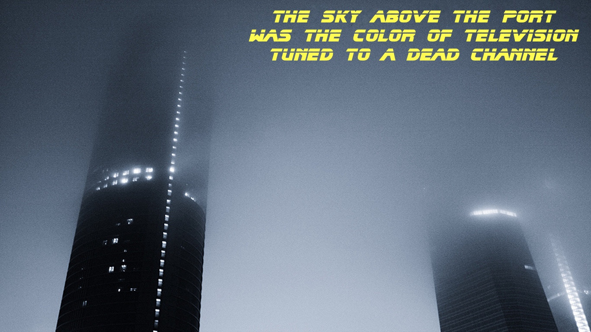

Обычно в этом блоге появляются посты про [наши конференции](https://jugru.org/), но ничто айтишное нам не чуждо — и в эту пятницу, когда весь мир обсуждает **Cyberpunk 2077**, захотелось отвлечься.

Выход этой игры вызвал новый всплеск интереса ко всему жанру киберпанка, поэтому захотелось отрефлексировать: что произошло с жанром за всё время его существования? Как он взаимосвязан с IT, и как на нём сказалось развитие IT? Почему громких киберпанк-произведений так давно не появлялось?

Я люблю киберпанк уже почти двадцать лет (с тех пор, как в школе попался в руки журнал «Навигатор игрового мира» с текстом про него), когда-то зачитывался Уильямом Гибсоном — поэтому теперь захотел собрать воедино всё, что знаю и думаю по теме.

---

## Что такое «киберпанк»?

Для начала надо определиться с терминологией. Что мы вообще понимаем под словом «киберпанк»? И тут мы сталкиваемся со сложностью: строгого определения нет, люди десятилетиями спорят, что является им и что не является.

Есть распространённое определение, которому вторит и Википедия: это субжанр фантастики с сочетанием «high tech, low life». Технологии стали более развиты, но счастья всем даром это не принесло. Наоборот, социальный договор сломался, и получился мрачный мир, где выживает сильнейший.

Определение хорошее, но всё-таки неполное. Например, киберпанк — это ещё и узнаваемая визуальная эстетика: урбанистические картинки, где в полутьме сияют вывески с иероглифами, и всё выглядит одновременно футуристичным и трущобным.

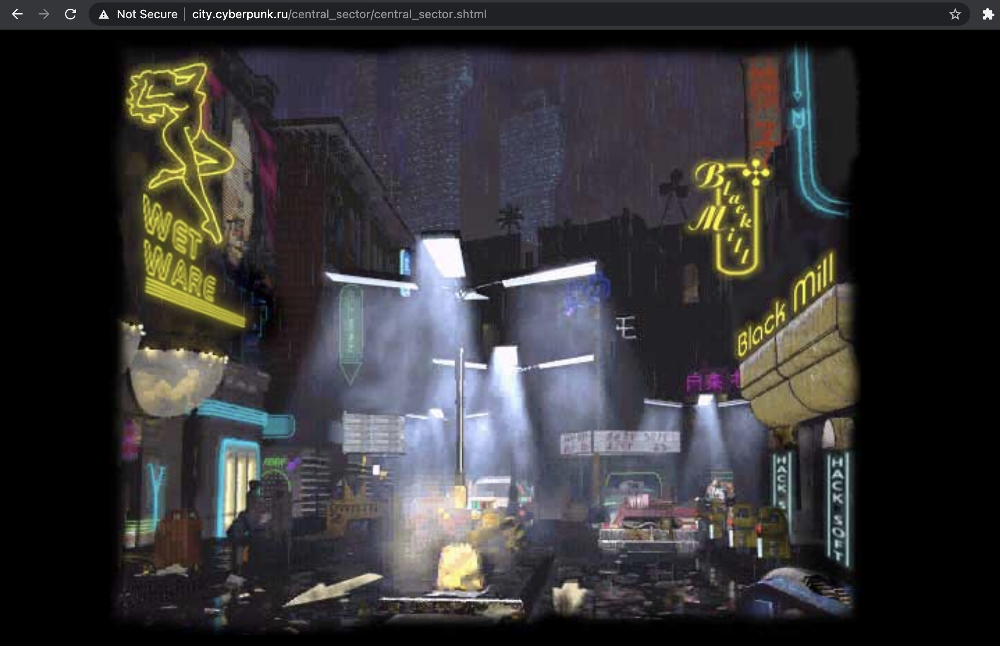
*Эстетику иллюстрирует сайт cyberpunk.ru (не обновлявшийся уже 17 лет)*

Интересно, что эту эстетику порой вспоминают при виде обычных спальных районов в формате «ночь, улица, фонарь, аптека»: вроде тут и особых технологических прорывов не видно, и социальный договор как-то по-новому не ломался, а слово всё равно так и вертится на языке:

*Вот, например, киберпанк района Западное Дегунино*

Думаю, есть и ещё одна важнейшая составляющая, которую часто забывают упомянуть (например, в словах «high tech, low life» про неё ничего напрямую не сказано): киберпанк плотно связан с IT.

Вот смотрите. Слова «high tech» означают вообще любые развитые технологии. И тогда, скажем, «Футурама» с её космическими полётами или «Довод» с поворотами времени вспять — это тоже про хайтек. Но никто не увязывает космос с киберпанком. С ним ассоциируются другие понятия, так или иначе связанные с компьютерами: «хакеры», «киберпространство», «виртуальная реальность», «искусственный интеллект». Его герои не бороздят космические просторы, зато часто сидят за клавиатурой (или подключены к виртуальным мирам напрямую, так что клавиатура уже не нужна). Они не в старой аналоговой фантастике с инопланетянами и механическими роботами, а в цифровой, где можно за пару секунд загрузить себе в голову навык пилотирования вертолёта.

По-моему, весь киберпанк возник как попытка человечества осмыслить компьютерную революцию. В 80-х было очевидно, что происходит что-то большое, и по всему миру на мониторах возникает новый мир, способный составить конкуренцию «реальному» — но совершенно непонятно было, к чему это приведёт. Что произошло в итоге спустя десятилетия, когда мы уже знаем, к чему привело? Давайте посмотрим на то, как это развивалось.

---

## 80-е

В 1982-м вышло сразу два основополагающих фильма, которые ещё не были полностью киберпанком в его нынешнем понимании, но многое для него сделали: «Бегущий по лезвию» (Blade Runner) и «Трон» (Tron). Ни один не оказался суперуспешным в кинопрокате, но оба стали культовыми и впоследствии на многое повлияли.

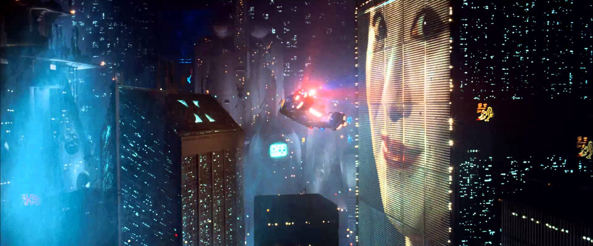
*Один из самых известных кадров «Бегущего по лезвию»*

«Бегущий по лезвию» довольно далеко ушёл от исходного романа Филипа Дика — и соединил фантастику с эстетикой нуар-фильмов, где никому нельзя верить. Получилось мрачное будущее, где автомобили научились летать, но приземляются они на тёмных улицах среди азиатских забегаловок. Все люди поудачливее уже сбежали с Земли, а оставшиеся живут в опустевших небоскрёбах, на стенах которых светится гигантская реклама. В этом мире, где не найти человеческого тепла, рассчитывать на историю с хеппи-эндом особо не приходится. Этими образами активно вдохновляются до сих пор — в том числе в «Cyberpunk 2077», где есть прямые отсылки.

«Трон» не был настолько мрачным, здесь сразу можно понять, что всё закончится хорошо. Но он важен в другом отношении. Во-первых, здесь заходила речь о взломе компьютерной системы, причём во имя благих целей, и возникал образ «хорошего хакера». (Стоит вспомнить, что слово «хакер» тогда вообще было лишено нынешних негативных коннотаций «взломщика-злоумышленника» и означало нечто вроде «компьютерный умелец».)

https://www.youtube.com/watch?v=3efV2wqEjEY

Во-вторых, здесь героя затягивало внутрь компьютерного мира. Стирание грани между реальным и виртуальным мирами — это позже на разный лад будет в «Матрице» и «Газонокосильщике», «Нирване» и «Лабиринте отражений». И хотя по сегодняшним меркам здешний виртуальный мир выглядит нарисованным в Paint, в нём есть свои яркие образы: сцена со световыми мотоциклами так запоминается, что из неё позже выросла отдельная игра Armagetron Advanced.

Годом позже, в 1983-м, возникает само слово «киберпанк» благодаря писателю Брюсу Бетке, назвавшему так свой рассказ. Он целенаправленно захотел соединить в одном слове два корня, первый из которых был бы про технологии, а второй — про подростковое наплевательство на правила. Его мысль была в том, что на смену хулиганам-байкерам должно прийти поколение бунтарей, владеющих компьютером с детства — и их родители совершенно не будут знать, что с ними делать.

В середине 80-х вообще происходит расцвет «книжного» киберпанка. Писатель Уильям Гибсон после рассказов вроде «Джонни Мнемоника» берётся за дебютный роман «Нейромант», и он становится главной киберпанк-книгой всех времён.

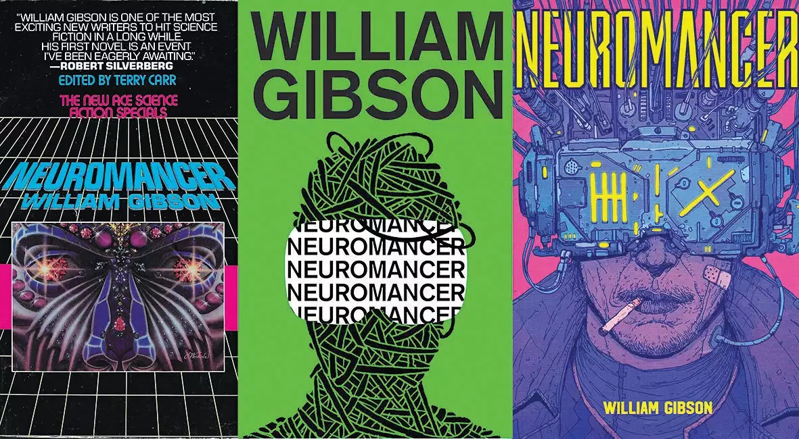

Я прочитал её в начале нулевых, когда ей было около 18 лет, и уже тогда её собирались экранизировать. С тех пор прошло ещё 18, а фильм так и не снят, но вроде бы по-прежнему собираются. Может, хоть хайп вокруг Cyberpunk 2077 на это сподвигнет? В любом случае, если «Бегущий по лезвию» был ещё «про андроидов», а не «про компьютеры», то вот тут IT-специфика развернулась во всю ширь: этот роман популяризировал слово «киберпространство».

А ещё в 80-х происходит заход на территорию с другой стороны. В Японии появляются «Акира» и «Призрак в доспехах», сначала в формате манги, а позже обе получат аниме-экранизации — тут возникает свой киберпанк.

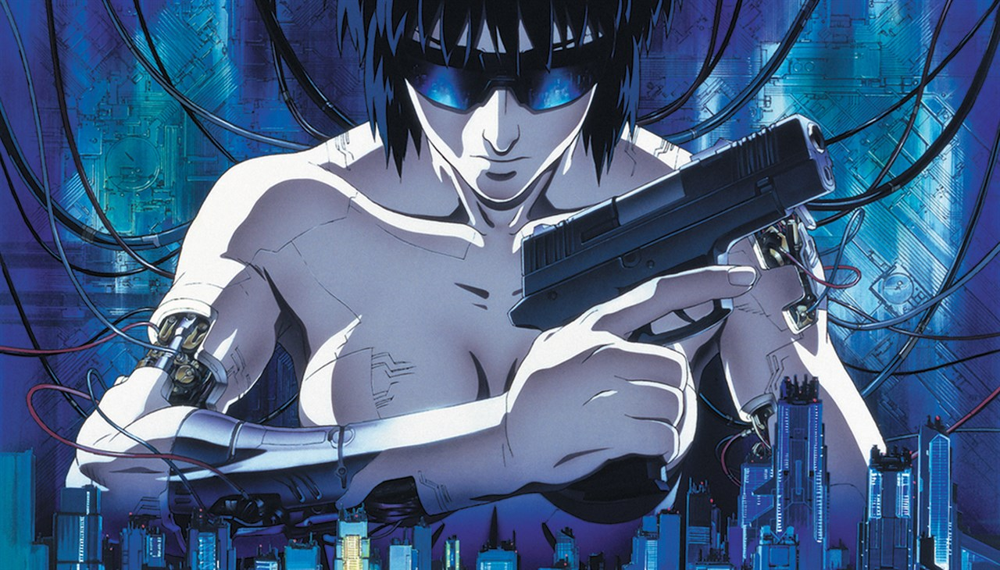

---

## 90-е

Если в 80-х происходило становление жанра, а интересовалась им нишевая аудитория, то в 90-х жанр уже зрелый и более мейнстримовый.

Взять, например, фильм «Джонни Мнемоник» о человеке, который перевозит данные в своей голове.

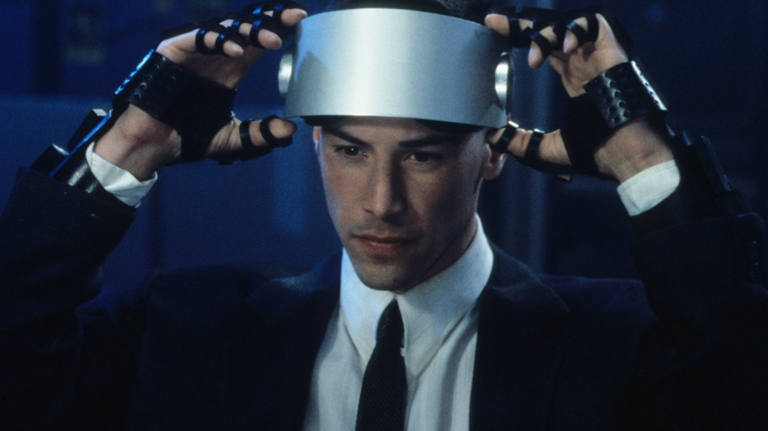

Оригинальный рассказ Гибсона в 80-е читали гики, а вот экранизация 1995 года получила ощутимый бюджет и звёздного Киану Ривза, так что вышла на более широкую аудиторию, хоть и не понравилась критике. (Любопытная маленькая деталь: у героя Киану Ривза объём для хранения данных составлял 80 гигабайт, и тогда казалось, что это безумно много. А теперь Cyberpunk 2077, где в числе прочего есть новый персонаж Киану, требует скачать больше 100 гигабайт.)

В том же 1995-м вышли «Хакеры» с первой заметной ролью Анджелины Джоли. Они не оправдали кассовых ожиданий, но показали, что само слово «хакер» пришло в массы. И что массы однозначно увязывали его со взломом, а не просто с компьютерными способностями.

Но пик популяризации киберпанка — это 1999 год и «Матрица». Фильм об искусственной реальности осмыслял, кажется, сразу всё сделанное до него — узнаваемые зелёные символы позаимствовал из «Призрака в доспехах», на главную роль взял того же Киану. А в итоге стал и суперпопулярным (так что сейчас готовится к выходу уже третий сиквел), и культовым, и высоко оцененным критикой.

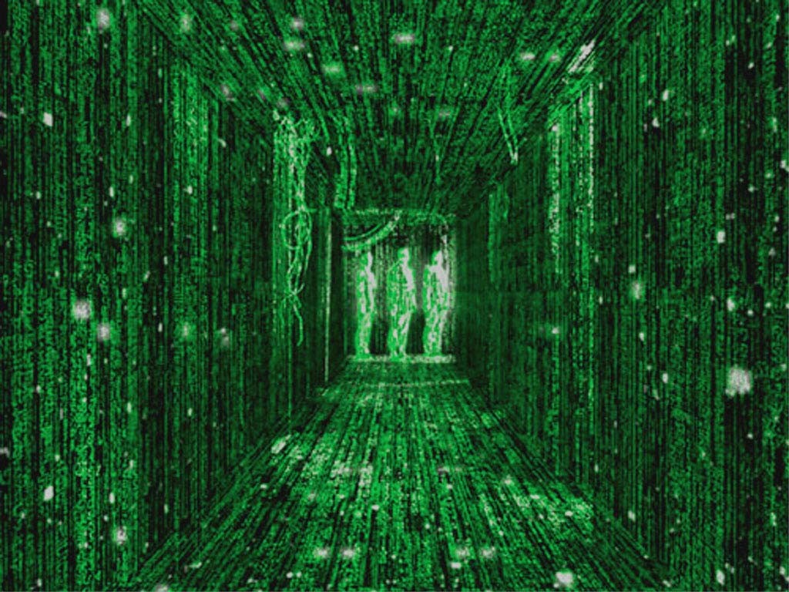

Любопытно, что в том же 1999-м появился ещё и «13-й этаж», где герой тоже с удивлением обнаруживает себя внутри виртуального мира, годом ранее их предвосхитил «Тёмный город», а ещё на год раньше Сергей Лукьяненко опубликовал «Лабиринт отражений». Вопрос о «настоящести» мира и способности заметить подмену в то время явно владел умами.

И параллельно жанр развивался как раз в «ненастоящих мирах» — компьютерных играх. На рубеже веков вышли две игры, которые связывают с киберпанком в первую очередь: System Shock 2 и Deus Ex.

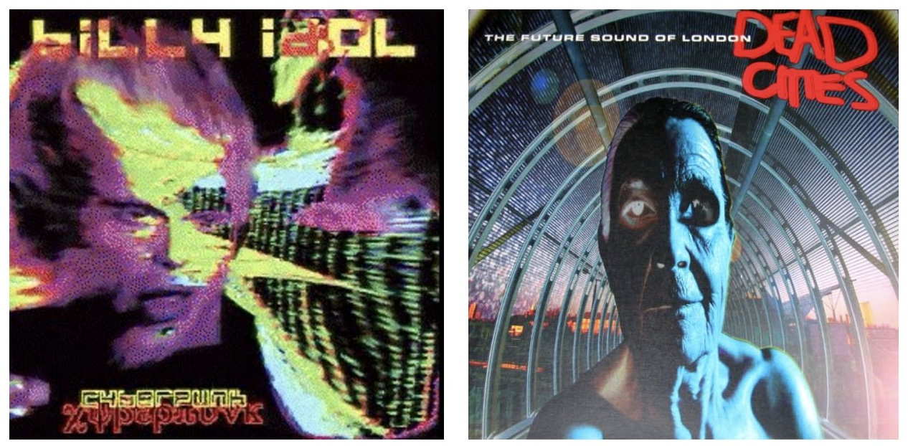

Если уже поговорили о фильмах, книгах, аниме и играх — а бывает ли киберпанк-музыка? Сложно сказать, что это такое: понятно, что тут напрашивается электроника, но её есть много всякой, не всю же в киберпанк определять. Поэтому в первую очередь вспоминаются случаи, когда музыкант сам прямо обозначает связь — например, Билли Айдол, который сначала был просто панком без всяких кибер-приставок, в 1993-м выпустил концептуальный альбом «Cyberpunk». Но у меня лично с киберпанком ассоциируется в первую очередь альбом The Future Sound of London «Dead Cities» (1996). По-моему, вот так и должен звучать мир, который напичкан инновациями, но при этом разваливается.

---

## XXI век

В 90-х жанр активно развивался — а вот потом как отрезало. За последние 20 лет мы не видели, кажется, ни одного по-настоящему значимого киберпанк-произведения. (**Update**: в комментариях неоднократно отметили сериал «Видоизменённый углерод» — каюсь, вот его не смотрел.)

Были сиквелы («Бегущий по лезвию 2049», «Призрак в доспехах 2», две «Матрицы»), ни один из которых не сравнился с оригиналом. Были какие-то фильмы, которые можно причислить к киберпанку со скрипом: «Википедия» [включает](https://en.wikipedia.org/wiki/List_of_cyberpunk_works) туда «Район 9» и «Робота по имени Чаппи» Нила Бломкампа, где показана южноафриканская low life, но инопланетяне и роботы появились в фантастике задолго до 80-х и персональных компьютеров.

Можно ещё вспомнить, что в начале нулевых были заигрывания с компьютерной/хакерской тематикой у далёких от неё людей: году в 2001-м я увидел клип «Жора хакер» поп-певицы с псевдонимом «НАСТЯ.da.ru» и до сих пор пытаюсь отойти от него.

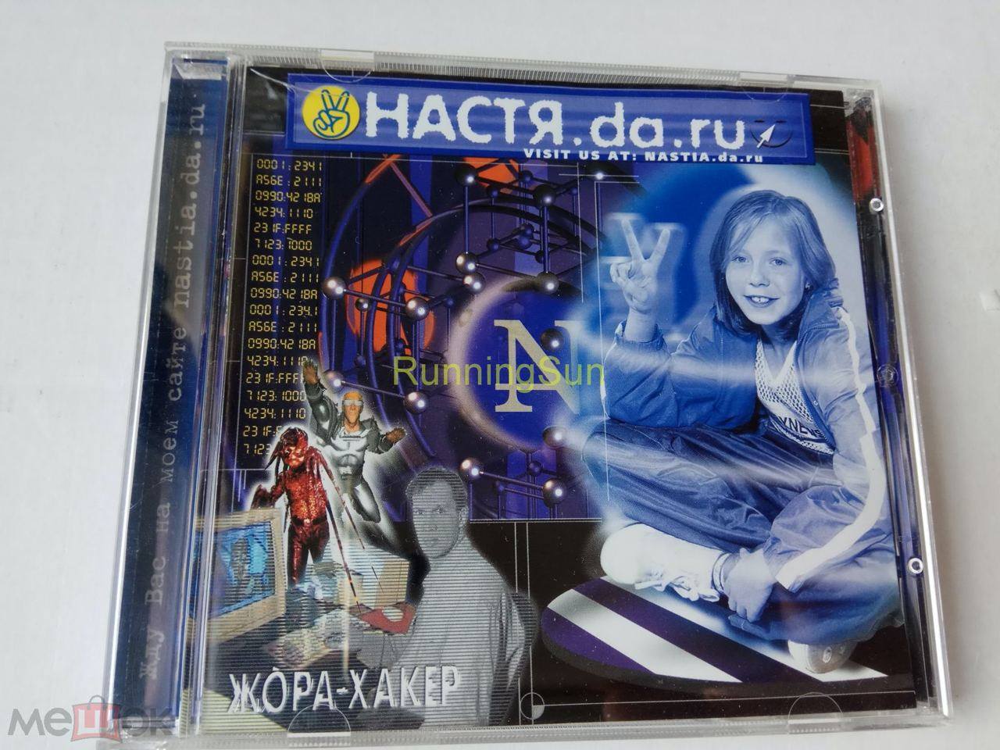

В 2010-х тему хакерства развивала игра Watch Dogs, тему искусственного интеллекта — фильмы «Her» и «Ex Machina», а пугать людей технологиями стал сериал «Чёрное зеркало». Но в связи с ними всеми слово «киберпанк» особо не звучало.

Так что, кажется, главное заявление за эти годы пришло не из кино или книг, а из автопрома. Cybertruck Илона Маска — это киберпанк-автомобиль во всём, начиная с названия и заканчивая тем, какие время и место выбрали для его премьеры («ноябрь 2019-го, Лос-Анджелес» — это вступительный титр из «Бегущего по лезвию»).

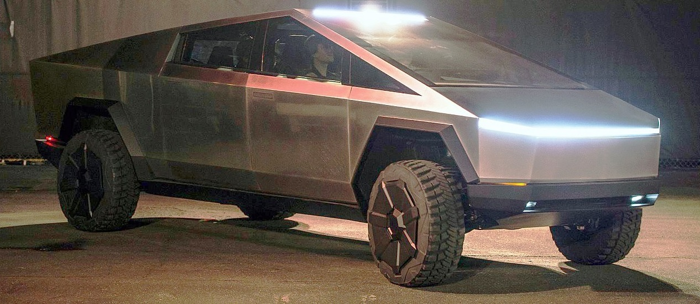

Зато, пока реальный киберпанк в дефиците, возникло ироничное ВК-сообщество «[киберпанк, который мы заслужили](https://vk.com/futureisnow)» с примерами того, как технологии вписываются в наши реалии («уважаемые соседи, просьба не занимать место у дерева, я тут заряжаю электромобиль»).

В сообществе закреплена запись «Киберпанк умер. Не потому, что жанр плохой — наоборот, великий жанр, пророческий. Просто он перестал быть фантастикой. Мы уже живём в киберпанке. "High tech, low life" — это наша жизнь, все эти смартфоны и дополненная реальность вперемешку с жареным супом и отклеивающимися обоями».

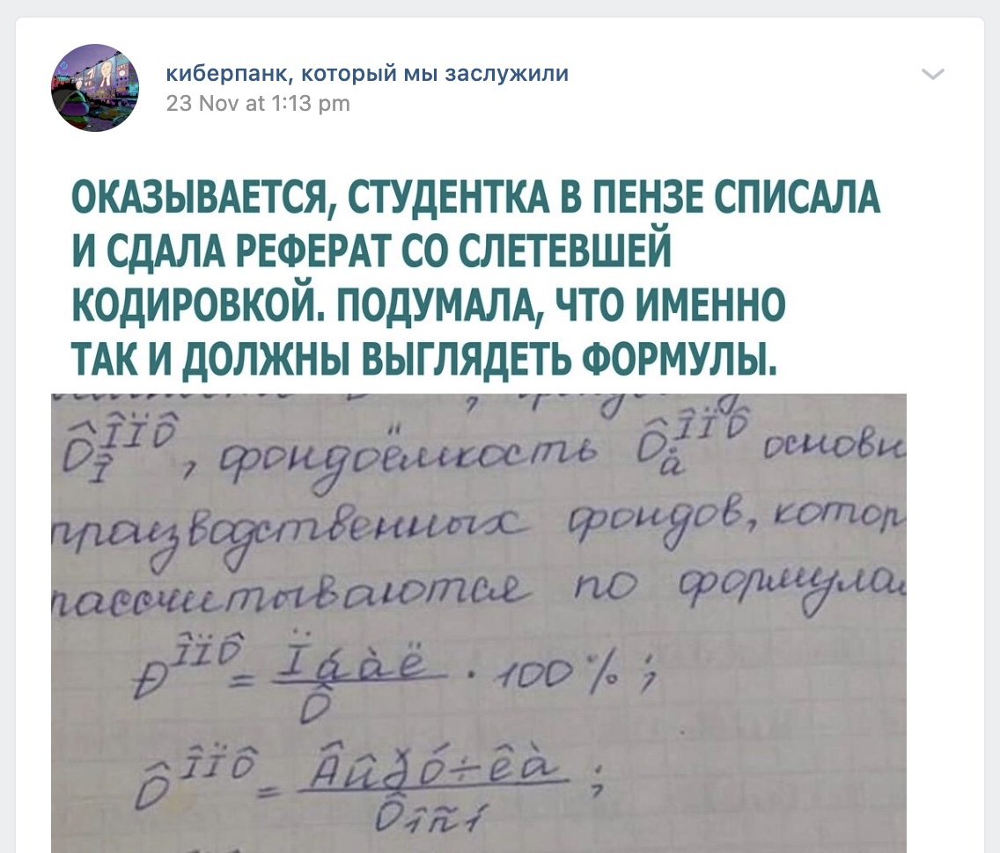

А теперь вот у нас есть Cyberpunk 2077 — первое за долгое время большое высказывание. Но в обзорах замечают, что при всём масштабе оно вторичное: использует уже сложившийся киберпанк-канон, а не добавляет к нему что-то принципиально новое. Причём канон за эти годы успел устареть (появились те же смартфоны, толком не предсказанные в классическом киберпанке), а ему продолжают следовать. Получается уже не «будущее», а «будущее, каким его представляли в прошлом».

И аудитория воспринимает это соответственно. Если когда-то неоновые вывески ассоциировались с будущим, то теперь для людей это эстетика 80-х. Сейчас никто уже не считает, что хакеры завтра захватят весь мир — зато можно повспоминать времена, когда это казалось реальным. Отчасти на подобном основан музыкальный феномен vaporwave/synthwave, тоже переосмысляющий 80-е и использующий киберпанк-образы.

То есть, хотя в название Cyberpunk 2077 вынесен год из будущего, интерес людей к нему — это во многом ностальгия по прошлому.

---

## Что всё это значит

Почему жанр, активно развивавшийся в XX веке, зачах в XXI? Могу ошибаться, но мне видятся следующие причины.

Во-первых, в 80-х было ясно, что развитие персональных компьютеров даст человечеству много нового, но было совершенно непонятно, что именно. И это давало богатую пищу для фантазии: можно было представлять любые виртуальные миры, неотличимые от настоящих, и в них легко было поверить. А сегодняшние новости уже не будоражат воображение. Переход Apple на ARM-процессоры — очень впечатляющая техническая работа, но не меняющая принципиально жизнь конечного пользователя. О каких новых киберпространствах мечтать в связи с ARM?

А во-вторых, я вижу принципиальное изменение в следующем. Чтобы эффективно пользоваться компьютером в 80-х, требовалось быть гиком-«хакером». Появились новые устройства, обещающие какие-то принципиально новые возможности (мгновенно общаться с людьми по всей планете!), но подвластны эти возможности только части людей. Это создавало вокруг них романтический флёр, возникал образ «всесильного хакера». И поэтому, скажем, в мире «Матрицы» ключевое умение — способность читать код. Главный герой, ещё находясь внутри Матрицы, связал свою жизнь с кодом, а потом вышел на новый уровень, научившись видеть код самой Матрицы. Даже номер его квартиры, 101, можно считать числом в двоичной системе.

Теперь же всё иначе. Главные возможности (вроде того же мгновенного общения) попали в руки всем и уже не требуют каких-то особых умений: бери да пиши в мессенджере, делов-то. Айтишник может получать root-права на телефоне, чтобы «выжимать из него больше», но с точки зрения простого пользователя что от рута изменится, кроме того, что «Сбербанк Онлайн» откажется работать? «Хакерство» и умение читать код стали чем-то вроде умений автомеханика: ну, круто разбираться в том, что под капотом, но большинство людей может спокойно ездить на машине и без этого, а когда что-то сломается, есть автосервисы. Где в чистке карбюратора романтика и будущее?

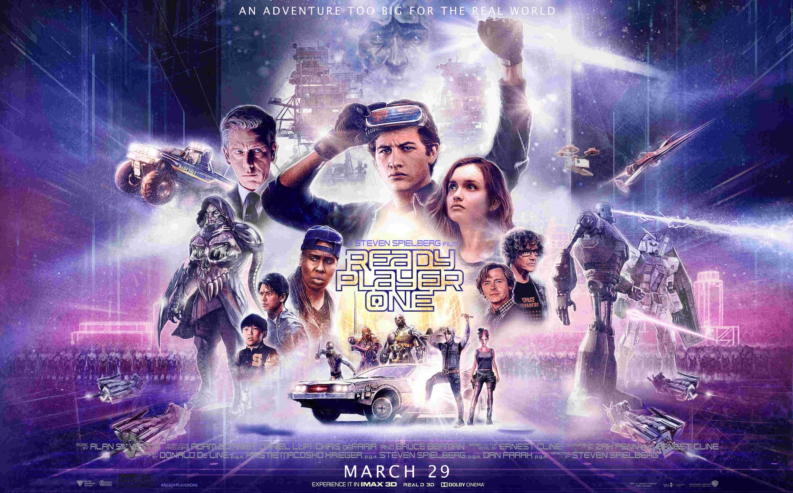

Интересно, что фильм 2018 года «Первому игроку приготовиться» по формальным критериям вроде как киберпанк. Развитие технологий? Да. Люди живут в трущобах? Да. Герой со шлемом на лице шляется по виртуальным мирам? Да. Почему тогда слово «киберпанк» к этому обычно не применяют? Помимо оптимистичности Спилберга, мне кажется, дело вот в этой разнице: герой не хакер, а геймер. Не программист, а пользователь. В настоящем мире VR сейчас тоже развивается и шлемы всё лучше, но купить и использовать Oculus Quest 2 может кто угодно, тут нет никакого хакерства — в чём тогда киберпанк?

Водораздел около 2000 года, после которого новый важный киберпанк перестал появляться — это, по-моему, массовое распространение интернета. Всё главное, что можно получить от компьютера, стало доступно рядовому пользователю, ничего не понимающему в номерах пойнтов FIDO. И можно прямо заметить, как вместо гиков осмыслять особенности интернета тогда принялись «обычные люди»: например, Земфира в 2002-м выпустила песню «Webgirl», где интернет играет важную роль для пользовательницы. А сегодня и такая песня не нужна — интернет стал слишком привычным и само собой разумеющимся.

В общем, Хабр, время нашей романтики прошло, теперь IT — не обещание удивительного будущего для избранных, а просто индустрия сродни любой другой.

Но мы можем в последний раз как следует прикоснуться к этой романтике, запустив Cyberpunk 2077.

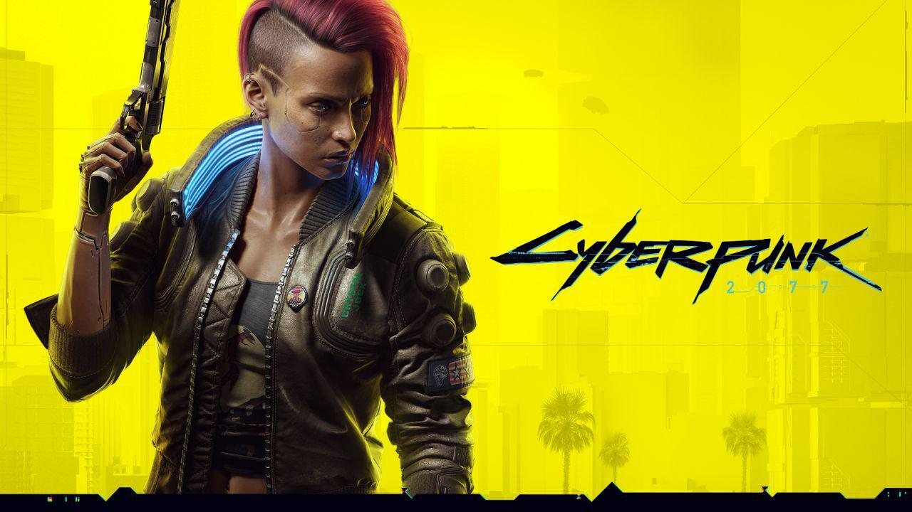
