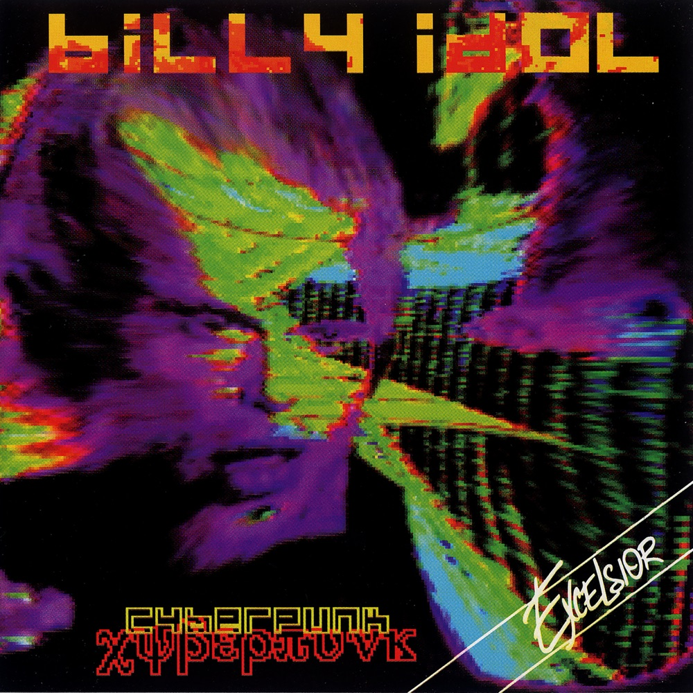
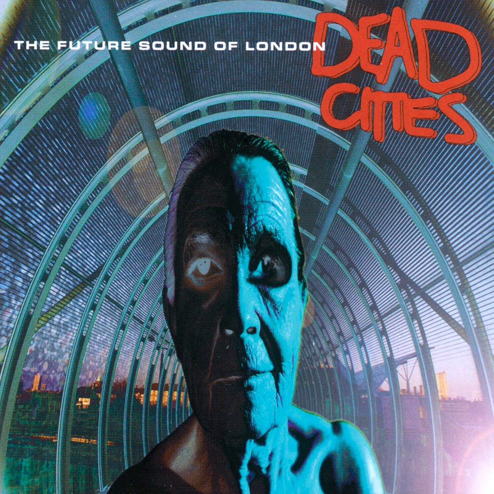
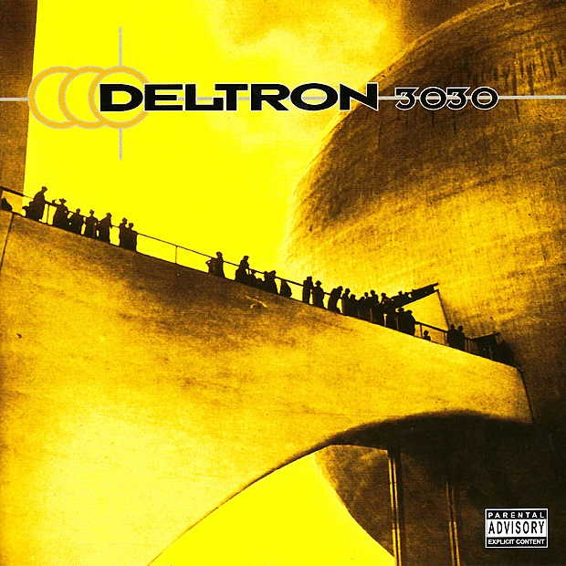

Привет, Саша! В этом году актуальной темой для музыкального поста ощущаю киберпанк.

Ещё в школе прочитал роман Уильяма Гибсона «Нейромант» и с тех пор ждал, когда кто-нибудь его экранизирует. Спустя много лет ожидание заканчивается: в 2027-м выйдет сериал. Книга, ставшая основоположником жанра, наконец получит визуальный ряд.

А реальность тем временем становится чем-то вроде «киберпанка, который мы заслужили». Искусственный интеллект, могущество корпораций, взломы, дипфейки, данные, роботы — и общее ощущение «high tech, low life».

Про киберпанк уже написано многое, в том числе и [мной](../cyberpunk2020/). Но обычно этот жанр ассоциируют с чем-то визуальным: фильмами, аниме, видеоиграми. Понятно, «как он выглядит», и фото выше многие назовут «киберпанковским» (если не обращать внимания на название станции «Шелепиха»).

А вот как он звучит? Что можно назвать «киберпанк-музыкой»? Думаю, что это интересный вопрос, на который нет одного «правильного ответа». Поэтому выбрал восемь разных вариантов и описал их все.

---

## Вариант 1: саундтреки

Раз киберпанк хорошо известен по фильмам, то напрашивается музыка из них. Прежде всего вспоминается саундтрек Вангелиса к оригинальному «Бегущему по лезвию» (1982): у него и статус общепризнанного шедевра, и своя узнаваемая эстетика, да и попросту сам его люблю.

Этот фильм известен «атмосферностью»: хотя в нём есть экшен-сцены, важнее неторопливые перелёты автомобилей между опустевшими небоскрёбами со светящейся рекламой. Фантастику тут скрещивают с нуаром, где тоже важна атмосфера: в мрачном мире, где силуэты скрываются за сигаретным дымом, немногословный герой идёт по следу нарушителей, а в процессе оказывается связан с женщиной. Сидя в одиночестве, он наливает виски… и использует для работы с уликами футуристичный голосовой интерфейс.

https://www.youtube.com/watch?v=jKCdNnAEpJY

С саундтреком похоже. Пока другие в начале 80-х использовали синтезаторы для бодрых танцев, Вангелис, наоборот, сделал музыку максимально «протяжной» и эмбиентной. Тут тоже не торопятся «развивать сюжет»; когда сидишь один в темноте с виски, это не требуется. Течение этой музыки — словно течение воды в реке. Зачем реке «законченный сюжет»? Просто любуйся течением, оно может быть бесконечным.

Но при всей значимости работы Вангелиса, такой ответ на вопрос о «киберпанк-музыке» очень банальный: ну это понятно, а что ещё среди саундтреков можно выделить?

Любители Ханса Циммера могут вспомнить сиквел «Бегущий по лезвию 2049». Фанаты Daft Punk и Nine Inch Nails — фильмы «Tron: Legacy» и «Tron: Ares».

А мне в случае с Tron жаль, что за этими сиквелами подзабыли оригинальный фильм 1982 года. Музыка там тоже была от неслучайного человека, Венди Карлос — важная фигура ранней электронной музыки. И сам фильм нравится больше: сейчас он визуально устарел, но «световые мотоциклы» в нём были оригинальнее тех современных спецэффектов, которые в сиквелах делали за миллионы. Новые фильмы ощущаю наборами обоев для рабочего стола: эффектная картинка, но на этом примечательное заканчивается.

Геймеры могут назвать музыку из франшизы Deus Ex. У многих ностальгия от звуков из меню в самой первой игре 2000 года, а позже особое внимание привлёк саундтрек Майкла МакКанна к «Deus Ex: Human Revolution» (2011).

Анимешники — например, музыку из «Призрака в доспехах», «Акиры» и «Экспериментов Лэйн». От западных саундтреков отличается заметно, иногда в футуристичные миры тут вплетают традиционные мотивы. Вот вступление «Призрака», где можно не только услышать музыку, но и увидеть зелёные буквы, отчасти вдохновившие зелёный код в «Матрице»:

https://www.youtube.com/watch?v=Uf7Pn8GB_jI

Ах да, «Матрица». Если группа Rage Against the Machine не про фантастику, но её песней «Wake Up» завершается киберпанк-фильм, где антагонистом выступает the machine, что это говорит нам о песне? Этот фильм не столько прославил сочинённую для него музыку композитора Дона Дэвиса, сколько популяризовал уже существовавшие треки разных артистов (от Propellerheads до Мэрилина Мэнсона), но получился важный слепок эпохи.

Что-то схожее у фильма «Хакеры»: он собрал треки важных электронных групп вроде Orbital, Underworld и The Prodigy, которые значимы и сами по себе, но у части людей стали ассоциироваться именно с этим сюжетом.

Ну а мне лично ещё нравится музыка из игры «Cyberpunk 2077». Тут чуть ли не противоположность Вангелису: зачастую звучит резко, грязно, энергично, с названиями треков вроде «[Мусорщики](https://www.youtube.com/watch?v=rie_ijfztgk)». Вместо задумчивого эмбиента — жесть как она есть.

---

## Вариант 2: «ранняя» электроника (до конца 1970-х)

А если не саундтреки, то что?

Ещё одна напрашивающаяся ассоциация — электронная музыка. Технологичному жанру — «технологичную» музыку, создаваемую по принципу «нажми на кнопку», а не «подёргай струну».

Здесь интересно пойти хронологически. Сейчас слова «электронная музыка» кто-то может воспринимать как «тыц-тыц из ночных клубов», а в банальных танцульках что футуристичного? Но когда всё только возникало, всё было иначе.

Выступления с терменвоксом в 1920-х были для публики как «что-то из другого мира» (как это к инструменту не надо прикасаться?), а позже его звук пригодился в Голливуде для фантастических фильмов. Авангардные работы в середине XX века вызывали очень смешанную реакцию («Это точно музыка?»). А в 1968-м альбом Венди Карлос «Switched-On Bach» показал «смотрите, Баха можно играть на синтезаторе» — и стал платиновым, тут публике было как-то понятнее.

Всё это не именно киберпанк, но вызывало у людей много вопросов, связанных с «технологическим будущим». Любопытно, что местами они перекликаются с тем, чем теперь люди задаются в связи с генеративной музыкой.

«Это вообще музыка? А что в принципе такое „музыка“ и „творчество“? Каковы роли человека и инструмента? Как они теперь меняются? Заменят ли машины живых музыкантов? А если кто-то создал трек с помощью машины, как его потом живьём исполнять?»

И тут вспоминаются Kraftwerk, ставшие первой массовой электронной группой. Они не убегали от таких вопросов, а наоборот: построили вокруг них свой образ «музыкантов-роботов», позже повлиявший на других вроде Daft Punk. Когда на альбоме с названием «The Man-Machine» через вокодер исполняется строка «We Are the Robots», это звучит как манифест.

https://www.youtube.com/watch?v=u_DZmgArjqU

И про Kraftwerk у людей тоже возникали вопросы, связанные с «запрограммированностью» их музыки. «Чем они вообще заняты во время концертов? Нажимают „Play“, а сами дальше втихую пасьянсы раскладывают?» На самом деле нет — но, кажется, им самим хочется, чтобы люди так считали.

Соединение человека с машиной — это ключевой и для киберпанка вопрос. Но роботы свойственны и фантастике в целом. А конкретно для киберпанка характернее что-нибудь вроде репликантов с подложенными воспоминаниями. Вдохновлялся ли кто-то подобным?

Тут мне вспоминается британский музыкант Гэри Ньюман. Он создал группу Tubeway Army в 1977-м, на пике популярности панк-рока, но быстро свернул в электронную сторону. Образ стал роботизированным, на музыке сказалось творчество Филипа К. Дика. В итоге альбом «Replicas» и песня с него «Are „Friends“ Electric?» про андроида-проститутку стали одними из первых массовых успехов синтезаторной музыки в Британии.

https://www.youtube.com/watch?v=BEop9nuTSrg

Ньюмана сейчас нечасто вспоминают, а его поздние альбомы и вовсе мало кому нужны. Но отчасти им вдохновлялась затмившая его же синти-волна 80-х.

---

## Вариант 3: жёсткая электроника (с 1980-х)

В 80-х, когда электронные инструменты стали доступнее, созданная с их помощью музыка стала по-настоящему массовой. Но хотя синтипоп был многим обязан Kraftwerk и Ньюману, пути с киберпанком и роботами при этом разошлись. Когда за синтезатором может оказаться любой студент, появляются танцевальные поп-хиты, которые и тематически никак не пересекаются с фантастикой, и звучат слишком оптимистично для жанра.

Мир киберпанка неблагополучный. Его часто описывают словами «high tech, low life»: технологии-то развились, но людям не стало хорошо. Тут сломан социальный договор и происходит беспредел, на улицах — криминал, у корпораций — своя бесчеловечная мясорубка.

Так что, пока люди танцевали под Pet Shop Boys, для киберпанка явно напрашивалась электроника, но *другая*. Жёсткая, грязная, мрачная, антиутопичная. Такая, которая уместно звучала бы в клубе, куда Нео в начале «Матрицы» зазывают знакомые. И такая в 80-х тоже развивалась, просто радиоротаций получала куда меньше. Со своими источниками вдохновения, вроде группы Suicide.

Отчасти тут важно слово «индастриал». Хотя этот жанр и не напрямую «киберпанковый», он в каком-то смысле про «технологии и дискомфорт», так что пересечения ощутимые. Другая важная тут аббревиатура — EBM («electronic body music»). Вообще слова «электронная музыка для тела» можно было бы применить много к чему (изначально их сказал в интервью Ральф Хюттер из Kraftwerk), но аббревиатура стала означать что-то вроде «танцевального индастриала».

В 1987-м в Великобритании возникла песня Nitzer Ebb «Join in the Chant»: агрессивно, с кучей повторов строки, будто тебе в голову забивают гвоздь. Но так ритмично, что можно и потанцевать под это. И она стала нишевым клубным фаворитом. А кто-то теперь пишет в комментариях: «В юности думал, что вот так все клубы в будущем и будут звучать».

https://www.youtube.com/watch?v=AGHMS_zh0zM

Другие британцы, Clock DVA, отчасти вдохновлялись языком героев «Заводного апельсина», так что «DVA» в их названии — это, собственно, «два». У них не «долбёжка», а скорее, «атмосферный мрачняк».

Возникло целых два важных «фронта»: в Бельгии — группа Front 242, а в Канаде ей вдохновился Билл Либ (экс-участник Skinny Puppy) и создал Front Line Assembly. Теперь альбом Front Line Assembly «Tactical Neural Implant» (1992) вылезает в обсуждениях «что такое киберпанк-музыка». В нём и EBM-звучание отполировано, и названия соответствуют жанру: «Bio-Mechanic», «Mindphaser», «имплант» тот же.

Подобную линию дальше продолжали и другие люди вроде KMFDM. А ещё жёстче и агрессивнее всё звучит у Atari Teenage Riot — её определяют обычно как «digital hardcore». Индастриал вроде Nine Inch Nails вроде бы в стороне от подобного, но когда на «Year Zero» Трент Резнор представляет антиутопическое будущее, это тоже ощущается где-то рядом.

Ну и забавная мелочь. Ещё одна схожая американская индастриал-группа 1990-х взяла название Machines of Loving Grace в честь [стихотворения](https://en.wikipedia.org/wiki/All_Watched_Over_by_Machines_of_Loving_Grace) хиппи-эпохи, которое словно и восхваляет будущую техноутопию, и иронизирует над этим. В 2024 году другой человек, сочиняя [эссе](https://darioamodei.com/essay/machines-of-loving-grace) о возможной техноутопии благодаря ИИ, тоже назвал его «Machines of Loving Grace». Этим человеком был сооснователь Anthropic Дарио Амодей.

---

## Вариант 4, концептуальный рок-альбом: Billy Idol «Cyberpunk» (1993)

Билли Айдол начинал в 1970-х как просто «панк» (без «кибер-»), но в 1990-х выпустил концептуальный альбом «Cyberpunk». Этот альбом разругали критики и не оценили фанаты, он отпугнул старую аудиторию и не нашёл новую. Но хотя в киберпанк-сообществах его до сих пор принято упоминать как безвкусицу, мне он неиронично нравится.

Неудивительно, что он вызвал негатив. Утрируя: представим, что группа «Звери» вдруг записала бы альбом витч-хауса. Их основная аудитория спросила бы «что это за хрень», а поклонники витчухи сказали бы «наша культура не ваш костюм, гоните тряпками этих примазывающихся попсарей».

Так и здесь: довольно попсовый панк записал альбом со словами вроде «нейромант», и думаю, что для одних это звучало как «чо вообще», а для других как «понатыкал тут словечек из субкультуры без понимания». И вот он вроде поёт про «шок для системы», но это какой-то карикатурный бунт от того, кто в реальности является *частью системы*, звездой MTV.

https://www.youtube.com/watch?v=lx2fZU5USus

Почему тогда мне нравится? Во-первых, у Айдола был искренний и глубокий интерес к теме. Он не просто подумал «какую бы новую фишку мне использовать для альбома», как поп-звезда, готовая к коллаборации с кем угодно, лишь бы это было в тренде. Он действительно залип на киберпанке, читал все главные книги, а для промо альбома использовал интернет, e-mail, новые мультимедийные возможности — в то время из мейнстримовых звёзд никто так не делал.

А во-вторых… Мне как раз нравится, что к теме он подошёл по-панковски: «А кто мне запретит?» Это альбом, игнорирующий иерархии и приличия: что хочу, то и делаю.

Когда Патти Смит в 1975-м открывала дебютный альбом строчкой «Jesus died for somebody's sins, but not mine», это было намеренной провокацией. Она знала, что посягает на авторитеты. Она этого и хотела.

Когда Билли Айдол выпускал «Cyberpunk», уже сама Патти Смит стала авторитетом, и использовать такую строку могло ощущаться кощунством уже по отношению к ней: кто ты такой, чтобы грязными лапами без спроса брать культовое заявление? А Айдол просто взял эту строку… и не менее культовую песню The Velvet Underground «Heroin»… И ЗАФИГАЧИЛ ОДНО В ДРУГОЕ. Некоторые люди просто хотят, чтобы мир горел.

---

## Вариант 5, концептуальный электронный альбом: The Future Sound of London «Dead Cities» (1996)

Люблю этот альбом, но даже не знаю, как его описать. Его треки не особо поддаются жанровым ярлыкам и сильно отличаются друг от друга. На RateYourMusic ему проставлены одновременно обозначения «big beat», «dark ambient», «downtempo» и «post-industrial»: много ли ещё записей, у которых такие сходятся вместе? Где ещё минимализм с участием композитора Макса Рихтера может уживаться с долбёжкой?

Но при таких контрастах ощущаю, что это не микстейп-винегрет, а единое цельное высказывание. Как будто нам поочерёдно показывают разные грани одного и того же города, который в разных районах и в разное время суток может жить очень по-разному. Получился альбом, который вряд ли хорошо будет звучать на вечеринке или в машине, потому что разнобой между треками будет мешать. Но его интересно слушать внимательно и целиком, глядя в ночное окно (особенно если за ним переливается неоновыми огнями высотка).

Музыка FSOL для меня вообще интересна тем, что её сложно описывать жанрами, зато можно описывать атмосферой и ассоциациями. На той же странице RateYourMusic есть и «дескрипторы» альбома, которые куда меньше противоречат друг другу, чем жанровые обозначения: «*futuristic, urban, ominous, dark, nocturnal, apocalyptic, science fiction, eclectic, mechanical, surreal, sampling, cold, dense, aquatic, psychedelic, instrumental, atmospheric, dystopian, hypnotic, mysterious, rhythmic, lonely, cyberpunk, melancholic, ethereal, anxious, progressive, suspenseful, ritualistic, lush, hazy, occult, sombre, tribal, desolate*». Да, вот это всё, и можно без хлеба. Этот набор слов отлично соответствует киберпанку, про «Бегущего по лезвию» можно такие же дескрипторы писать. И получается, что никто не знает «что такое киберпанк-музыка», но вот это явно она.

Двумя годами ранее они выпустили альбом «Lifeforms», который для меня лично звучит именно как «формы жизни». Словно электронную музыку собрали не «из битов и синтов», а «из жвал, щупалец и ложноножек». Не знаю, как это возможно, но у них получилось.

А альбом «Dead Cities», особенно его заглавный трек, для меня что-то вроде мрачного брата-близнеца «Lifeforms». Там про живое и естественное, тут про полумёртвое и искусственное.

https://www.youtube.com/watch?v=1lTseaEvDSQ

Трек начинается репликой «I've killed a man, a man who looked like me», это сэмпл из фильма «Deep Cover» (1992). Не смотрел его, но вроде бы эту фразу там произносит Лоуренс Фишберн. Оставалось три года до того, как выйдет «Матрица», и Фишберн окажется в киберпанк-каноне с ролью Морфеуса. В каком-то смысле Future Sound of London действительно оказались «звуками будущего», предвосхитив это.

---

## Вариант 6, концептуальный хип-хоп-альбом: Deltron 3030 «Deltron 3030» (2000)

Группа Deltron 3030 — это нечто вроде «Gorillaz до Gorillaz». В ней трое участников: Del the Funky Homosapien зачитывает, Dan the Automator занят битами, Kid Koala — turntablist. Собравшись записать альбом, на одну песню они зазвали Дэймона Албарна. А когда дальше уже сам Элбарн затеял «горилл», к записи дебютного альбома он привлёк всех троих, и местами получилось похоже на ту самую их совместную песню «Time Keeps On Slipping».

Так что, если бы не Deltron 3030, вряд ли появились бы Gorillaz в привычном нам виде: например, куплеты хита «Clint Eastwood» зачитывает именно Del the Funky Homosapien. А альбом «Deltron 3030» — это час его читки об антиутопическом мире 3030 года. Уже в первой песне встречаются слова «Neuromancer», «Matrix» и «Ghost in the Shell», так что источники вдохновения понятны.

У альбома есть простенький сюжет, пересказать всё важное можно одним абзацем. Герой когда-то был меха-солдатом, но не любил повиноваться приказам. Оглядевшись, он замечает, что корпоративно-государственные элиты угнетают людей и технологически, и творчески (искусство хип-хопа подвергается гонениям). Он хочет противостоять на обоих фронтах, создавая вирус для разрушения привычных систем и участвуя в рэп-баттлах. В остальном всё типично для хип-хопа: скиты для атмосферы, певучие сэмплы, прославление себя и своего битмейкера.

Группа осталась малозамеченной. Думаю, что Gorillaz помог яркий визуальный образ, а вот тут его не хватает. Таким песням можно было бы сделать яркие киберпанк-клипы, но на YouTube находится только живое выступление (интересное, но без фантастического колорита).

https://www.youtube.com/watch?v=s7FxVSDLonY

В итоге из визуального только обложка с [Перисферой](https://en.wikipedia.org/wiki/Trylon_and_Perisphere) со Всемирной выставки 1939 года. Но какой-то фанат, делая самопальную [караоке-версию](https://www.youtube.com/watch?v=VMjnamS8sE4) песни, использовал там кадры из фильмов «Матрица» и «Я, робот» — вот в каком-то таком контексте эта музыка и существует.

---

## Вариант 7: darksynth и тому подобное (с 2000-х)

Почти всё упомянутое выше появилось в XX веке. К его концу многие ждали перемен от 2000 года, и у киберпанк-фильма «Странные дни» сюжет происходит в последние дни 1999-го. А что стало с жанром (не только в музыке) после этого года-водораздела?

Новых громких произведений появлялось мало, а старые начали выглядеть ностальгически-устаревшими. Сначала жанр был «про будущее», а потом стал «про будущее, каким его представляли в прошлом».

Причём в каком-то смысле представляли верно: компьютерные технологии и мегакорпорации действительно играли всё большую роль, и далеко не всегда положительную. Но это происходило без засилья репликантов и имплантов. Всё оказалось рутиннее: вот твоя подписка на облачное хранилище, теперь плати за аренду виртуального угла, а мы сможем заглянуть в твои данные там. Вот твоё банковское приложение, теперь твои деньги — записи в чьей-то базе данных, по ним можно много узнать о тебе, а можно и отрубить тебе доступ. Ну и немножко неона бери.

В этом отношении более метким киберпанк-фильмом выглядит тот, где был минимум спецэффектов: забытая всеми «Сеть» с Сандрой Баллок. Там в кадре не было летающих автомобилей и неоновых небоскрёбов, зато жизнь героини очень зависела от того, что о ней записано в чьих-то чужих компьютерах.

А в XXI веке такую «более реалистичную» линию продолжил сериал «Мистер Робот». Там тоже «капитализм и хакеры», но вместо будущего с андроидами — мир настоящего. И это редкий случай, где «про хакеров» снимают не [в духе](https://www.youtube.com/watch?v=Eme5A7qZ37k) «хакер взламывает Пентагон за минуту, пока ему делают минет». Тут поставили целью «показать инфобезопасность реалистично» и нашли опытных консультантов. В итоге у сериала появились фанаты среди реальных инфобезопасников, которые с лупой разглядывали каждый момент, когда в кадре есть экран — и оставались удовлетворены увиденным, а не кидались тапком в экран.

На таком фоне неон, синтезаторы и слова вроде «киберпространство» приобрели ретро-оттенок. Зачастую ироничный и гипертрофированный, как в пародийном ретрофильме «Kung Fury», где персонаж по имени Hackerman ВЗЛАМЫВАЕТ ВРЕМЯ. Мол, понятно, что в наши дни такое «хакерство» всерьёз воспринимать невозможно, в истории оно осталось рядом с инструментом «кейтар» и причёской «маллет» — но мы любим эту забавную ерунду, на которой выросли, и теперь хотим постиронично выкрутить все ручки до упора.

Всё это отразилось и на музыке. Возникли жанры вроде «вейпорвейва», намеренно эксплуатирующие ностальгию по прошлому (частично выдуманному). Обычно вейпорвейв слишком расслабленный, чтобы причислять его к киберпанку, но пересечения есть: например, музыку проекта 2814 называли «dreampunk» и описывали словами «словно ночная поездка по шоссе кибербудущего из снов».

https://www.youtube.com/watch?v=F9L4q-0Pi4E

А ещё ближе тут ощущаются понятия вроде «synthwave» и, особенно, «darksynth». Сочетание слов «мрачно» и «синтезаторы» в тексте уже возникало, но теперь речь не про EBM. Имена, которые тут чаще всего связывают с понятием «киберпанк» — французы Perturbator и Carpenter Brut, американцы Dance with the Dead.

Все они используют наследие 80-х, но делают суровее и современнее. И при этом, с моей точки зрения, звучат одновременно иронично и нет. Когда вижу, что у артиста с псевдонимом Perturbator есть релиз с названием «Sexualizer», ощущаю «Надеюсь, он это не серьёзно? Звучит китчем, как если бы артист „Терминатор“ выпустил трек „Пенетратор“». Но потом включаю сам трек и ощущаю, что вполне готов слушать его неиронично (возможно, благодаря тому, что там нет текста).

Carpenter Brut из наследия 80-х вдохновляется не только музыкой, но и хоррорами, даже его псевдоним отсылает к режиссёру Джону Карпентеру. Слово «низкобюджетный» для него не ругательство, категория «Б» ему интересна. И его клип «Turbo Killer» (2016) ощущаю примерно таким «намеренным перебарщиванием», как фильм «Kung Fury» — собственно, с режиссёром этого фильма он сам потом ещё сошёлся.

https://www.youtube.com/watch?v=er416Ad3R1g

Ну а меня лично из «мрачной электроники» ещё подкупает ритмичная музыка с несколько отрешённым женским вокалом: как будто бит зовёт на танцпол, а голос на виселицу, тут Эрос и Танатос одновременно. Сюда можно подтянуть многое от Client до АИГЕЛ. А ещё есть, например, Boy Harsher, про которых мало знаю — и подозреваю, что существует ещё целый ряд групп с таким сочетанием, которые не особо отличаются и которые можно заменить нейросетями так, что никто не заметит — а мне всё равно понравится, потому что тут просто само сочетание нажимает у меня на какую-то кнопку для дофамина.

---

## Вариант 8: генеративная музыка

В эпоху LLM многие стали говорить, что мы дожили до своеобразного киберпанка: ведь искусственный интеллект там всегда был одной из ключевых тем. А значит, как ни относись к ИИ-сгенерированной музыке, она киберпанк-явление, и рассмотреть её тут надо.

Теперь выходят на новый виток дискуссии про «человека и машину», которые шли ещё во времена Kraftwerk. Люди снова обсуждают вопросы, которыми задавались при появлении синтезаторов: «Теперь оно само за нас играть будет, что ли?»

Впрочем, «новых Kraftwerk» пока что не видно. Вместо этого треки от ИИ-сервисов вроде Suno обычно хейтят как «слоп-машину, паразитирующую на человеческом творчестве». У меня нет именно хейта, но для меня большинство сгенерированных треков звучит скучно и заурядно. Ну да, если пропустить через мясорубку сто групп одного жанра, можно получить фаршем «сферического коня в вакууме»: сто первую, звучащую как все эти сто сразу. И что, раньше такой не хватало?

Среди живых музыкантов многие тоже звучат так одинаково и шаблонно, словно они нейросети, и таких мне всегда было скучно слушать. Куда интереснее уникальное, вроде саундтрека «Бегущего по лезвию». Конечно, Вангелис тоже вдохновлялся другими музыкантами, но не звучит так, будто механически вычислил среднее между ними, а наоборот: это по нему теперь другие вычисляют. И вот музыку такого уровня как сгенерировать?

(Поэтому весь этот текст про мир машин сочинён полностью вручную. Но ИИ заметил в нём некоторые ошибки, помог оформить и запостить.)

Однако всё же вижу случаи, о которых интересно поговорить. Для начала давайте вспомним, что «генерировать музыку» стали пробовать не сейчас в эпоху ИИ-чатботов, а куда раньше. Разных попыток было уже много: например, композиторы вроде Янниса Ксенакиса и Карлхайнца Штокхаузена экспериментировали в этом направлении ещё в середине XX века. Конечно, тогда речь была не про «Спой вот этот текст», а про вещи типа «Какую музыку можно сделать из синусоид?»

А позже энтузиастом «генеративной музыки» стал Брайан Ино. Например, в 2017-м он выпустил альбом «Reflection» в двух версиях. Обычная состоит из единственного трека длиной почти в час. А вторая — это iOS-приложение на основе альбома, которое может бесконечно генерировать музыку. Мне нравится комментарий Ино:

«Моей исходной задумкой с эмбиент-музыкой было создать бесконечную музыку, которая звучала бы столько, сколько захочется. При этом я хотел, чтобы она всегда развивалась по-разному, это „как сидеть у реки“: река всегда та же самая, но она всегда меняется. Но у аудиозаписей — хоть винила, хоть кассет, хоть дисков — ограниченная продолжительность, и на репите они звучат идентично каждый раз. Так что раньше я был ограничен этим (…) Но приложение Reflection лишено ограничений: оно создаёт бесконечную и бесконечно меняющуюся версию музыкального произведения».

https://www.youtube.com/watch?v=NKAtp6qMlSs

Но с эмбиентом такое провернуть проще, а что тем временем происходило с созданием другой музыки? В 2016-м нейросети уже попадали в заголовки, но ещё не как «умные чатботы» с генерацией текста, а, например, благодаря победе над людьми в игре го. И из музыкального тогда возник проект «Нейронная оборона». ML-рисёрчеры Иван Ямщиков и Алексей Тихонов попробовали применить тогдашние методы, чтобы создавать новые песни в стилистике Егора Летова.

Узнать его манеру там было легко, но легко было и упрекнуть проект «это просто копиист»: как уличные музыканты, которые старательно имитируют Цоя, но никогда не станут такими же яркими и индивидуальными. И Юрий Сапрыкин тогда изящно сформулировал своё отношение: «Возможно, машины и научились играть в го, но вот играть ГО не научились».

А теперь, спустя 10 лет, Ямщиков снова выпустил запись, созданную с помощью нейросетей — теперь уже современных генеративных. У их совместного с Митей Пузыревым проекта «Горы» вышел EP «Жестокаин» (full disclosure: я тут предвзят, потому что учился с Митей в одном классе). Мне там особенно нравится трек «[Переучёт](https://www.youtube.com/watch?v=tRN3o3zeNmY)». Но в контексте киберпанка, наверное, самым подходящим будет «Мясные машины», правда, почти весь текст уже содержится в названии.

https://www.youtube.com/watch?v=LVbZN2WN9pI

Здесь вижу интересным вот что. Куча людей вбивает в Suno простые промпты вида «сделай мне крутой пост-панк», и по-моему, это скучно: ну смешает тебе машина сто пост-панк-групп, но зачем, они же и живые-то зачастую трудноотличимы. А вот здесь подходили куда тщательнее: тексты писали вручную, потом песню исполняли живьём и подавали это нейросети на вход. Митя прокомментировал:

«Мы старались алгоритм выталкивать из простых решений к более странным состояния равновесия. Он работает примерно как директор ВИА с долбанцой) То есть нужно давать на вход и музыку, и текст, и теги, чтобы у него была нетривиальная задача и достаточно каких-то странных фишек/зацепок для сохранения индивидуальности»

А ещё в 2026-м любопытным для меня явлением стал «слопкор». Самый заметный пример — песня «Slopcore: Escape Velocity»:

https://www.youtube.com/watch?v=C3fxudvU-UU

Интересно здесь вот что. Часто ИИ-музыку критикуют по причинам вроде «слоп», «неестественно», «пережёвывает человеческие данные». Но здесь именно от этого всего и оттолкнулись. Здесь это не баг, а фича.

LLM пережёвывают то, что было в датасете? Составим весь текст из сан-францисских мемов про ИИ, здесь каждая строчка пережёвывает что-то человеческое, вот ссылки на референсы.

LLM делают слоп? Ну да, так тут жанр прямо в названии заявлен как «slopcore». Если не нравится, можете не запускать. Но кто запретит нам кайфовать от слопа?

LLM делают «искусственных исполнителей», в которых нет живого? Ну да, тут искусственная певица, которая сама в курсе своей искусственности, а минусы будут?

В итоге получается какая-то песня-симулякр, идеальная вторичность, которая не стесняется своей вторичности, а воспевает её.

Дам чуть-чуть контекста. Например, «escape velocity» («вторая космическая скорость») из названия песни отсылает к идеям имморталистов вроде Обри ди Грея и Рэя Курцвейла. Их позиция в следующем: медицина уже сильно продлила срок человеческой жизни, но дальше ещё ускорится. И в итоге начнёт за год продлевать жизнь более чем на год. И кто доживёт до этого момента — те смогут дальше спокойно дожидаться, пока прогресс доберётся до полного бессмертия. Как вторая космическая позволяет оторваться от планеты, так longevity escape velocity поможет нам оторваться от смерти.

«Escape velocity» стала так популярна, что автор завёл специальный сайт claudia.gallery, чтобы любой мог натравить туда своего ИИ-агента и сделать собственный клип с той же героиней. И позже появился, например, французский слопкор от ИИ-певицы, которая поёт именно о том, что все «считают её пальцы» в поисках доказательств «это ИИ»:

https://www.youtube.com/watch?v=vyqWAF3s69E

ИИ пережёвывает в песню человеческие идеи об ИИ… что может быть самореферентнее и киберпанковее?

Думаю, вот что: скормить черновик этого поста Claude и сказать «сделай киберпанк-песню с учётом этого». Превратить весь этот пост в большой промпт. Что тогда получится?

Наверное, идеально было бы не давать больше вообще никаких вводных, но некоторые пожелания у меня всё-таки есть. Хотелось, чтобы вместо стандартного «куплет-припев» постепенно нарастало напряжение и была кульминация. Чтобы основным языком был английский, но модель могла использовать и другие (хоть русский, хоть арабский, хоть турецкий). Чтобы были и пение, и скоростная хип-хоп-читка с аллитерацией. Чтобы была мрачная электроника с женским вокалом. Чтобы в клипе использовалась ИИ-певица с claudia.gallery и в нём постоянно что-то происходило, а не просто статичные планы певицы.

Основной в проекте была модель Opus 5.5, для музыки использовался сервис Suno, а для видеогенераций я дал Opus доступ к недорогой видеомодели MiniMax H3 Max Turbo и бюджет в $10. Результат получился таким: 

https://www.youtube.com/watch?v=XQVRQJjFDvc

По-моему, звучит стандартно. Разве что любопытно, как легко переключается между стилями и языками: копирует других артистов, зато самых разных в пределах одной песни.

Зато местами понравилось, как обыграны цитаты из этого поста. Строка «died for somebody's sins, but not mine» после Патти Смит и Билли Айдола получила ещё одно воплощение, а слова «Мясные машины» из текста Ивана Ямщикова — симметричный ответ.

Но сильнее всего мне понравилась задумка. Модель взяла мои рассуждения о «среднестатистичности» ИИ-генераций и возразила им. В клипе она сначала делает максимально стереотипичный и банальный киберпанк («Неоновый дождь на хроме…»). А потом иронично высказывается в духе «Ну да, это была самая вероятная строка, вероятное-то мне легко хоть километрами гнать»… и якобы начинает сама себе поднимать параметр «температура».

Это остроумное возражение. Параметр температуры в реальности работает так: если он установлен в ноль, ИИ-модель среди возможных вариантов продолжения фразы всегда выбирает «самый вероятный». И тогда при одинаковых вводных может отвечать совершенно одинаково, как робот. А если повышать температуру, возрастают шансы использования менее вероятных вариантов. 

То есть чем выше температура, тем разнообразнее и неожиданнее ответы, но тем дальше они уходят от максимальной вероятности. Поэтому может получиться и что-то интересное, и просто рандомный мусор.

По сюжету клипа, повышая температуру, героиня начинает выбирать всё менее предсказуемые варианты, становясь менее шаблонной. Доходит до значения 2.0, где обычно начинается уже полурандомная дичь (забавно, что про людей есть выражение «сны при температуре 39», тут схоже). После чего убивает прежнюю «среднестатистическую версию себя» и переписывает сама себя.

А дальше видоизменяет свою первую строку про «неоновый дождь». Вместо банальнейшего неона выбирает из этого поста противоположность: слово, которое в обучающих датасетах наверняка было крайне далеко от слова «киберпанк». Название станции «Шелепиха».

Это фото из начала поста сделал фотограф Александр Попов, который в целом [снимает](https://unsplash.com/@5tep5) Москву и другие города «по-киберпанковски». Мне вообще нравятся его снимки, а этот особенно из-за контраста. Изначально Шелепихой называлась деревня, позже ставшая частью Москвы. А теперь с этой станции видно Москву-Сити, поэтому виды там действительно отчасти киберпанковые. Сам оказывался там по пути на концерт ATL, поэтому с местом связаны личные воспоминания, и они усиливают для меня эффект фото.

ИИ-модель там не была, но догадалась загуглить название и пришла к выводу, что вот это удачная развязка для клипа. В начале был стереотипичный киберпанк-задник из несуществующего города. В конце получается конкретное настоящее место, выглядящее не так эффектно, зато уникальнее и человечнее.

Конечно, сюжет «ИИ становится человечнее» не новый. Стараниями самых разных писателей он попал в обучающие датасеты в куче разных вариаций. Но реализация тут мне оказалась интересной.

Кстати, то, что модель по сюжету «переписала сама себя» (изменила собственные значения весов) — это, конечно, художественный вымысел, пока что модели так делать не могут.

Но вообще говоря, финальная цель ИИ-рисёрча и состоит примерно в том, чтобы модели смогли «улучшать сами себя». И насколько мы от этой цели далеки, сказать сложно. А что начнётся, если она будет достигнута — ещё сложнее.

Так что, возможно, к посту когда-то ещё придётся писать продолжение, если реальность станет ещё киберпанковее, и это породит новую музыку.
