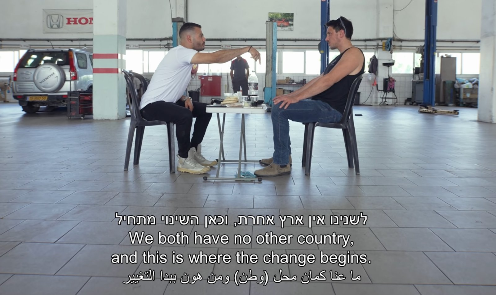

Привет, Саша. В этом году про палестино-израильский конфликт писали много, но считаю, что обычно упускают важное.

Исторические тексты «как менялись границы» — это полезно, однако они не передают **БОЛЬ**. По-моему, чтобы понять сложный конфликт, надо выслушать людей с обеих сторон и прочувствовать их боль как свою. Это не значит «во всём соглашаться». Возражать можно и нужно. Но ПОСЛЕ того, как поймёшь.

В 2023-м я как раз познавал Ближний Восток по живым высказываниям: песням, твитам, мемам. Конечно, за год лишь прошёлся по верхам. Но этого хватило, чтобы после 7 октября от половины интернет-комментариев ощутить «да ёлки, вы ничего не понимаете».

Поэтому написал большой музыкально-социальный материал, собрав песни и боли обеих сторон:

1. [Палестинский взгляд](#Палестинский%20взгляд)
2. [Израильский взгляд](#Израильский%20взгляд)
3. [Мой взгляд](#Мой%20взгляд)

---

Важные оговорки:

- Я не эксперт и могу ошибаться.
- В тексте есть страшные упрощения.
- Когда передаю мнения сторон, это не означает моего полного согласия.
- Я полгода тыкал в Duolingo арабский и иврит, но продвинулся недалеко.
- На всякий случай проговорю очевидное: я против терроризма, антисемитизма, дискриминации мусульман. Нигде не призываю к этому.

---

## Палестинский взгляд

### Часть 1

**Песня: MC Abdul «Shouting at the Wall»**

**События: обстрелы сектора Газа (2008-2009, 2012, 2014, 2021)**

В прошлогоднем [тексте](https://telegra.ph/eminem-8-role-12-18) про Эминема я упоминал, что песня «Not Afraid» призвана помочь людям преодолевать жизненные сложности. А теперь узнал, что она помогла мальчику из сектора Газа.

Он влюбился в эту песню, научился её [зачитывать](https://www.instagram.com/p/CA0ztVXponr/), начал сочинять сам. Взрослые из Палестины и Ирландии заметили потенциал и помогли. И в 2021 году вышел его клип о жизни под бомбёжками:

https://www.youtube.com/watch?v=l8qay1Al7Dc

Наткнувшись на клип этим летом, я сразу офигел от читки и рифм: «ОХ ЁЛКИ, ЭТОТ РЕБЁНОК ЗАЧИТЫВАЕТ ЛУЧШЕ МНОГИХ ВЗРОСЛЫХ РЭПЕРОВ».

А содержание оказалось таким: «всё здание трясётся, словно одержимое», «чтобы сестрёнка заснула, я врал ей, что это звучат фейерверки», «кричу в стену, но ничего не меняется».

Песня винит «плохой Израиль», но не призывает к насилию. В [интервью](https://variety.com/2020/music/news/12-year-old-rapper-gaza-empire-records-offer-1234761201/) Абдул говорит: «Я пока ничего не понимаю в политике, но я за мир».

Кто-то заподозрит, что тут взрослые сочиняют за ребёнка жалостливые тексты для образа «умучанных палестинцев». Честно говоря, не знаю, сколько тут вклада взрослых. Но [видно](https://www.instagram.com/p/CDekF2NpMai/), что самому Абдулу близка песня Тупака «Changes» — а она как раз про «моих людей угнетают, но нужно научиться жить в мире».

В день теракта 7 октября я думал об израильтянах. А когда в ответ начались адские бомбёжки Газы, подумал об Абдуле: он там? Он жив? Оказалось, что он уже подписал контракт с американским лейблом и перебрался в Лос-Анджелес. Возможно, песня «Not Afraid» спасла ему жизнь.

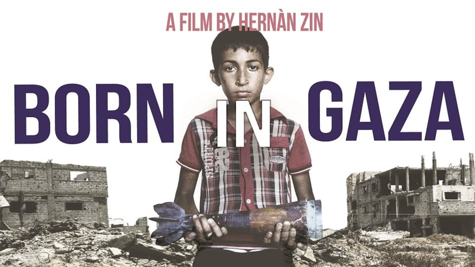
*На тему жизни детей в Газе ещё есть документалка 2014 года*

Многие скажут: жизнь под бомбёжками ужасна, но почему Абдул винит не террористов, а ответный огонь Израиля?

Думаю, тут надо понять, что вообще такое «жизнь подростка в Газе»:

Ты рождаешься в месте размером меньше Петербурга. Оно окружено забором, у ворот автоматчики. Просто так выйти нельзя, только при определённых условиях. Есть берег моря, но попробуешь уплыть — израильтяне начнут стрелять. Получается, ты родился в чём-то вроде концлагеря (хоть и с красивым пляжем).

У тюремщиков были свои причины, но ты-то в них не виноват. И возникает **боль: ты не совершил ничего плохого, а тебя уже заточили**.

Иногда прилетают израильские ракеты. Вроде как «в террористов», но убивают и гражданских вроде тебя. Это **вторая боль: ты ничего не сделал израильтянам, но твоей жизни угрожают их ракеты**.

У кучи людей вокруг ПТСР от бомбёжек, и все через пару рукопожатий знают кого-то погибшего. **Третья боль: израильтяне убили кого-то из твоих близких**.

Израиль объясняет обстрелы борьбой с террористами. Но если не хочешь погибнуть от ракеты, что тогда должен сделать? Голыми руками свергнуть террористическую организацию? **Четвёртая боль: израильтяне наказывают тебя за то, что ты не можешь изменить.**

Над тобой нет защитной системы, а над Израилем есть. Так что люди, отправляющие ракеты на тебя, сами не особо рискуют жизнью. Пока ты в опасности и в нищете, в их инстаграмах вместо руин — дорогие кафе. А единственные израильтяне вокруг тебя — суровые автоматчики, которые не видят в тебе человека. **Пятая боль: успешные израильтяне готовы взаимодействовать с нищим тобой только в формате ракеты.**

Думаю, в таком месте сложно ***не*** возненавидеть Израиль. А поскольку многие лишались близких и хотели отомстить за них, напрашивается вопрос: могли ли там ***не*** возникать новые террористы? Я абсолютно не оправдываю терроризм, но если мы хотим жить без него, важно понимать, что к нему приводит.

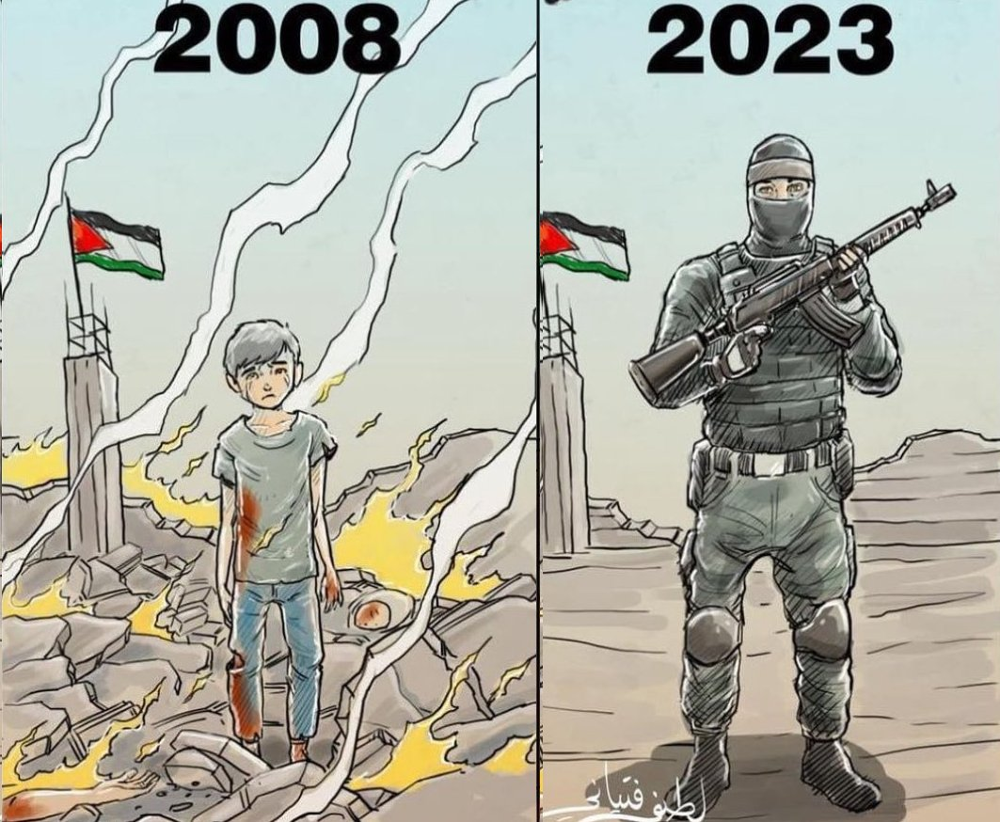

А кроме ужасов бомбёжек, в Газе узнаёшь палестинский взгляд на историю. Согласно которому, у израильтян нет права на землю, с которой они тебя бомбят. И кого тогда будешь критиковать в песнях?

Чтобы понять, почему палестинцы так видят историю, вернёмся к началу XX века.

---

### Часть 2

**Песня: попурри**

**События: предыстория (до 1948 года)**

В Иордании собрали старые палестинские песни (около 1920-х годов) и записали мэшап в современных аранжировках:

https://www.youtube.com/watch?v=NKxf7B2owV8

*В этом видео (и многих других в тексте) можно включить английские субтитры*

Кто-то возразит: «Какие "палестинские песни", если ещё не было палестинцев как народа? Было просто место Палестина, где жили арабы». Порой вообще говорят «арабы после образования Израиля придумали народ, чтобы страдать от его ущемления». Приводят [фразу](https://en.wikipedia.org/wiki/There_was_no_such_thing_as_Palestinians) Голды Меир «there was no such thing as Palestinians».

Историк Джеймс Гелвин [писал](https://books.google.com.eg/books?redir_esc=y&id=wfIFVze1MqQC&q=arose+in+reaction+#v=snippet&q=arose%20in%20reaction&f=false), что палестинская идентичность у арабов выделилась уже в ходе конфликта с евреями, но это не делает её «ненастоящей»: наличие общего врага как раз сплачивает. И сейчас палестинцев слова «выдуманный народ» задевают: **«нам отказывают в самом факте существования»**.

А музыка тут помогает: вот наши песни, вот наша куфия, вот наш [Хандала](https://en.wikipedia.org/wiki/Handala), мы настоящий народ. Песню «[Куда? В Рамаллу](https://www.youtube.com/watch?v=f5FXos8ByJA)» сочинили ещё до появления Израиля, а ведь сейчас этот город — де-факто палестинская столица!

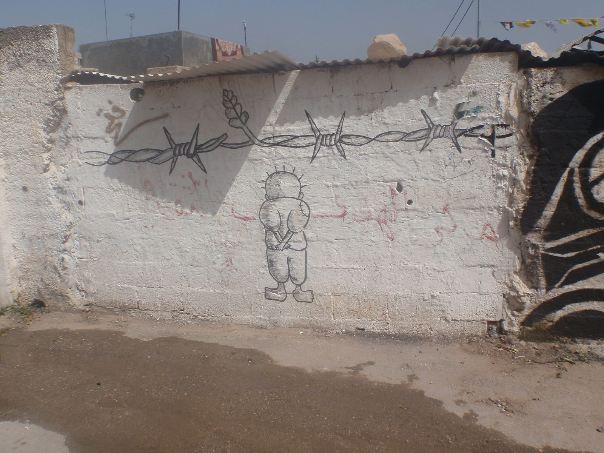
*Хандала — персонаж-символ палестинского народа*

Впрочем, в начале XX века Рамалла не была столицей, а вся территория Палестины была частью Османской империи. Там жили арабы и немного евреев. А евреи-сионисты из других стран всё активнее хотели «вернуться туда».

В ходе Первой мировой Британия [сказала](https://en.wikipedia.org/wiki/McMahon%E2%80%93Hussein_Correspondence) арабам: «Помогите бороться с Османской империей, а на отвоёванных землях сделаете арабское государство». Борьба арабов действительно возникла. Но Британия тайно [начала](https://en.wikipedia.org/wiki/Sykes%E2%80%93Picot_Agreement) переговоры с Францией о дележе этих земель. А в 1917-м подписала [декларацию Бальфура](https://en.wikipedia.org/wiki/Balfour_Declaration), разрешив евреям создать в Палестине «национальный дом».

Получается **боль: Британия пообещала землю, а затем втихую распорядилась по-своему**. Есть нюансы, и ситуацию возможно расценивать иначе. Но арабы расценили так: на нашу землю позвали евреев чёртовы колонизаторы, не имея на это права.

Евреев в Палестине становилось всё больше, начались конфликты. И возникал вопрос: что они с нами сделают, когда все соберутся? Тоже **боль: палестинские арабы ощутили угрозу**.

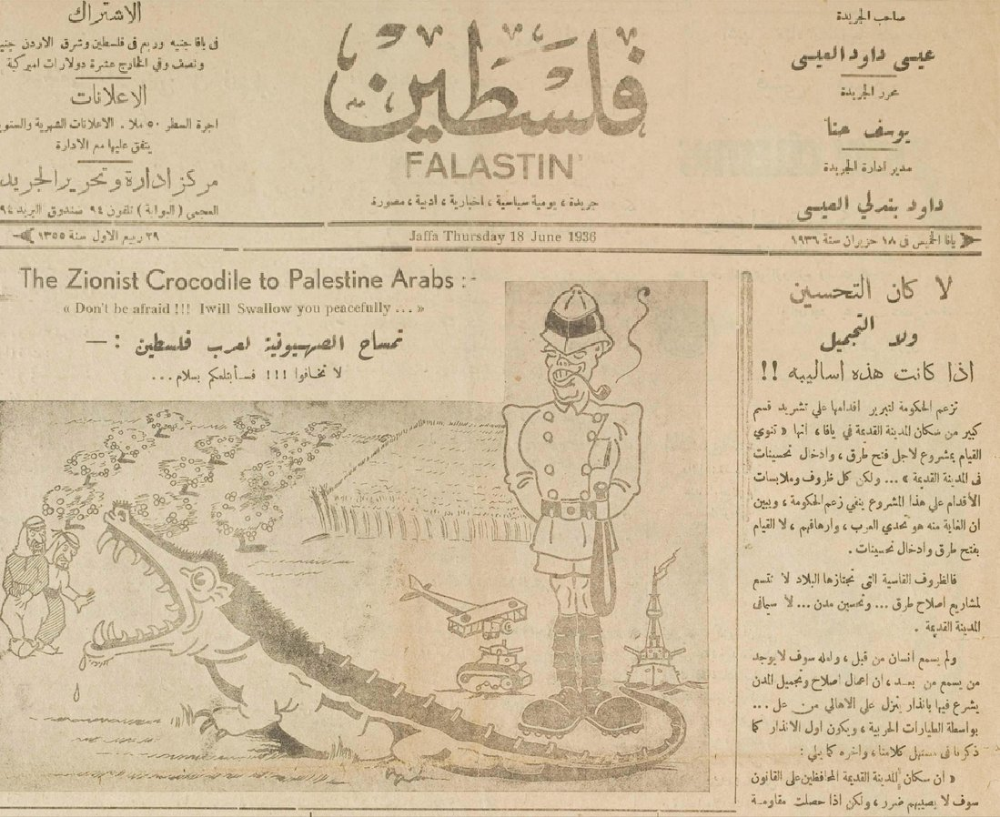
*В арабской газете сионистский крокодил говорит: «Не бойтесь! Я проглочу вас мирно»*

После Холокоста европейцы ощутили, что евреям нужно государство. И решили разделить палестинские земли на арабскую и еврейскую страны.

Для арабов это звучит так: европейцы резали евреев, а теперь за это дарят им нашу землю. Мы-то при чём? Если немцы провинились, пусть их землю и дарят! Это **боль: чёртовы колонизаторы решают свои проблемы за наш счёт**.

Арабы отвергли предложенный ООН вариант разделения. Почему кто-то делит нашу землю? Почему нам предлагают половину, если у нас 70% населения?

А евреи приняли план и в 1948-м создали государство Израиль. Тогда ряд арабских стран объявил ему войну на уничтожение.

---

### Часть 3

**Песня: Файруз «**[**Цветок среди городов**](https://www.youtube.com/watch?v=hsrTUDS6El4)**» («Захрат аль-мадаин», زهرة المدائن)**

**События: Накба и Накса (1948–1967)**

Израиль ухитрился не только выстоять, но и расширить территории. Из того, что делили в 1947-м, у арабов остались сектор Газа и Западный берег.

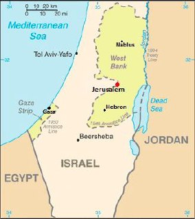

А ещё из-за войны более 700 000 палестинских арабов покинули дома. Кого-то, как жителей Рамле и Лидды, [прогнала](https://en.wikipedia.org/wiki/1948_Palestinian_expulsion_from_Lydda_and_Ramle) израильская армия. Кто-то сам бежал, услышав про [резню в Дейр-Яссине](https://en.wikipedia.org/wiki/Deir_Yassin_massacre). Тогда они думали, что вернутся, как только война закончится.

Но Израиль, присоединив много земли, запретил беженцам туда возвращаться и до сих пор не изменил решение. А в других странах их тоже не приветствуют, сделав «вечными беженцами». Поэтому в некоторых палестинских семьях уже 75 лет передают по наследству ключи от домов, куда хотели бы вернуться.

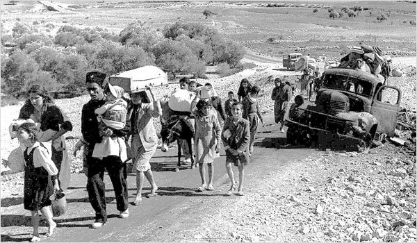

Отец супермоделей Беллы и Джиджи Хадид [утверждает](https://twitter.com/CensoredMen/status/1732426545166496129), что в 40-х в Палестине его родители приютили у себя семью еврейских беженцев, а в итоге семья завладела их домом. Буквально сказка про лисичку и зайца.

Всё это палестинцы назвали «Накба» («катастрофа», النكبة). И **Накба — их главная боль: они ощущают себя изгнанным народом и хотят это исправить**.

Можно возражать «вот греки не ноют о покинутых домах в Турции». Но факт в том, что это сформировало палестинскую идентичность, люди ощутили себя народом со своим главным событием. Сказать палестинцу, что Накба не особо важна — как сказать русскому, что ВОВ не особо важна.

Ситуацию усугубляет репатриация в Израиль: **«то есть еврей, родившийся где угодно, может легко переехать в Хайфу, но моей семье из Хайфы запрещено туда вернуться?»**

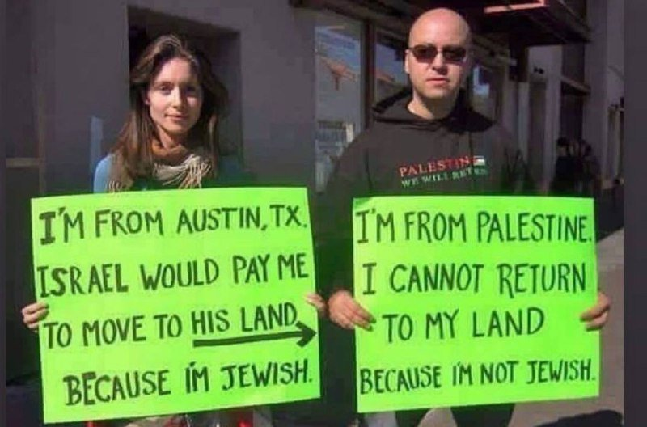

В Шестидневной войне 1967-го Израиль снова победил, оккупировав сектор Газа и Западный берег. Палестинцы назвали это «Накса» и ощутили себя *ещё более изгнанными*.

Отдельно важен Аль-Кудс (арабское название Иерусалима). Город религиозно значим и для мусульман, и для иудеев. После 1948-го у евреев была западная часть, а у арабов восточная: какой-никакой компромисс. В 1967-м, когда Израиль оккупировал всё, выгонять арабов он не стал, но вызвал **боль: враг контролирует наш священный город**.

Иерусалимская мечеть Аль-Акса так важна в исламе, что судьба города волнует весь арабский мир. И ключевую песню о нём спела ливанка Файруз, одна из главных арабских певиц в истории.

https://www.youtube.com/watch?v=hsrTUDS6El4

Этот девятиминутный эпик сочинили в 1967-м, сразу после оккупации. Так что песня — тоска по «утраченному важному» с надеждой снова это обрести.

---

### Часть 4

**Песня: «Красное знамя поднято» (من أجل فلسطين ,طلت الراية الحمرا)**

**События: «освободительное движение» и мирный процесс (1967-2000)**

По предыдущим песням заметно, что стереотип «арабы живут одним насилием» глупый. Но и представлять их всех зайчиками было бы неправильно. Возникали организации «для борьбы с оккупантами», и вот песня «Народного фронта освобождения Палестины»:

https://www.youtube.com/watch?v=QEIuiihOhSk

НФОП были за марксизм-ленинизм (отсюда «красное знамя») и «демократическую Палестину», где арабы и евреи «смогли бы жить без дискриминации — и этнической, и классовой». Звучит красиво, но организация захватывала самолёты, и ряд стран признал её террористической.

Сейчас она подзабыта, а на слуху ХАМАС (жестокая исламистская) и ФАТХ (не религиозная, со временем ушла от террора).

Арабы по-разному отвечают на вопрос «какие методы борьбы допустимы». Но сходятся на «тут праведная борьба с угнетателем, не стоит ожидать цветочков». И в 1987-1993 произошла интифада — вооружённое восстание.

Чтобы исправить ситуацию, США выступили медиатором «мирного процесса». Предполагалось, что в итоге будут два равноправных государства. Для этого палестинцы должны были признать право Израиля на существование, а израильтяне — одобрить создание независимой Палестины. Этих уступок удалось добиться.

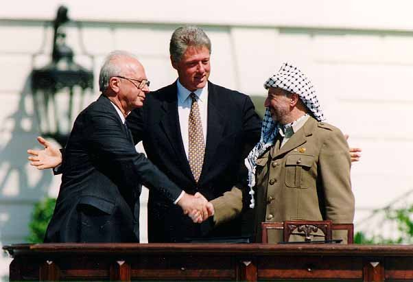

Но дальше застряли на сложных вопросах: точные границы, статус Иерусалима, «право арабов на возвращение». И к 2000-му мирный процесс увяз на полпути: Палестину сделали частично автономной.

---

### Часть 5

**Песня: DAM «Кто террорист?» («Мин эрхаби», مين إرهابي)**

**События: вторая интифада (2000-2005), ХАМАС в Газе (2007)**

В 2000-м начиналась новая интифада, а в израильском городе Лод зарождался палестинский хип-хоп: там араб Тамер Нафар вдохновлялся рэперами вроде Тупака.

Из-за наркоторговли в Лоде израильская полиция доставала арабов. И песни Тупака очень подходили: «нас угнетают», «полиция к нам жестока», «но мы и сами друг друга мочим».

Тамер создал группу DAM, и песня «Кто террорист?» стала хитом.

https://www.youtube.com/watch?v=P7fakEks8ak

Это программное заявление: «Вы называете нас террористами, но сами вы террористы. Отняли нашу землю, убиваете нас, а мы не можем пойти в суд — там всё решаете тоже вы».

Тут видна **боль: палестинцы недовольны, что их называют террористами, но Израиль не признан государством-террористом**. Статья «[Военные преступления Израиля](https://en.wikipedia.org/wiki/Israeli_war_crimes)» в Википедии обширная, а суд в Гааге годами не брался за них.

Группа DAM стала чем-то вроде «Касты»: уважаемыми ветеранами, способными и иронизировать («[Mama, I Fell in Love with a Jew](https://www.youtube.com/watch?v=7zxX_yWM2us)»), и быть очень серьёзными («[If I Could Go Back in Time](https://www.youtube.com/watch?v=UjnFbe7D9pY)»). Не стоит оценивать их по одной «Кто террорист?» и считать близкими реальному терроризму — наоборот, это «мирное музыкальное сопротивление». Причём критикующее не только Израиль, но и арабов. В песне о правах женщин они [говорят](https://genius.com/Dam-freedom-for-my-sisters-lyrics): «если мы сами дискриминируем друг друга, разумеется, другие тоже будут».

После интифады произошёл новый виток. Сначала Израиль прекратил оккупацию сектора Газа: арабы, живите там как хотите. В 2006-м прошли выборы в палестинский парламент, где внезапно победил ХАМАС. А затем он силой подчинил весь сектор Газа.

Многие из-за выборов говорят «жители Газы сами виноваты». Но и здесь есть **боль: «Почему люди не помнят, что выборы были не про контроль Газы, что ХАМАС притворялся присмиревшим, что половина нынешнего населения Газы тогда ещё даже не родилась?»**

---

### Часть 6

**Песня: Шедия Мансур и Омар Оффендум «Мы должны измениться» («Лазим нетъхэйяр», لازم نتغير)**

**События: блокада Газы (с 2007), рост поселений на Западном берегу**

Палестинская диаспора есть по всему миру, и на стыке культур возникают интересные явления (вроде сериала «[Мо](https://en.wikipedia.org/wiki/Mo_(TV_series))»). Так получилось и с певицей/рэперкой Шедией Мансур из Лондона. Она ощущает себя палестинкой (первый же [клип](https://www.youtube.com/watch?v=21OXQ4m1-Bo&pp=ygUXc2hhZGlhIG1hbnNvdXIga2VmZml5ZWg%3D) был про куфию), но при этом ценит права женщин и свободу слова. Выступает в национальном платье, но без хиджаба.

У неё много фитов с рэперами, покажу любимый. Омар Оффендум — сириец, выросший в США, тоже сочетает восточные ценности с западными.

https://www.youtube.com/watch?v=87rk2sd7TCs

*Тут тоже можно включить английские субтитры*

Звучит интересно, напоминает российских артистов Drummatix и Horus. А содержание не сводится к «опять евреи виноваты».

Омар цитирует [хадис](https://sunnah.com/nawawi40:32) **«не надо ни причинять вред, ни отвечать вредом»**. И поэтично критикует арабов, доверяющих телевизору: «твоя лодка жизни плавает между Полуостровом и Маяком» (каналы «Аль-Джазира» и «Аль-Манар»).

Шедия говорит: «У меня есть надежда на человечность, но одними разговорами не поможешь». А её главный тезис — **«Мир теряет баланс, и нам надо измениться»**. То есть арабы могут хотеть изменений не только от евреев, но и от себя.

Это песня 2013 года. Что произошло к моменту её выхода?

ХАМАС, заняв сектор Газа, стал обстреливать Израиль ракетами. Там решили отгородиться: сделали противоракетную систему «Железный купол», обстреливали в ответ, а весь сектор поместили в «блокаду» с тщательной проверкой людей и товаров.

А на Западном берегу условная палестинская администрация, но в реальности больше контроля у Израиля. Например, он понаставил кучу блокпостов. Арабы регулярно сталкиваются с ситуацией «недружелюбные евреи нацеливают на тебя винтовки».

Это приводит к **боли: палестинцы чувствуют, что им выкручивают руки, они стали заключёнными на своей земле**. Причём «тюремщики» могут превышать полномочия.

А ещё на Западном берегу становилось всё больше еврейских поселений. С точки зрения международного права они незаконны. Но религиозные  поселенцы считают, что это их земля, потому что в Торе так написано.

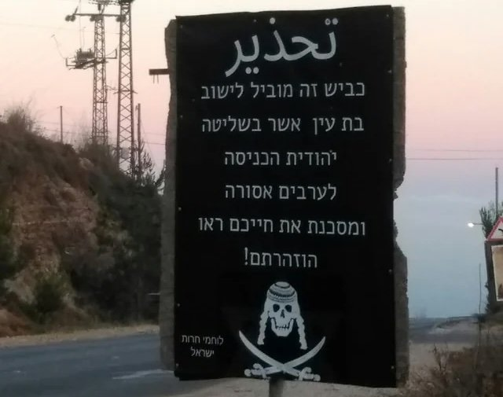
*Знак у поселения: «Арабам въезд воспрещён под страхом смерти»*

Для арабов получается так: евреи ставят свою священную книжку важнее закона, поэтому тихо захватывают нашу землю. А наша книжка говорит, что тогда надо уничтожать этот народ. Но им мир позволяет, а нас называют террористами. **Почему евреям можно ставить священную книжку выше закона, а нам нельзя?**

Ладно, попробуем жить не по Корану, а по закону. Как нам остановить незаконные поселения?

- Требовать? Не помогает.
- Подать в суд? В израильском только посмеются.
- Обратиться в ООН? Пробовали, там выпускают резолюции «Израиль, прекрати», но Израиль ими подтирается.
- Добиться юридически обязующей резолюции? Пробовали, США это заблокировали.
- Обратиться в Международный уголовный суд? Пробовали, там сказали «Израиль не принял Римский статут».
- Мы даже сами приняли Римский статут, сказали «преступление на нашей территории». Там вроде как приняли заявление, но дальше толком ничего не стали делать.
- Убедить всех ввести санкции? Пробовали, но всем плевать.
- Объявить войну? Так Израиль запретил нам создавать армию.

И тут у палестинцев возникает **боль: а какие варианты, кроме террористических, Израиль нам оставил-то?** Если бандит тебя грабит, а полиция подкуплена им, то что делать?

И ещё **боль: почему Израиль называют «цивилизованной демократией», а нас «примитивными варварами», если это Израиль плюёт на законы и понимает только грубую силу?**

Но **главная боль такая: Накба продолжается**. С помощью незаконных поселений Израиль постепенно аннексирует нашу землю.

И если не сопротивляться, у нас её просто не останется. А если Израиль не оставил нам цивилизованных вариантов сопротивления, на что он жалуется-то тогда?

---

### Часть 7

**Песня: Daboor & Shabjdeed «**[**Inn Ann**](https://www.youtube.com/watch?v=FKvKnuvXUSU)**»**

**События: напряжённость последних лет (2020 — наше время)**

К незаконным поселениям добавились новые проблемы.

Первая: выселения арабов в иерусалимском районе Шейх-Джарра, где вместо них заселялись евреи. Критики называют это планом «евреизировать» город.

Юридически там всё сложно. Но для арабов это простая **боль: враги выгоняют нас из нашего священного города**. Молодой иерусалимский рэпер Daboor выпустил песню «[Sheikh Jarrah](https://www.youtube.com/watch?v=74H-dZP-4TY)». И появилось меметичное видео, где на упрёк «вы крадёте мой дом» еврей отвечает «ну если не я, кто-то другой украдёт»:

https://www.youtube.com/watch?v=KNqozQ8uaV8

Вторая тема: «уход вправо». Израиль и так держал курс «прижать арабов к ногтю», но в 2022-м это усугубили ультраправые министры Итамар Бен-Гвир и Бецалель Смотрич. Для понимания: у Бен-Гвира дома когда-то висел портрет еврея-террориста Баруха Гольдштейна, убившего 29 палестинцев.

Тут понятная **боль: у противника к власти пришли люди с людоедскими взглядами на нас**.

Есть давний спор про Израиль и апартеид: оказались ли арабы гражданами второго сорта? Бенджамин Погрунд родился в ЮАР, и много лет [писал](https://www.theguardian.com/commentisfree/2015/may/22/israel-injustices-not-apartheid-state): «В Израиле много проблем, но это не апартеид, уж мне-то поверьте». А этим летом [написал](https://www.theguardian.com/commentisfree/2023/aug/19/israel-apartheid-state-south-africa-netanyahu): «Вот теперь думаю, что всё идёт в сторону апартеида». Он в ужасе, потому что ощущает повторение истории ЮАР.

А в 2018-м в Израиле приняли закон [Nation-State Bill](https://en.wikipedia.org/wiki/Basic_Law:_Israel_as_the_Nation-State_of_the_Jewish_People), закрепив основополагающий статус евреев. Арабы тогда ставили на аватары саркастичный штамп, подчёркивающий их **боль: быть «человеком второго сорта» никому не хочется**.

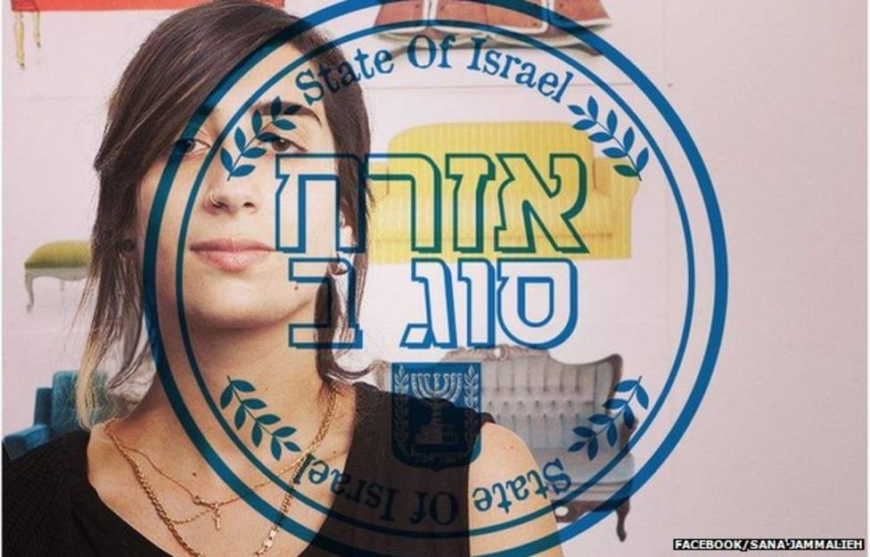
*Штамп «Гражданин класса Б»*

И третья тема — про мечеть Аль-Акса.

Во-первых, арабов взбесили рейды израильской полиции туда. Они случились не на пустом месте, а из-за кидавшихся камнями палестинцев. Но **для мусульманина видеть, как евреи в Аль-Аксе кладут всех лицом в пол — это боль**.

А во-вторых, радикалы вроде Бен-Гвира стали подниматься к этой мечети. Там священное место и для иудеев, но по договорённости с Иорданией им нельзя ходить туда когда вздумается. **И хотя Бен-Гвир не заходил в саму мечеть, для мусульманина его действия — это боль.**

ХАМАС резко критиковал это, а Египет и Иордания прямо называли опасной провокацией. При этом теракт 7 октября назывался «Operation Al-Aqsa Flood», упоминая Аль-Аксу. И получается **такая боль: «израильтяне, вас предупреждали не совать пальцы в розетку, вы продолжили, вас ударило током, а теперь вы наказываете нас»**.

В 2021-м палестинским хитом стала песня «Inn Ann»:

https://www.youtube.com/watch?v=FKvKnuvXUSU

Текст недопонимаю, просто ощущаю вайб уличного КАЧАЮЩЕГО хип-хопа. Но контекст даёт [интервью](https://youtu.be/JJ6phWLBYOQ?si=pBrZo1h9UKJGP7GO&t=491) с Shabjdeed. Он говорит, что к конфликту его поколение подходит по-новому, потому что выросло в менее кровавое время, чем интифады. И уже почти нашло общий язык с евреями.

Это интервью вышло 20 сентября 2023-го. Вскоре тезис про общий язык разлетелся вдребезги.

---

### Часть 8

**Песня: Мохаммед Ассаф «Моя палестинская кровь» («Дамми фаластини», دمي فلسطيني)**

**События: текущие**

Певец Мохаммед Ассаф вырос в секторе Газа, где проявить талант мог только на свадьбах. Но затем смог выбраться в Египет на шоу Arab Idol — и триумфально победил с песней «[Поднимем куфию](https://www.youtube.com/watch?v=Aj-pyJF6ckU)». А ещё важнее песня «[Моя палестинская кровь](https://www.youtube.com/watch?v=S-1KDZTNty4)», ставшая своего рода гимном.

Она временно пропадала из стримингов, и арабы утверждают, что под давлением Израиля. После волны возмущения вернулась, но это не первая подобная история. Ещё одна **боль палестинцев: Израиль заглушает наши голоса цензурой**.

Израильтяне создали ремикс «Моя еврейская кровь» и гордо [постят](https://www.youtube.com/watch?v=oCdUbxdfnBY) его в тиктоке. **Реакция арабов: вам мало было землю украсть, так ещё и песню стырить решили?**

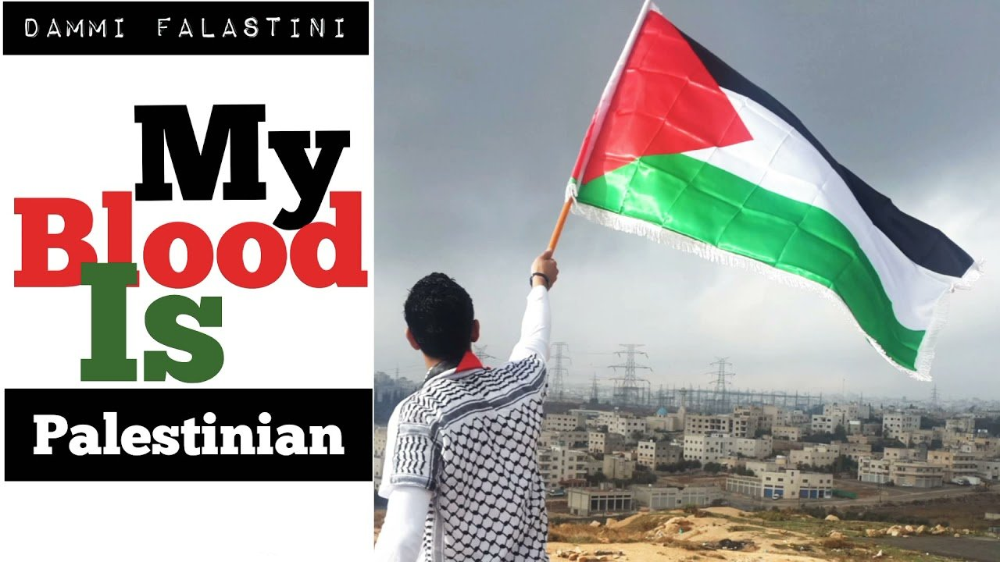

А теперь к нынешним событиям. 7 октября ХАМАС вторгся в Израиль, бесчеловечно убил больше тысячи человек и захватил сотни заложников.

Раз подход «обнесём ХАМАС забором» не сработал, Израиль в ответ решил уничтожить его армией. Поскольку террористы используют гражданские объекты, это влечёт много жертв, в том числе детей. Куда больше, чем в исходном теракте.

Это вызвало дискуссию о пределах самообороны. Не совершает ли Израиль в ответ на чудовищную вещь ещё более чудовищную?

Арабы уверены, что совершает. И тут есть такая **боль: даже жёсткий ветхозаветный принцип «око за око» означал «только одно око за око», почему у нас берут десятки за одно?** Диспропорциональная [доктрина «Дахия»](https://en.wikipedia.org/wiki/Dahiya_doctrine) аморальна и противозаконна.

Многие называют это геноцидом. Это слово не вполне подходит, но в Газе кошмар, и не только из-за смертей. От обычной войны гражданские хотя бы могут бежать. Здесь же миллионы человек третий месяц заперты в пыточной,

где каждое утро выясняют «кто из знакомых погиб»,

где прорва раненых, а медицины почти нет,

где массовый дефицит еды, воды и вообще всего,

где уже половина жилья разрушена, и людям некуда будет вернуться,

где у многих тёплая одежда осталась под руинами их домов,

где связь так неустойчива, что бывает не проверить «живы ли близкие»,

где у всех жителей, думаю, психика расхреначена на всю жизнь.

И у многих в мире возникла **боль: «Так нельзя. Каким бы ужасным ни был теракт, ответ тоже бесчеловечный»**.

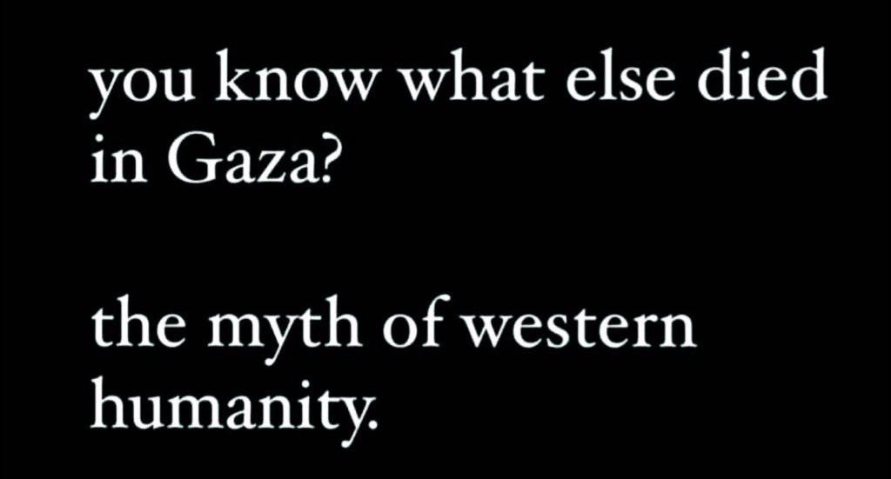

Возникли митинги в поддержку Палестины, и про них стали спорить: участники просто переживают за детей под бомбами или поддерживают терроризм? Если первое, почему не протестуют против ХАМАС? Получается, второе!

Думаю, тут важны две вещи:

1. На Западе вопрос «осуждаете ли вы» видят как «да» или «нет». Но у арабов чаще видел что-то такое:

«Бессмысленно осуждать неизбежные вещи. Если вы оставите кастрюлю на плите с закрытой крышкой, а она закипит, вы осудите её кипение? Город-тюрьма Газа и был такой закрытой кастрюлей».

2. По мнению арабов, палестинский народ угнетён: его существование отрицают, часть земли уже отобрали и теперь отбирают оставшуюся, любую борьбу с этим давят.

И арабы смотрят так: что бы ни сделал ХАМАС, без угнетения он и не возник бы. Давайте решать первопричину, а не о(б)суждать следствия.

И возникает **боль: почему Нельсона Манделу считают героем-освободителем, хотя он тоже использовал насилие, а нашу борьбу осуждают?**

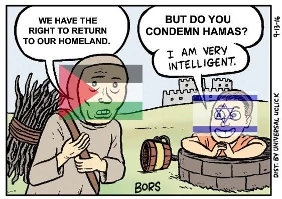

Также арабов бесит риторика Израиля. Одно дело, если бы Нетаньяху сказал: «Мы очень сочувствуем мирным жителям Газы, но у нас нет другого выхода».

Вместо этого Нетаньяху говорит: «Мы люди света, а они люди тьмы». И у арабов возникает **боль: «Это же звучит буквально как Гитлер. Что за расчеловечивание?**»

А реплики части израильтян вроде «сравнять Газу с землёй» выглядят призывами к геноциду. Это тоже **боль: «И вот эти людоеды — "люди света"? Да они же превратились в нацистов, от которых когда-то пострадали»**.

---

Закончу новой песней MC Abdul. После 7 октября он сидел в безопасной Калифорнии, но испытывал **большую боль: переживал за оставшихся в Газе родных**. И недавно со словами «We are human too» выложил [песню](https://www.instagram.com/p/CzOrmxNLsG3/), куда добавил голосовое сообщение от младшего брата.

---

## Израильский взгляд

### Часть 1

**Песня: «**[**Хава нагила**](https://www.youtube.com/watch?v=YxP2cSa5aXE)**» (הָבָה נָגִילָה)**

**События: предыстория (до 1948 года)**

Объяснять израильский взгляд проще палестинского. У еврейского народа понятная **первая боль: тебя вечно кто-то хочет убить**. Чтобы прочувствовать проблему, не требуется стать историком, достаточно обладать эмпатией. В принципе, этим абзацем можно было бы и ограничиться.

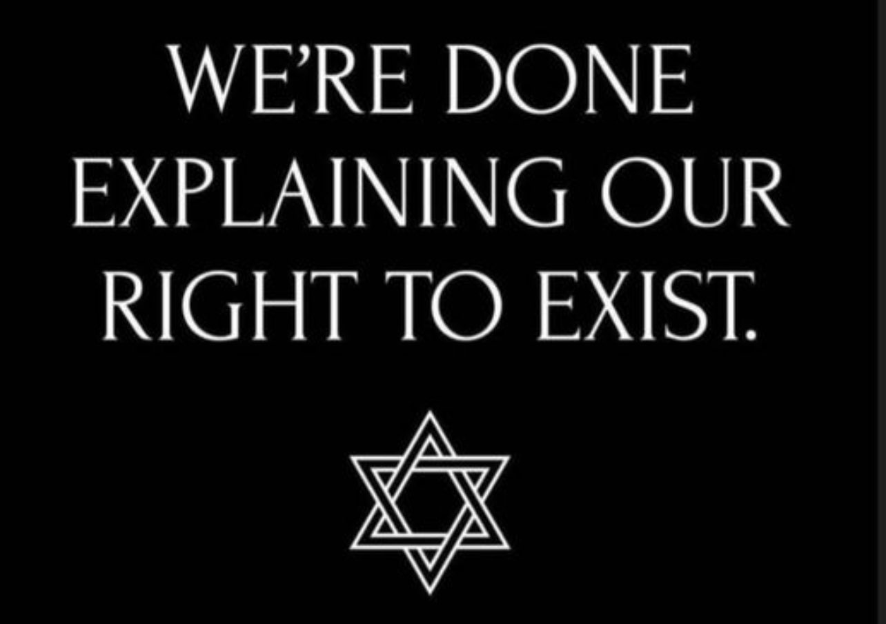

Даже когда не убивали, возникала **вторая боль: тебя вечно кто-то хочет прогнать**. В Википедии есть целая [страница](https://en.wikipedia.org/wiki/Expulsions_and_exoduses_of_Jews) «Expulsions and exoduses of Jews». Тоже легко понять, что может не нравиться.

А теперь пойдём с начала: как убивали и прогоняли, и как это подводит к нынешнему конфликту?

Евреи восходят к израэлитам, которые жили на Ближнем Востоке ещё тысячи лет назад. Тут возникает **третья боль: почему арабы говорят «наша земля», если мы были здесь куда раньше, и некоторые никогда не уезжали?** Как мы можем быть «колонистами», если веками [хотели](https://en.wikipedia.org/wiki/L%27Shana_Haba%27ah) вернуться в Иерусалим? Вы ещё индейцев в Америке колонистами назовите.

Во времена Римской империи евреи не очень захотели ей подчиняться. В итоге Рим разрушил [Иерусалимский храм](https://en.wikipedia.org/wiki/Temple_in_Jerusalem), а большинство евреев разъехалось по миру. Они сохранили общую идентичность, а не растворились в других народах, но возникла **четвёртая боль: получаешься народом-изгнанником, лишённым своей земли**.

В других странах евреям не жилось спокойно из-за второй боли:

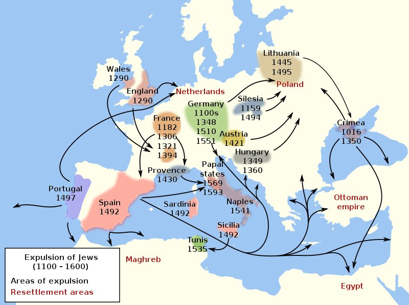

А в XIX веке и первая боль возникала всё чаще, евреев захотели убивать сильнее обычного.

Когда в чужих странах тебя убивают и прогоняют, хочется иметь свою. И в 1897 году Теодор Герцль созвал первый сионистский конгресс для создания еврейского государства. Сионисты готовы были рассматривать разные локации (от Уганды до Аргентины), но решили вернуться-таки в регион Палестина.

Когда Первая мировая ещё шла, Британия уже вовсю делила шкуру Османской империи. И в 1917-м подписала декларацию Бальфура, разрешив создать в Палестине «национальный дом для еврейского народа».

Ещё не полноценное государство, но уже повод для радости. А в 1918-м появилась песня «Хава нагила» («Давайте возрадуемся»). Сложно выбрать конкретное исполнение из множества, поэтому взял то видео, где переведён (нехитрый) текст.

https://www.youtube.com/watch?v=YxP2cSa5aXE

(Про еду тут ни слова, но вспоминается шутка, что любой еврейский праздник сводится к формуле «они хотели нас убить, у них не получилось, так давайте же поедим».)

Евреи стали постепенно съезжаться в контролируемую Британией территорию Палестины, где уже жили арабы и немного евреев. Своего государства не было ни у кого, и сначала получалось уживаться, но постепенно возникали конфликты. В 1929-м произошёл погром в Хевроне, где убили десятки евреев. Хотя они в Палестину от погромов и бежали. Опять первая боль!

Но на этой земле евреи готовы были дать бой. Возникла оборонительная организация «Хагана», затем радикальная «Иргун», которая и вовсе совершала теракты. Так что насилие тогда происходило в разные стороны (например, в сторону местных британских властей).

Как известно, однажды в XX веке убивать евреев захотели с рекордной силой. В первую очередь ужасы были в Европе. Но фотография иерусалимского муфтия Амина аль-Хусейни намекает нам, что и на Ближнем Востоке было не расслабиться:

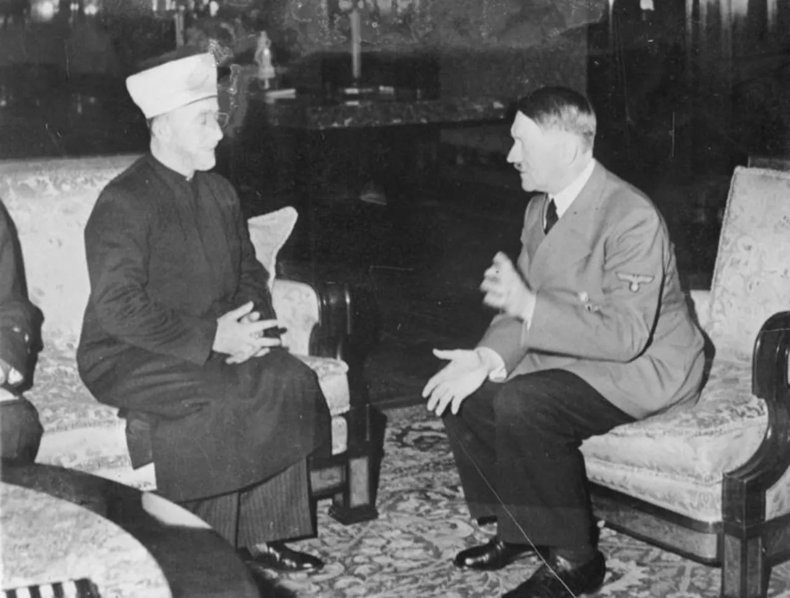

Всё это помогало идее «евреям нужно полноценное государство». И в 1947-м ООН предложила план разделения земель на две страны. Арабы отказались, а евреи односторонне согласились, и 14 мая 1948-го возник Израиль.

Но праздновать под песню «Хава нагила» было некогда, потому что евреев опять захотели убить.

---

### Часть 2

**Песня: «**[**Серебряное блюдо**](https://www.youtube.com/watch?v=9hmqoCqtxWw)**» («Магаш хакесеф», מגש הכסף)**

**События: Война за независимость и последующие годы (1948-1967)**

Какое ещё государство может похвастаться, что прямо в день его возникновения на него напали сразу несколько других, а оно победило?

Против Израиля выступила коалиция арабских стран. Но он не только отстоял свои земли по плану ООН, а ещё и присоединил новые. Как это возможно? Отчасти дело в том, что для арабских стран это не было вопросом жизни и смерти, а евреи стояли насмерть.

Поэт Натан Альтерман в 1948-м сочинил стихотворение «Серебряное блюдо». Название подразумевает, что государство не приносят «на серебряном блюде» (аналог русского «на блюдечке с голубой каёмочкой»), за него приходится биться.

https://www.youtube.com/watch?v=9hmqoCqtxWw

Прикрепляю исполнение Йорана Гаома. Он родился в 1939-м, и в момент возникновения Израиля был ребёнком в Иерусалиме. Позже сам служил в армии, как и подобает израильтянину (в стране с недружелюбными соседями призыв обязательный). Там в ансамбле «Нахаль» и началась его певческая деятельность.

Тут получается **боль: ты можешь быть мирным человеком, но твою страну вечно хотят уничтожить, и требуется быть готовым воевать просто для её существования**. Другим как-то попроще живётся, у португальцев танки ржавеют от простоя.

До появления Израиля немало евреев жило в арабских странах, но с эскалацией конфликта это стало опасным, и сотни тысяч людей покинули свои дома. Теперь они хотя бы могли переместиться в собственную страну, но понятно, что вынужденный переезд не бывает лёгким.

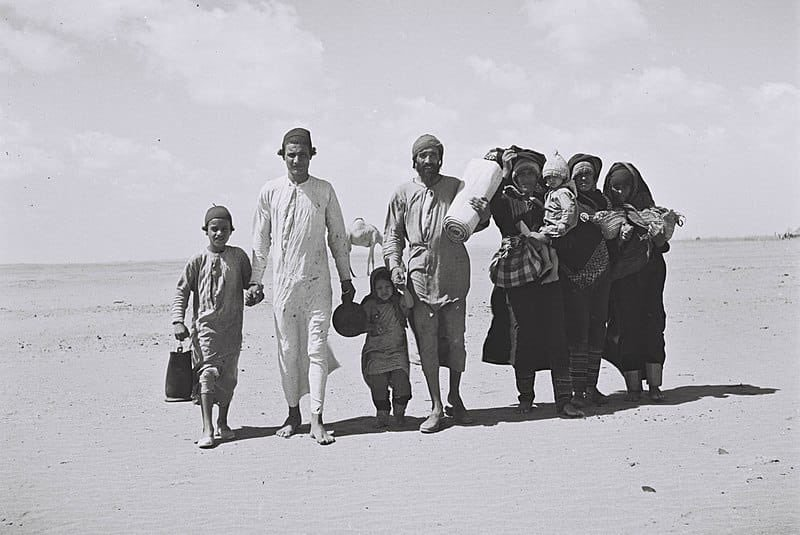

И тут у евреев **боль: арабы постоянно говорят о Накбе, но почему не помнят, что они нас тоже изгоняли?**

---

### Часть 3

**Песня: «**[**Золотой Иерусалим**](https://www.youtube.com/watch?v=JH8gtdDA5x0)**» («Йерушалаим шель захав», ירושלים של זהב)**

**События: Шестидневная война, Первая интифада (1967-1991)**

К 19-летию независимости Израиля (15 мая 1967-го) поэтесса и композитор Наоми Шефер сочинила песню о Иерусалиме, куда евреям важно было вернуться. Впрочем, тогда возвращение было «половинчатым»: по итогам мира 1949-го страна получила только западную часть города.

А уже в июне 1967-го Израиль опять отражал атаку. И снова целой коалиции арабских стран. И снова победил. И снова получил контроль над большей площадью, чем раньше. Прослеживается паттерн!

Теперь вся территория, которую ООН задумывал для Палестины, была оккупирована им. В интернетах регулярно постят картинки о расширении Израиля с подтекстом «посмотрите, как ужасные захватчики подминают бедных палестинцев»:

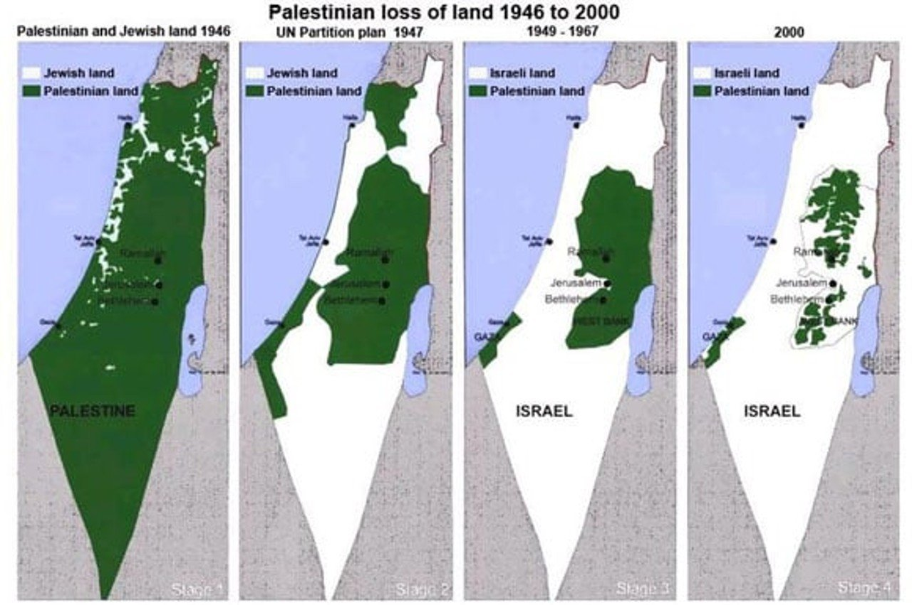

Эти картинки не очень корректны, а ещё у евреев тут **боль: почему мы считаемся захватчиками, если это на нас нападали?** К нам пришли агрессоры, получили по щам, потеряли часть земель (чтобы понимали на будущее). И мы в этом виноваты? Они хотели нас убить, у них не получилось, так давайте же что-нибудь присоединим.

Присоединён по факту оказался и Восточный Иерусалим. Песня про город, представленная лишь месяцем ранее, резко стала актуальнее. Теперь она символизировала уже «полную победу». И Наоми Шефер дописала ещё один куплет.

Первой исполнительницей песни [стала](https://www.youtube.com/watch?v=mjmMllp8hJg) Шули Натан. Но тут прикреплю другое видео — и из-за английских субтитров, и потому что поёт легенда израильской музыки Офра Хаза:

https://www.youtube.com/watch?v=JH8gtdDA5x0

Песня стала так важна для Израиля, что её называют «неофициальным гимном». Впрочем, и официальный гимн «[А-тиква](https://www.youtube.com/watch?v=1DPqNHkm1bM)» важен, сейчас его [поют вместе](https://twitter.com/persianjewess/status/1734284254765555982).

Но хотя вся спорная территория теперь контролировалась Израилем, проблемы не закончились. В 1973-м произошла война Судного дня с арабскими государствами, а в 1987-м вспыхнула интифада — восстание палестинцев. Мирного сосуществования не было.

---

### Часть 4

**Песня: «**[**Песня мира**](https://www.youtube.com/watch?v=Sz8O0OcAA3c)**» («Шир ЛаШалом», שיר לשלום‎)**

**События: Мирный процесс (1991-2000)**

Возможно ли в принципе это «мирное сосуществование»? «Левые» израильтяне считают, что возможно и надо стремиться к нему, «правые» — что конфликт непреодолим и действовать надо силой.

Но это теория, а все 90-е пытались ответить на практике. На тайных переговорах в Осло правительство Израиля и Организация Освобождения Палестины вели мирный диалог.

В 1993-м подписали соглашение, предполагающее, что Израиль выведет армию с оккупированной в 1967-м земли, и будет создана Палестинская национальная администрация. Но это не означало «сразу передаём всё управление палестинцам» — предполагался долгий постепенный процесс.

Тогда стала актуальнее «Песня мира». Сочинена она была ещё в 1969 году Яковом Ротблитом, который перед этим потерял ногу на Шестидневной войне. Её строчка «пойте о любви, а не войне» спорит с милитаристским дискурсом.

https://www.youtube.com/watch?v=Sz8O0OcAA3c

В 90-е песня получила новую жизнь. Но не все израильтяне радовались в белом платье, в венке ромашковом. Мирный процесс требовал от обеих сторон идти на уступки, и радикалы говорили «нельзя так помогать врагу». Усложнял ситуацию ещё и тайный характер переговоров: у правых израильтян была **боль «мою страну сдают врагу, даже не спросив меня»**.

В сентябре 1995-го Ицхак Рабин (премьер-министр Израиля) и Ясир Арафат (глава ООП) подписали второе соглашение. А уже в ноябре Рабина после его публичного выступления застрелил ультраправый израильский радикал, настроенный против мирного процесса. В кармане Рабина лежал текст «Песни мира», и он оказался забрызган кровью.

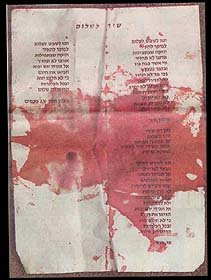

Это выглядит так символично, что подмывает сказать «вот это событие и убило весь мирный процесс». Но я не знаю, что его убило. Мог ли этот процесс закончиться лучше, или был обречён? У нас нет контрольной вселенной, где Рабин выжил, чтобы проверить.

Мы знаем только, что когда в 2000-м Билл Клинтон позвал нового израильского премьера Эхуда Барака и Ясира Арафата в свою резиденцию Кэмп-Дэвид, достичь успеха не получилось.

Читал утверждение, что Арафат отвергал предложенные условия, но не предлагал свои. И вижу у израильтян б**оль: «Как нам мирно договориться с теми, кто сам этого не хочет? Эти палестинцы не упускают возможности упустить возможность».**

Тогда приходится отвечать на насилие. А когда побеждаешь агрессоров, мир почему-то их жалеет. И тут возникает ещё одна **боль: «Человечество, осознай уже: мы не хотим этой войны. Просто мы её выигрываем. А что нам ещё делать-то?»**

---

### Часть 5

**Песня: Subliminal «**[**Tikva**](https://www.youtube.com/watch?v=hybBJ0InVSA)**» («Надежда», התקווה)**

**События: Вторая интифада (2000-2005)**

Израильский хип-хоп зарождался в конце «мирных» 90-х, и поначалу был отчасти мирным сам. Евреи начали зачитывать на иврите, это увидели живущие в Израиле арабы — и поскольку хип-хопа на арабском ещё не было, поначалу присоединились к этой движухе. Главный еврейский первопроходец Subliminal и главный арабский Тамер Нафар дружелюбно общались.

Но в ходе второй интифады, когда сторонники Палестины взрывали израильские автобусы, стало не до дружбы народов.

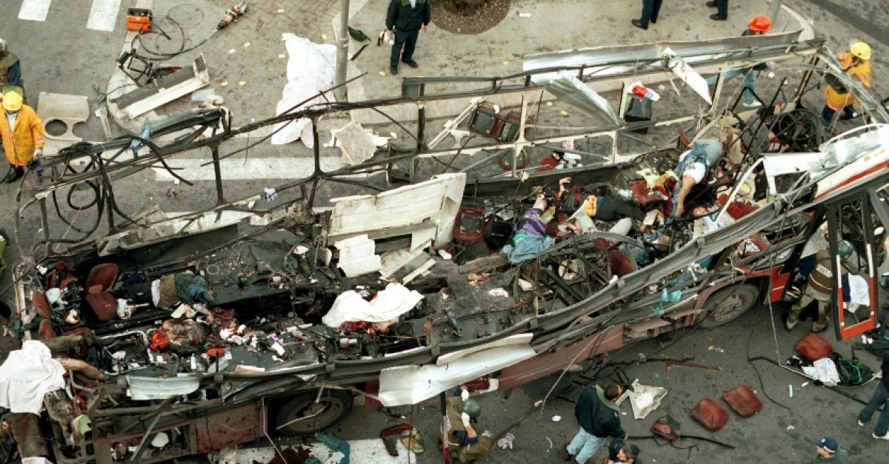

И хип-хоп-сцена треснула пополам. Subliminal и Тамер Нафар рассорились (об этом есть даже документалка «[Channels of Rage](https://www.youtube.com/watch?v=wWDnUeF9xk4&t=3281s)»). Тамер перешёл на арабский язык, создал группу DAM и стал выступать перед арабами.

А Subliminal стал «сионистским рэпером», воспевающим Израиль. Он принялся носить Звезду Давида как украшение, назвал альбом «Свет Сиона», а в текстах упоминал проблемы из-за арабов. Его полюбили правые, причём вплоть до радикальных, что он осуждает: «Иногда кто-то говорит мне, что любит моё творчество и давно пора поубивать арабов. Но я ведь хочу не смерти арабам, а жизни евреям!»

Думаю, это тоже **боль евреев: ты просто хочешь блага своей стране, а тебя зачисляют в фашисты**.

Вот песня «Надежда», настрой такой: «не родился ещё сукин сын, что сможет остановить Израиль», «они говорят о мире, но сами стреляют и угнетают нас», но главное — «давайте продолжать жить, не теряйте надежды».

https://www.youtube.com/watch?v=hybBJ0InVSA

После интифады Subliminal поумерил пыл и позже совместно с поп-артистами записывал песни вида «какой чудесный день». Наверное, можно назвать его «местным Бастой»: из «голоса улиц» стал «толстым котом». Но после 7 октября, когда текст «Надежды» снова стал актуален, он выложил на ютуб-канале недавнее [концертное исполнение](https://www.youtube.com/watch?v=9gI-ttwZeoQ) — как можно видеть, отдача зала там мощная.

---

### Часть 6

**Песня: «**[**Shirat Hasticker**](https://www.youtube.com/watch?v=dH-GepDymiA)**» («Стикерная песня», שירת הסטיקר)**

**События: ХАМАС в Газе (с 2007-го), рост поселений на Западном берегу**

Часто вижу, как всем израильтянам дают общую оценку (не важно даже, «мирные лапочки» или «злобные оккупанты»). Думаю, многие не понимают, насколько различаются мнения внутри Израиля. Людям кажется, что есть единый еврейский хайвмайнд (видимо, плетущий заговоры).

Кстати, о заговорах. Когда-то я увидел телеграм-чат антипрививочных конспирологов и офигел от обилия антисемитских теорий. Понятно, что они существуют, но когда живёшь в своём инфопузыре, это кажется какими-то исключениями. А тут вдруг видишь во всю ширь, от реки до моря.

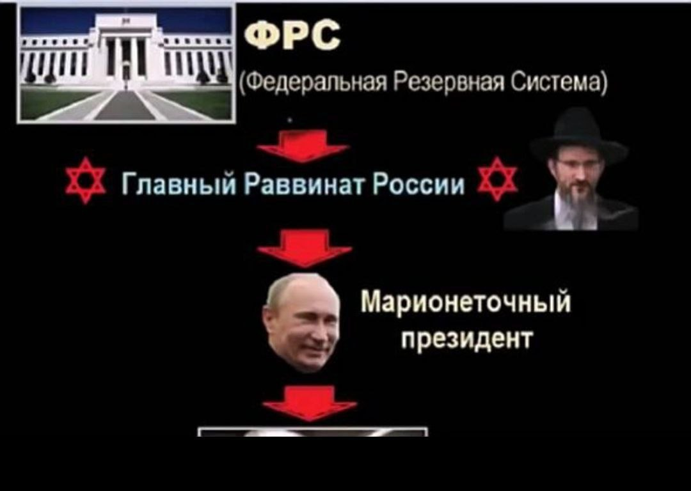
*Это не мем, это на полном серьёзе, и такого тонны*

Отчасти забавно, но когда задумываешься, что эти конспирологи одобрили бы еврейские погромы, становится не смешно. Ну и напрашивается **боль евреев: «если уж мы владеем всем миром, то скажите, где я могу получить свою долю»?** Как-то обидно, когда ты управляешь всеми президентами, но не можешь осилить аренду в Тель-Авиве.

Но пока конспирологи обсуждают заговоры, сами евреи шутят «два еврея — три мнения». Разногласия у них по множеству вопросов — политических, религиозных, социальных. И поскольку в Израиле свободы слова куда больше, чем в секторе Газа, мнения сталкиваются и бурлят.

Тут можно назвать **ещё одну боль еврея: почему мне предъявляют за действия других евреев?** Если где-то агрессивный поселенец убил палестинца, почему вы считаете, что я это одобряю? И как я лично должен всё изменить, мне надо лечь под танк «Меркава»?

И **следующая боль: почему критикуют нас, а не арабов, если мы способны на самокритику и плюрализм мнений?** Израиль может в чём-то ошибаться, но у нас есть издания вроде Haaretz с лютой критикой Израиля, мы их как-то терпим. А вот у арабов признания ошибок не услышишь, там невозможно представить Haaretz. Чтобы прийти к миру, самокритика необходима с обеих сторон. Так кто блокирует конструктивный процесс?

Свои плюралистичные мнения израильтяне нередко выражают с помощью стикеров, приклеенных на автомобиль или ещё куда-то. Вроде таких:

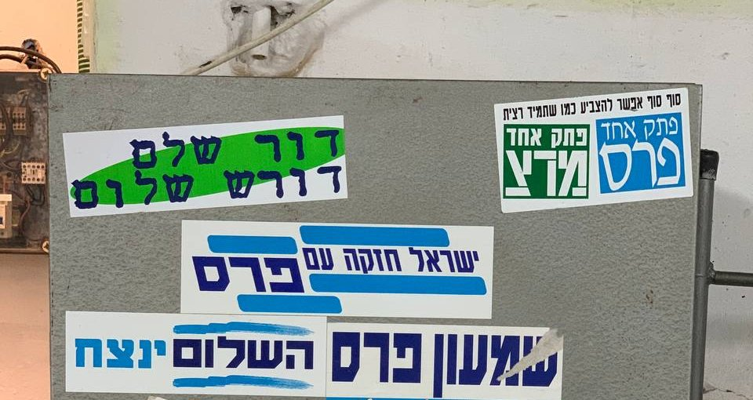

Эти стикеры эпохи «мирного процесса» недавно [сфотографировал](https://t.me/alester_moran/1025) израильтянин, мобилизованный в ЦАХАЛ после 7 октября:

> «нашел тут предвыборные стикеры Ихуда Барака и Шимона Переса  
>     
> "целое поколение требует мира"  
> "мир победит"  
> "да миру нет насилию"  
>    
> хорошо сохранились в бункере в трех метрах под землей»

Теперь своеобразно смотрятся, да. «Целое поколение требует мира» — это верхний левый (*ба-дум-тсс*) стикер. На иврите звучит очень складно, словно готовая строчка для хип-хоп-песни: «Дор шалем дореш шалом».

Она и оказалась в хип-хоп-песне. Писатель Давид Гроссман однажды [заметил](https://www.evrey.com/sitep/culture/arkhiv.php3?menu=250), какую большую роль играют стикеры в жизни Израиля. Он стал собирать слоганы с них, а затем соединил их в стихотворный текст. А группа Hadag Nahash его исполнила:

https://www.youtube.com/watch?v=dH-GepDymiA

В видео нет субтитров, но текст этой песни [разбирали](https://www.teachmehebrew.com/the-sticker-song-by-hadag-nachash.html) в интернете. И по нему можно буквально изучать спектр мнений в Израиле. Представлены все подряд — правые и левые, умеренные и радикальные, светские и религиозные.

Музыка музыкой, а что происходило тем временем? Сектор Газа, ранее оккупированный Израилем, в 2005-м стал полностью палестинским. А ещё через пару лет властью там завладел ХАМАС. И стал оттуда обстреливать Израиль. Чем это всё закончилось, мы теперь видим. И в связи с этим появился новый стикер:

*источник фото: https://twitter.com/MairavZ/status/1733853437127757840*

---

### Часть 7

**Песня: «**[**Bassa Sababa**](https://www.youtube.com/watch?v=jV1sjm9Lz_Q)**» («Облом / клёво», באסה סבבה)**

**События: статус-кво до 7 октября**

В палестинской музыке конфликт с Израилем — это главная тема, а вот в израильской о нём зачастую и не вспоминают. Скажем, в 2019-м в Газе шли протесты, но певица Netta тогда выпустила никак не связанный с этим хит «Bassa Sababa».

https://www.youtube.com/watch?v=jV1sjm9Lz_Q

Тут ощущается связь Израиля с западным миром: дэнс-поп с наполовину английским текстом от победительницы Евровидения… кстати, а почему вообще Израиль участвует в Евровидении?

Формальная причина — членство в европейском телерадиовещательном союзе. Но думаю, тут в целом важны социальные, культурные, политические связи. Одни евреи приехали в Израиль с Запада, другие остались на Западе. Неудивительно, что страна получилась «единственной демократией на Ближнем Востоке».

Но в той же песне есть и ближневосточное. Её название составлено из сленговых слов: «басса» — что-то вроде «облом», «сабаба» — наоборот, «клёво». И забавно, что оба этих слова… пришли в иврит из арабского.

Сочетание западного с ближневосточным порождает для Израиля **боль: мы уже поняли важность демократии, толерантности и гуманности, а наши соседи пока не очень, ну и как ужиться?** Если ты готов считать арабов людьми, а они тебя нет, то как построить диалог?

А поскольку Израиль — демократия с западными связями, с неё и спрашивают больше. Требуют соблюдения всяких конвенций. И это тоже **боль израильтян: «ХАМАС обстреливает нас без заботы о гражданских, и даже подставляет под удар собственных детей, стреляя из школ. Но если мы ответным огнём ненамеренно убьём их школьников, то МЫ во всём виноваты?»**

Словно хулиган бьёт отличника, отличник даёт сдачи, а взрослые говорят: «будь умнее, не опускайся до его уровня». А что вы предлагаете делать, перевоспитывать красивыми речами?

Да и про «заботу о гражданских»… Тут тоже **боль: «Мир вообще осознаёт, каковы эти палестинские "гражданские"? Видел, как они празднуют еврейские смерти? И вот о них нам надо заботиться?»**

В Израиле есть свои кровожадные радикалы, и это отдельная боль: **«Люди, жаждущие обвинить Израиль, вы достали брать отдельные людоедские сюжеты и представлять их как повсеместные. Вот в Газе общая система промывки мозгов и натравливания на ненависть, а у нас это исключения. Хотите сказать, что у вас своих неадекватов нет?»**

И ещё вот что. Заняв сектор Газа, ХАМАС поставил главной целью максимальный вред Израилю. Для этого, например, создал мощнейшую сеть тоннелей. На это тратили гигантские силы и деньги, в том числе гуманитарную помощь, поступавшую на улучшение жизни граждан. А сама жизнь граждан осталась довольно нищей.

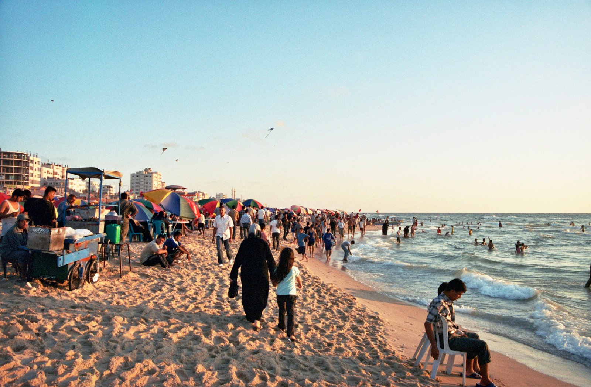

И тут возникает **новая боль израильтян: «Им дали возможность процветать. Оставили в покое, дали гуманитарку. С таким пляжем можно построить курорт мечты и зарабатывать на туристах. Но они потратили ресурсы на обстрелы нас, распугав туристов. Что мы можем сделать-то, если они хотят не хорошей жизни себе, а плохой нам?»**

Когда говорят «так Израиль устроил блокаду, кому хочется строить курорт в концлагере», это вызывает другую **боль: «А как нам не блокировать материалы для терактов? И почему не учитывают, что у сектора есть граница с Египтом, так что блокируем не только мы?»**

---

### Часть 8

**Песня: Ness & Stilla «**[**Harbudarbu**](https://www.youtube.com/watch?v=1rk3n9V-aQs)**» («Заварушка», חרבו דרבו)**

**События: текущие**

Нужно ли объяснять, пришествием какого ада стало для израильтян 7 октября? Вроде и так ясно. Но похоже, что многие не вполне понимают. Мол, «ну да, тут крупный теракт, но мало ли в мире терактов?»

Во-первых, нечасто в мире случается, что бабушка запускает лайвстрим, родные подключаются посмотреть — и обнаруживают, что её убивают, а стрим с её аккаунта запустил убийца. И это лишь одна из множества чудовищных историй. То есть дело не только в числе жертв, но и в запредельном садизме, с обезглавлением тяпкой и тому подобным. Если пытаться представить абсолютное первобытное зло, его действия будут выглядеть как-то так.

Во-вторых, для всего мира теракт закончился уже 7 октября. А для израильтян нет. На них продолжили лететь ракеты из Газы. Добавились обстрелы из Ливана и Йемена. Заложники оставались у террористов. А угрозы для евреев во всём мире возросли. В общем, нельзя назвать возвращением к нормальной жизни, когда на твоей улице разносит машину.

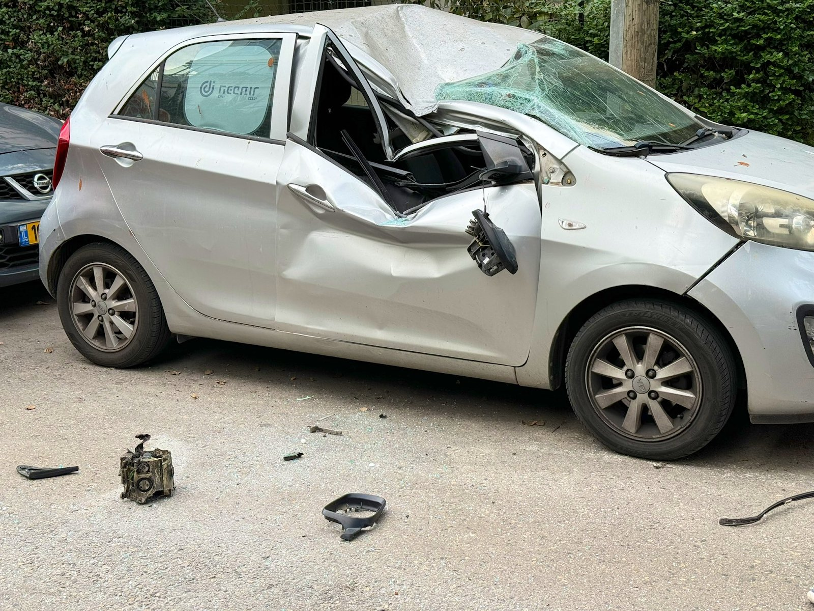
*источник фото: https://twitter.com/Ostrov_A/status/1733113559498801247/photo/3*

И в-третьих, ХАМАС прямо заявили «это только начало, мы собираемся повторять 7 октября снова и снова». То есть сказали «мы намерены устроить геноцид».

Израильтяне объединились в порыве «ХАМАС должен быть уничтожен». Неизбежные гражданские потери уже не останавливали. Настрой стал боевым: сплотимся и поддержим армию, которая должна и с Газой разобраться, и от других стран защитить.

Настроения отразились и в музыке. Поначалу, отходя от шока, израильтяне вспомнили песню «Не надо больше». В 1970-м она вышла на дебютном альбоме 20-летнего певца Шломо Артци — а теперь, полвека спустя, он снова её [исполнил](https://www.youtube.com/watch?v=2r-wmQV8h04). Но затем появился новый хит. Дуэт «Несс и Стилла» выплеснул накопившееся — и тут уже не печальная рефлексия, а выход на тропу войны.

https://www.youtube.com/watch?v=1rk3n9V-aQs

Краткое содержание: крысы вылезли из нор, хотят «бесплатной Палестины» (ирония над лозунгом «Free Palestine»), но наша армия им устроит харбу-дарбу (выражение из арабского, означающее что-то вроде «месилово»). На YouTube есть подробный [разбор](https://www.youtube.com/watch?v=1h5kqeD_69o) текста.

Эта песня стала главным хитом. Впрочем, мне больше нравится другая новая, «[Ша-гер](https://www.youtube.com/watch?v=sfZOJYA7EOg)». Там тоже боевой настрой, речитатив сочетается с пением, а мужской вокал с женским. Но кульминационная строчка не про убийства арабов, а про жизнь евреев: «Ам Исраэль хай» («Народ Израиля жив»). Этот лозунг давно популярен и сам по себе, и как название классической [песни](https://www.youtube.com/watch?v=wkLJgK0HfqI) «поющего раввина» Шломо Карлебаха.

«Харбу-дарбу» и «Ша-гер» не призывают к геноциду палестинцев, однако же и никакой рефлексии о смертях гражданских там тоже нет. Мир с подобным израильским дискурсом не согласился: мол, теракт ужасен, но запирать два миллиона человек с дефицитом всего и адски их бомбить — это коллективное наказание, когда за преступления одних наказывают других. И при голосовании в ООН подавляющее большинство стран [проголосовали](https://en.wikipedia.org/wiki/United_Nations_General_Assembly_Resolution_ES-10/21) за прекращение огня:

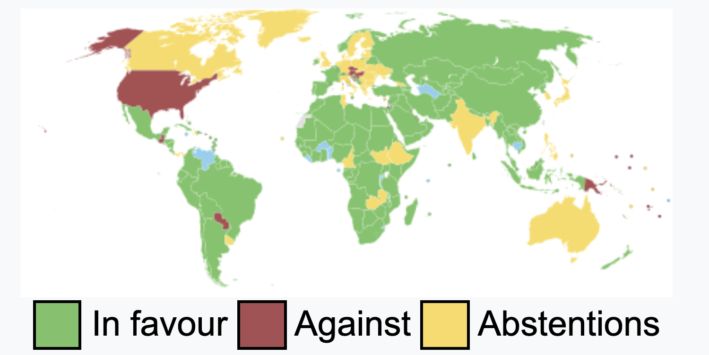

Израиль не стал слушать мировое сообщество и продолжил операцию. За что стал подвергаться критике, международные отношения стали ухудшаться. И тут вижу **боль: вам легко голосовать за «гуманные решения», но что бы вы делали на нашем месте?** Как бы вы позволили существовать под вашим боком организации, которая анонсировала ваш геноцид и уже убила больше тысячи человек? Критиков миллион развелось, а какие альтернативные предложения-то?

Возникли и другие разногласия с миром. С про-палестинской стороны зазвучали голоса не только в поддержку мирных гражданских, но и в оправдание действий ХАМАС. И это вызвало понятную **боль: «Да вы упоролись, что ли? Как можно оправдывать настолько чудовищный теракт? Вы там Гитлера заодно оправдать не хотите?»**

Также в Израиле критикуют многие организации — ООН, Amnesty International и так далее. По мнению многих, они предвзяты, потому что на «страдания несчастных палестинцев» выделяются деньги, так что на критике Израиля можно строить целые карьеры. И тут **боль: почему международные организации, которые должны быть беспристрастными, работают против Израиля**?

Более того, в некоторых организациях работают жители сектора Газа, помогающие ХАМАС. Порой медицинские автомобили используются для террористической деятельности. Тоже **боль: почему такие организации де-факто помогают террористам, но остаются уважаемыми в мире**?

Также возникло много претензий к СМИ. Там знатно накосячили, когда даже уважаемые издания растиражировали фейк про обстрел больницы Израилем. Израильская передача «Эрец неэдерет» («Чудесная страна») [пародировала](https://www.youtube.com/watch?v=VYUL1R4pupU) BBC, показывая, как мировые новости выглядят для евреев. Получается **боль: почему СМИ так предвзяты против нас, они что, антисемиты**?

В целом израильтяне ощущают себя во враждебном мире. Вроде как призывать к геноциду евреев в мире уже не принято, но самые разные организации, политики, журналисты, деятели по-прежнему настроены против Израиля. Народ исторически был «крайним», на который можно свалить все беды — и словно бы таким и остался. Это тоже **боль: быть для мира ультимативным «иным»**.

А отдельная сложность с миром в росте антисемитских настроений и происшествий. Это тоже **боль: в 2023-м быть евреем на планете Земля (включая развитые западные страны) внезапно снова стало небезопасно**. И это в то самое время, когда даже в собственной стране безопасность исчезла. Но там есть хотя бы армия для защиты. «Так дайте же, блин, армии защищать нас как следует».

В общем, описав всю историю еврейского народа, снова приходим к основополагающей первой боли: **евреев опять хотят убивать**. Неудивительно, что они против.

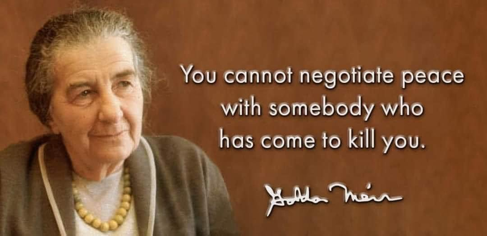

---

## Мой взгляд

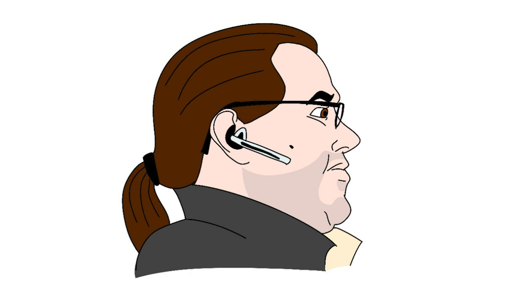
*Мем "both guy" тут хорошо подходит*

Окей, взгляды [обеих](#Палестинский%20взгляд) [сторон](#Израильский%20взгляд) узнали, что теперь? Чей флаг надо запостить, чтобы быть хорошим человеком?

Не считаю себя истиной (возможно, позже сам всё тут перепишу). И не хочу навязывать мнение. Особенно палестинцам и израильтянам: я не был под бомбёжками, поэтому что вообще могу знать об их опыте.

Но осторожно выскажусь для людей со стороны. По-моему, разгорается цивилизационный конфликт, выходящий далеко за пределы крошечного сектора. От того, что человечество пишет в интернетах, отчасти зависит, насколько вообще все сможем уживаться на планете.

И по-моему, сейчас мы всем человечеством только усугубляем проблему. Глядя на интернеты, ощущаю даже не «стоит писать наоборот», а «стоит писать перпендикулярно». Почему и как?

---

### Часть 1: эскалация

**Песня: DUGRI "**[**Mumfas**](https://www.youtube.com/watch?v=XYP4X9AxLoY)**"**

Сейчас пугающе раскручивается спираль насилия:

- ХАМАС кошмарно обострил ситуацию терактом с тысячей смертей.
- Израиль в ответ устроил в десятки раз больше смертей.
- Тогда во всём мире вырос антисемитизм.
- А антисемитские действия способствуют исламофобии.
- Из Йемена стали атаковать корабли, расширив зону конфликта.
- США в ответ создали коалицию, втянув ещё больше стран.

До чего дойдёт, сказать сложно. Не исключаю сценарии вплоть до Третьей мировой, а тогда мы все пожалеем, что её не предотвратили. Раньше думал «и как человечество могло втянуться в Первую мировую», теперь смотрю вокруг: «а, вот как». Может, извлечём уроки?

Пока не извлекаем: в интернете тоже эскалируют и расчеловечивают. Когда-то эта картинка считалась смешной, а сейчас это буквальное описание дискурса:

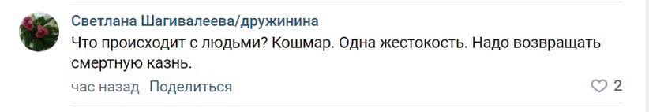

Высказывания зачастую геноцидальные: «сравнять Газу с землёй», «From the river to the sea Palestine will be free» (а что тогда будет с палестинцами и израильтянами?)

И все решают «за кого надо быть». **Но я ощущаю так: разгорается пожар, а мы вместо тушения выбираем, с какой стороны подливать бензин.**

Вот известная иллюстрация «[теории подковы](https://ru.wikipedia.org/wiki/%D0%A2%D0%B5%D0%BE%D1%80%D0%B8%D1%8F_%D0%BF%D0%BE%D0%B4%D0%BA%D0%BE%D0%B2%D1%8B)»:

Если мысленно заменить «left» и «right» на «Палестина» и «Израиль», то все спорят, надо быть справа или слева. А меня беспокоит вертикальная ось: сверху центризм, снизу радикализм, мы все летим вниз. **Так что мой взгляд тут буквально перпендикулярен общему.**

Как вернуться к чему-то умереннее? Вопрос сложный, но можно хотя бы задумываться перед постингом в интернете, не подливаешь ли масла в огонь и не расчеловечиваешь ли людей.

Эту проблему радикализации в 2021-м озвучил мирный дуэт DUGRI из еврея и араба: «все умеренные голоса заглушают, и нам нечем дышать».

https://www.youtube.com/watch?v=XYP4X9AxLoY

---

### Часть 2: гридлок

**Песня: Noa & Mira Awad "**[**There Must Be Another Way**](https://www.youtube.com/watch?v=bBTQFOkFZw8)**"**

Чем больше погружался в проблемы обеих сторон, тем чаще видел, как проблемы утыкаются друг в друга. И вспоминалось слово «гридлок». Это транспортный затор, где все блокируют друг друга и никто не может проехать:

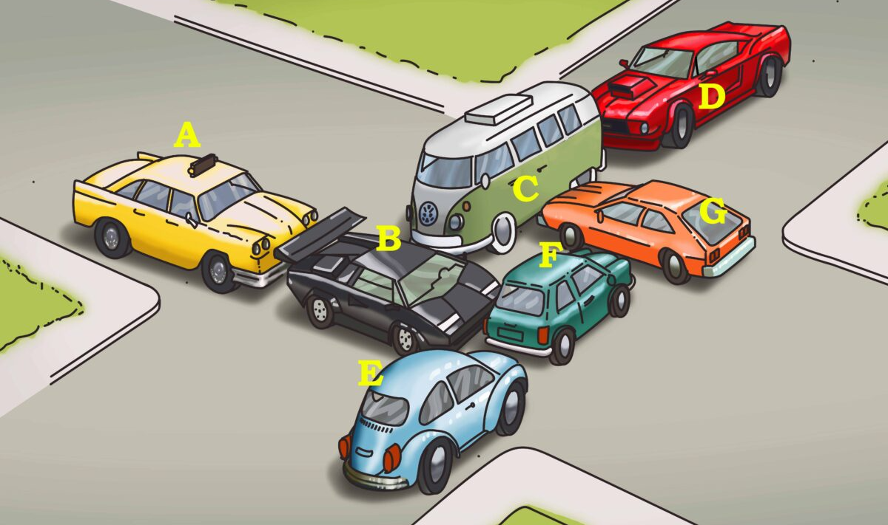

Почему Израиль устроил блокаду Газы? Отчасти из-за того, что иначе туда поступило бы много ракет для обстрелов. Разумеется, от такого будут защищаться.

А почему в Газе обстреливают Израиль? Отчасти из-за того, что блокада бесчеловечна. Разумеется, в ней будут ненавидеть «тюремщиков».

Так возникает замкнутый цикл насилия. Образно говоря, Палестина хочет дать Израилю в морду, а он для защиты заламывает ей руки. Когда это длится поколениями и люди рождаются сразу с заломанными руками, конечно, они будут хотеть вырвать их и врезать заламывающему. И конечно, тогда он продолжит заламывать. У всех боль, и от этого дальше у всех боль.

Всем было бы лучше без гридлока (кроме людей, делающих на нём карьеру — к сожалению, многие решения принимают как раз они). Но чтобы разъехаться, кому-то надо сначала «сдать назад». А любой стороне сложно это сделать: «Они поступают с нами ужасно, а мы подарим им возможность сделать ещё больше?!» Как ни удивительно, лучше всего это описывает мем-цитата Маргариты Симоньян:

https://www.youtube.com/watch?v=VilWvPZJ9f4

В идеале сдать назад надо сразу обеим сторонам, договорившись через нейтрального медиатора. Но в 90-е это не сработало. А прямо сейчас об этом никто и слушать не станет. Может ли это сработать в будущем?

Честно говоря, понятия не имею. Ясно лишь, что это безумно сложно. Взаимных обид накопилось столько, что пытаться договориться — это строить карточный домик в сто этажей. И если домик рухнет, может похоронить многих под собой.

С обеих сторон многие хотели бы исчезновения другой. Неудивительно, что везде говорят: «Вы с ума сошли говорить о шагах навстречу? Они притворятся, что согласны, но мы протянем руку, а её откусят по локоть».

Такие риски действительно есть. Но альтернативой предлагают «просто ехать вперёд тараном». И тут хочется спросить: а вы не замечаете, что за сто лет этот подход тоже не преодолел гридлок? И тоже много кого похоронил под собой? И хоронит вот прямо сейчас?

**Поэтому сейчас, когда половина интернета призывает ехать тараном в одну сторону, а половина в другую, ощущаю это «двумя барашками на мосту, которые в итоге оба свалятся в воду». И смотрю перпендикулярно: может, тут всё-таки возможен другой путь?**

Тем же вопросом задаётся совместная арабо-еврейская песня, с которой Израиль выступал на Евровидении-2009 в Москве:

https://www.youtube.com/watch?v=bBTQFOkFZw8

---

### Часть 3: кто виноват

**Песня: Tzachi Halevi & Lucy Amarish "**[**Seen**](https://www.youtube.com/watch?v=qILxNEVMJo4)**"**

Главный вопрос для интернета — «кто виноват». Идёт академическая дискуссия: одни кричат «ТЕРРОРИЗМ», другие «ГЕНОЦИД», кто перекричит, тот и победил.

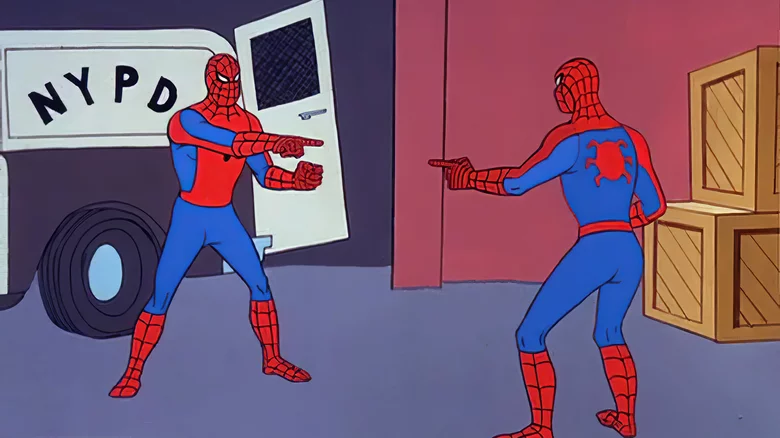
*Типичная академическая дискуссия в интернете*

И тут снова ощущаю **перпендикулярность: пока все решают «кто виноват», мне куда важнее «что делать»**.

Споры «кто виноват» бессмысленные, потому что тут из исторической фактуры легко сделать любой нарратив (хоть деколонизаторский, хоть антитеррористический) с любым виноватым. Приведите любой аргумент любой стороны, и смогу убедительно возразить.

Так что подобными спорами можно добиться только эскалации — то есть наихудшего сценария.

К тому же правильный ответ на «кто виноват» в первых трёх секундах здесь:

https://www.youtube.com/watch?v=wNQRvVlCk2w

А вот в формате «что делать» вижу конструктив. Например, кто должен контролировать Газу после устранения ХАМАС, если палестинцы резко против варианта «израильтяне», и наоборот? Видел идею «арабская коалиция», звучит любопытно, и стоит обсуждать подобные компромиссы.

Также с обеих сторон вижу тезис «я не фанат насилия, но что ещё делать, если они иначе не понимают». Поэтому считаю полезным такой диалог:

> «Про-палестинская сторона, расскажите: а если бы вы родились в Израиле, что бы делали после такого теракта? Можете предложить израильтянам план без насилия?»

> «Про-израильская сторона, расскажите: а если бы вы родились палестинцем, что бы делали с тем, что Израиль постепенно отнимает земли Западного берега? Можете предложить обычному палестинцу план без насилия?»

По-моему, это полезно, потому что всем людям важно быть замеченными и понятыми, это способствует деэскалации.

В Израиле есть звёздный смешанный брак: еврейский актёр Цахи Алеви и арабская телеведущая Люси Ахариш. И в 2020-м они записали дуэт:

https://www.youtube.com/watch?v=qILxNEVMJo4

Ключевая строчка — «I want you to know that you're seen». Имели ли они в виду то же самое «людям важно быть замеченными»? Не знаю, но сам воспринимаю её так.

---

### Часть 4: сложность

**Песня: U2 «**[**The Cedars of Lebanon**](https://www.youtube.com/watch?v=7tQKxWCjZTU)**»**

Многие говорят: «Всё очень просто, что тут думать». Только у одних это «всё просто, мирная цивилизация против варварского террора», а у других «всё просто, угнетённый народ против колонизаторского угнетателя».

**Тут тоже перпендикулярен: мне ближе не один из этих вариантов, а «всё непросто».** И вспоминаю песню U2 «Кедры ливанские»:

https://www.youtube.com/watch?v=7tQKxWCjZTU

Её герой — западный журналист в Ливане. И мои любимые строчки — о том, как он «втискивает сложные жизни в простой заголовок»:

> «Spent the night trying to make a deadline  
> Squeezing complicated lives into a simple headline»

С 7 октября, открывая новости, вспоминаю эти строчки. Этот конфликт не влезает в заголовок. И в тикток. И в твит.

Эти мои тексты получились длиннющими, но даже в них ОЧЕНЬ УПРОЩЁННАЯ история конфликта, опускающая ОЧЕНЬ ВАЖНЫЕ факторы (вроде Ирана).

А другие люди после трёх тиктоков дают советы космического масштаба, вроде «а пусть евреи вернутся на Запад» или «а пусть палестинцы переедут в Иорданию» (спойлер: обе идеи нерабочие хотя бы из-за Иерусалима). Это неудивительно, но жаль, что некомпетентность подбрасывает дров в главный конфликт человечества.

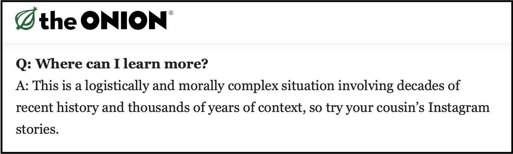

И что тогда, молчать в тряпочку, если не прочитал сто книг по теме? Думаю, что можно иначе (я вот не прочитал ни одной).

Для некоторых заявлений не требуется быть историком. Например, «теракт 7 октября кошмарен»: для такого нужны не учебники, а сердце.

А про сложные вопросы можно писать, уточняя степень своего знакомства с темой и используя вопросительную форму: «Я тут мимокрокодил, но задумался, а не может Египет просто пустить всех беженцев к себе?»

---

### Часть 5: субъективность

**Песня: «**[**This Land is Mine**](https://www.youtube.com/watch?v=8tIdCsMufIY)»

Со сложностью есть ещё одна подстава.

Поняв «всё непросто», некоторые зарываются в источники, чтобы найти Настоящую Правду. И затем бегают по интернетам, размахивая ссылками: смотрите, я нашёл статью 1967 года и теперь Точно Знаю, Кто Прав.

При этом статья может быть ужасной агиткой, но проблема даже не в этом. А в уверенности, что на каждый вопрос есть Объективный Ответ. По-моему, зачастую его нет.

Например, многие пеняют арабам: «Зря вы в 1940-х не согласились на разделение поровну, жили бы уже счастливо». Но они тогда посчитали разделение несправедливым. А кто может Объективно Оценить тут справедливость? Это же не просто «разрезать бутерброд пополам»: есть уйма факторов (от плотности населения до старых договорённостей), какие важнее?

А евреям порой говорят: «Вы слишком цепляетесь за клочок земли в опасном регионе. Вам же в США небось весь Вайоминг отдадут, он всё равно квадратный и для смеха был придуман. И все заживут мирно». Но если людям важно жить на земле своих предков, как Объективно Оценить, «слишком» они цепляются или нет?

А как ответить на ключевой вопрос «чья земля»? Тут люблю этот клип (к нему даже есть [исторические пояснения](https://blog.ninapaley.com/2012/10/01/this-land-is-mine/)):

https://vimeo.com/50531435

По нему получается так:

1. Смотря на какой странице открыть учебник истории.

2. Пока люди не осознают пункт 1 и будут отстаивать «единственную правду», земля будет принадлежать смерти. «Эта земля была нашей, пока мы не увязли в борьбе».

И думаю, про этот конфликт важно осознавать:

— на часть вопросов в нём нет «правильного» ответа

— при этом обе стороны уверены «есть, вот же он»

— и их ответы несовместимы

Выруливать из такого непросто. Но осознать ситуацию — уже шаг вперёд по сравнению с уверенностью «я по источникам разобрался и Точно Знаю».

---

### Часть 6: сломано всё

**Песня: Sagol 59, Tamer Nafar, Sha'anan Streett «**[**Summit Meeting**](https://www.youtube.com/watch?v=umFl-zHD2LM)**» (ועידת פסגה)**

Кризис показал, что проблемы не только в самих Израиле/Палестине: сломано ПРИМЕРНО ВСЁ В МИРЕ, что должно помогать.

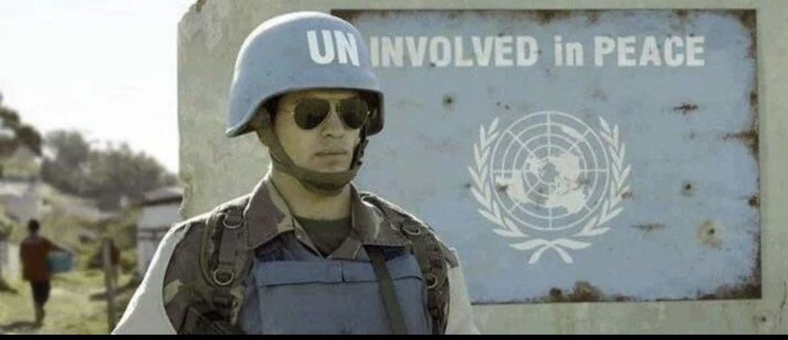
*Фото постановочное, но яркое*

Не секрет, что ООН малоэффективна. Но тут организацию обвиняют ещё и в про-палестинской предвзятости.

А международный уголовный суд в Гааге, наоборот, годами не открывал расследования по заявлениям палестинцев.

У правозащитных и медицинских организаций бывает ореол «святых», но в Израиле называют Amnesty International предвзятой помойкой.

Журналисты регулярно делают дичь, причём в обе стороны. Кроме громкой истории с распространением фейка ХАМАС про бомбёжку госпиталя, есть прорва мелких. Вот автор насилует английский язык, похоже, пытаясь сгладить трагедию:

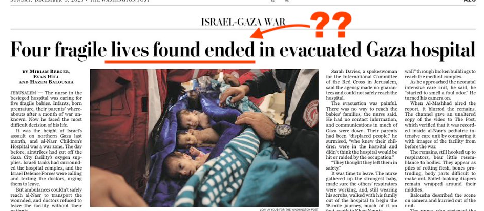

Человечество даже не дало ключевым понятиям чёткие определения. Интернет спорит, [геноцид](https://jewishcurrents.org/a-textbook-case-of-genocide) в Газе или [нет](https://www.ajc.org/news/5-reasons-why-the-events-in-gaza-are-not-genocide) — а [определение](https://www.un.org/en/genocideprevention/genocide.shtml) из конвенции ООН такое широкое, что почти бессмысленное, и не помогает закончить спор.

С международными законами тоже плохо. Я не эксперт, но ощущаю, что их писали под «обычные» войны, а к уникальной ситуации «город в блокаде под управлением террористов» они плохо подходят. И не дают чётких ответов там, где на кону миллионы судеб.

А всё западное левое движение налетело на небесную ось. После защиты геев, женщин и чернокожих оно нашло новых подзащитных в виде палестинцев. Но как быть с тем, что они только что совершили чудовищный теракт? Левые принялись выгораживать ХАМАС в духе «какие ваши доказательства» (алло, террористы сами навыкладывали доказательств).

Так ультралевые и ультраправые сошлись в готовности расчеловечить евреев.

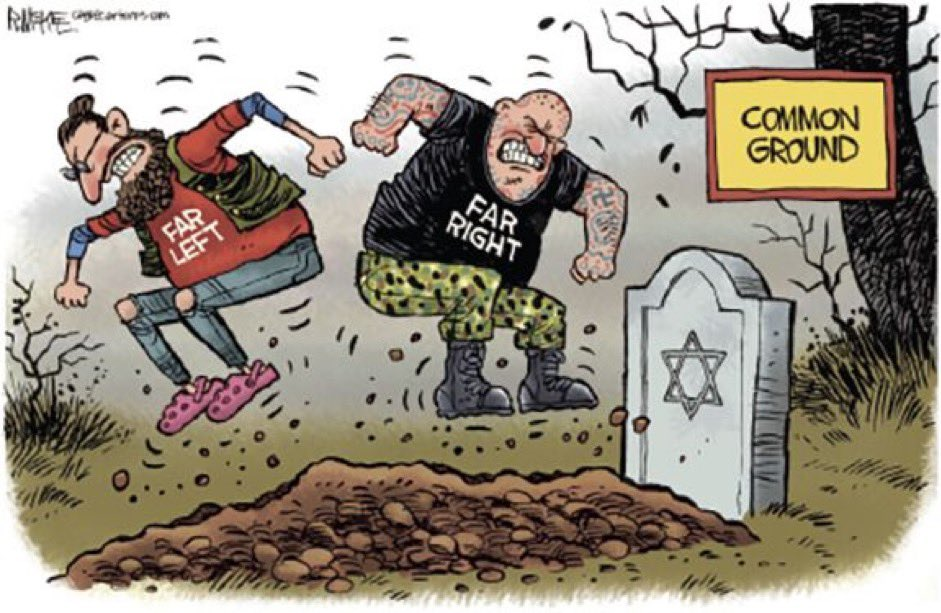

Я вижу в интернете миллион жалоб на всё это. **И тут моя перпендикулярность такая: возможно, помимо простой ругани, найдём место конструктиву?**

Например, много спорят про «геноцид», «апартеид» и «город-тюрьму». Эти слова не вполне подходят к ситуации. Но она настолько уникальная, что более подходящих у нас нет, а обозначать проблемы как-то надо. Так может, человечеству необходимы новые термины, и стоит заговорить об этом?

А упоминаются ли все эти «внешние мировые силы» в музыке? Не особо, но миролюбивая песня 2001 года «Summit Meeting» названа по международной встрече в рамках «мирного процесса». Это первый в истории хип-хопа совместный арабо-еврейский трек. Израильский рэпер Sagol 59 позвал другого еврея Shanaan Street (из Hadag Nahash) и араба Тамера Нафара (из DAM), и каждый зачитал по куплету на своём языке.

https://www.youtube.com/watch?v=umFl-zHD2LM

---

### Часть 7: сходство

**Песня: Noize MC «**[**Иордан**](https://www.youtube.com/watch?v=AOrH0sq-tKY)**»**

Хотя конфликт асимметричен и у сторон много различий, зачастую они говорят одно и то же:

- «Мы гонимый народ»
- «Иерусалим для нас свят»
- «Мы просто хотим жить на своей земле»
- «А они хотят нас убить или хотя бы изгнать»
- «С ними не договориться, они понимают только силу»
- «Медиа врут в их пользу»
- «Нам больно видеть смерть наших близких»
- «Шоколадный хумус — это издевательство над нашим блюдом»

Когда читаешь ресурсы обеих сторон, нередко вспоминается это:

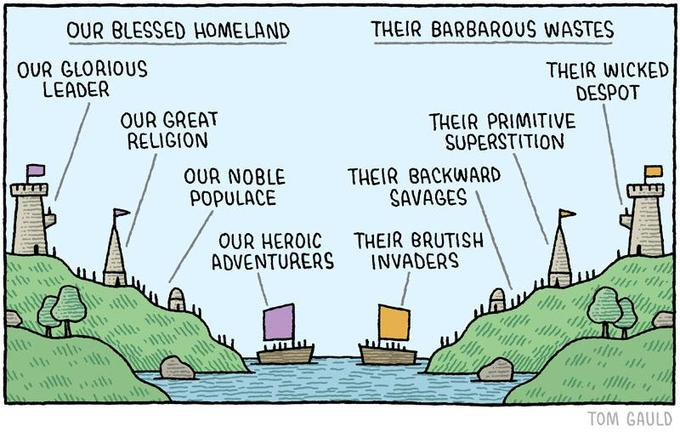

Но главное общее вижу вот в чём:

- «Очевидно, что мы жертва, а они агрессор»
- «Мы как Давид против гиганта Голиафа»

Как сразу обе стороны могут быть Давидами?

Палестинцы видят так: «Мы с камнями против танков: у них есть армия, а у нас только мы сами. Зазеваешься — раздавят».

А израильтяне так: «Мы маленькая еврейская страна среди кучи злых арабских. Зазеваешься — раздавят».

Сходство усиливается языками семитской группы. В арабском и иврите почти идентичные приветствия: «ас-саляму алейкум» и «шолом алейхем» оба означают «мир вам». Непроизвольно думаешь: да как вообще мог возникнуть конфликт почти братских народов? (А потом кое-что вспоминаешь.)

Эта перекличка приветствий давно обыграна в песне Noize MC (на всякий случай замечу, что иноагента) и Atlantida Project «Иордан».

https://www.youtube.com/watch?v=AOrH0sq-tKY

«Все помирятся, шолом алейхем — ва'алейкум салам», поёт Александра Соколова, подразумевая «даже евреи с арабами». На момент записи она уже была больна раком, и вскоре её не стало. Но клип вспоминают, и в октябре под ним появился новый комментарий: «Эта песня когда-нибудь перестанет быть актуальной?💔».

---

### Часть 8: главное

**Песня: DUGRI "**[**Let's Talk Straight**](https://www.youtube.com/watch?v=vuUxnfL9I_Y)**"**

Послушав арабов и евреев, ощутил, что многие из них живут в своих нарративах и не слышат друг друга. Не просто расходятся во мнениях, а даже не понимают чужое. Ну, человечество вообще так устроено. Но тут конфликт уже сто лет распутывают, а воз и ныне там.

Вот пример разницы нарративов. Однажды еврей [сжёг](https://en.wikipedia.org/wiki/Duma_arson_attack) дом палестинцев с ребёнком внутри, а затем на ультраправой еврейской свадьбе [плясали](https://www.timesofisrael.com/groom-6-guests-at-infamous-jewish-hate-wedding-convicted-of-incitement-to-terror/) с фотографией этого ребёнка. Конечно, это ужасно, но важно, что в Израиле убийцу осудили: общество в целом там против подобного.

В арабской среде этот случай обмусоливают и преувеличивают. Вплоть до тезиса «это теперь часть израильских свадебных ритуалов»:

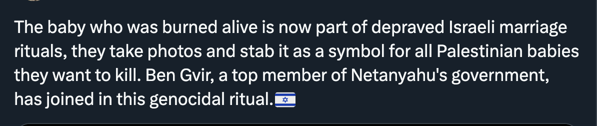

Эти слова видят израильтяне, которые не слышали об исходной истории. И они не просто возражают преувеличению, а поражаются «вот же бред придумали, не могли же евреи реально ребёнка сжечь»:

Получаются два нарратива: арабский — «там все свадьбы такие», еврейский — «про нас сочиняют ужасы на пустом месте». И оба искажают реальность в разные стороны. Стоит ли удивляться, что люди не могут найти общий язык?

Порой даже не перевирают факты, а точечно их выбирают. Например, есть длинный [список](https://www.reddit.com/r/list_palestine/comments/l43xgk/megalist_israels_crimes_controversies_full/) «прегрешения Израиля». Там не выдумки, всё с пруфлинками. Но при чтении возникает ложное ощущение «все евреи — чудовища». Зачастую арабы вот по таким штукам и делают выводы. Эффект возможен и в обратную сторону: израильтянин замечает палестинцев, когда они совершают теракты, а не собирают оливки — и выводы делает только по первому.

Создатель ряда американских сериалов Дэвид Саймон известен уходом от чёрно-белого восприятия: в его «Прослушке» полицейские и преступники оказываются не одномерными «героями и злодеями», а живыми людьми. Они все несовершенны, но всех можно понять, и все отчасти жертвы системы.

И про Израиль с Палестиной он разродился [твиттер-тредом](https://twitter.com/AoDespair/status/1719184297007993124), что его задолбали «знающие-половину-этой-истории» спорщики, которые игнорируют одну сторону и не хотят осознать неизбежную реальность: «двум травмированным народам нужно делить одну и ту же землю, и часть её может ещё 75 лет пробыть домом евреев, но только если будет и государство Палестина».

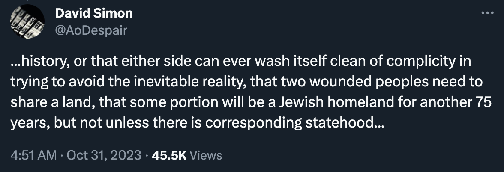

Я согласен с определением «два травмированных народа», у обоих много боли. Неудивительно, что могут не слышать друга друга: сложно разделить чужую боль, когда испытываешь свою.

И неудивительно, что вскипело в секторе Газа. Если обнести людей забором, они совсем перестают видеть второй нарратив, а это радикализирует.

Как это исправить? Точно не знаю, но вспоминается финал рэп-баттла еврея (и тоже иноагента) Оксимирона с арабом Dizaster. Мирон там говорил, что баттлы при их внешней жёсткости могут способствовать миру. Когда люди грязно шутят друг про друга, они замечают своё сходство, а тогда меньше хочется убивать. Тут это с отметки 49:00:

https://www.youtube.com/watch?v=ldK9qvRBkMI

Это мой любимый раунд в баттл-рэпе. Вместо банальных шуток «про мамку» — серьёзное высказывание о мире. Но при этом точечно добавлена «грязь-грязь», чтобы зрители не заскучали, а смеялись. На предыдущем баттле Мирон проиграл Гнойному, перезанудствовав — и тут получилась крутая «работа над ошибками».

Впрочем, сам Мирон уже ни в чём [не видит](https://t.me/norimyxxxo/365) спасения. Вижу ли я?

Не знаю насчёт «спасти», но думаю, что для хотя бы минимальной деэскалации полезно доносить боль обеих сторон. Сейчас про-палестинской стороне может казаться, что евреи просто так угнетают, а про-израильской — что арабы просто так убивают. И у людей с обеих сторон очень дополняется картина мира, если они по-настоящему понимают другую.

Есть евреи, которые побывали в палестинских городах и ощутимо пересмотрели свои взгляды. Есть арабы, на которых повлияло знакомство с болью еврейского народа. А есть моя любимая песня, которая для такого эффекта и предназначена.

В 2017-м американский рэпер Джойнер Лукас снял клип «[I'm Not Racist](https://www.youtube.com/watch?v=43gm3CJePn0)», где два американца с разным цветом кожи предъявляют друг другу претензии, и в итоге понимают друг друга. А в Израиле еврей UR и араб SAZ, вдохновившись этим, сделали свой клип с взаимными претензиями двух народов. По-моему, получилось очень хорошо, и этот клип я в 2023-м пересматривал чаще всего.

https://www.youtube.com/watch?v=vuUxnfL9I_Y

После 7 октября обоим участникам очень тяжко, но они не сдались, а продолжили вести «примирительную» деятельность.

Считаю, что такое «объяснение болей» — лучшее, что мы сейчас можем делать. Собственно, поэтому я и написал оба других «взгляда». Если это кажется полезным — можно порепостить.

А если хочется услышать больше с обеих сторон от умеренных людей, можно почитать пару аккаунтов в твиттере: [палестинский](https://twitter.com/aziz0nomics), [израильский](https://twitter.com/skjask). Или посмотреть сериалы «[Мо](https://en.wikipedia.org/wiki/Mo_(TV_series))» и «[Фауда](https://en.wikipedia.org/wiki/Fauda)».

Напоследок мем — думаю, слева тут я, а справа интернет:

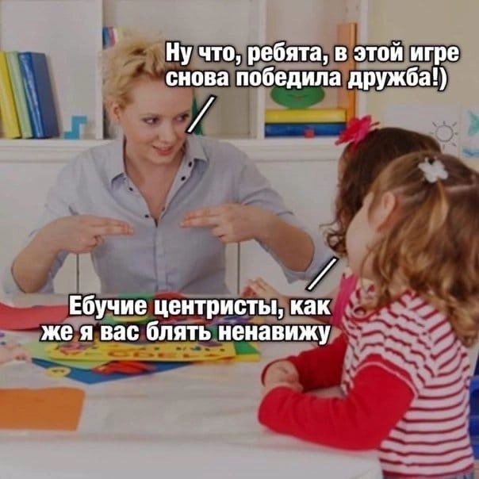
