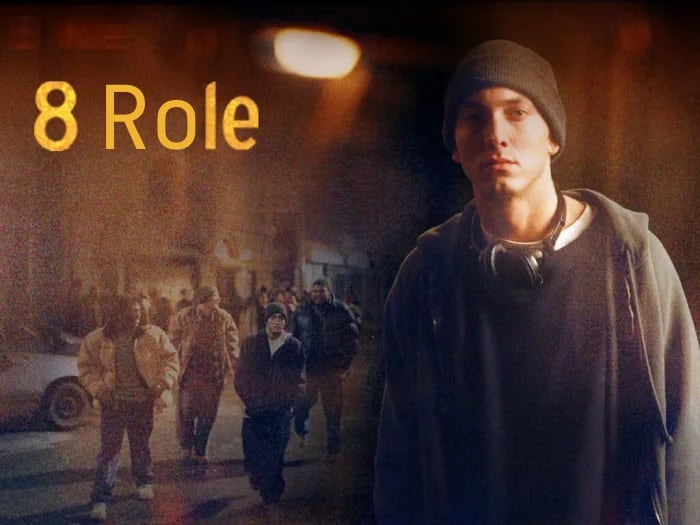
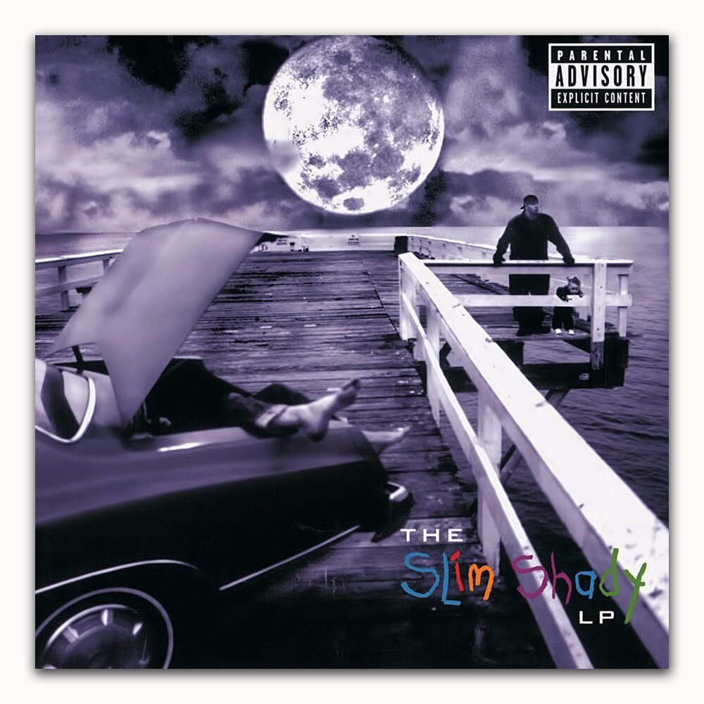
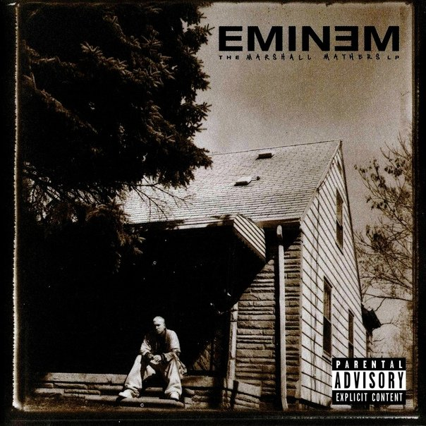
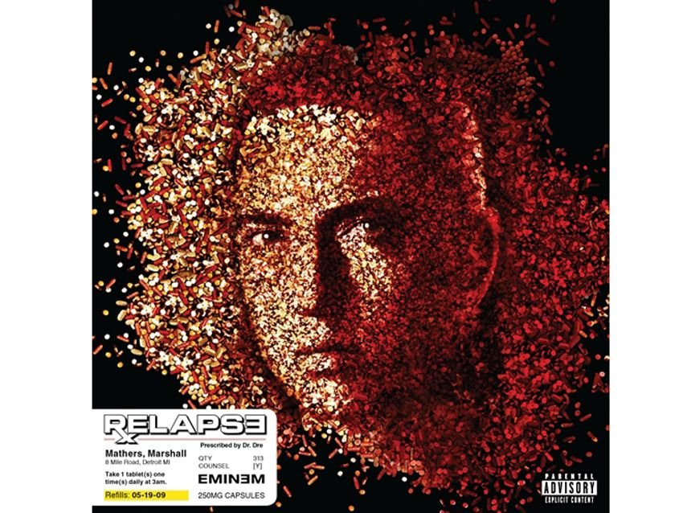
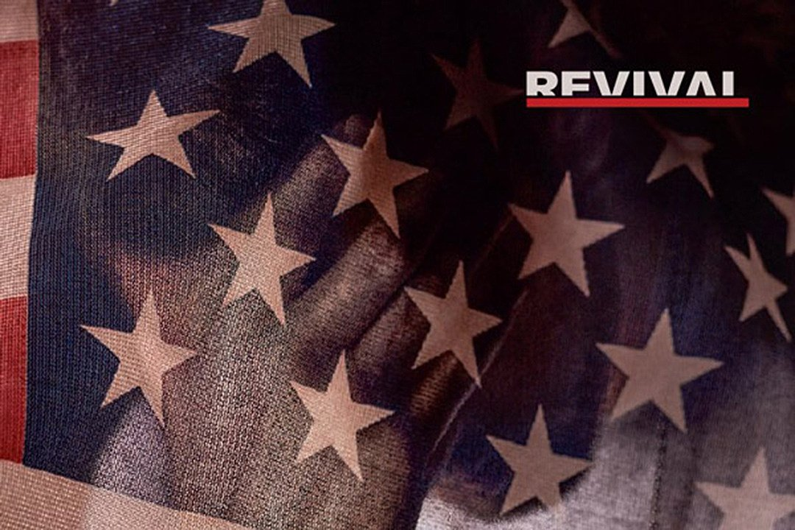

Привет, Саша. В 2022-м было как-то особо не до новой музыки, поэтому в этот раз подарочный текст к твоему дню рождения — юбилейный: про артиста, которому осенью исполнилось 50.

Казалось бы, что скучнее, чем писать про Эминема, каждый чих которого давно разобран под микроскопом? Разве не всё всем давно понятно?

Думаю, что не всё.

Во-первых, что-то понимаешь, лишь когда закапываешься в аннотации на сайте Genius. Я закапывался и хочется поделиться найденным.

А во-вторых, по истории Эминема можно сделать интересные выводы не только о нём, а вообще о музыке и людях. Захотелось их сделать.

Поэтому я решил описать всю его карьеру, условно разделив её на восемь «ролей».

---

## Роль 1: задрот

Про начало карьеры есть общеизвестные биографические подробности: мрачный Детройт, нищета, буллинг, безотцовщина, конфликты с матерью и женой, копеечные подработки, чтобы прокормить дочь — и рэп-движуха, которая помогла из этого выбраться.

Но есть менее известная часть. Эминем ворвался в инфополе в 1999-м, однако первым альбомом был «Infinite» (1996). Почему о нём сейчас почти не вспоминают? Что это было вообще?

https://www.youtube.com/watch?v=TyUWs246kAo

Если включить его, быстро замечаешь, что уже тогда Эминем был очень техничным в отношении фонетики и флоу, тексты делал максимально созвучными:

> «Man, I got **evidence**, I'm **never dense**  
> And I've been **clever ever since**  
> My **residence** was **hesitant** to do some shit that **represents**...»

Сразу видно текстового задрота: все рэперы хотят звучать поскладнее, но здесь это уже выглядит обсессивно-компульсивным расстройством.

Однако техничностью всё и ограничивается: тут ещё нет ни острых шуток, ни виртуозного сторителлинга, ни уникальной харизмы. И темы стандартные («я крутой», «город родной, Детройт, я твой»). Альбом неплохой, получить удовольствие можно, но зацепиться особо не за что — даже обложка эталонно никакая. Неудивительно, что он остался незамеченным.

И думаю, что мы можем извлечь такую мораль: *хотя техничность в музыке и способна впечатлять, она довольно бессмысленна, когда это просто техника ради техники в отрыве от всего остального.*

Как много лет спустя [сформулировал](https://genius.com/Versus-battle-12-04-15-oxxxymiron-vs-johnyboy-lyrics) другой рэпер:

> «Дело не в количестве панчей, не в качестве рифм —  
> Дело в личности, что за ними»

И вот личности в этом альбоме ещё особо не слышно. Критики написали «копирует Наса и AZ», слушатели не покупали альбом, и Эминема это злило.

---

## Роль 2: маньяк

Помимо сольного творчества, Эминем участвовал в детройтской группе D12. Там был его друг Proof, который предложил всем участникам придумать по альтер-эго, и так возник персонаж Slim Shady.

Из-за неудачи «Infinite» Эминем был зол на мир, а от имени выдуманного персонажа удобно говорить что угодно: если что, «я в домике, я такого не говорил, это всё он».

Поэтому второй альбом «Slim Shady LP» (1999) стал возможностью выплеснуть всё. И тут охренели даже слушатели гангста-рэпа, вроде бы привычные ко всякой жести.

Что может заставить их охренеть? Например, песня «'97 Bonnie & Clyde». Она обыгрывает песню Уилла Смита «Just the Two of Us» — милый трек об отношениях отца и ребёнка. И в тексте Эминема любящий отец разговаривает с маленькой дочкой по пути на пляж. Только в этом случае он убил жену и теперь едет избавляться от тела. Это вынесено на обложку альбома:

Как писал кто-то, «there have been more violent songs in rap, but few more disturbing». Герой сюсюкает с ребёнком, и это звучит страшнее, чем когда рэперы угрожают матом. Уличный хип-хоп жёсткий, но даже там обычно не впутывают в жесть маленьких детей. У Слима Шейди такого ограничения нет. Он отмороженнее отморозков.

И ещё криповее от того, что герой называет ребёнка «Хей-Хей». А настоящую дочь Эминема зовут Хейли. И в песне использована запись её голоса. И Эминем не ладил с её мамой Ким. Будь я на месте настоящей Ким, после такой песни сбежал бы с Хейли на другой континент по фальшивому паспорту.

И это лишь одна из песен «Slim Shady LP». Тексты альбома — это насилие, шутки за гранью, мат, нездоровый секс, психические проблемы, наркотики, суицид и оскорбления собственной мамы. Всё это выкручено на максималки, так что зачастую выглядит мультяшно и несерьёзно (шутовской хит «My Name Is»), но порой и пугающе реально (выстраданный монолог про нищету «Rock Bottom»). Если бы Тарантино снял мультипликационное кровавое гей-порно про нищего клоуна-убийцу под галлюциногенами, то даже это ощущалось бы менее запредельно, провокационно, эклектично.

https://www.youtube.com/watch?v=sNPnbI1arSE

*(в этой видеоверсии текст очень смягчён, лучше слушать альбомную версию)*

Слим Шейди привлёк на порядки больше внимания, чем пресный «Infinite». Кто-то был в восторге — в том числе Доктор Дре, который помог успеху. А кто-то в ужасе — например, консервативные родители, заметившие, какую музыку полюбили их дети. Из ноунейма Эминем стал и героем, и злодеем. Его обвинили сразу во всём от гомофобии до провоцирования скулшутингов. Его мама решила отсудить у него миллионы за клевету в текстах.

Сам он на упрёки в жестокости отвечал, что в хоррор-фильмах людей тоже убивают и всем плевать, а стоит такой же сюжет изложить в песне, как все с ума сходят. Также хочу заметить, что в «Slim Shady LP» есть песня «Role Model», саркастично дающая понять юным слушателям, что равняться на автора не стоит, и изложенные в его песнях вещи не то что бы хорошее руководство к действию.

А позже в песне «The Real Slim Shady» он озвучил такой тезис: «моё отличие в том, что у меня хватает яиц, чтобы прямо говорить на публику те вещи, которые вы не скажете». Он предоставил слово своим внутренним демонам и стал выглядеть маньяком. Но демоны-то есть у многих, просто обычно им не дают микрофон. И получается, что Эминем даже осознаннее многих: у него всё это хотя бы честно проговорено, а не делается вид, будто этого не существует.

Можно было бы списывать все претензии к Эминему на пуританское общество, жаждущее обвинить кого-то в своих проблемах («все эти скулшутинги из-за хип-хопа»). Но я считаю не все претензии безосновательными. Скажем, когда женские предсмертные хрипы становятся регулярным звуковым приёмом в песнях, это ощущаю действительно problematic. Я не считаю это поводом канселить артистов, но считаю поводом задумываться, как такая музыка сказывается на формировании картины мира и какое возрастное ограничение правильно ставить.

*И мораль тут вижу такой. В обсуждениях всякого problematic-творчества позиции обычно бинарные: либо «это проблемно, давайте без этого», либо «это талантливо, давайте не посягать на свободу слова». Но думаю, SSLP наглядно показывает, что тезисы «это талантливо» и «это проблемно» не взаимоисключающие. Выражение «великий и ужасный» обычно фигуральное, но вот это буквально великий альбом и ужасный альбом.*

---

## Роль 3: кумир

«Slim Shady LP» дал мощный рост популярности, но полное доминирование пришло дальше, с альбомом «Marshall Mathers LP» (2000) и фильмом «8 миля» (2002).

MMLP стал одним из самых продаваемым альбомов в истории. А изменилось ли в творчестве что-то по сравнению с SSLP? На первый взгляд это прямое продолжение, тут у песни «'97 Bonnie & Clyde» даже появился приквел «Kim». На смену шутовскому хиту «My Name Is» пришёл шутовской хит «The Real Slim Shady». Насилие, оскорбления, наркотики — в альбоме всё на месте, даже персонажи скитов те же.

Однако вижу и отличия. Одно прямо в названии альбома, где Маршалл Брюс Мэзерс использовал своё настоящее имя. Тут есть одноимённая песня, где он говорит уже от своего лица без всяких слимовшейди: «Я просто обычный парень, не знаю, почему вокруг меня столько шумихи». И на обложке не выдуманные ужасы, а крыльцо родного дома.

А ещё произошёл другой тектонический сдвиг. Типичной претензией к раннему Эминему было «Да это эпатажная жвачка для школьников, а по сути этому однодневке сказать нечего» (как сейчас говорят про какую-нибудь Инстасамку). И на MMLP появился убедительнейший ответ: песня «Stan».

Снова хоррор-стори, но с отличиями от прежних. Тут и эпистолярный жанр, и отличный сторителлинг с нарастанием градуса от куплета к куплету, и идеально подошедший фрагмент песни Дайдо.

https://www.youtube.com/watch?v=gOMhN-hfMtY

А главное — в песне введён образ самого Эминема, отвечающего в конце. Благодаря этому становится ясно, что автор песни — не безумный маньяк, а адекватный человек, который был бы рад вовремя остановить чужое безумие. И песню восприняли уже не как «дешёвую пугалку для школьников», а как «драматическое произведение, поднимающее проблему нездорового фанатизма». Слово «stan» попало в словари, Эминем — в историю. Теперь «однодневкой» было уже не назвать.

Ещё сильнее его статус зацементировал полуавтобиографический фильм «8 миля», где герой выглядел не возмутителем спокойствия, а человеком, который начинал в самых жёстких условиях и смог заслуженно добиться успеха.

Песня «Lose Yourself» из этого фильма стала первым хип-хоп-треком, получившим «Оскар». Первым синглом Эминема с «бриллиантовым» статусом (продажи более 10 платиновых). И первым его хитом, который не оскорблял или ужасал, а воодушевлял.

https://www.youtube.com/watch?v=_Yhyp-_hX2s

Наверное, тут можно извлечь *мораль о том, что легко привлекать внимание людей оскорблениями и жестью, но в принципе возможно побеждать и конструктивным образом*.

А ещё одним «конструктивным моментом» стало исполнение «Stan» живьём с Элтоном Джоном. Эминема постоянно обвиняли в гомофобии, он отвечал, что ничего против геев не имеет, просто воспитан детройтскими улицами, где словом «faggot» ругались без привязки к ориентации. И выступление показывало, что реального конфликта с геями у него нет.

В итоге по состоянию на 2002-й Эминем добился вообще всего. Бриллиантовые продажи, отличные отзывы прессы, респект хип-хоп-тусовки, успешное начало кинокарьеры, громадное внимание в самых разных слоях общества. А позже он вспоминал это время так: «I had the world by the balls, eating out my palm». Он не просто продавал много дисков, а держал мир за яйца.

---

## Роль 4: наркоман

Что может сделать талантливый, но неуравновешенный человек, когда добился всего? Всё продолбать.

Работая на съёмочной площадке «8 мили» по 16 часов в день, Эминем столкнулся с бессонницей. Кто-то посоветовал ему Ambien. Так началась его зависимость от рецептурных препаратов.

В 2004-м при записи пятого альбома «Encore» он употреблял их в больших количествах, и альбом был принят куда хуже предыдущих. Золотой период закончился.

В 2005-м он вынужден был вообще отменить часть тура и взять творческую паузу.

А в 2006-м во время конфликта в детройтском клубе был застрелен его лучший друг Proof, что усугубляло состояние.

В итоге четыре года у Эминема было относительное затишье, во время которого он боролся с зависимостью (с чем помогал тот же Элтон Джон). Борьба закончилась победой, уже много лет Эминем не прикасается к веществам, способным испортить его жизнь.

В 2009-м он анонсировал долгожданное возвращение аж с двумя альбомами. Первым стал «Relapse», где портрет на обложке был выложен таблетками.

Но с альбомом не получилось такой победы, как с зависимостью. Провалом тоже не назвать, о дважды платиновом статусе многие могут только мечтать. Но «Relapse» считается одним из самых слабых альбомов Эминема. А числа продаж больше не трансформировались в «держать мир за яйца». «Ну да, Эминем что-то там выпустил, ничего так, а теперь давайте перейдём к следующему».

На «Relapse» есть хорошие песни. Но в свои лучшие моменты Эминем сочинял не просто хорошие песни, а песни на века. «Without Me» востребована и сейчас (спустя 20 лет), а кто вспоминает о существовании «We Made You» или «Crack a Bottle»? В историю ничего из «Relapse» не попало.

https://www.youtube.com/watch?v=RSdKmX2BH7o

Предполагаю, что для Эминема это уже означало провал. Если перестал быть пупом земли — всё, Акелла промахнулся.

*Мораль: ну, видимо, don't do drugs*

---

## Роль 5: бог

В 2010-е Эминем вступал легендой в смысле былых заслуг, но неудачником в настоящем. Как снова доказать всем, что ты лучший? Эминем признал недостатки «Relapse», стал переделывать полуготовый «Relapse 2» и в итоге переименовал его в «Recovery», потому что от исходной задумки всё ушло далеко.

И в 2010-м «Recovery» действительно отчасти получился «восстановлением». Сразу у двух клипов оттуда больше миллиарда просмотров на ютубе: снова получилось писать суперпесни, резонирующие в сердцах миллионов.

https://www.youtube.com/watch?v=j5-yKhDd64s

Одна из них — «Not Afraid», духоподъёмный стадионный гимн о преодолении. Эминем, прошедший в жизни огонь и воду, теперь увидел свою миссию в том, чтобы помогать другим справляться со сложностями — и записал песню для этого.

А «Love the Way You Lie» положила начало сотрудничеству с Рианной, которое через три года продолжилось ещё одним хитом «The Monster». Обеим этим песням Рианна обеспечила попсовость и прилипчивость; их обе ставили на рингтоны и включали на дискотеках. Хотя обе они, если вслушаться, довольно мрачные.

«Love the Way You Lie» — про двух людей, которые не могут друг без друга и не могут друг с другом. Для Эминема, который дважды разводился с одной и той же женщиной, это знакомая территория.

«The Monster» — и вовсе про ментальные проблемы и внутренних демонов Эминема. Человек, у которого многое не в порядке, рассказывает об этом — а человечество не особо заметило это, но полюбило песню как танцевальный хит.

https://www.youtube.com/watch?v=EHkozMIXZ8w

В случае с «Monster» отдельно интересен клип. Эминем продирается через слои своего бессознательного — и в конце доходит до Слима Шейди. Который, конечно, монстр, но тексты сочиняет яркие, поэтому можно навестить его ради них.

А главной песней 2010-х с точки зрения релевантности Эминема считаю «Rap God» (2013). Это песня, попавшая в книгу рекордов Гиннесса как хит с наибольшим количеством слов (их там 1560). Песня, лидирующая на сайте Genius по просмотрам среди всех англоязычных текстов. Песня с миллиардом просмотров у клипа. Песня с той-самой-скоростной-частью. Песня, после выхода которой слушатели постили её в соцсетях с приписками вроде «я кончила». Когда люди в караоке хотят проверить, насколько хорошо я зачитываю, они спрашивают меня: «а Rap God можешь?» (правильный ответ: не совсем, некоторые слоги проглатываю, но обычно слушатели не успевают заметить, что я их проглотил).

https://www.youtube.com/watch?v=XbGs_qK2PQA

Хип-хоп во многом построен на самовосхвалении. Порой меня это раздражает (в том числе у Эминема): «Вам не о чем больше читать, кроме своей крутизны? Сколько можно одно и то же обмусоливать-то?»

Но тем ценнее то, что получилось у «Rap God». Хип-хоп-песен в жанре «как мощны мои лапищи» прорва — а Эминему удалось в этом сверхконкурентном сегменте сделать главную песню. Получается, его лапищи самые мощные! Сделав громкую заявку на статус бога, получилось подкрепить её делом: редкий случай, когда замах на рубль, а удар на два. Тот, кого многие считали сбитым лётчиком, вернулся и показал, кто в хип-хопе god и GOAT (greatest of all time).

*Мораль: любопытно, что для суперуспеха не всегда требуется следовать поп-формулам «три минуты, цепкий певучий припев, столько-то строк в куплетах». «Rap God» победила, хотя там всё наоборот: это шесть минут речитатива, где нет никакой попсовой певучести от Рианны и вообще почти отсутствует припев.*

---

## Роль 6: лох

Означал ли успех «Rap God», что проблемы позади? Нет, совершенно.

В 2015-м Эминем занялся саундтреком фильма «Левша» (Southpaw) про успешного боксёра, жизнь которого идёт под откос после смерти жены. Вероятно, история «звезда оказывается в кризисе и с нуля собирает свою жизнь по кусочкам» была ему лично близка.

Но и сам фильм, и синглы Эминема для него «Phenomenal» и «Kings Never Die» прошли малозамеченными. Из фильма никакой новой «8 мили» не получилось и близко. А обе песни, по-моему, просто очередные «я крутой», непонятно зачем вообще нужные после «Rap God»: чувак, ну какое ещё «kings never die», если ты до этого закончил легендарную песню словами «why be a king, when you can be a god»? Из богов в короли — это же дауншифтинг.

Это была уже даже не ситуация «продажи хорошие, песни хорошие, но великих больше нет». Тут и продажи были уже не платиновыми. И критические отзывы вместо умеренно-благосклонных звучали всё чаще.

И теперь это было уже даже не свалить на зависимость, смерть друга и тому подобные причины. У него просто не получалось.

При этом способности к подбору созвучий никуда не делись, технически его песни по-прежнему оставались впечатляющими. Но тут мы возвращаемся к началу текста: на одной технике далеко не уедешь. А кроме неё, тут снова особо нечего было ловить. В тот период Эминем поучаствовал в песне «Speedom» с куплетом, не уступающим по скорости «Rap God» — но пока скоростную часть «Rap God» превозносили и заучивали наизусть, куплет из «Speedom» просто не заметили.

Спустя два года после «Левши», в 2017-м, вышел «Revival» — первый за четыре года полноценный альбом, с большой подготовкой и соответствующими ожиданиями. Много приглашённых вокалистов, причём не рэперов с куплетами, а поп-исполнителей на припевах (видимо, памятуя о суперхитах с Рианной). Продуманная маркетинговая кампания. Само название, говорящее, что он вернулся подавать признаки жизни, держись, мир. И... неудача.

*Фейспалм на обложке выглядит уместным*

И среди критиков, и среди фанатов возникло много недовольства. В комментариях на The Flow альбом порой называли «неслушабельным». В музыкальных изданиях писали: «Помните, когда-то Эминем умел быть уморительно смешным? Тут на 77 минут лишь одну строчку можно с натяжкой назвать шуткой». На роль суперхита напрашивалась только песня «The River» с Эдом Шираном, да и та оказалась запорота подачей: клип долго готовился и получился странноватым, так что на ютубе больше просмотров у аудиоверсии без видеоряда.

В чём причина проблем «Revival»? Я вижу сразу две. Одна в том, что Эминем 2010-х хотел быть «конструктивнее» Эминема 2000-х: вместо ссор и оскорблений — взаимопомощь и поиск общего языка. Желание похвальное, и на конструктиве в своё время выстрелили «Lose Yourself» и «Not Afraid», но масштабировать этот успех не удалось. Сингл «Cleanin' Out my Closet» (2002), где он оскорбляет маму, продавался куда лучше сингла «Headlights» (2013), где он извиняется перед мамой.

На «Revival» есть, например, антирасистское высказывание «Untouchable». Неудивительно, что белый человек, который всей своей карьерой обязан чёрной музыке, настроен антирасистски. Но, по-моему, получилась просто ещё одна агитка за всё хорошее против всего плохого, а не что-то яркое.

А другая проблема более общая. Она не только про Эминема, а про любого музыканта, который в начале карьеры переворачивал игру: делать так всю жизнь не получается.

Это известный сценарий, много раз повторявшийся в разных контекстах. Скажем, ты весь такой хайрастый придумываешь хеви-метал, консерваторы обличают эту «музыку сатаны», подростки в восторге, ты бунтарь против системы и твои альбомы в списках лучших. А потом прошли десятилетия, ты всё так же рубишь тяжеляк, но его тяжесть уже никого не возмущает, и для новых подростков ты и есть та скучная система, против которой надо бунтовать. Возможно, за счёт старых суперхитов ты даже собираешь стадионы, но больше не можешь сочинить новый — в лучшем случае просто хорошую песню. «Да, теперь уже не то, но спасибо за детство».

По-моему, дело просто в том, как работает человеческий мозг. С одной стороны, для ярких впечатлений ему нужно что-то новое и непривычное. А с другой, чем он старше, тем меньше новых нейронных связей образует и тем меньше непривычного способен генерировать. Поэтому слушатели хотят, чтобы музыка менялась, а музыкантам с годами всё сложнее что-то менять. Возможны особые случаи (Дэвид Боуи переизобретал себя до конца жизни), но в целом это такая же неизбежная вещь, как гравитация.

Эминем попался в эту ловушку так же, как и все. При всём таланте на самом деле он не бог и не умеет ходить по воде, у него нет противоядия от гравитации. Но в его случае есть интересный нюанс: как уже цитировалось в этом тексте, «моё отличие в том, что у меня хватает яиц, чтобы прямо говорить на публику те вещи, которые вы не скажете». И оказывается, это не только про вещи вида «кого из Spice Girls хочу трахнуть».

Многие музыканты переживают из-за потери актуальности, но стараются не подавать вида, об этом не принято говорить вслух. А уж среди рэперов с их токсичной гипермаскулинностью тем более не принято давать слабину. Уличный пёс может легко рассказать, как он тебя уроет, но переживания о потере актуальности для него слишком сложно проговорить. А вот для Эминема — нет.

Поэтому первым синглом с «Revival» стала песня «Walk on Water»: ровно о том, как у него ничего не получается, и о переживаниях по этому поводу.

https://www.youtube.com/watch?v=ryr75N0nki0

Тут нет ни суперскоростных куплетов, ни прогрессивных агиток, ни издевательских шуток, ни танцевальных битов — просто откровенный монолог, в котором Эминем сам критикует своё творчество похлеще иных критиков.

Это не спасло альбом от неудачи: критики всё равно его раскритиковали. Но, по-моему, сама эта песня прекрасная. Оксимирон (тоже одновременно и мастер самовосхвалений, и любитель печально порефлексировать, а также, уточню на всякий случай, иноагент) твитил: «У Эминема охуительный трек! Чуть ли не первый за долгие годы, который не только технически крут, а тронул».

*Мораль: есть проблемы, с которыми мы вряд ли можем что-то сделать, но хотя бы честно признавать их и говорить о них считаю уже лучше, чем замалчивать.*

---

## Роль 7: мститель

Перед долгожданным «Revival» была продуманная маркетинговая кампания, подогревавшая ожидания фанатов, а в итоге закончившаяся пшиком.

Спустя каких-то восемь месяцев после этого без анонсов, синглов и предупреждений внезапно возник новый альбом «Kamikaze». Словно из ниоткуда: Эминем просто загрузил его на стриминги и опубликовал ссылки. Это было противоположностью предыдущему подходу.

При прослушивании альбома становилось ясно, почему он появился так быстро и выпущен таким образом: он возник как реакция на хейт «Revival». Эминем начитался разгромных рецензий, взбесился и решил всем как следует ответить. Количество диссов на единицу времени тут громадное даже по его меркам. Надписи «FU-2» и «TIKCU5» на обложке — это «fuck you too» и «suck it».

*Обложка ассоциируется у меня с реактивной тягой горящего пукана*

Сам «Kamikaze», как и его маркетинговый подход, практически противоположен «Revival». Вместо конструктива тут снова клыки Слима Шейди. Вместо попсы на припевах — проверенные боевые товарищи с куплетами. И вместо тщательного планирования этот альбом словно записан на одном дыхании, даже длится он всего 45 минут вместо привычных 75 (а уж на 45 минут задержать дыхание для Эминема не проблема). И первые шесть минут — это один цельный хейт-монолог «The Ringer», где флоу постоянно меняется, а вот гневный напор остаётся.

Кого именно хейтит Эминем на «Kamikaze»? В целом весь мир, но есть и более конкретные варианты. Журналистов, которые разругали «Revival» («В чём ваш талант? Ах, в том, чтобы критиковать мой талант»). Всю новую школу хип-хопа, которая променяла сложные тексты на невнятное бормотание («Вы, клоуны, ничего не понимаете в классике»). Рэпера Machine Gun Kelly за то, что он назвал 16-летнюю дочь Эминема сексуальной. Премию «Грэмми» за паразитирование на успехе артистов. Дональда Трампа за то, что он Дональд Трамп.

Этот альбом не побил рекорды продаж, но в комментариях The Flow, где годом ранее «Revival» называли «неслушабельным», про «Kamikaze» писали «ух, какое мясо». Мол, в топку всех этих поп-певиц на припевах, хороший Эминем — злой Эминем.

Я в целом согласен с оценкой «ух, какое мясо». Когда-то в песне «The Way I Am», ругаясь на бесящих его людей, он замечал «но я рад, они дают топливо, которое мне нужно для огня». И здесь произошло именно так: на «Revival» не хватало огня, а вот теперь благодаря злости его стало хоть отбавляй. Когда ставится чёткая цель, то пустые скитанья становятся квестом: без конфликтов Эминем своими техничными строками словно молотил руками в воздухе (умело, но бесцельно), а теперь песенные хуки словно превращались в боксёрские.

«You already know who the fuck you are, Kelly» — обращался он к Machine Gun Kelly и легонько выделял интонацией «are, Kelly», чтобы слушателям вспомнился музыкант-педофил R. Kelly. Кто ещё может настолько изящно превратить строку в оскорбительное сравнение, не добавив ни одной буквы? Келли не струсил пойти против рэп-бога и ответил своим диссом «[Rap Devil](https://www.youtube.com/watch?v=Fp0BScQSSvg)» (довольно удачным), Эминем в ответ записал ещё одну песню «[Killshot](https://www.youtube.com/watch?v=FxQTY-W6GIo)» — такой масштабный и яркий биф нечасто увидишь.

А кроме злости, на этом альбоме вернулось весёлое дуракаваляние. «Revival» весь был на серьёзных щах и этим вызывал критику, а на «Kamikaze» заглавная песня — чуть ли не самое дурацкое из всего записанного Эминемом. Помимо жёстких наездов, альбом ещё и показывал, что ко всем этим наездам их автор способен относиться с иронией.

*Мораль: вообще хотелось бы, чтобы музыка меняла мир к лучшему, но на связке «Revival-Kamikaze» наглядно видно, что нередко для творчества деструктив полезнее конструктива. И ещё интересно наблюдать, как провалы могут приводить к успеху: если бы не неудача «Revival», Эминем не получил бы волшебный пендель и не записал более удачный альбом*.

---

## Роль 8: ???

Удачный злой альбом — это хорошо, но не панацея. Как замечено на самом этом альбоме, «что дальше — "Kamikaze 2" с критикой всех, кому не понравился "Kamikaze"?» Очевидно, что дальше надо было как-то иначе. А вот как именно?

В 2020-м вышел «Music to Be Murdered By» — самый свежий на данный момент альбом. Какой он? Каким Эминем подошёл к юбилею? Гравитация победила-таки и получился один сплошной самоповтор? Или он нашёл-таки способ её обмануть и всех удивить?

Ну, один трек многих удивил: совместный с Juice WRLD «Godzilla». После того, как Эминем изо всех сил хейтил новую школу, он внезапно записал песню с одним из лидеров этой школы. И отдельного драматизма ситуации добавило то, что Juice WRLD погиб в 21 год ещё до выхода песни. Многие ожидали, что могут появиться посмертные релизы, но никто не думал, что релиз окажется таким.

https://www.youtube.com/watch?v=r_0JjYUe5jo

«Godzilla» набрала полмиллиарда просмотров. Она не то что бы стала песней на века, но показала, что Эминем по-прежнему может создавать хиты, у которых подростки будут разучивать скоростную часть наизусть. Что он не стал окончательно нерелевантным музыкантом из прошлого.

А что остальной альбом? Мне лично очень нравятся отдельные песни с него, причём совершенно по-разному. «Darkness» — серьёзная мрачная история [с двойным сторителлингом](https://t.me/trifonov/524), протестующая против слишком свободной продажи оружия. «Those Kinda Nights» — наоборот, очень легкомысленный дуэт с Эдом Шираном о клубной жизни и случайном сексе, одновременно уморительный и возмутительный.

Но в целом альбом не назвать ни триумфальным, ни провальным. Он *неплохой*.

Эминем справляется удивительно хорошо для своего положения. Один из самых залайканных комментариев под клипом Godzilla гласит «я отказываюсь верить, что ему 48 лет».

Но всё-таки «для своего положения». Гравитация никуда не девается. Его сегодняшние достижения — бледная тень былых высот. Вряд ли он может с этим что-то сделать.

Было бы красиво завершить этот текст каким-то однозначным выводом — или хеппи-эндом, или печальным концом. Чтобы получалась чёткая законченная история: или о том, как принципы работы мозга побеждают даже самых талантливых творцов, или о том, как терпение и труд всё перетрут.

Но правда в том, что у меня нет такого однозначного вывода. *Так что, видимо, мораль такая: это в фильмах всё заканчивается однозначно, и у каждого есть чётко очерченная роль, а в жизни всё сложнее.*

Поэтому не знаю, каким словом охарактеризовать его роль в 50 лет. Он не является полностью ни героем, ни злодеем, ни лидером, ни лузером. Он человек, который иногда сочиняет невероятные вещи, а иногда полную ерунду. Который в песнях порой целенаправленно оскорбляет людей, а порой целенаправленно поддерживает. Который попадает то в яблочко, то в молоко.

Какие чувства вызывает его текущее творческое состояние? Я скорее доволен: когда на очередном альбоме нахожу три очень нравящиеся мне песни, радуюсь им, а большего особо и не ожидаю.

А вот самого Эминема это, возможно, бесит и хочется большего.

> «Но если б я мог дать ему совет, я бы сказал "забей" — я ж не терапевт».
