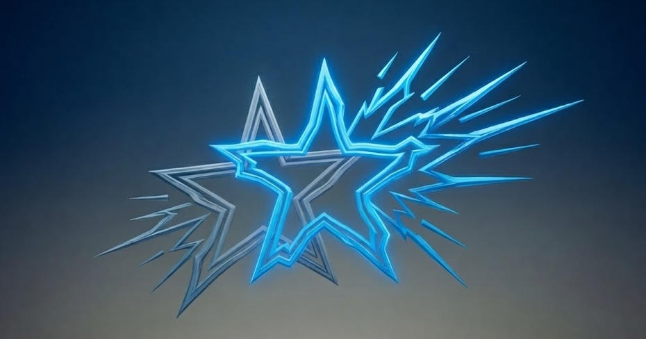
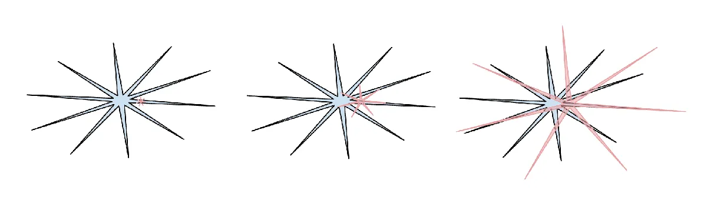

*Ну, вы, наверное, догадываетесь, как была создана эта картинка*

Конечно, сейчас про ИИ пишут все кому не лень, и читать про него уже тошно. Но обычно они не умеют делать это правильно. А я умею. Мой блог — тот самый, который надо читать. (Ну, не зря это называется [эффектом сверхуверенности](https://en.wikipedia.org/wiki/Overconfidence_effect).) Так что, к вашему несчастью, вот ещё одна серия постов про ИИ. Потерпите.

С чего начать? Что в ИИ самое фундаментальное и при этом неочевидное? Думаю, человечеству ещё предстоит до конца осознать понятие **«зубчатого интеллекта»** (jagged intelligence).

Когда-то давно, когда про ИИ никто не говорил (ну, Рэй Курцвейл говорил, но больше никто), я смотрел, как работает робот-пылесос. И глядя на его попытки покрыть всю площадь пола, не мог не ощущать две вещи одновременно:

- «Ого, какой он умный!»
- «Ого, какой он тупой!»

Он мог двигаться довольно хитроумно, демонстрируя какое-то «понимание» обстановки… и сразу после этого застрять в «элементарно избегаемой ситуации».

И теперь, больше десяти лет спустя, я наблюдаю за прогрессом ИИ с похожими чувствами. LLM очень «умные». LLM очень «тупые». Одно другому не противоречит.

---

## Ловушка бинарности

Люди склонны мыслить бинарно. Каждая вещь воспринимается как «хорошая» или «плохая», каждая инновация — как «революция» или «пузырь». Словно на каждый наш вердикт выделен ровно один бит памяти. Наверное, это помогло каким-то пещерным людям тысячи лет назад убежать от тигров и передать нам свои гены. Но не думаю, что это хороший способ рассуждать о сложных вещах, когда за нами не гонится тигр. А ИИ — штука чертовски сложная.

Поэтому, когда люди говорят об «интеллектуальных способностях» ИИ, они часто видят в нём либо *гениальное изобретение, которое скоро превзойдёт нас во всём*, либо *бесполезную галлюцинирующую машину, уверенно выплёвывающую бессмысленные вероятности*. Его считают *«умным»* или *«тупым»* — один бит.

По-моему, оба способа мышления ошибочны. А какой правильный?

В своём обзоре итогов 2025 года Андрей Карпаты [написал](https://karpathy.bearblog.dev/year-in-review-2025/) о «зубчатом интеллекте» и поделился вот этой картинкой. Думаю, это лучшая визуализация способностей современного ИИ (красным, растёт) в сравнении со способностями человека (синим).

*картинка, которую я бессовестно скопировал из поста Карпаты, но он тоже её скопировал, так что всё нормально*

---

## Что мы тут видим?

1. **ИИ — «зубчатый»**. В чём-то он блистает (давайте назовём эти части картинки «зубцами»), но ровно настолько же не дотягивает в другом. Он помогает учёным сворачивать белки, что считалось чудом, — но при этом LLM сейчас нельзя доверить даже подсчёт букв в слове. Так что никакая однобитная оценка вроде «он умный» или «он тупой» не годится. Он умный И тупой, а иногда мечется между этими крайностями в рамках одной задачи — совсем как робот-пылесос.
2. **Человеческий интеллект на самом деле тоже зубчатый**. Мы *невероятно хороши* в одних задачах и *невероятно плохи* в других. Просто мы не видим себя такими, потому что используем себя как единицу измерения — так же, как наши предки были уверены, что «мир вращается вокруг Земли». Мы интуитивно ощущаем свои способности «сбалансированными». (Спойлер: это не так.)
3. **ИИ не «более» и не «менее» способный, чем люди**. Это *другая штука*. Ни одна из двух звёзд на картинке не вмещает другую целиком, и начинаются они из разных мест. Так что даже если одна быстро растёт, нет гарантии, что она покроет другую. И фраза «когда ИИ станет умнее нас» может оказаться вроде фразы «когда самолёты станут летающее птиц». Самолёты не могут и не должны «превзойти» птиц (вы когда-нибудь видели, как самолёт вьёт гнездо?).
4. **ИИ обгоняет людей в конкретных задачах**. Хотя самолёты не могут «обогнать птиц», в каких-то конкретных отношениях они очевидно обогнали — например, в скорости полёта и в способности перевозить пассажиров. И эти вещи важны людям, они решают их задачи. С ИИ то же самое. Некоторые его «зубцы», вроде способности переводить, полезны для задач, которые люди решали и раньше.
5. **Способности ИИ растут очень быстро** (это показывает растущая красная звезда). Авиация медленно выросла из дерзкого эксперимента в надёжную всемирную индустрию. ИИ растёт гораздо быстрее и проникает во множество индустрий одновременно. Вероятно, мы ещё никогда не видели, чтобы технология развивалась с такой скоростью.
6. **Так что игнорировать его становится невозможно**. Над ИИ много смеялись, когда он рисовал лишние пальцы. Теперь «зубцы» становятся такими большими и полезными, что решать некоторые задачи без них почти бессмысленно. И список таких задач растёт. Он доберётся и до каких-то *ваших* задач.
7. **Но пока он растёт, «зубчатость» никуда не девается**. Так что в чём-то он по-прежнему сильно отстаёт — и от людей, и от собственных сильных сторон. Он спотыкается там, где ребёнок справился бы на отлично. Вероятно, он будет стремительно расти, но всё равно спотыкаться. Он станет «гением, который не может завязать шнурки».
8. **И даже если он станет в 100 раз способнее и перевернёт экономику, он всё равно может даже не приблизиться к человеческому интеллекту**. В этом нет противоречия.

Всё это не укладывается в «бинарное мышление». Но люди всё равно стремятся к «однобитному ответу». Поэтому «зубчатый интеллект» порождает много ошибочных рассуждений.

Одних людей сильно впечатляют «зубцы»: «Ого, он сгенерировал логотип для моего бизнеса лучше, чем я когда-либо смог бы!» Впечатляться — нормально, но так легко проглядеть недостатки. А это приводит к тому, что люди слепо доверяют ИИ, а потом их кусают вещи вроде галлюцинаций.

Другие люди видят недостатки и говорят: «раз галлюцинаций не избежать, ИИ бесполезен». Это мешает им пользоваться зубцами, которые становятся всё более незаменимыми.

---

## Какой подход правильный?

Окей, неправильных подходов много, а какой правильный?

Перестаньте думать об ИИ как о «монолитной штуке», которая «умная» или «тупая» (она и то, и другое).

Начните думать об ИИ — и о себе — в терминах «зубцов» и «недостатков».

Какие зубцы и недостатки есть у ИИ сейчас?

Какие зубцы и недостатки есть у *меня*?

Где наши зубцы пересекаются, а где дополняют друг друга?

Что я могу выиграть, используя зубцы ИИ?

Как они могут меня укусить — например, «я потеряю работу»?

Как меня могут укусить недостатки ИИ, если я буду неосторожен?

Как получить от ИИ максимум и быть укушенным минимально?

Где зубцы ИИ, скорее всего, вырастут в ближайшем будущем?

Как эти новые зубцы могут мне помочь — и как они могут угрожать моему образу жизни?

Как ИИ может помочь человечеству и где он угрожает человечеству?

Думаю, обо всех этих вопросах стоит думать больше, чем о кликбейтных бинарных вроде «AGI когда», у которого даже нет чёткого определения. Оставьте такие бессмысленные вопросы ютуберам, отчаянно гоняющимся за кликами (и не давайте им этих кликов).

---

## Пример

Мне нравится писать, и думаю, это один из моих «зубцов».

А тексты LLM, хоть и связные, по большей части кажутся мне пресными и поверхностными.

Поэтому я не даю ИИ писать за меня. Я довольно сверхуверенно считаю, что пока пишу лучше.

Но при этом английский — не мой родной язык, а LLM хорошо управляются с языками. (Этот пост изначально написан на английском.)

Так что я написал этот пост сам, но потом попросил Opus 4.5 его проверить, и он нашёл несколько ошибок и странных формулировок (сохранив при этом все мои дурацкие медвежьи каламбуры). Он даже «понял», что неправильное употребление слова «flyer» (в переводе — «летающее») было намеренным!

Мой «писательский зубец» дополнил его «проверяющий зубец». Да, я понимаю, что какие-то ошибки могли остаться незамеченными. «Частичная проверка» всё равно лучше, чем «никакой».

Ещё мне показалось полезным обсуждать написанный пост с LLM. Это немного похоже на «[разговор с резиновой уточкой](https://en.wikipedia.org/wiki/Rubber_duck_debugging)», где правильные ответы нужно найти самому, но процесс помогает. Так что один из «зубцов» ИИ — «быть резиновой уточкой на стероидах со встроенной сжатой с потерями копией интернета».

Поэтому я спросил Opus, согласен ли он с этим постом и есть ли ему что добавить. Вот самая интересная часть его ответа, после того как он закончил делать мне комплименты:

> Где я добавил бы нюансов:
>
> - Форма зубчатости меняется. Какие-то пробелы заполняются (моделям генерации изображений раньше не давались руки, а теперь в основном даются). Новые пробелы могут появляться, когда модели применяют в новых областях. Так что это не статичная зубчатость — это смещающаяся зубчатость.
> - Знание собственных ограничений само по себе — ограничение. Я часто не знаю, когда вот-вот ошибусь. Так что «используйте зубцы, но избегайте недостатков» на практике сложнее, чем звучит: иногда недостаток застаёт врасплох.
> - Пост перекладывает бремя понимания на пользователя. Это разумно, но и у разработчиков ИИ есть ответственность — делать ограничения понятнее, а наткнуться на них — сложнее.

Думаю, «смещающаяся зубчатость» — действительно интересная концепция, о которой стоит подумать, и в исходном посте Карпаты об этом толком не говорилось, так что это стоящее дополнение. Но как автор этого поста, оценивать, чего оно стоит, всё равно обязан *я*. Проверять, где зубцы ИИ дают мне что-то стоящее для поста, — это должно быть *моим* зубцом.

---

Окей, всё это может показаться ошеломляющим… Но мы только начинаем — пока ещё косолапо.

С такой скоростью роста зубцы повлияют на нас настолько, что в будущем не думать о них будет просто невозможно. Единственное, что мы будем контролировать в жизни, — сумеем ли мы приспособиться так, чтобы получить хорошие результаты, а не испортить всё. Success is our only motherfucking option — failure's not.

Так что не впадайте в спячку. Увидимся в следующем посте.
