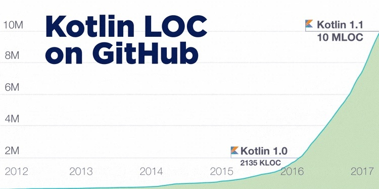
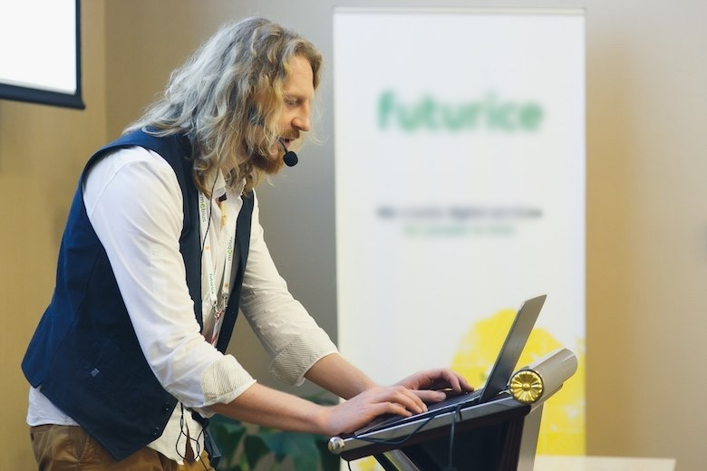
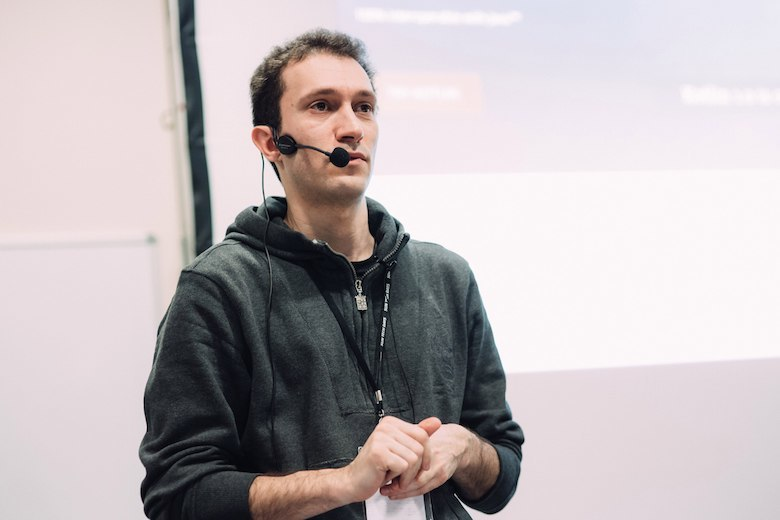
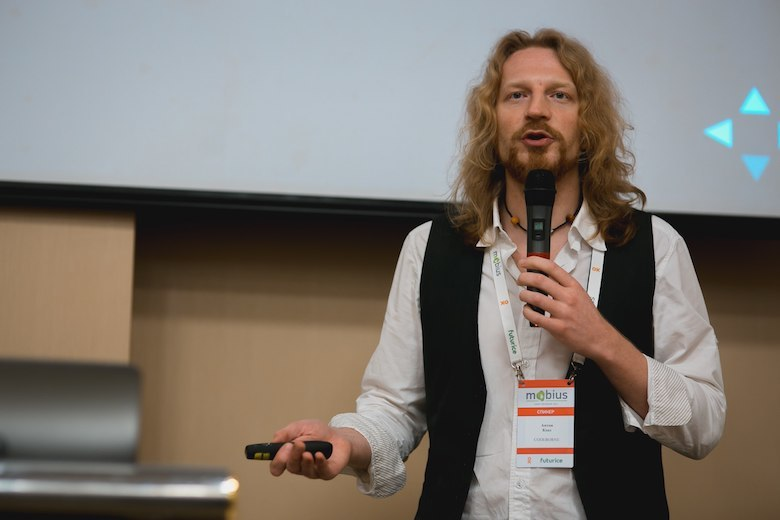
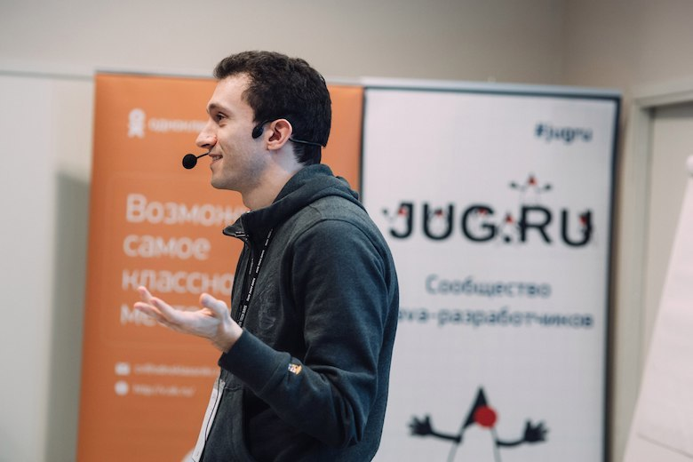

In the year since Kotlin 1.0 was released, the language has made breakthroughs on many fronts, from support in Gradle and Spring to the publication of the book “Kotlin in Action”. The number of Kotlin lines on GitHub has more than quadrupled, passing 10 million. And now version 1.1 is out, adding compilation to JavaScript, which looks like a bold bid for a new share of the market. Does all this mean that Kotlin's time has truly come, and that we should all be actively using the language in production?

**Andrey Breslav** (JetBrains) and **Anton Keks** (Codeborne) know a lot about Kotlin (and both will soon give talks about it at [JPoint](https://jpoint.ru/)), but they look at it from different sides: while Anton develops in the language, Andrey works on the language itself. We thought it would be interesting to talk about the present and future of Kotlin with both of them at once, to get the full picture. We started with questions about its rapid growth and then managed to discuss much more:

- Interaction with developers and how the language evolves
- Compilation to JS, the Kotlin Native project and multiplatform in general
- Imperfections
- Kotlin puzzlers
- Expectations and ambitions

**JUG.ru: To start with, tell us how exactly you're connected to Kotlin.**

*Andrey Breslav*

**Andrey Breslav:** For me it's very simple: I lead the whole project, all of the language design and all of the management.

*Anton Keks*

**Anton Keks:** I've done one production project in Kotlin, I'm now slowly going to move another very large project to it, and I'm moving a lot of my personal open-source projects from Java to Kotlin to get a better feel for the language.

The one I've already done in production is a plugin for IDEA, so it was easier to convince the client to use Kotlin. I started it last year: as soon as 1.0 came out, we started writing in it.

For me, as an experienced developer, the experience was very positive, while a less experienced developer on that project had a hard time learning a new language. So for me it was more fun, and for the other person it was more of an obstacle to getting the work done quickly. But I think we got the hang of it quickly, and since then I've come to love the language more. Before that I was a bit sceptical, because it seemed to me that Java 8 had already covered many of the use cases. But it turned out that Kotlin is still much nicer than Java 8. So now I'm doing my best to promote the language in the projects I'm involved in.

**JUG.ru: From the outside, it looks like 2016 was a breakthrough year for Kotlin. How do you see it?**

**Andrey:** 2016 really was a breakthrough year, at the very least because the release came out. Naturally, the community started taking the project seriously, and adoption began. We're very happy with the dynamics we see: large companies use Kotlin in serious projects; lots of learning materials are appearing from different people; people from the community write books that we didn't sponsor in any way, and they're popular.

You can see that, say, the Android developer community or the Spring community paid very close attention to Kotlin's arrival, and people started using it. The next version of Spring will already include some Kotlin extensions, and among Android developers it's simply a very popular tool. So in both markets we were mainly counting on, we have a very good result: server-side development is doing very well, and so is Android development.

**JUG.ru: Demand for a language is also measured by things like the number of job openings. How is Kotlin doing there?**

**Andrey:** I've seen very few purely Kotlin vacancies, but there are more and more of the “we need a Java and/or Kotlin developer” kind. Obviously, if people have an actively developed project, either on the backend or on Android, and someone on the team adds Kotlin to it, then the vacancies there become not just Java, but Kotlin as well. If people are used to hiring fairly serious specialists, for whom picking up a cool new technology isn't hard, then it's no barrier for them, and they do it without any trouble.

**Anton:** As an employer, I can add that there's a trend towards full stack development. At our company all developers are full stack, so hiring someone who only knows Kotlin or only Java is a bad idea. It's better to hire people who know how to program in general, who understand how object-oriented programming works and how functional programming works. Learning Kotlin's syntax afterwards is fairly easy, especially if you have experience with Java on the JVM. Many of our people write in Ruby or in Java, and for those who've seen both, starting to write in Kotlin doesn't take long.

**Andrey:** I agree with Anton that it's better to hire good programmers, and for such people the language is mostly not an obstacle.

**JUG.ru: Anton, what has changed for you as a developer in the year you've been using Kotlin?**

**Anton:** When Kotlin 1.0 came out, it was raw, or at least the IDE was. IDEA still lagged far behind what it could do for Java. For example, there were loads of bugs in the debugger, and in the compiler too… On the first project we ran into quite a lot, especially problems with the debugger. And while IDEA's inspections are great for Java, in Kotlin it didn't find the same kinds of flaws. But gradually it got much better.

I think version 1.0 was the trigger for many, including us, to start writing real projects, and thanks to that some things were polished at a much faster pace. At this point there are almost no features missing from the IDE compared to Java. I think the support has reached a very good level.

**JUG.ru: And is it easy enough to find the information you need? Stack Overflow has a couple of thousand answers tagged “Kotlin” and nearly a million tagged “Java”. Isn't that a problem?**

**Anton:** I'd say it's not a problem. In fact, there are few problems specific to Kotlin, and its documentation usually helps you find the answers. Very often, when you're developing an Android or web application, the questions are about the platform or the API, not the programming language. So of the million Java answers, probably 90% apply to Kotlin too; I don't see a problem. An unexpected feature in IDEA also helps: if you paste Java code from somewhere on the internet into a Kotlin class, it's automatically converted to Kotlin.

## Interaction with developers and the evolution of the language

**JUG.ru: Kotlin recently got an official [podcast](https://talkingkotlin.com), and before that the language development process was made more open as [KEEP](https://github.com/Kotlin/KEEP). Andrey, are these part of a general plan to “reach out to developers more”, or separate initiatives?**

**Andrey:** I can't boast that we have some big, detailed plan; the world changes too fast to make plans like that. But of course we have a general direction towards communicating with users as much as possible, and we invest a lot of resources in it.

We have a public [Slack](https://slack.kotlinlang.org), whose audience is now approaching 6,000 people. Engineers from our team show up there fairly regularly and answer questions, and the community talks among itself very actively. On the Stack Overflow question: if it turns out you can't find the answer to a question in public sources, you can go to Slack and get answers there very quickly, including a fairly detailed consultation from the person who wrote that functionality. There's also the podcast, various publications we try to produce ourselves, and we recently opened a user group support programme to make it easier for people to organise Kotlin meetups. That's one direction.

The other direction, KEEP, is no longer about organising the community as such, but about language design: the Kotlin Enhancement & Evolution Process, how we're going to evolve Kotlin. KEEP is still in a relatively early stage. That was the first try: within the scope of 1.1 we tried to publish our design decisions, so that people from the community could give us feedback, discuss things with us, tell us their impressions, suggest something. It works pretty well, although of course the load on the design team increases, and now we're reorganising things a bit. That is, we'll still publish everything, we'll just do it a bit differently so there's less load. But the idea is that we try to work on the language design as openly as possible, so that as many people as possible look at it as early as possible and tell us what they think. That's in the best traditions of open-source projects, and we like those traditions very much.

**JUG.ru: Anton, does this openness of the company help you in your work?**

**Anton:** Not in the sense that it helps a lot. I'll say again that in terms of understanding, everything is good enough without having to personally bother anyone. You can always look at the source code of the libraries. But it's very nice that the language designers are easy to reach, at conferences, for example. Perhaps because I'm not far from St. Petersburg, it's fairly easy to meet someone and talk. Of course, there's nothing like that with any other language I've written in; usually it's harder to get through to a language's authors. And I think that's a big plus.

**JUG.ru: Speaking of “easy to reach when you're near St. Petersburg”, we're curious: does this lead to more interest in Kotlin in Russia compared with other countries?**

**Andrey:** We really do see a great deal of attention to Kotlin in Russia. We have fewer actual users in the country than in America or China, but that reflects the population. It's hard for me to compare with other languages, since I don't have good geographic data on them, but I can say for sure that we feel a lot of attention from the Russian community. On the one hand, there are loads of people who do things and put their heart into it, not just read. On the other hand, here's a surprising fact, and I don't know what explains it: the very rare people who, in our various channels, express their opinion harshly and inappropriately, get personal and are rude in all sorts of other ways, have so far turned out to be Russian in 100% of cases.

**Anton:** I can guess that it's easy for a Russian to be rude to another Russian. A Russian is unlikely to be rude to an Englishman or an American.

**Andrey:** An interesting theory, I hadn't thought of it. Possibly.

**JUG.ru: Back to KEEP: Anton, do you take part in it or not?**

**Anton:** So far I mostly just read the KEEPs. You have to spend a lot of time getting into the context there. It's a pity I didn't take an active part in working out the 1.1 features, coroutines and so on, but maybe at some point I'll find more time for it.

**Andrey:** Yes, getting into all the details of the design of some tricky language feature is a very heavy load. As someone who, in various circumstances, has dug into the design of other languages (Java in particular) and taken part in the process, I understand that you have to load a lot of very specific context into your head. But of course there are people who can and want to do it, and we try to give them that opportunity.

A big question for us is how to organise the design process so that, on the one hand, it's open, and on the other, it doesn't get slowed down by that. We have a lot of verbal communication, because we're in the same office or can call each other, and if we moved all design communication into writing, it would simply slow down several times over. We don't want to slow everything down that much, so instead we periodically dump our current vision, publish it, collect comments and then rework it. So far this hasn't worked as effectively as we'd like, but we'll improve the process and make it possible for outside people to really get involved.

**Anton:** Actually, I'd say it's good that you keep communication more efficient within your office, because a successful programming language needs a dictatorship to some extent. You can see now how slowly Java develops because many decisions are very scary to make; those wretched lambdas were chewed over for so many years… I think that sometimes, if there are two alternatives, you just need to pick one and implement it.

Kotlin has been fine on this so far, and I think that's how it should continue. Not wait for too many comments on some things, perhaps.

**Andrey:** I completely agree. On the one hand, we try to gather as much input as possible; above all we're interested in use cases: how people write code in different contexts. But at the same time, we really don't want to get blocked on questions.

For example, with coroutines the situation is this: in 1.1 we've released them in experimental mode. We have a fully working implementation, there are libraries from us and from other people, but we understand that the feature is too big to cover completely in any finite time. So we're releasing the existing design with experimental status, so that lots of people use it, we get feedback, and if necessary we fix things.

Such a feedback loop with the community is, I think, absolutely necessary so as not to lose touch with reality. At the same time, it's not at all necessary to do it as super-conservatively as is customary in the Java team. They have their own reasons for doing it that way, but fortunately we don't have that need, and we try to keep moving, not slow down, not be stuck in “analysis paralysis” and the need to satisfy everyone in the world.

**Anton:** At the same time, Kotlin perhaps hasn't been around long enough to run into some of the problems that make the Java community so slow and conservative. We don't yet know how well Kotlin code will stand the test of time, whether code compiled with 1.0 will still work well in five years, whether today's source code will still compile in five years.

**Andrey:** As for compiled code, I'm largely confident that it will all work as well as any other Java program, because Kotlin itself has fairly limited influence there. But as for how source code will compile, that depends on us, and we have many questions about how best to do it; we'll try different strategies.

We had a very good experiment before the 1.0 release, when we were changing the language but already had a few hundred users, and we didn't want to break all their code. We made migration tools: that's not very common in other communities, where a programming language changes incompatibly but the tooling provides the migration. It was a fairly positive experience; there wasn't any moaning or particularly great suffering, which is very nice. For us it's an encouraging sign: if it suddenly turns out that something is very important to change, we can do it without losing our audience and without turning into Python 3.

But it's a very difficult balancing act: how to evolve the language so that, on the one hand, there's no stagnation, no horrible legacy that everyone is fed up with, and on the other, people are fine using it and don't suffer through migrations. There are different approaches: Java is super-conservative, Scala breaks binary compatibility in every release, Swift breaks source compatibility in every release, and they all have some results. We keep an eye on all of them and think, “How could we do this better?” So far we're behaving very conservatively and breaking very little: nothing at all binary-wise, and at the source level very, very carefully.

**Anton:** In that sense, automatic migration is a very nice thing. Even Java 9 is now starting to take some steps in that direction, improving the deprecated annotation, but as I understand it, they still have a way to go to reach Kotlin?

**Andrey:** Yes, we've developed a serious universal mechanism that not only we but also library authors can use, and so far it's simply a mega-success. A person really can write a deprecated annotation, and the IDE will automatically migrate everything for them, and it's all great. Well, for a wide class of cases. Some things won't work, of course, but a great deal can be migrated.

**JUG.ru: Since JetBrains does both the language and the tooling, does that give you a trump card compared with Java?**

**Andrey:** Well, in principle, absolutely nothing stops Oracle from contacting us and saying, “Guys, we're making this thing, could you add support for it in the IDE?”, and of course we'd do it; there's no problem with that. The other thing is the language authors' mindset, their approach. It's simply a different mode of language evolution. Today it evolves 100% compatibly. As for deprecating various APIs, they're now simply forced to take steps that are painful for them. They hesitated for a very long time with Java 9, and now they're doing something to make it more or less convenient. And of course all the tooling there is will rush to help them, because there are millions of Java programmers, it has to be made convenient for them, and there's simply no alternative.

But it's easier for us in the sense that the cycle of interaction between the tooling and the language is shorter. We can make a decision very quickly, implement it very quickly and see how it works: it takes days, not months. In that sense, of course, we have an advantage.

## Compilation to JS, Kotlin Native and multiplatform in general

**JUG.ru: In an [episode](https://habr.com/ru/companies/jugru/articles/318842/) of “Without Slides”, JetBrains CEO Maxim Shafirov named the ability to use the same code on the server and on the client as an important advantage of Node.js. And the arrival of compilation to JavaScript in Kotlin 1.1 is meant to give Kotlin the same advantage. Anton, tell us: does this really matter to you as a developer? Since everyone at your company is full stack, does JS compilation make Kotlin dramatically more attractive to you?**

**Anton:** I can't say the attractiveness rises dramatically. JS support was promised long ago, I even tested it a little, but I'm not yet entirely sure that using the same code on the client and the server is all that useful. When Node.js appeared, people said “that's it, this solves all problems, full stack in one language”, but in fact it didn't solve any problems, because client and server code are completely different and very little can be reused.

So we'll see; it needs a lot more experimenting. What interests me more is Kotlin Native, also a very interesting project, or idea; I don't know what stage it's at now.

**Andrey:** Let me tell you. First, a couple of words about JS and its fate: we've now released the release version of the Kotlin-to-JS compiler, plus a standard library shared by the two platforms. That's the first step towards being able to write multiplatform projects where you really can conveniently reuse code and compile to different platforms. Special tooling in the IDE and so on will appear for this over time.

And it's a fairly broad story, because if you include native in the same line-up, we get three classes of platforms: Java virtual machines, JS virtual machines, and all the native platforms Kotlin Native can run on (practically everything LLVM supports). For us, that's a chance to cover, roughly speaking, every more or less conceivable use case. Our ultimate goal is tooling where you can write code in Kotlin and compile it to all three platforms without changes. And, accordingly, add platform-specific modules to it, making applications that reuse part of their code across platforms.

As for Kotlin Native, we started very recently, at the beginning of autumn, and we're now working on the first implementation. It has its own full runtime: it doesn't use any ready-made virtual machine, only LLVM as compilation infrastructure. At the moment it supports a fairly large part of the language's features. There's a first implementation of memory management, and we can already interoperate with native calls. We can, for example, write an echo server on Unix sockets or something like that, so you can already write meaningful code that uses the C standard library and the Kotlin standard library as a wrapper over it. There's still loads of work to do; it's nowhere near a release. The initial phase of the project is doing the common work for all possible native platforms, the basic things: compilation, memory management, linking with everything needed, and interop with native APIs. After that we'll have to choose one platform to support first, really properly, and we'll see what it will be: iOS, small embedded systems, or something else.

**Anton:** And this JS and Native support will probably strongly influence new language features? For example, some feature that's easier to do on the JVM than on JS, you'd decide not to do in Kotlin at all?

**Andrey:** I don't see such tendencies yet; if anything, the opposite: they push us to do some features that are hard to do on the JVM. For example, native badly needs value types, so we'll have to do at least something of our own for interop with value types on the JVM. Naturally, not as nice as what Valhalla will have; in principle nothing crazy, they've designed it all quite reasonably there. We haven't yet had a case where the existence of another platform outright blocked some serious feature.

Except that there's always the temptation to support something fancy on a particular platform, something specific to just that platform. Native has the most of that: the ability to write to ports and so on. So far we've managed pretty well to stuff all of that into the library and not drag such crazy things into the language. The dynamic type is an example of a feature we support only on JS, because it's simply a specific trait of the platform. Whether we'll ever support the dynamic type in native and on the JVM isn't clear yet: on the JVM there are still some use cases, for native we haven't come up with any. And, really, no use cases means no need to support anything.

That is, we have no formal requirement to port 100% of Kotlin code across all platforms. We try to approach the question pragmatically: we have a common vision of the language, in a sense a “core language”, and we compile it as closely as possible to the different platforms. We have a very small common library, and everything else each platform can do a bit in its own way. The JVM has platform types, and all sorts of JVM specifics are taken into account there. JS has nothing related to threads, and has the dynamic type instead. Native has its own specifics related to value types, and that's fine, because our goal isn't to make a language in a vacuum but to make something you can write real programs for real platforms in. And if you need to write portable code, the modules that must be portable will impose some restrictions that a given platform might not have.

**JUG.ru: JavaScript's shortcomings have become proverbial. What's JS like when you deal with it not as an ordinary developer but while compiling Kotlin to JavaScript?**

**Andrey:** It's not all that terrible. Of course it has its own peculiarities, but I wouldn't say it's catastrophically worse than Java. The JVM imposes far more restrictions, while JS doesn't have such a direct mapping: some Kotlin constructs simply don't exist in JS. Interfaces, for example, simply don't exist there in any sense. On the other hand, on the JVM there are lots of things you fundamentally can't do, while in JS the restrictions are softer.

In terms of language interop it's a very sprawling story, but ideologically it's the same as with Java. It's just that Java has platform types, which in a sense erase nullability, while in JS, since there's only one type, we simply have this new dynamic type in Kotlin that behaves just like a JS type: nothing is known about it, it can hold anything, and you can call anything on it. And in principle it covers much of the need for such direct interop: if there's a library in raw JS, you can interact with it. But naturally it's inconvenient for the tooling: first, no types can be checked because there simply aren't any, and second, there's nowhere to get information for code completion and things like that.

So we rely on typed headers written in TypeScript, which is now the de facto standard for typing JS. There's a large repository of such headers, [Definitely Typed](https://definitelytyped.org), and we let users convert them to Kotlin. Converting raises lots of creative questions about how to map all this onto Kotlin, because it's a different type system with its own peculiarities: while Java's is simply strictly weaker than Kotlin's, TypeScript's is just different. Fortunately, that doesn't really concern compilation; it's more a question of “how do we describe the type information in this TypeScript in Kotlin terms”. I think we're doing quite well, but again, the community will tell us if something isn't right.

## Imperfections

**JUG.ru: It all sounds so good from every side that we want to find a catch somewhere. For example, last year Anton said that compilation speed was a drawback for him. How is it now?**

**Anton:** I haven't measured, but it feels better. The compiler running as a daemon probably helps, and on the codebases I've worked with, compilation isn't a problem now. But I haven't yet tried it on a really big codebase with maybe hundreds of thousands of classes or something like that.

**Andrey:** Tell me, do you use incremental compilation?

**Anton:** Yes, of course. At least in the IDE. I think the problem is precisely without incremental compilation.

**Andrey:** Right, we've put quite a lot of effort into making incremental compilation fast and making it work not only in the IDE but also in Gradle, and I think the results there are very good. I don't have complaints about compile time either when I program in Kotlin. Still, we're by no means done with compiler performance; loads more is planned. For us it's also closely tied to performance in the IDE, because the compiler in the IDE reuses a lot of code. And in the next release cycle, 1.2, we plan to devote a lot of time to improving performance.

JUG.ru: There's another imperfection. Among Kotlin's main selling points are null safety and convenient interop with Java. But these two advantages turn out to be mutually exclusive: in interop with Java you lose null safety, and an unexpected null can fly in from Java.

And in theory, a developer might see the words “Avoid entire classes of errors such as null pointer exceptions” on the website and get excited, but since nobody moves a large project to Kotlin all at once and they'll have to constantly interact with Java, in the end they'll only be disappointed.

The question: in practice, does this scare people away from the language?

**Anton:** It hardly scares anyone away. I'd even say it was a very wise decision, shortly before version 1.0, to make platform types not all nullable. Otherwise writing in the language using the standard Java libraries would have been pure hell. So it was a trade-off, and in my view a good one. Of course, you need a bit of experience to understand that in Kotlin, when using some Java classes, you sometimes need to explicitly declare the type when you know what should come from there, nullable or non-nullable, so that the compiler doesn't have to guess later. Otherwise, just as in Java, you'll get an exception at runtime. But on the whole, the way it's done now is done well.

**Andrey:** Indeed, the question of nullability in Java interop ate up a huge amount of our time before the 1.0 release. I think in total it delayed the release by about a year, because we tried several different interop schemes for nullability, three or four I think. And the first n were inconvenient; code was simply hard to write: either the code came out bad, or the configuration was too complicated and something was always not working. We arrived at the current option, and I agree with Anton that it has proven itself very well.

I don't remember complaints like “how could you, you promised null safety, and here I have a Java library and there's no null safety with it”. People don't expect a miracle from us; obviously, if it's Java, then sorry… Although actually there are exceptions even to this rule. It requires extra work from the author of a Java library, but you can annotate it right in the code so that Kotlin understands what's going on with nulls there and does everything correctly. In IDEA, most of our code is annotated, and everything there is just great, because Kotlin simply knows where Java has null and where it doesn't, and the Java side of IDEA knows too and complains in Java. If someone really wants to protect themselves from such problems even at the boundary between Kotlin and Java, the possibility is there, but it takes work.

**Anton:** Andrey, have you seen Uncle Bob's very interesting [post](https://blog.cleancoder.com/uncle-bob/2017/01/11/TheDarkPath.html) on precisely Kotlin and nullability?

**Andrey:** I have, I have.

**Anton:** He really laid into this nullability; I'd be interested in your comment.

**Andrey:** After a lot of people drew attention to it, I read… He wrote three posts in total (at least when I last looked). And the message is roughly this: once there were languages without types, then languages with types, then languages without types became popular again; a pendulum swings back and forth, and now the pendulum has swung towards types and gone past the point of balance. We have more types than we need.

First, this assumes that Uncle Bob knows where the point of balance is. Fine, he knows, but I think I know too, and I have a different opinion. At this point we can simply exchange opinions.

Second, there are some concrete arguments like “if I, for example, made some type in my program nullable, I now have to change the whole rest of the program for it to compile”. This point I don't understand, because yes, of course you need to change something; it's meaningful. If some type became nullable, then the code that uses this type must take that into account, otherwise it will work incorrectly! And of course that code needs to be changed. Well, you can run it, get an exception and change it later, or you can just change it right away. In Kotlin, you have to do it right away.

There are some other arguments too, analogies with const in C++ and something else; that analogy isn't quite correct, in my opinion.

**Anton:** With all due respect to Uncle Bob, it also seems to me that he simply used the opportunity to say once again “you still have to write tests for your code, and the compiler won't save you”. In which he is basically right, but I personally really like this nullability feature in Kotlin; maybe for me it's even one of the main features I want to write in Kotlin for. On the other hand, there are times when Kotlin doesn't let me easily describe what I want, and the compiler says I have to put either ? or !! somewhere. Lately, as I gain more experience with the language, I have to fight the compiler less and less, but such cases exist. There's also the lateinit keyword for this, which sometimes helps. So there are pros and cons, but I think the balance has tipped the right way, and it brings more benefit than inconvenience.

**Andrey:** Of course, I agree there are downsides, but everything has a price. If we want the compiler to guarantee something, some amount of work is required on our side. It's just a question of what's more justified. I think the experience of both ourselves and everyone else with Kotlin shows that introducing nullable types is fully justified; it turned out well.

**Anton:** And from my side, I see that as a rule I first declare all types non-nullable, and changing non-nullable to nullable is almost always very easy. The other way round is harder, of course.

**JUG.ru: Now that Kotlin is taking off, a silver bullet effect may arise: many will take it for a panacea that solves every possible problem. So here's a question: a lot has already been said about what you can expect from Kotlin, but what shouldn't you expect from it?**

**Anton:** You shouldn't expect any programming language to fix the design of your own code. Almost all the problems I see in programming are related not to the language but to how the program is structured. And in that sense, neither Kotlin nor any other language will help. It can give you some tools to make it more convenient; for example, delegation is very easy in Kotlin. But you need to know how to design your code regardless of the language.

**Andrey:** I agree with Anton; I'll just put it in other words. We tried to make Kotlin a convenient language, and as a convenient language it removes unnecessary complexity that, in terms of meaning, isn't in the programmer's head. But the complexity that corresponds to the program, the meaning put into the program, no programming language will remove. That complexity has to be structured and organised in any case.

And don't expect other miracles either. A JVM program in Kotlin won't be ten times faster than a program in Java, or even twice as fast. Because we're as fast as Java, and being faster is very hard. There are no miracles like that. But it's a convenient tool, and you can expect the effects of a convenient tool.

**Anton:** The most important thing, I think… Andrey, I don't know if you'll like this definition, but essentially, at the moment Kotlin is a “better Java”, and that means the equivalent amount of code can usually be written much shorter in Kotlin. And since code is read many times more often than it's written, that gives a very big productivity boost when you need to read less to figure out where a bug or problem is.

**Andrey:** Well, I quite like the definition of Kotlin as a “better Java”. It's one of the language's use cases, and we really did want Kotlin, among other things, to be a “better Java” too.

## Puzzlers

**JUG.ru: A year ago, at a [JUG.ru meetup](https://www.youtube.com/watch?v=YOmdOTlhZa8), when Andrey and Dmitry Jemerov were asked about Kotlin puzzlers (counterintuitive quirks), they answered “the community will probably find them over time”. And now, a year later, Anton is going to give a talk called “Kotlin Puzzlers” at JPoint. Have the expectations been fully met?**

**Anton:** Yes, Andrey said that if someone found them, there would be puzzlers, and that may have motivated me to collect them. The folks from JetBrains said in their talks that many Java puzzlers are fixed in Kotlin, but every language has, and will have, puzzlers of its own. I started collecting them when I knew the language less well and kept stumbling on nuances that weren't obvious at first glance. Gradually the idea came up that I could make a talk about it in the familiar puzzlers format: it's above all fun, and maybe it's a way to show off the language.

Not everyone knows Kotlin, so in my talk there's first an introductory set that's not strictly puzzlers but rather for Java developers: to introduce them to some features of the language so they try to guess how Kotlin will behave in a given case. And the second half is real puzzlers, where even an experienced Kotlin programmer can run into non-obvious nuances.

**Andrey:** First, I fully agree that every language has puzzlers, and that's normal. And it was my idea, a long time ago, to take the Java puzzlers, try writing them in Kotlin and see how many fall away. But of course it was never a real driver of the language design or any serious guideline; at some point I just took them and looked at what happened. Because of certain design decisions in the language, some Java puzzlers really are simply impossible. At the same time, naturally, others of its own are possible. I'd never take on making a substantial, production-useful language with fewer puzzlers than Java, or with no puzzlers; those are far too steep demands. And there'll be talks about them; the idea is cool, and people are ready to do such things with any language. We all know the super-popular [“WAT”](https://www.destroyallsoftware.com/talks/wat) video about JavaScript and other dynamic languages, which is actually also about puzzlers. So it's a kind of tradition, and Kotlin can't possibly stay out of it.

**JUG.ru: And when a puzzler is discovered, can it affect the further development of the language?**

**Andrey:** It can, of course. Well, the question is what you call a puzzler. There are bugs where some code that shouldn't compile at all compiles and runs, but in a completely unexpected way. That's simply a bug; we go and fix it.

There are cases where we see that many users have come with the same problem: they wrote unintuitive code. That may mean, for example, that something in our library API isn't very well designed; then we can deprecate that API and offer one that reads less ambiguously. It may mean that the language has some combination of features that leads to this. If we understand that the combination is strictly harmful, we can issue a warning in the IDE or the compiler, saying “you're doing something here that you probably don't want”. That's not always possible: sometimes the same combinations of features that lead to a puzzler also lead to useful things. That's simply an unavoidable evil; nothing can be done about it.

And of course some puzzlers come to light at the design stage. We're working on new features, there's a prototype, we start writing code on it, and if we run into puzzlers there, we look at them carefully and try to see whether we can rework things so they don't arise. In short, we try to do what we can, but we're aware that we'll never avoid all puzzlers.

**Anton:** I can also add that some of the puzzlers people sent me were real bugs in the compiler, and some still are. I usually file those in the JetBrains tracker, and I hope puzzlers of that kind will gradually go away. I don't even really want to use them in the talk.

**Andrey:** Well, if you report some harmless bug with a note that it's a puzzler and you really need it because it entertains the audience, we can leave it unfixed for a while, if you like!

**Anton:** Well, it's no problem to use an older version of Kotlin in the talk if necessary, so there's no need to do that!

## Expectations and ambitions

**JUG.ru: Andrey, since you're preparing the talk “The Future of Kotlin: Strategy and Tactics”, we'd like to ask about the future to finish. The past year was a breakthrough for Kotlin. What forecast can you make for the year ahead?**

**Andrey:** Well, I'll say straight away that reading tea leaves is a tricky business… I can talk about what I hope for, and there are also things I can't talk about because they're tied to things not yet announced by other market players. But in terms of the general trend, I can say two things.

First, unless some global cataclysm happens, adoption will grow, and most likely it will snowball. And not only in the number of users, but also in the number of large infrastructure projects. If right now the big tools we interact with are, say, Gradle, Spring and Vert.x, then over the coming year, I think, that number will grow quite a lot. And accordingly the number of users will grow in proportion to adoption among popular projects.

And second, we roughly know our plans for the year: if all goes well, Kotlin Native will come out in some form (most likely a beta preview), and with it our expansion into the market of some native platform, I don't know which yet: iOS, Arduino, or something else. We expect that this year we'll manage at least to start building a community around full stack scenarios in Kotlin. We firmly believe that writing full stack in a typed language is great.

As our internal users who already write full stack applications in Kotlin show, compared with JS there's a huge gain precisely because it's typed: the tools help, and some errors are simply ruled out by the type system. I have a personal love: type-safe web, in the sense that web applications really let you catch some silly errors at compile time, like path mismatches, how paths are represented on the client and the server, all sorts of serialisation things and so on, so that all of this is out of the programmer's way, because a compiler can do such silly things.

Well, we'll see how much of this we can pull off, but that's the plan; we have a lot of strength and enthusiasm here.

**JUG.ru: The last question is no longer about next year, but about the global perspective. Maxim Shafirov [said](https://habr.com/ru/companies/jugru/articles/318842/) about Kotlin that creating a language is a hugely ambitious task from the start: there's no point in making a “small” one, so if you take this on, you aim straight for a large share of the market. Andrey, how far do your own ambitions reach? Roughly speaking, do you want to get into the top 5 of the TIOBE index?**

**Andrey:** There are different things here: there are ambitions, and there are expectations.

I certainly want to make the coolest language in the world. I'm doing absolutely everything, and a little more, for Kotlin to be the coolest language in the world and, accordingly, one of the most in-demand, and so on.

At the same time, I try not to go crazy and to be aware that getting into the top 5 most in-demand languages (and probably, for all the inadequacy of the TIOBE index, its top 5 is adequate) is a very long road. On which, besides what I can control, there are quite a lot of factors I don't control.

JetBrains is a relatively small company and isn't the maker of any platform. If Apple told all its developers “you now write in Swift, which we break every six months”, then those developers write in Swift and fix their code every six months. We have no way to compete realistically with Swift on iOS. And that's not the goal, because it's obviously impossible. There's a vendor, the vendor isn't crazy, it made a very decent language for its platform, and that's it: programmers will do what the vendor said. Full stop. You can't change anything.

And I always remember one wonderful remark. A professor in Estonia once told me: “We can probably claim that today we write more web applications in Java than in COBOL. But that's all we can claim about Java and COBOL.” Jokes aside, the amount of COBOL in the world is staggering. On the one hand, of course, it isn't at the top of any TIOBE index, and on the other, you have to understand that inertia is an absolutely enormous thing. In that sense, competing with C, for example, is a completely out-of-this-world endeavour. And with Java too, in many ways. We'll see a huge amount of Java in the world for many years to come, simply because all of programming humanity has built up enormous inertia on this very language and won't lose it for a very long time.

And in that sense, naturally, I want to be number one, and at the same time I understand that if I end up not in the top 1 but in the top 20, that's very cool, and I've done a great job.

Since the language interests both “server-side Java people” and Android developers, **Anton Keks** was preparing “Kotlin Puzzlers” for two JUG Ru Group conferences at once: the Java conference [JPoint](https://jpoint.ru/) and the mobile development conference [Mobius](https://mobiusconf.com/). And **Andrey Breslav** was preparing a talk for JPoint on how JetBrains sees the future of Kotlin as a language and an ecosystem, and on how far an agile approach can be applied to developing a programming language.
