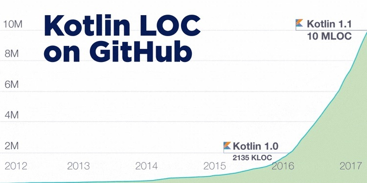
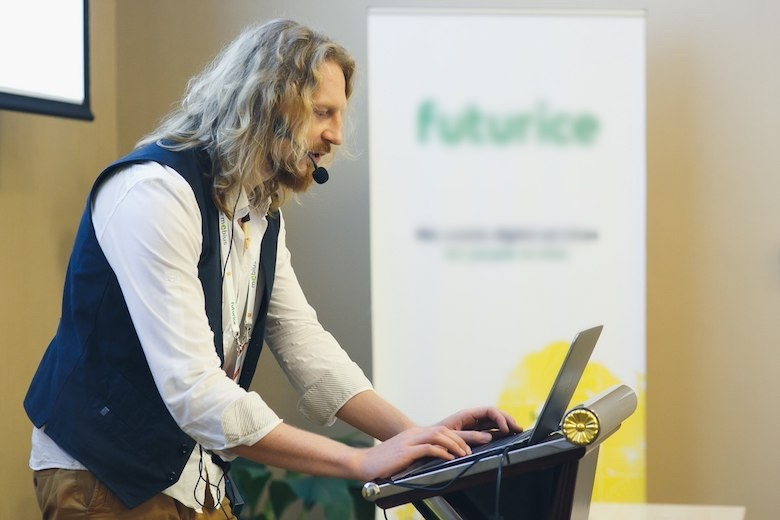
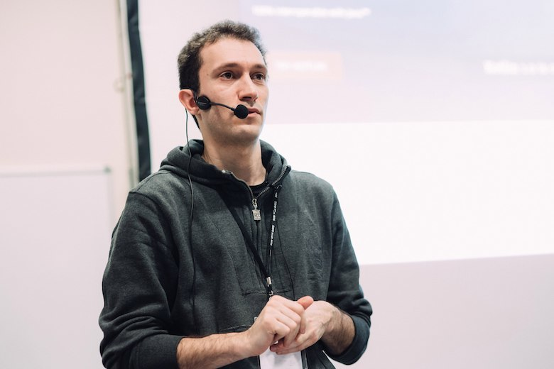
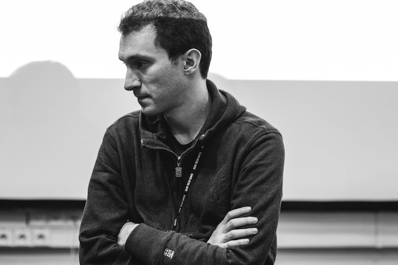
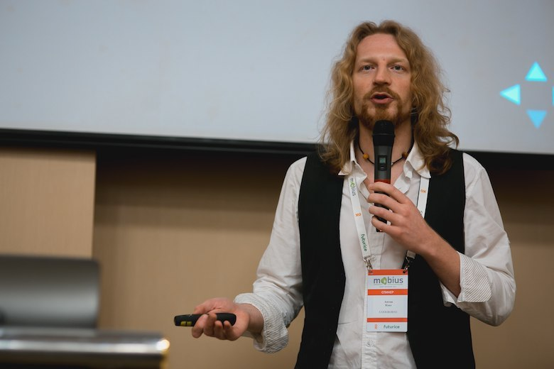
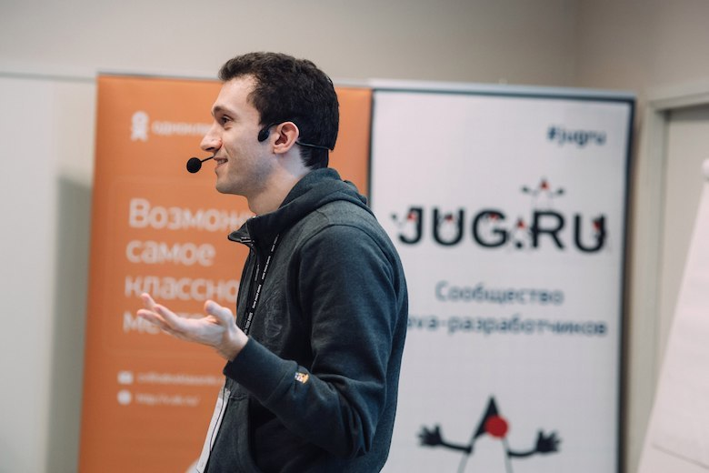

За год, прошедший с релиза Kotlin 1.0, у языка произошли прорывы по многим фронтам: от поддержки в Gradle и Spring до выхода книги «Kotlin in Action». Число Kotlin-строк на GitHub возросло более чем вчетверо, превысив 10 миллионов. А теперь вышла версия 1.1, добавляющая компиляцию в JavaScript, и это выглядит громкой заявкой на новую долю рынка. Означает ли это всё, что вот теперь время Kotlin по-настоящему пришло, и нам всем пора активно использовать язык в продакшене?

**Андрей Бреслав** (JetBrains) и **Антон Кекс** (Codeborne) многое знают о Kotlin (и оба скоро выступят на [JPoint](https://jpoint.ru/) с докладами о нём), но при этом смотрят на него с разных сторон: пока Антон разрабатывает на этом языке, Андрей работает над самим языком. Мы решили, что о настоящем и будущем Kotlin интересно поговорить с ними обоими сразу, получив полную картину. Начав с вопросов о бурном росте, затем успели обсудить ещё многое:

- Взаимодействие с разработчиками и процесс эволюции языка
- Компиляцию в JS, проект Kotlin Native и мультиплатформенность в общем
- Несовершенства
- Kotlin-паззлеры
- Ожидания и амбиции

**JUG.ru: Для начала расскажите, как именно вы связаны с Kotlin.**

*Андрей Бреслав*

**Андрей Бреслав:** У меня всё очень просто, я возглавляю весь проект: и весь language design, и весь менеджмент.

*Антон Кекс*

**Антон Кекс:** Я делал на Kotlin один проект в продакшене, ещё один очень крупный проект собираюсь сейчас потихоньку переводить на него, и очень много личных опенсорсных проектов перевожу с Java на Kotlin, чтобы лучше прочувствовать язык.

Тот, который уже делал в продакшене — плагин для IDEA, поэтому проще было убедить заказчика использовать Kotlin. Я начинал делать его в прошлом году: как только выпустили 1.0, так мы сразу начали на нём писать.

У меня как опытного разработчика опыт был очень положительным, а менее опытному разработчику в этом проекте было тяжело учить новый язык. То есть для меня это было больше fun, а для другого человека это было больше препятствием к тому, чтобы делать работу быстро. Но мне кажется, что мы быстро освоились, и с того времени я больше полюбил язык. До того немножко скептично относился, потому что мне казалось, что при выходе Java 8 она уже покрыла многие юзкейсы. Но оказалось, что Kotlin всё-таки гораздо приятнее, чем восьмая Java. Поэтому я сейчас вовсю пытаюсь пропагандировать язык в тех проектах, в которых участвую.

**JUG.ru: Со стороны кажется, что 2016-й стал для Kotlin прорывным годом — а как это видите вы?**

**Андрей:** 2016-й действительно был прорывным годом, как минимум, потому что вышел релиз. Естественно, комьюнити стало всерьёз рассматривать проект, пошёл adoption. Мы очень довольны динамикой, которую видим: Kotlin пользуются крупные компании в серьёзных проектах; появляется много обучающих материалов от разных людей; люди из комьюнити пишут книжки, которые мы сами никак не спонсировали, и они популярны.

Видно, что, скажем, комьюнити Android-разработчиков или Spring очень внимательно отнеслось к появлению Kotlin, люди начали пользоваться. Следующая версия Spring будет включать в себя уже какие-то расширения на Kotlin, среди Android-разработчиков это просто очень популярный инструмент. То есть на обоих рынках, на которые мы в основном рассчитывали, у нас очень хороший результат: и server-side development очень бодро, и Android development.

**JUG.ru: Востребованность языка определяется ещё и вещами вроде числа вакансий — а с этим у Kotlin что?**

**Андрей:** Чисто котлиновских вакансий я видел совсем немного, а вот вакансий «нужен разработчик на Java и/или Kotlin» становится больше. Понятно, что если у людей есть активно разрабатываемый проект либо на бэкенде, либо на Android, и кто-то из участников добавляет туда Kotlin, то вакансии там становятся не только Java, но и Kotlin. Если люди привыкли нанимать достаточно серьёзных специалистов, которым несложно освоить новую прикольную технологию, то для них это не барьер, и они спокойно это делают.

**Антон:** Я как работодатель могу ещё прокомментировать, что идёт тренд full stack development, у нас в компании все разработчики full stack, поэтому нанимать кого-то, кто знает только Kotlin или только Java — это плохая идея. Лучше нанимать людей, которые вообще умеют программировать, понимают, как работает объектно-ориентированное программирование, как работает функциональное. И выучить потом синтаксис Котлина достаточно легко, особенно если есть опыт с Java на JVM. У нас многие пишут кто на Ruby, кто на Java, и для тех, кто видел тот и другой, начать на Котлине писать не занимает много времени.

**Андрей:** Я Антона поддерживаю, что лучше нанимать хороших программистов, и для таких людей язык — это не препятствие в основном.

**JUG.ru: Антон, а что за год вашего использования Kotlin изменилось для вас как разработчика?**

**Антон:** Когда вышел Kotlin 1.0, он был сырой — или, как минимум, IDE. IDEA всё-таки очень сильно уступала возможностям на Java. Например, была куча багов в дебаггере, в компиляторе тоже встречались… На первом проекте мы столкнулись с достаточно многим, особенно много было проблем с дебаггером. И если в случае с Java у IDEA всё классно с инспекциями, то, например, в Kotlin те же самые недочёты она не находила. Но постепенно стало гораздо лучше.

Думаю, что версия 1.0 была триггером для многих, в том числе и для нас, начать писать настоящие проекты, и благодаря этому какие-то вещи удалось отточить уже гораздо более быстрым темпом. На данный момент уже почти нет возможностей, которых в IDE не хватает по сравнению с Java. По-моему, поддержка стала очень хорошего уровня.

**JUG.ru: А, например, нужную информацию достаточно легко найти? На Stack Overflow ответов по тегу «Kotlin» пара тысяч, а по «Java» чуть ли не миллион — это не мешает?**

**Антон:** Я бы сказал, что это не проблема. На самом деле, специфичных проблем с Kotlin мало, и обычно его документация помогает найти ответы. Очень часто, когда разрабатываешь Android или веб-приложение, возникают вопросы про платформу или API, а не язык программирования. Поэтому из миллиона ответов по Java, скорее всего, 90% подходят и для Kotlin, не вижу проблем. Помогает также неожиданная фича в IDEA: если в класс на Kotlin cкопировать Java-код откуда-нибудь из интернета, то он автоматически конвертируется в Kotlin.

## Взаимодействие с разработчиками и эволюция языка

**JUG.ru: Недавно у Kotlin появился официальный [подкаст](https://talkingkotlin.com), до этого процесс разработки языка сделали более открытым как [KEEP](https://github.com/Kotlin/KEEP) — Андрей, а это части общего плана «активнее обращаться к разработчикам», или отдельные инициативы?**

**Андрей:** Я не могу похвастаться тем, что у нас прямо какой-то большой детально продуманный план, мир слишком быстро меняется, чтобы такие планы строить. Но, конечно, у нас есть общее направление на максимальное общение с пользователями, мы в это вкладываем очень много ресурсов.

У нас есть публичный [Slack](https://slack.kotlinlang.org), аудитория которого сейчас приближается к 6000 человек, инженеры из нашей команды там достаточно регулярно появляются и отвечают на вопросы, а комьюнити очень активно общается между собой. К вопросу про Stack Overflow: если вдруг оказывается, что где-то в публичных источниках не найти ответ на вопрос, то можно пойти в Slack и очень быстро получить там ответы, включая достаточно детальную консультацию человека, который писал эту функциональность. Также есть подкаст, разные публикации, которые мы стараемся делать сами, а недавно открыли программу поддержки юзергрупп, чтобы людям было проще организовывать встречи по Котлину. Это одно направление.

Другое направление, KEEP — это уже не про собственно организацию комьюнити, а про дизайн языка, Kotlin Enhancement & Evolution Process: то, как мы собираемся эволюционировать Kotlin. KEEP сейчас в относительно зачаточном состоянии, вот была первая проба — мы в скоупе 1.1 старались публиковать наши дизайновые решения, чтобы люди из комьюнити могли выдать нам какой-то фидбэк, вместе с нами что-то обсудить, сказать нам о своих впечатлениях, предложить что-то. Это довольно неплохо работает, хотя, конечно, нагрузка на дизайновую команду увеличивается, и сейчас мы всё немножко реорганизуем. То есть мы по-прежнему будем всё публиковать, просто немножко по-другому это сделаем, чтобы нагрузки было меньше. Но смысл такой, что мы стараемся максимально открыто работать над дизайном языка, чтобы как можно больше людей смотрели на это как можно раньше и говорили нам, что они думают. Собственно, это в лучших традициях опенсорсных проектов, и эти традиции нам очень нравятся.

**JUG.ru: Антон, а вам в работе помогает эта открытость компании к взаимодействию?**

**Антон:** Такого, чтобы сильно помогала, нет — ещё раз скажу, что в плане понимания всё достаточно хорошо и без того, чтобы кого-то лично дёргать. Всегда можно посмотреть исходный код библиотек. Но очень приятно, что лёгок доступ к дизайнерам языка, например, на конференциях. Возможно, благодаря тому, что я нахожусь недалеко от Санкт-Петербурга, достаточно легко с кем-то пересечься, поговорить — такого, конечно же, нет ни с каким другим языком, на котором я писал, обычно достучаться до авторов языка сложнее. И мне кажется, что это большой плюс.

**JUG.ru: В связи с «легко достучаться, когда ты недалеко от Петербурга» любопытно: а приводит ли это к повышенному интересу к Kotlin в России по сравнению с другими странами?**

**Андрей:** Мы действительно видим в России очень большое внимание к Kotlin. Фактических пользователей в стране у нас меньше, чем в Америке или в Китае, но это отражает количество населения. Мне сложно сравнить с другими языками, у меня нет хороших географических данных по другим, но могу точно сказать, что мы чувствуем очень много внимания со стороны российского сообщества. С одной стороны, есть куча людей, которые что-то делают, вкладывают душу, а не просто читают. А с другой — это удивительный факт, я не знаю, чем он объясняется, но те очень редкие люди, которые у нас в разных каналах информации резко и некорректно высказывают своё мнение, переходят на личности и всяко-разно по-другому хамят, пока что в 100% случаев оказывались русскими.

**Антон:** Я могу предположить, что русскому человеку легко нахамить другому русскому человеку. Вряд ли русский человек будет хамить англичанину или американцу.

**Андрей:** Интересная версия, я про неё не думал. Возможно.

**JUG.ru: Возвращаясь к KEEP: Антон, а вы в нём участвуете или нет?**

**Антон:** Пока что KEEP’ы в основном только читаю. Там надо потратить очень много времени, чтобы погрузиться в контекст. Жаль, что не участвовал активно в проработке фич 1.1, корутин и так далее, но, может быть, в какой-то момент найду больше времени, чтобы этим заниматься.

**Андрей:** Да, погрузиться во все детали дизайна какой-нибудь хитрой фичи языка — это очень большая нагрузка. Я как человек, который при разных обстоятельствах погружался в дизайн других языков (в частности, Java) и участвовал в процессе, понимаю, что надо загрузить в голову очень много специфического контекста. Но, безусловно, есть люди, которые могут и хотят это сделать, и мы стараемся дать им такую возможность.

Большой вопрос для нас — как организовать дизайновый процесс так, чтобы он, с одной стороны, был открытым, а с другой — не тормозился об это. У нас очень много устной коммуникации, потому что мы находимся в одном офисе или можем созвониться, и если мы переведём все коммуникации по дизайну в переписку, они просто замедлятся в разы. Мы не хотим всё настолько замедлять, поэтому вместо этого периодически дампим текущее видение, выкладываем его, собираем комментарии и потом это перерабатываем. Это пока работало не так эффективно, как хотелось бы, но мы будем улучшать процесс и делать так, чтобы внешние люди могли реально включиться.

**Антон:** Я бы сказал, на самом деле хорошо, что вы делаете более эффективную коммуникацию у себя в офисе, потому что успешный язык программирования в какой-то мере нуждается в диктатуре. В принципе, сейчас видно, насколько медленное развитие у Java из-за того, что многие решения очень боятся принимать, эти несчастные лямбды столько лет мусолили… Мне кажется, что иногда, если есть две альтернативы, нужно просто выбрать одну и реализовать.

В Kotlin до сих пор с этим всё окей, и мне кажется, что так и нужно продолжать. Не ждать, может быть, о каких-то вещах слишком много комментариев.

**Андрей:** Совершенно согласен. С одной стороны, мы стараемся собрать как можно больше входной информации, в первую очередь интересуют юзкейсы: как люди пишут код в разных контекстах. Но при этом мы действительно не хотим блокироваться на каких-то вопросах.

Например, с корутинами у нас такая ситуация: мы сейчас в 1.1 выпустили их в экспериментальном режиме. У нас есть абсолютно работающая реализация, есть библиотеки от нас и от других людей — но мы понимаем, что фича слишком большая, чтобы охватить её полностью за какое-то конечное время. Поэтому мы выпускаем имеющийся дизайн в экспериментальном статусе, чтобы много людей попользовалось, мы получим фидбэк, и если нужно, что-то починим.

Такой цикл обратной связи с сообществом, как мне кажется, совершенно необходим, чтобы не оторваться от реальности. При этом совершенно необязательно делать это так суперконсервативно, как принято в команде Java. У них свои причины для того, чтобы это делать, но у нас, к счастью, такой необходимости нет, и мы стараемся двигаться, не тормозить, не быть парализованными «analysis paralysis» и необходимостью удовлетворить всех на свете.

**Антон:** В то же время Kotlin, возможно, ещё недостаточно долго жил, чтобы наткнуться на какие-то проблемы, которые делают Java-комьюнити таким медленным и консервативным. Мы ещё не знаем, насколько выдержит код на Kotlin тест времени, будет ли хорошо работать через пять лет код, скомпилированный с 1.0, будет ли компилироваться сегодняшний исходный код через пять лет.

**Андрей:** Что касается скомпилированного кода, я в большой мере уверен, что работать всё будет так же хорошо, как любая другая джавовская программа, потому что там достаточно ограниченное влияние самого Котлина. А вот что касается того, как будет компилироваться исходный код — это зависит от нас, и у нас есть много вопросов о том, как идеально это делать, мы будем пробовать разные стратегии.

У нас был очень хороший эксперимент перед релизом 1.0, когда мы меняли язык, но у нас уже были какие-то сотни пользователей, и мы не хотели ломать им весь код. Мы делали средства миграции: это то, что не очень принято в других комьюнити, когда язык программирования меняется несовместимым образом, но инструментарий предоставляет миграцию. Это был довольно позитивный опыт, не было каких-то стонов и особенно большого страдания, что очень приятно. Это для нас обнадёживающий сигнал: если вдруг окажется, что очень важно что-то поменять, то мы можем это сделать и не потерять аудиторию, не превратиться в Python 3.

Но это очень сложный вопрос баланса — как эволюционировать язык, чтобы, с одной стороны, не было стагнации, какого-то жуткого легаси, которое всех достало, а с другой — чтобы людям было нормально этим пользоваться, и они не мучались с миграцией. Есть разные подходы — Java суперконсервативная, Scala в каждом релизе ломает бинарную совместимость, Swift в каждом релизе ломает source-совместимость, и у них всех есть какие-то результаты. Мы на них всех посматриваем и думаем: «А как бы нам получше с этим?» Пока что очень консервативно себя ведём, очень мало чего ломаем, бинарно вообще ничего, а на source-уровне очень-очень аккуратно.

**Антон:** В этом смысле автоматическая миграция — очень приятная вещь, даже Java 9 сейчас начинает какие-то шаги в этом направлении делать, улучшать deprecated-аннотацию, но, как я понимаю, до Kotlin им ещё расти?

**Андрей:** Да, мы выработали серьёзный универсальный механизм, которым можем пользоваться не только мы, но и авторы библиотек, и пока это просто мегауспех. Действительно, человек может написать deprecated-аннотацию, и IDE ему автоматически всё смигрирует, и всё классно. Ну, для широкого класса случаев. Какие-то вещи, конечно, не получится, но очень много чего можно смигрировать.

**JUG.ru: Поскольку JetBrains занимается и языком, и инструментарием, тут у вас по сравнению с Java козырь на руках?**

**Андрей:** Ну, в принципе, абсолютно ничто не мешает Oracle связаться с нами и сказать «Ребята, мы тут делаем такую штуку, сможете ли вы сделать в IDE поддержку», и мы, конечно, сделаем, никакой проблемы с этим нет. Другое дело — какой у авторов языка mindset, подход к этому. Там просто другой режим эволюции языка. Он на сегодня эволюционирует 100% совместимо. А что касается deprecation всякого разного API, они сейчас просто вынуждены пойти на болезненные для них шаги. Они очень долго колебались с Java 9, и сейчас что-то делают для того, чтобы это было более-менее удобно. И, конечно, весь тулинг, какой только можно, бросится им помочь, потому что есть миллионы программистов на Java, им надо сделать удобно, и тут вообще без вариантов.

Но нам легче в том смысле, что цикл взаимодействия между тулингом и языком короче. Можем очень быстро принять решение, очень быстро заимплементить, посмотреть, как работает — это занимает не месяцы, а дни. В этом смысле у нас, конечно, есть преимущество.

## Компиляция в JS, Kotlin Native и мультиплатформенность в общем

**JUG.ru: в [выпуске](https://habr.com/ru/companies/jugru/articles/318842/) «Без слайдов» СЕО JetBrains Максим Шафиров называл важным преимуществом Node.js возможность использовать один и тот же код на сервере и на клиенте. И появление в Kotlin 1.1 компиляции в JavaScript призвано дать ему то же преимущество. Антон, расскажите: а для вас как разработчика это действительно имеет значение? Раз у вас в компании все full stack, становится ли Kotlin для вас резко привлекательнее благодаря JS-компиляции?**

**Антон:** Не могу сказать, что привлекательность резко повышается. Обещание JS-поддержки было уже давно, я даже немного это тестировал, но пока не совсем уверен, что использовать один и тот же код на клиенте и сервере так уж полезно. Когда появился Node.js, говорили «всё, это решает все проблемы, full stack на одном языке», но на самом деле это никаких проблем не решило, потому что код для клиента и сервера абсолютно разный, очень мало чего можно переиспользовать.

Поэтому посмотрим, нужно ещё очень сильно поэкспериментировать. А что меня больше интересует — так это Kotlin Native, тоже очень интересный проект или идея, я не знаю, на какой стадии он сейчас находится.

**Андрей:** Давай расскажу. Сначала два слова про JS и его судьбу: у нас сейчас вышла релизная версия компилятора Котлина в JS, и стандартная библиотека, общая для двух платформ. И это первый шаг в сторону возможности писать многоплатформенные проекты, где действительно можно удобно переиспользовать код, компилировать в разные платформы. Для этого со временем появятся специальный тулинг в IDE и так далее.

И это достаточно широкая история, потому что, если в эту же линейку включить native, у нас получается три класса платформ: виртуальные машины Java, виртуальные машины JS и все нативные платформы, на которых может запуститься Kotlin Native (фактически, всё, что поддерживает LLVM). И для нас это возможность, условно, покрыть все более-менее мыслимые юзкейсы. И наша конечная цель — сделать такой тулинг, в котором можно написать код на Kotlin и скомпилировать его во все три платформы, не меняя. И, соответственно, добавлять к нему какие-то платформенные модули, делая приложения, которые переиспользуют на разных платформах какую-то часть кода.

Что касается Kotlin Native — мы недавно совсем начали, в начале осени, сейчас работаем над первой реализацией. Это полный свой рантайм — он не использует никакой готовой виртуальной машины, только LLVM как инфраструктуру для компиляции. В настоящий момент там поддержана довольно большая часть фич языка. Есть первая реализация управления памятью, и мы уже умеем интеропиться с нативными вызовами. Умеем, например, написать какой-нибудь echo server на юниксовых сокетах или ещё что-то такое, то есть уже можно писать какой-то осмысленный код, который использует стандартную библиотеку C и стандартную библиотеку Kotlin как обёртку над ней. Там ещё куча работы, это совершенно не близко к релизу. И начальная фаза проекта состоит в том, что мы делаем общую работу для всех возможных нативных платформ, базовые вещи: компиляция, управление памятью, линковка со всем, чем нужно, и интероп с нативными API. А дальше нам уже надо будет выбрать какую-нибудь одну платформу, которую первой будем поддерживать совсем-совсем по-настоящему, и мы посмотрим, что это будет — то ли iOS, то ли маленькие embedded-системы, то ли ещё что-то.

**Антон:** А эта поддержка JS и Native, наверное, будет очень сильно влиять на новые фичи в языке? Например, какую-то фичу, которую на JVM сделать проще, чем на JS, вы решите вообще не делать в Котлине?

**Андрей:** Я пока не замечаю таких тенденций, скорее наоборот: они подталкивают нас делать некоторые фичи, которые на JVM сделать сложно. Например, value-типы для native очень нужны, нам придётся делать хоть что-то своё для интеропа с value-типами на JVM. Естественно, не такое красивое, как будет в Valhalla, в принципе, ничего безумного, там всё довольно нормально придумали. Такого, чтобы существование другой платформы прямо блокировало какую-то серьёзную фичу, у нас пока не было.

Разве что есть всегда соблазн на конкретной платформе поддержать что-то эдакое, специфичное именно для этой платформы. В native такого больше всего: возможность писать в порты и ещё что-то. Пока у нас довольно неплохо получалось всё это запихивать в библиотеку, и в язык таких безумных вещей не тащить. Вот динамический тип — пример, когда мы поддерживаем какую-то фичу только на JS, потому что это просто специфическая особенность платформы. Будем ли мы когда-нибудь в native и на JVM поддерживать динамический тип — пока не ясно, на JVM ещё есть какие-то юзкейсы, в native пока не придумали. Ну и, собственно, нет юзкейсов — нет и необходимости что-то поддерживать.

То есть у нас нет формальной необходимости портировать 100% котлиновского кода между всеми платформами. Мы стараемся прагматически к этому вопросу подходить: у нас общее видение языка, в некотором смысле «core language», и мы его максимально близко компилируем на разные платформы. У нас есть очень небольшая общая библиотека, а всё остальное каждая платформа может делать немножко по-своему. На JVM есть платформенные типы, и там учитываются всякие особенности JVM. На JS нет ничего, связанного с потоками, и есть, наоборот, динамический тип. В native свои особенности, связанные с value-типами, и это нормально, потому что у нас цель не сделать язык в вакууме, а сделать то, на чём можно писать реальные программы для реальных платформ. И если нужно писать портируемый код, то те модули, которые должны быть портируемыми, будут накладывать какие-то ограничения, которых в той или иной платформе может не быть.

**JUG.ru: Недостатки JavaScript стали притчей во языцех — а каково с JS, когда сталкиваешься с ним не как обычный разработчик, а занимаешься компиляцией Kotlin в JavaScript?**

**Андрей:** Там не так всё ужасно. Безусловно, там свои особенности, но я бы не сказал, что как-то катастрофически хуже, чем в Java. JVM накладывает гораздо больше ограничений, а на JS нет такого прямого мэппинга, какие-то конструкции Kotlin в JS просто не существуют — например, интерфейсов там просто нет ни в каком смысле. С другой стороны, в JVM очень много вещей сделать в принципе нельзя, а в JS ограничения более мягкие.

С точки зрения языкового интеропа это очень развесистая история, но идеологически она такая же, как в Java. Просто в Java есть платформенные типы, которые nullability в некотором смысле стирают, а в JS, поскольку там один тип, то у нас просто есть такой новый в Kotlin динамический тип, который ведёт себя просто как JS-тип: то есть про него ничего не известно, в нём может лежать что угодно, на нём можно вызвать что угодно. И он, в принципе, во многом покрывает потребности такого прямого интеропа, если есть библиотека на сыром JS, то можно с ней взаимодействовать. Но, естественно, инструментарию будет неудобно: во-первых, никакие типы проверять невозможно, потому что их просто нет, во-вторых, негде взять информацию для code completion, каких-то таких вещей.

Поэтому мы опираемся на типизированные заголовки, написанные на TypeScript, это ныне де-факто стандарт типизации для JS. Есть большой репозиторий таких заголовков [Definitely Typed](https://definitelytyped.org), мы даём пользователям возможность их конвертировать в Kotlin. На уровне конвертации возникает очень много творческих вопросов о том, как всё это мэппить на Kotlin, потому что там другая система типов со своими особенностями: если джавовская просто строго слабее, чем котлиновская, то тайпскриптовская просто другая. Но это, к счастью, не очень касается компиляции, это скорее вопрос «как бы нам описать ту типовую информацию, которая в этом TypeScript есть, в котлиновских терминах». По-моему, мы неплохо справляемся, но, опять же, комьюнити нам подскажет, если что-то не очень хорошо.

## Несовершенства

**JUG.ru: Всё звучит настолько хорошо со всех сторон, что хочется уже найти где-то подвох. Вот, например, Антон в прошлом году говорил, что для него недостатком стала скорость компиляции — что с этим теперь?**

**Антон:** Я не замерял, но по ощущениям стало лучше. Наверное, помогает компилятор, который запускается как демон, и на тех кодовых базах, с которыми я работал, компиляция сейчас не проблема. Но я ещё не пробовал на реально большом codebase, где может быть сотни тысяч классов или что-то такое.

**Андрей:** А скажи, пожалуйста, вы инкрементальной компиляцией пользуетесь?

**Антон:** Да, конечно. Как минимум, в IDE. Думаю, как раз без инкрементальной компиляции проблема и есть.

**Андрей:** Ну да, мы вложили довольно много усилий в то, чтобы инкрементальная компиляция работала быстро, чтобы она работала не только в IDE, но и в Gradle, и мне кажется, что там очень хорошие результаты. У меня тоже нет претензий ко времени компиляции, когда я программирую на Kotlin. Тем не менее, мы совершенно не закончили работу над перформансом компилятора, там ещё куча всего планируется. Для нас это тесно связано ещё и с производительностью в IDE, потому что компилятор в IDE переиспользует очень много кода. И мы планируем в следующем релизном цикле, в 1.2, посвятить много времени как раз улучшению перформанса.

JUG.ru: Есть ещё такое несовершенство. У Kotlin в числе главных selling points есть null-safety и удобство интеропа с Java. Однако два этих преимущества оказываются взаимоисключающими: в интеропе с Java лишаешься null-safety, из Java может прилететь неожиданный null.

И теоретически может оказаться так, что разработчик увидит на сайте слова «Avoid entire classes of errors such as null pointer exceptions», загорится, но поскольку большой проект никто не переведёт сразу на Kotlin и ему придётся постоянно взаимодействовать с Java, в итоге он только разочаруется.

Вопрос: а практически отпугивает ли это людей от языка?

**Антон:** Вряд ли отпугивает. Я бы даже сказал, что было очень мудрым решением незадолго до версии 1.0 сделать так, чтобы платформенные типы не были все nullable. Иначе было бы полным адом писать на языке, используя стандартные Java-библиотеки. Так что это был такой трейд-офф, и, на мой взгляд, всё-таки хороший. Конечно, нужно немного опыта, чтобы понять, что на Kotlin при использовании каких-то джавовских классов иногда нужно специально объявить тип, когда ты знаешь, что оттуда должно прийти — nullable или не nullable, чтобы компилятор потом не гадал. Иначе точно так же, как и в Java, получишь потом в рантайме исключение. Но, в принципе, то, как это сделано сейчас — хорошо сделано.

**Андрей:** Действительно, вопрос nullability при интеропе с Java у нас сожрал кучу времени до релиза 1.0. Я думаю, что в сумме это задержало релиз примерно на год, потому что мы пробовали несколько разных схем интеропа в связи с nullability, кажется, три или четыре. И первые n были неудобными, просто код писать было тяжело: либо код просто получался плохой, либо конфигурация была слишком сложная, что-то всё время не работало. Мы пришли к текущему варианту, и я согласен с Антоном в том, что он очень неплохо себя зарекомендовал.

Я не помню таких жалоб «как же так, вы обещали null safety, а у меня тут джавовская библиотека и null safety с ней нет». Люди не ожидают от нас чуда, очевидно, что если Java, то извините… Хотя, на самом деле, есть исключения даже из этого правила. Это требует дополнительной работы от автора Java-библиотеки, но можно и её так проаннотировать прямо в коде, чтобы Kotlin понимал, что там с null’ами, и всё правильно делал. В IDEA у нас большая часть кода проаннотирована, и там вообще всё отлично, потому что Kotlin просто знает, где в Java null, а где не null, и джавовская IDEA тоже знает, и ругается в Java. Если кто-то реально хочет себя защитить от таких проблем даже на стыке Kotlin и Java, то возможность есть, но это требует работы.

**Антон:** Андрей, а ты видел интереснейший [пост](https://blog.cleancoder.com/uncle-bob/2017/01/11/TheDarkPath.html) Uncle Bob как раз на тему Kotlin и nullability?

**Андрей:** Видел, видел.

**Антон:** Он хорошо прошёлся по этой nullability, мне интересен твой комментарий.

**Андрей:** После того, как на это обратило внимание много народу, я прочитал… Он написал в общей сложности три поста (по крайней мере, когда я в последний раз смотрел). И посыл примерно такой: когда-то были языки без типов, потом языки с типами, потом снова стали популярны языки без типов, такой маятник качается туда-сюда, сейчас маятник качнулся в сторону типов и ушёл за точку баланса. У нас больше типов, чем надо.

Во-первых, это предполагает, что Uncle Bob знает, где точка баланса. Ну хорошо, он знает, а я думаю, что я тоже знаю, и у меня другое мнение. В этом месте можно просто обменяться мнениями.

Во-вторых, там есть некоторые конкретные аргументы «как же, если я, например, сделал какой-нибудь тип в своей программе nullable, то мне ж теперь надо поменять всю остальную программу, чтобы эта программа скомпилировалась». Этот момент я не понимаю, потому что — да, конечно, нужно что-то поменять, это содержательно. Если какой-то тип стал nullable, значит, код, который этот тип использует, должен учесть этот факт, иначе он будет неправильно работать! И, конечно, этот код надо поменять. Ну, можно его запустить, получить исключение, и поменять потом, а можно просто сразу поменять. Вот в Kotlin надо сразу.

Там ещё есть какие-то аргументы, аналогии с const в C++, ещё чем-то — эта аналогия не совсем корректная, по-моему.

**Антон:** При всём уважении к Uncle Bob, мне тоже кажется, что он просто использовал возможность ещё раз сказать «вы всё равно должны писать тесты для своего кода, и компилятор вас не спасёт». В чём он, в принципе, прав, но мне лично очень нравится в Kotlin эта фича с nullability, может быть, для меня это даже одна из основных фич, ради которых хочу писать на Котлине. С другой стороны, бывает такое, когда Kotlin не позволяет мне легко описать то, что я хочу, компилятор говорит, что я должен где-то поставить либо ?, либо !!.. В последнее время, когда у меня всё больше опыта с языком, мне всё меньше приходится бороться с компилятором, но есть такие кейсы. Для этого есть ещё ключевое слово lateinit, которое иногда помогает. Так что есть и плюсы, и минусы, но мне кажется, что всё-таки уклон ушёл в правильную сторону, что от этого больше пользы, чем неудобства.

**Андрей:** Безусловно, я согласен, что минусы есть, но за всё надо платить. Если мы хотим, чтобы компилятор что-то гарантировал, то требуется какое-то количество работы с нашей стороны. Здесь просто вопрос, что более оправданно. По-моему, опыт нас самих и всех остальных людей с Kotlin показывает, что введение nullable-типов вполне оправдано, получилось хорошо.

**Антон:** Причём со своей стороны я вижу, что, как правило, сначала все типы объявляю не-nullable, и изменить не-nullable на nullable почти всегда очень легко. Наоборот, конечно, сложнее.

**JUG.ru: Сейчас, когда Kotlin взлетает, может возникнуть эффект серебряной пули: многие примут его за панацею, решающую все возможные проблемы. Поэтому есть такой вопрос: о том, чего можно ждать от Kotlin, уже много говорилось, а вот чего от него ждать не надо?**

**Антон:** Не стоит от любого языка программирования ждать того, что он исправит дизайн твоего собственного кода. Почти все проблемы, которые я вижу в программировании, связаны не с языком, а со структурированием программы. И в этом смысле ни Kotlin, ни любой другой язык не поможет. Он может дать какие-нибудь тулзы для этого, чтобы это было удобнее сделать — например, в Kotlin очень легко делается делегирование. Но свой код нужно уметь дизайнить независимо от языка.

**Андрей:** Я поддерживаю Антона, скажу просто другими словами. Мы пытались сделать Kotlin удобным языком, и как удобный язык он убирает лишнюю сложность, которой по смыслу нет в голове у программиста. А ту сложность, которая соответствует программе, тот смысл, который вкладывается в программу, никакой язык программирования не уберёт. Эту сложность в любом случае приходится структурировать и организовывать.

Ещё не стоит ожидать других чудес. Программа на JVM на Kotlin не будет в десять раз быстрее, чем программа на Java, и даже в два раза. Потому что мы такие же быстрые, как Java, и быстрее быть очень сложно. Подобных чудес нет. Но это удобный инструмент, и можно ожидать эффектов удобного инструмента.

**Антон:** Самое главное, как мне кажется… Андрей, не знаю, понравится ли тебе такое определение, но по сути, в данный момент Kotlin — это «более хорошая Java», и это означает, что эквивалентное количество кода написать на Kotlin, как правило, можно гораздо короче. И так как код читается в разы чаще, чем пишется, это даёт очень большой прирост продуктивности, когда нужно меньше читать, чтобы разобраться, где баг или проблема.

**Андрей:** Ну, мне вполне нравится определение Kotlin как «лучшей Java». Это один из юзкейсов языка, и мы действительно хотели, чтобы в числе прочего Kotlin был и «лучшей Java» тоже.

## Паззлеры

**JUG.ru: Год назад Андрей и Дмитрий Жемеров на [встрече JUG.ru](https://www.youtube.com/watch?v=YOmdOTlhZa8), когда был задан вопрос о паззлерах (контринтуитивных особенностях) Kotlin, отвечали «вероятно, со временем их найдёт сообщество». А теперь, спустя год, Антон собирается выступить на JPoint с докладом «Kotlin Puzzlers» — ожидания полностью оправдались?**

**Антон:** Да, Андрей говорил, что если кто-то найдёт, то будут паззлеры, и это, может быть, и смотивировало меня собирать их. Товарищи из JetBrains говорили в докладах, что многие Java-паззлеры в Kotlin исправлены, но свои паззлеры есть и будут в любом языке. Я начал собирать их, когда хуже знал язык, периодически натыкался на какие-то нюансы, которые были неочевидны с первого взгляда. Постепенно возникла идея, что про это можно сделать доклад в привычном формате паззлеров — это в первую очередь фан, и, возможно, позволяет демонстрировать язык.

Не все знают Kotlin, поэтому в докладе у меня сначала ознакомительный набор не строго из паззлеров, а скорее для Java-разработчиков — познакомить их с некоторыми фичами языка, чтобы они попытались угадать, как Kotlin себя поведёт в определённом случае. А вторая половина — это уже реальные паззлеры, когда и опытный Kotlin-программист может столкнуться с неочевидными нюансами.

**Андрей:** Во-первых, полностью присоединяюсь к мнению о том, что паззлеры есть в любом языке, и это нормально. И это моей идеей когда-то давно было взять Java-паззлеры, попробовать написать их на Kotlin и посмотреть, сколько отвалится. Но это, конечно, никогда не было настоящим драйвером дизайна языка и каким-то серьёзным ориентиром, просто в какой-то момент я взял и посмотрел, что получается. Из-за некоторых дизайнерских решений в языке определённые Java-паззлеры действительно просто невозможны. При этом, естественно, возможны какие-то свои. Я никогда не возьмусь сделать какой-то содержательный, продакшен-полезный язык, в котором будет меньше паззлеров, чем в Java, или не будет паззлеров — это слишком крутые запросы. И доклады про них будут, идея прикольная, и люди с любым языком готовы делать такие вещи — ну, мы знаем суперпопулярный ролик [”WAT”](https://www.destroyallsoftware.com/talks/wat) про JavaScript и другие динамические языки, который тоже, на самом деле, про паззлеры. Так что это такая традиция, и Kotlin тут совершенно не может стоять в стороне.

**JUG.ru: А когда паззлер обнаружился, на дальнейшем развитии языка это может сказаться?**

**Андрей:** Может, конечно. Ну, вопрос в том, что называть паззлером. Бывают баги, когда какой-то код, который вообще не должен компилироваться, компилируется, работает, но совершенно неожиданным образом. Это просто баг, мы идём и чиним его.

Бывают случаи, когда мы видим: многие пользователи пришли с одной и той же проблемой, они написали неинтуитивный код. Это может означать, например, что у нас в библиотеке что-то не очень удачно с API, тогда мы этот API можем задепрекейтить и предложить более однозначно читаемый. Это может значить, что у нас в языке есть какое-то сочетание фич, которое приводит к такому. Если мы понимаем, что это сочетание фич строго вредное, можем выдать warning в IDE, в компиляторе, сказать «вы тут делаете что-то такое, что вы вряд ли этого хотите». Такое возможно не всегда: иногда те же самые сочетания фич, которые приводят к паззлеру, приводят и к каким-то полезным вещам. Это просто неизбежное зло, ничего не поделаешь.

Ну и понятно, что какие-то паззлеры выясняются на стадии дизайна. Мы работаем над новыми фичами, есть какой-то прототип, мы начинаем писать на нём код, и если там сталкиваемся с паззлерами, то внимательно на них смотрим, пытаемся понять, можем ли как-то переделать, чтобы такие вещи не возникали. В общем, стараемся сделать что можно, но отдаём себе отчёт, что всех паззлеров мы никогда не избежим.

**Антон:** Я могу ещё прокомментировать, что некоторые из паззлеров, которые мне присылали, и были реальными багами в компиляторе, и до сих пор такие ещё есть. Я такие обычно регистрирую в трекере JetBrains, и надеюсь, что вот такого рода паззлеры будут потихоньку уходить. Их даже не очень хочу в докладе использовать.

**Андрей:** Ну, если ты зарепортишь какой-нибудь не вредный баг с пометкой, что это паззлер и он тебе очень нужен, потому что развлекает аудиторию, мы его можем некоторое время не фиксить, если хочешь!

**Антон:** Ну, не проблема при необходимости использовать в докладе более старую версию Котлина, так что не нужно так делать!

## Ожидания и амбиции

**JUG.ru: Андрей, поскольку вы готовите доклад «Будущее Kotlin: Стратегия и тактика», напоследок хочется спросить о будущем. Прошедший год стал для Kotlin прорывным — а какой вы можете сделать прогноз на год вперёд?**

**Андрей:** Ну, я сразу говорю, что гадание на кофейной гуще — такое дело… Я могу говорить, на что я надеюсь, а ещё есть то, про что не могу говорить, потому что это связано с вещами, которые ещё не объявлены другими участниками рынка. Но по общей тенденции я могу сказать две вещи.

Во-первых, если не произойдёт никаких катаклизмов глобальных, adoption будет расти, и, скорее всего, он будет расти как снежный ком. И не только по количеству пользователей, но и по количеству крупных инфраструктурных проектов. Если сейчас с нами из крупных инструментов взаимодействуют, скажем, Gradle, Spring и Vert.x, то за ближайший год это количество, я думаю, достаточно сильно увеличится. Ну и, соответственно, количество пользователей будет расти пропорционально adoption среди популярных проектов.

А во-вторых, мы приблизительно знаем свои планы на год: если всё будет хорошо, то у нас выйдет в каком-то виде (скорее всего, бета-превью-состоянии) Kotlin Native, и, соответственно, будет наша экспансия на рынок какой-то нативной платформы, ещё не знаю, какой: то ли iOS, то ли Arduino, то ли что-то ещё. Мы ожидаем, что за этот год нам удастся, по крайней мере, начать строить комьюнити вокруг full stack-сценариев на Kotlin. Мы свято верим в то, что писать full stack на типизированном языке — это классно.

Как показывают наши внутренние пользователи, которые уже пишут full stack-приложения на Kotlin, по сравнению с JS есть огромный выигрыш именно из-за того, что он типизированный: и инструменты помогают, и просто какие-то ошибки исключаются за счёт системы типов. У меня есть моя личная любовь — это type-safe web в том смысле, чтобы веб-приложения действительно позволяли во время компиляции отслеживать какие-то дурацкие ошибки в духе соответствий путей, представлении о путях на клиенте и на сервере всяких сериализационных вещей и так далее, чтобы это всё было вне внимания программиста, потому что такие глупые вещи может делать компилятор.

Ну, посмотрим, насколько мы всё это сдюжим, но планируем, у нас тут много сил и энтузиазма.

**JUG.ru: Последний вопрос — уже не про следующий год, а про глобальную перспективу. Максим Шафиров в связи с Kotlin [говорил](https://habr.com/ru/companies/jugru/articles/318842/), что создание языка изначально очень амбициозная задача: мол, бессмысленно делать «маленький», так что если затевать такое, то сразу размахиваясь на большую долю рынка. Андрей, а у ваших собственных амбиций какой размах? Грубо говоря, хотите ли попасть в топ-5 индекса TIOBE?**

**Андрей:** Тут есть разные вещи: есть амбиции, а есть ожидания.

Я, безусловно, хочу сделать самый крутой язык на свете. Я делаю вообще всё-всё-всё и немножко больше для того, чтобы Kotlin был самым крутым языком на свете, соответственно, одним из самых востребованных и так далее.

При этом я стараюсь не сходить с ума и отдавать себе отчёт в том, что попасть в топ-5 самых востребованных языков (а, наверное, при всей неадекватности TIOBE-индекса топ-5 в нём адекватный) — это очень длинный путь. На котором, кроме того, что я могу контролировать, есть довольно много факторов, которые я не контролирую.

JetBrains — относительно небольшая компания, не является производителем никакой платформы. Если Apple сказал всем своим разработчикам «вы теперь пишете на языке Swift, который мы ломаем каждые полгода», то эти разработчики пишут на языке Swift и каждые полгода чинят у себя код. У нас нет никакой возможности реалистично конкурировать со Swift на iOS. И цели такой нет, потому что очевидно, что это невозможно. Есть вендор, вендор не сумасшедший, сделал очень неплохой язык для своей платформы — ну и всё, программисты будут делать так, как сказал вендор. Точка. Ничего не изменишь.

А также я всегда вспоминаю одно замечательное суждение. Мне как-то профессор в Эстонии сказал такую мысль: «Мы, наверное, можем утверждать, что сегодня мы пишем на Java больше веб-приложений, чем на COBOL. Но больше ничего про Java и COBOL мы утверждать не можем». Шутки шутками, а количество COBOL в мире поражает. И с одной стороны, конечно, ни в каком TIOBE-индексе его в топе нет, а с другой — надо понимать, что инерция штука совершенно огромная. И в этом смысле конкурировать, например, с C — вообще абсолютно запредельная деятельность. Ну и с Java во многом тоже. Мы будем видеть огромное количество Java в мире ещё очень много лет просто из-за того, что всё программирующее человечество набрало огромную инерцию именно на этом языке, и потеряет её ещё очень нескоро.

И в этом смысле, естественно, я хочу в топ-1, и при этом понимаю, что если попаду не в топ-1, а в топ-20, это очень круто, и я большой молодец.

Поскольку языком интересуются и «серверные джависты», и Android-разработчики, **Антон Кекс** готовил «Kotlin Puzzlers» сразу для двух конференций JUG Ru Group: Java-конференции [JPoint](https://jpoint.ru/) и конференции по мобильной разработке [Mobius](https://mobiusconf.com/). А **Андрей Бреслав** — доклад для JPoint о том, как в JetBrains представляют себе будущее Kotlin как языка и экосистемы, и о том, насколько можно применять agile-подход к разработке языка программирования.
