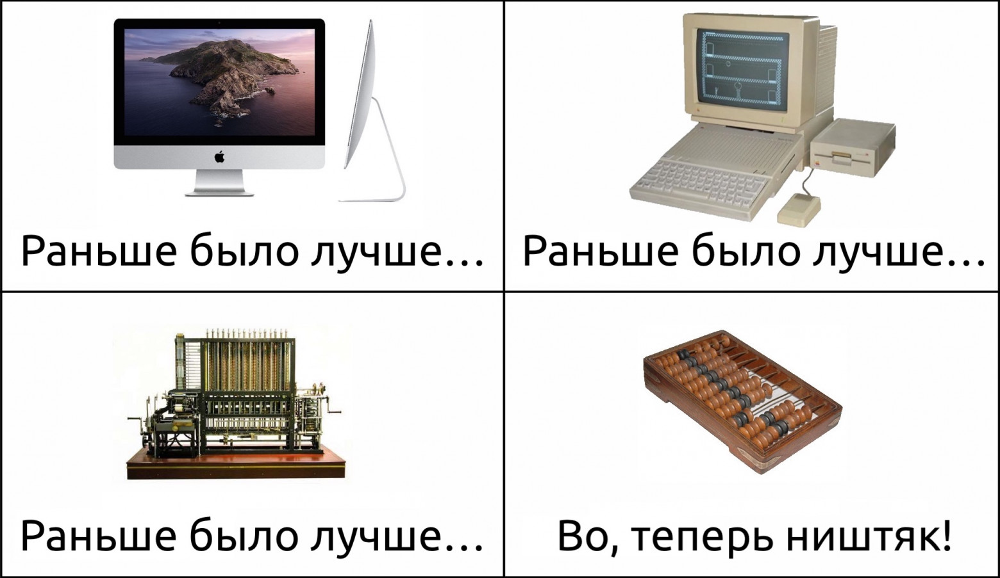
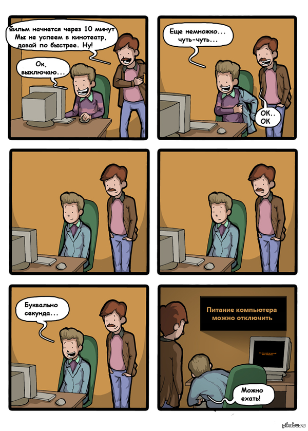
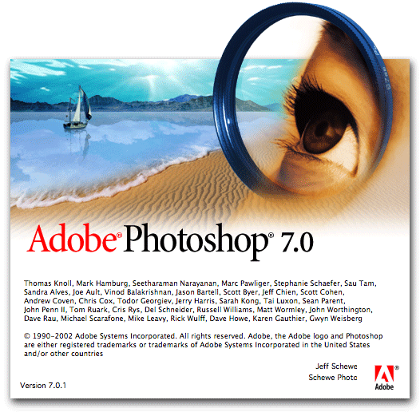

Есть типичная позиция, которую можно встретить на Хабре и не только: «хотя железо с годами всё лучше, человечество свело эффект на нет тем, что пишет софт всё хуже».

Мол, ядер в процессорах стало больше, но тормозит всё пуще прежнего. Electron и Slack — порождения тьмы, пришедшие лишить нас счастья и памяти. Мобильные приложения стали прожорливее, чем старые операционные системы. А в самих операционных системах уже толком нет прогресса, но почему-то они продолжают разбухать в размерах. То ли дело было, когда люди умели уместить ОС на дискету!

Скажу прямо: когда я вижу подобные заявления, у меня бомбит. По-моему, в них упускают целый ряд важных факторов. А в итоге ситуация напоминает классическую речь Луи Си Кея «[Everything's amazing and nobody's happy](https://www.youtube.com/watch?v=MkS3hyzarrA)»: всё стало удивительно хорошо, а люди сидят и жалуются.

Поэтому решил описать эти упущенные факторы. Поскольку текст получился резким, хочу подчеркнуть, что мнение сугубо моё личное (хоть я и ссылаюсь на конференции компании, в которой работаю).

## Избирательность памяти

Известно, что существует ностальгический эффект «раньше трава была зеленее, а музыка лучше». Но, по-моему, у многих этот эффект принимает пугающие масштабы, когда ощущения совсем уж драматически расходятся с реальностью.

Я говорю о заявлениях вроде такого: «Почти всё на компьютере ощущается медленнее, чем в 1983-м». Судя по тысячам лайков, это не единичное мнение, а массовое.

> almost everything on computers is perceptually slower than it was in 1983
>
> — Gravis (edited) (@gravislizard) [November 6, 2017](https://twitter.com/gravislizard/status/927593460642615296)

Первая моя реакция: «Ну и как в 1983-м ощущался стриминг 4K-видео?» То есть для начала давайте вспомним, что большинство сегодняшних применений компьютера раньше были невозможны, в том числе как раз из-за скорости. Когда-то фильм (даже не в 4K, а в 1080p) пришлось бы скачивать месяцами, а потом компьютер не смог бы его воспроизводить с 24 FPS. И как тогда сравнивать нынешнюю скорость с той, которая была бы такой запредельно низкой, что её вообще не было?

Вторая реакция: да, какие-то вещи, которые из командной строки переместились в GUI, могут там требовать больше времени. Готов поверить, что Word в 2020-м запускается медленнее, чем консольный редактор vi в 1983-м (лично сравнить не могу: впервые оказался за компьютером в 90-х). Но если для вас это настолько важно, можно ведь и в 2020-м для многих «задач из 80-х» использовать командную строку. Я прямо сейчас пишу этот текст в vim — прекрасный редактор, которому экосистема плагинов помогает не отставать от времени. Замечательно выглядит на современном ретиновом iMac: буковки стали очень чёткими, а отрабатывает по-прежнему моментально. В чём проблема-то?

Но самое главное даже не в двух названных вещах. Важнее следующее: по-моему, мы стали забывать, насколько компьютеры тормозили. Когда что-то начинает тормозить сильнее, мы это сразу замечаем — а вот когда что-то становится быстрее или проще, мы просто принимаем это как должное и забываем о прошлом.

Ко всем людям, пишущим «раньше всё было быстрее», у меня такой вопрос: вы вообще помните, например, вот это?

Признаюсь честно: я и сам об этом особо не вспоминаю. Когда сегодня выключаю компьютер, не задумываюсь о том, что двадцать лет назад сидел и ждал между нажатием кнопки в ОС и нажатием кнопки на системном блоке. Я просто принял как должное то, что теперь так не нужно, и забыл о том, что было иначе.

С временем запуска компьютера тоже произошли большие перемены. Сейчас я сажусь за аймак, нажимаю одну клавишу, и через секунду он готов к работе (спасибо SSD и спящему режиму). Когда в детстве я ждал загрузки Windows с HDD, вряд ли поверил бы, что доживу до такого.

«Когда в письме стопицот картинок, оно ужасно медленно открывается, иногда аж десять секунд!» Понимаю, что это может раздражать — но слушайте, в 2000-м для проверки почты я сначала минуту наслаждался трелями модема, потом ждал, пока неторопливо загрузится главная страница почты, а затем само письмо тоже подгружалось не моментально — и при этом в нём не было вообще никаких картинок, только текст. Сегодня такое открылось бы без промедления. Может быть, просто не надо забивать тысячей картинок средство коммуникации, которое было придумано для другого? И прежде чем заявлять «всё испортилось», давайте подумаем: сколько времени письмо с таким количеством картинок открывалось бы в 2000-м?

Или вот ещё одно воспоминание, затерявшееся во времени, как слёзы в дожде. В нулевых была популярна такая шутка: «Медленный компьютер — это когда знаешь по именам всех разработчиков Photoshop». Для тех, кому это ни о чём не говорит: тогда в России был очень популярен спираченный Photoshop, и при каждом его запуске россиянам приходилось подолгу смотреть на это:

*Ой, понял сейчас, что знаю одного из этих людей — Шон Пэрент [выступал](https://www.youtube.com/watch?v=Xtk_JXDqmxo) у нас на С++ Russia*

А теперь сравните. Сегодня шутят «когда-то понадобилось два килобайта памяти для запуска человека на Луну, а теперь нужно два гигабайта для запуска Slack». Звучит хлёстко, но вы замечаете разницу? Сколько бы оперативной памяти Slack ни потреблял, с ситуацией «на запуске программы можно идти пить чай» пользователи не сталкиваются. Всё стало лучше, а мы это не заметили.

Или вот показательный исторический артефакт: серия Масяни «Даунлоад» (2002). Герои страшно переживают из-за дисконнекта, при котором придётся скачивать файл заново.

https://www.youtube.com/watch?v=m05xKxkIGU4

Обратите внимание: файл, который они скачивают, весит 591 килобайт. Персонажи переживают из-за необходимости заново загрузить полмегабайта. Это реальное положение дел в 2002-м.

Для сравнения свежий пример из жизни. У меня на Mac возникла маленькая техническая проблема, на Stack Overflow нашёл совет «установить Xcode и принять её условия использования». Моя реакция: странно скачивать 8-гигабайтную IDE для нажатия одной кнопки, но если поможет, почему бы и нет.

То есть размеры программ с годами возросли (во времена Масяни от «8-гигабайтной IDE» у людей бы волосы зашевелились), но загрузить их стало куда проще, и наша жизнь стала куда лучше.

Ну и последний пример в этой части — про «разбухшие мобильные приложения». Про это временами пишут возмущённые посты вроде «[App sizes are out of control](https://trevore.com/post/app-sizes-are-out-of-control/)»: «с каких это пор LinkedIn стал занимать на телефоне 275 мегабайт?!» В 2018-м можно было [прочитать](https://tonsky.me/blog/disenchantment/) жалобу «у меня после установки приложений остался всего гигабайт для фотографий».

Не стану врать, эти 275 мегабайт LinkedIn у меня тоже вызывают вопросы. Но мне вспоминается, как в 2010-м на Хабре [написали](https://habr.com/ru/post/109616/), что у Альфа-банка появилось мобильное приложение. Оно весило 30 мегабайт — сегодня такой размер не вызвал бы вообще никаких вопросов. А тогда в комментариях писали:

Знаете, почему? В те времена российский пользователь мог ходить, например, с [HTC Hero](https://en.wikipedia.org/wiki/HTC_Hero). Заглянем в его характеристики: «storage — 512 MB, 165 for applications». 165 мегабайт суммарно на все установленные приложения! В таких условиях приходилось постоянно выбирать, какие из них важнее, а без каких можно прожить. И чтобы установить 30-мегабайтное, пришлось бы снести сразу несколько других. Это была боль.

И если бы мы могли вернуться в 2010-й, подойти к людям, испытывающим эту боль, и сказать им фразу из 2018-го «у меня после установки приложений остался всего гигабайт для фотографий», думаю, нас бы побили. Эти слова звучали бы не жалобой, а издевательством и хвастовством.

Причём даже с 2018-го, когда эта жалоба появилась, ситуация успела улучшиться: сейчас бюджетный Xiaomi Mi A3 в базовом варианте снабжён 64 гигабайтами, так что после установки приложений явно останется куда больше одного свободного.

Да, приложения за 10 лет выросли в разы. Но объём места за то же время вырос в СОТНИ раз. То есть жить стало в десятки раз лучше.

И вы вообще помните, что такое было использовать смартфон в 2010-м и сколько там было разных болей «всё тормозит»?

- Маленький объём оперативки означал, что приложения постоянно приходилось запускать «с нуля», а не моментально переключаться на уже запущенное.
- А маломощные процессоры очень неспешно запускали их с нуля.
- Про скорость мобильного интернета и вспоминать не хочется.
- Скидывать фотографии на компьютер и бэкапить телефон приходилось по проводу, и во времена USB 2.0 это было мучительно медленно.

Использование смартфона выглядело как постоянное ожидание: что бы ты ни хотел сделать, это включает периоды «стоишь и тупишь». Если ты на улице и тебе понадобилась карта — стоишь на месте и сначала ждёшь, пока приложение соизволит запуститься, а потом ждёшь, когда карта в нём соизволит подгрузиться. И ещё ощутимо платишь за потреблённый при этом трафик.

По сравнению с этим всем мы сейчас живём в райских условиях, но при этом активно жалуемся. Это выглядит «проблемами первого мира» — что-то вроде «хочу почитать твиттер лёжа, держа телефон над лицом, но ведь тогда можно его случайно уронить на себя». Ну, сочувствую, но говорить в такой ситуации «всё стало хуже» выглядит неуважением и к прошлому, и к настоящему.

> Общий вывод: громкие тезисы «раньше всё работало быстрее и лучше» оказываются очевидной неправдой. Похоже, что память ностальгически подсовывает их авторам только приятные части прошлого, подавляя неприятные. Очень многое было гораздо медленнее и хуже.

---

## Непонимание «внутренностей»

Есть другая типичная ситуация. Люди говорят «софт всё более раздутый и тормозной, хотя для пользователя там почти ничего к лучшему не меняется» — и при этом не вполне в курсе, а что там происходит-то на самом деле.

В качестве маленького наглядного примера. В 2018-м был [нашумевший текст](https://tonsky.me/blog/disenchantment/) Никиты Прокопова об «испортившемся софте», и в числе прочего там были слова «Сервисы Google Play, которыми я не пользуюсь (я не покупаю там книги, музыку или видео) — 300 МБ, которые просто сидят здесь и которые нельзя удалить».

Читая такое, хочется преисполниться праведным гневом, да. Но есть нюанс: вообще-то Google Play Services — это не про «покупаю книги». Туда входит много самых разных API, и, как [сообщает](https://en.wikipedia.org/wiki/Google_Play_Services) Википедия, «All major Android services are controlled by Google Play Services». То есть, по всей вероятности, Никита активно пользуется этим софтом, сам не зная об этом — просто в Google дали ему название, сбивающее с толку.

Моя цель здесь — не раскритиковать конкретный пост, а показать общий подход: мы часто заявляем «приложения разбухли/затормозили без веских причин», не до конца понимая эти причины. В приложение что-то добавили, у его разработчиков есть подробная информация, что именно и зачем, а у нас её нет — но мы почему-то считаем себя компетентнее их в этом вопросе.

А ведь внутри много того, что неочевидно снаружи. Возьмём для примера текстовые редакторы: казалось бы, люди делают их с незапамятных времён на слабейшем железе, с ними всё давно ясно и там нечему тормозить, «что может быть проще». Поэтому снаружи это выглядит так: если что-то отрабатывает не мгновенно, то это криворукие разработчики разучились тому, что человечество уже умело. Но если погрузиться в тему (мы как-то публиковали [хабрапост](https://habr.com/ru/company/jugru/blog/424763/) об этом), резко обнаруживается много неочевидных нюансов — и слова «что может быть проще» перестают выглядеть убедительно.

Или вот ещё. Новости о мобильных ОС часто вызывают такую реакцию: «За последние лет восемь там ничего полезного не сделали. Каждый год с шумихой выкатывают новую версию, которая весит больше предыдущей, но из отличий я вижу только новые эмодзи. В гробу я эти эмодзи видал, верните старую версию, она была лучше».

Слушайте, ну вроде же все айтишники знают по опыту: можно потратить кучу сил на обоснованный рефакторинг бэкенда, и пользователь этого даже не заметит, а можно за полчаса поменять в интерфейсе пару иконок, и среди пользователей начнутся бурные обсуждения. То есть мы знаем, что «снаружи» заметны только некоторые изменения, причём зачастую не самые важные. Почему же тогда мы не осознаём, что если нам самим в новой версии ОС заметны только эмодзи, то это больше говорит про нас, чем про ОС?

Возьмём, например, Project Treble из Android 8.0. Известно, что в Android есть большая проблема: пока айфоны легко обновляются на новые версии ОС, андроидфоны обычно навсегда остаются с предустановленной версией, потому что их производители не хотят морочиться. И в Google затеяли масштабную переделку всей архитектуры, чтобы упростить производителям жизнь и стимулировать апдейты. И хотя Treble совершенно не решил проблему целиком, статистика показывает заметное улучшение. То есть для борьбы с наболевшей проблемой в Google вложили много труда (отрефакторить такую махину — это вам не верхом на форточке кататься), и ситуацию получилось частично улучшить. По-моему, компания как раз и должна разбираться с наболевшими проблемами, всё правильно сделали.

А теперь скажите: если вы не мобильный разработчик, вы вообще об этом слышали? Когда вы впервые взяли руки телефон с Android 8.0+, это как-то сказалось на вашем мнении о новой версии? Вряд ли, потому что в первые месяцы использования телефона это вообще никак не проявляется для пользователя. Заметить можно только спустя время, когда выйдет новая версия Android. И только если производитель телефона окажется в числе тех, кого Treble сподвиг обновлять устройства. И даже в этом случае пользователь может не осознать, что в обновлении есть заслуга Google, и по-прежнему говорить «ничего полезного за восемь лет не сделали».

И такая ситуация типична — «подводная часть айсберга» вообще большая. Когда в Android ввели Adaptive Battery («умное» определение, каким приложениям можно есть аккумулятор в фоне), замеряли ли вы, изменилось ли энергопотребление вашего телефона? Когда Google Play Protect в фоновом режиме заботится о вашей безопасности, вспоминаете ли вы, что раньше этого не было? Когда добавили поддержку видеокодека AV1, задумались ли вы, что с высокой вероятностью за этим кодеком будущее и такая поддержка полезна? Или вы просто берёте в руки телефон, и эмодзи бросаются в глаза, а поддержка AV1 не бросается?

Уже после выхода этого поста появился прекрасный [тред](https://threadreaderapp.com/thread/1242983413642076160.html?refreshed=yes) от [lany](https://habr.com/ru/users/lany/) о том, что софт разбухает во многом из-за обработки редких ситуаций. И что тогда получается: для 1% случаев, когда возникают эти ситуации, всё стало гораздо лучше — но 99% людей, не сталкивающихся с этими редкими ситуациями, не могут как следует оценить изменения.

> Это пригождается крайне редко. Но это уже сотни килобайт в запакованном виде (часы теперь зависят от алгоритма раззипования) и мегабайты в распакованном. Разумеется, это всё надо регулярно обновлять. В часах проявляется механизм обновлений. Дальше високосные секунды.
>
> — Tagir Valeev (@tagir_valeev) [March 26, 2020](https://twitter.com/tagir_valeev/status/1242987538597412866)

А из этого следует, что когда мы ругаемся скопом на все «разбухшие и тормозящие приложения», во многих случаях для этого были объективные причины. Где-то люди в рабочее время вдумчиво взвешивали все плюсы и минусы, обсуждали их друг с другом, и пришли к выводу «плюсы перевешивают». А потом приходим мы, понятия не имеем, что там было на весах, тратить время на вдумчивое изучение не собираемся, видим только изменившийся размер — и делаем уверенное заключение «всё испортилось».

> Общий вывод: часть заявлений о «бессмысленно раздутом софте» вызвана ошибками непонимания. И делать такие заявления без тщательного исследования причин — не самая разумная стратегия.

---

## Внимание к производительности

Заявления об «испортившемся софте» звучат так, будто раньше разработчики экономили вычислительные мощности, а сейчас они все плевать хотели на оптимизацию. Мол, важно лишь, чтобы работало — а что требования к железу получились высокие, так закон Мура как-нибудь всё разрулит. Если код медленно выполняется, жрёт память как не в себя и занимает много места — и так сойдёт, никто не станет переживать об этом и улучшать что-то.

Слушайте, ну это попросту неправда. В качестве отдельного примера: Facebook Messenger недавно [переписали](https://techcrunch.com/2020/02/28/messenger-removes-discover), и сообщается, что производительность повысилась вдвое, а размер уменьшился вчетверо. А к словам выше о том, что приложение LinkedIn весит 275 мегабайт — я сейчас проверил и увидел в App Store надпись «195.4 MB», похоже, его тоже успели уменьшить в полтора раза. То есть в обеих компаниях явно и задумались о потреблении ресурсов, и выделили для их снижения немало трудозатрат, которые можно было бы потратить на «пилить фичи».

А поскольку я по работе связан с конференциями для разработчиков и пересекаюсь с многими из них (причём из разных стеков), я вижу, какие темы их заботят. О чём они слушают доклады, о чём общаются и пишут посты.

И производительность — точно одна из таких тем. По названиям докладов вроде [«Оптимизация времени запуска iOS-приложений»](https://www.youtube.com/watch?v=REaGfwq3Q5Y) видно: разработчики готовы тратить 60 минут, чтобы послушать о миллисекундах.

Говорят о производительности везде — хоть в JavaScript-мире ([«Производительность JavaScript через подзорную трубу»](https://www.youtube.com/watch?v=HPFARivHJRY)), хоть в мобильной разработке ([«Как уместить в айфоне миллион звёзд»](https://habr.com/ru/company/jugru/blog/427845/)). Но больше всего говорят в бэкенде. Думаю, это потому что смартфоны пользователи покупают себе сами, а вот в бэкенде за вычислительные мощности платит компания, так что есть мощная финансовая мотивация оптимизировать.

Недавно я проделал простой эксперимент: открыл программу нашей Java-конференции [JPoint](https://jpoint.ru/?utm_source=habr&utm_medium=493178) и посмотрел, в скольки описаниях докладов встретится что-то о производительности. Позже из-за коронавируса мы перенесли конференцию на июнь, так что в программе возможны изменения, но результаты в любом случае показательные. Они такие:

- «Этот доклад будет про тюнинг производительности Producer»
- «Рассмотрим методы оптимизации файлового I/O»
- «Может, для одного из модулей вы хотите получить большую производительность, чем вы когда-либо сможете выжать из Java?»
- «Какие связанные с safepoint оптимизации делает HotSpot JVM? О чём стоит помнить разработчикам, чтобы избежать нежелательных пауз?»
- «Проект Валхалла, инлайн-типы и всё вокруг них, от программной модели до производительности»
- «Optimize query performance, throughput and memory consumption»
- «Доклад посвящен детальному разбору того, как происходит процесс записи в базу данных Apache Cassandra с точки зрения производительности»

Слушайте, если бы этот эксперимент я проводил как drinking game, то к его окончанию был бы уже пьян. Невооружённым глазом видно: Java-разработчиков волнует, как им делать свой код не просто работающим, но и быстрым.

Более того: зачастую это их даже слишком волнует! От людей, плотно занимающихся перформансом, я неоднократно слышал, что тут легко перестараться. Например, ради незначительного роста производительности люди используют какие-то грязные хаки, которые в итоге создают больше проблем, чем решают. Ну, про это было в прекрасном кейноуте Алексея Шипилёва на JPoint 2017, мы для Хабра делали [расшифровку](https://habr.com/ru/company/jugru/blog/338732/).

> Подытожим: пока в интернетах сокрушаются «разработчики обленились и совсем перестали думать о тормозах», в реальности многие разработчики думают о них *больше, чем нужно*.

---

## Осмысленность и целесообразность

А теперь, по-моему, самый важный тезис.

Да, приложения со временем стали требовать больше ресурсов, порой на порядки. Да, в проекты стали затаскивать куда больше, даже не слишком нужное, вместо того, чтобы тратить время на вычленение «строго нужного». Это правда.

Но я считаю, что выросшие приложения не делают сегодняшних разработчиков неумелыми дураками. Более того, всё наоборот:

**Разработчики были бы дураками, если бы приложения НЕ выросли.**

Представим мир, где железо в последние десятилетия развивалось как в нашем, а вот подход к разработке софта при этом не изменился. Программы там по-прежнему умещаются в объём дискеты, хотя сами дискеты уже никто не использует. Во имя производительности примерно всё пишут на С. Все разработчики постоянно спускаются как можно ближе к железу и знают каждое место, где можно выгадать пару байт. И хотя пришли ретиновые экраны, никто не стал детализировать иконки приложений, чтобы они не начали больше весить. В общем, праздник оптимизации и бережного подхода к ресурсам. Всё то, о чём жалеют сейчас как об «утраченном мастерстве».

Знаете, какое впечатление на меня производит эта картина? Большая семья вынужденно жила в одной маленькой комнате, поэтому научилась размещать вещи с точностью до миллиметра и овладела тайным искусством создания пятиярусных кроватей. А потом переехала в просторную многокомнатную квартиру — но по привычке заняла там только одну комнату, все остальные оставила пустыми. Люди по-прежнему сидят друг у друга на головах.

Вопрос: не кажется ли вам, что это безумие? Если появилась возможность дать каждому вдоволь пространства, то ради чего его экономить? Кому лучше от древнего мастерства пятиярусных кроватей, если при этом пригласить кого-то в гости некуда? Не пора ли овладевать новым мастерством выбора king size-кровати?

То же самое и в софте. Если в эпоху, когда даже у бюджетных смартфонов есть по 64 гигабайта, мы будем переживать «рантайм Kotlin увеличит наше приложение на мегабайт», то мы и превратимся в эту семью. Расслабьтесь, место для того и нужно, чтобы в нём что-то находилось. Если оно пропадает впустую, это никому не делает лучше. Если места стало много, и для чего-то понадобился рояль — значит, можно смело его ставить, не переживая о квадратных сантиметрах.

Slack — это и есть рояль. Окей, он ест много памяти, но слышали ли вы, чтобы не-айтишники жаловались на него, как когда-то жаловались на Photoshop? По моим ощущениям, у обычных пользователей уже достаточно пространства, чтобы этот «рояль» не мешал им «пройти по комнате». Да, можно заменить на пианино и сэкономить место. Но если живёшь во дворце, и с годами площадь дворца становится ещё больше, то зачем?

По-моему, из-за Slack переживают в основном айтишники, которым оперативка нужна для других тяжёлых задач. Но айтишники — это отдельная история: развивая квартирную метафору, это люди, у которых из квартиры сделана мастерская. Ну да, тут какой дворец ни предоставь, все комнаты окажутся заняты чем-то очень важным. И тогда рояль может мешать, можно ведь вместо него токарный станок поставить. Но большинство людей в мире живёт иначе, им дома не нужны токарные станки, и для их образа жизни ресурсов уже достаточно.

И в такой ситуации лихорадочно избегать всего, что занимает память, когда её уже стало много — это как с мобильными таск-менеджерами, где пользователи прибивают запущенные приложения, чтобы «расчистить оперативную память». Уже много раз создатели мобильных платформ говорили: «Остановитесь, безумцы. Система сама прибьёт приложения, если памяти станет не хватать, а до того-то их прибивать зачем? В чём смысл покупать смартфон с большим объёмом оперативной памяти, а потом держать её пустой и не пользоваться тем, за что заплатил?»

*Выглядит оптимизированно. Хочется ли вам тут жить?*

И ещё мне вспоминается история с «ошибкой 2000». Кто-то из айтишников середины XX века в старости вспоминал: «Мы были в числе породивших её. Мы тогда экономили каждый байт. И когда мы придумали, что можно год хранить двумя цифрами, а не четырьмя, ощущали себя очень умными. Мы сэкономили по два байта в куче мест! И только ближе к концу века стали ясны последствия».

Да, в то время записывать год двумя цифрами наверняка выглядело разумным решением. И оно прямо-таки воплощает в себе всё то, за что ратуют сторонники «бережного» подхода. Вот тут действительно дошли до предела в заботе о ресурсах.

Но потом, много лет спустя, другим людям пришлось потратить кучу ресурсов на то, чтобы разобраться с последствиями этого решения и предотвратить проблемы.

И теперь, когда сэкономленные два байта уже никому не помогут, а негативные последствия известны, было бы очень странным хранить год так.

Так вот: многое из того, что сегодня хочется воспевать как «разумное сберегание ресурсов», в будущем станет выглядеть такой же «экономией на спичках», которая потратила больше ресурсов, чем сэкономила. Например, потому что время разработчика — это тоже ценнейший ресурс, а его тут в расчёты часто не включают. Если вы упоролись по выравниванию данных, и ваше приложение стало чуть-чуть меньше и быстрее, но вы потратили на это неделю, которая могла бы уйти на полезную фичу, то вы сделали пользователю лучше или хуже?

> Да, очень хочется ощущать «я умный и экономный, я умею сберечь ресурсы там, где другие ими разбрасываются». Это приятное ощущение.
>
> И приятные ощущения — это важно. Если разработчика тошнит от проекта, в этом ничего хорошего, это будет бить по его мотивации и сделает хуже всем.
>
> Но при этом надо уметь различать, где что-то полезное вообще для всех (напрямую делающее счастливее пользователей), а где приятные ощущения от почёсывания своего эго. И не выдавать одно за другое.

---

## Примирительное заключение

Предвосхищаю возражения в комментариях: «а вот задача X стала у меня выполняться реально медленнее, чем 13 лет назад, верните мне мой 2007-й».

Поймите меня правильно: я не пытаюсь сказать, что таких задач не бывает. [Бывают](https://danluu.com/input-lag/). И чрезмерное использование зависимостей бывает. И bloatware бывает. Когда я слышу, что в Photoshop есть редактирование видео, я испытываю такое же ощущение «ЗАЧЕМ», как и вы. Когда я читаю, что создание любого приложения с create-react-app сразу означает 4304 директории с 28678 файлами в них, у меня тоже возникает вопрос, не свернули ли мы куда-то не туда. Есть много реальных проблем, о которых стоит говорить.

Моя претензия лишь к тому, что в связи с этими проблемами возникает какая-то радикальная секта, верящая в скорый конец света из-за разрастания софта. В этой секте переписывают историю («раньше всё быстрее работало!»), недопонимают происходящее («а почему это Windows с годами так выросла, там же ничего особо и не поменялось»), говорят о разработчиках незаслуженные вещи («они не хотят ничего оптимизировать») и ударяются в крайность «давайте экономить каждый байт, даже когда это сделает пользователям хуже». Давайте не будем так делать.

Мои возражения радикальной позиции, конечно, тоже получились несколько радикальными (просто в противоположную сторону). К ним тоже можно придраться, и их тоже можно назвать сектой. Но цель этого поста не в том, чтобы каждое моё слово считали истиной в последней инстанции. Его цель в следующем: чтобы люди поменьше вовлекались в секты.

> Главный вывод — скучный и банальный, но от того не менее правильный: всё зависит от конкретной ситуации. Оптимизации — это не абсолютное зло и не абсолютное добро. Они могут одновременно помогать и вредить. Есть ситуации, где оптимизации явно стоят того, и ситуации, где явно не стоят. И есть промежуточные ситуации, где разные люди по-разному расценят «стоит или нет», и никто из них не будет более прав, и это нормально.
>
> А если кто-то, включая меня, скажет вам иначе — это сектант, гоните его в шею.
