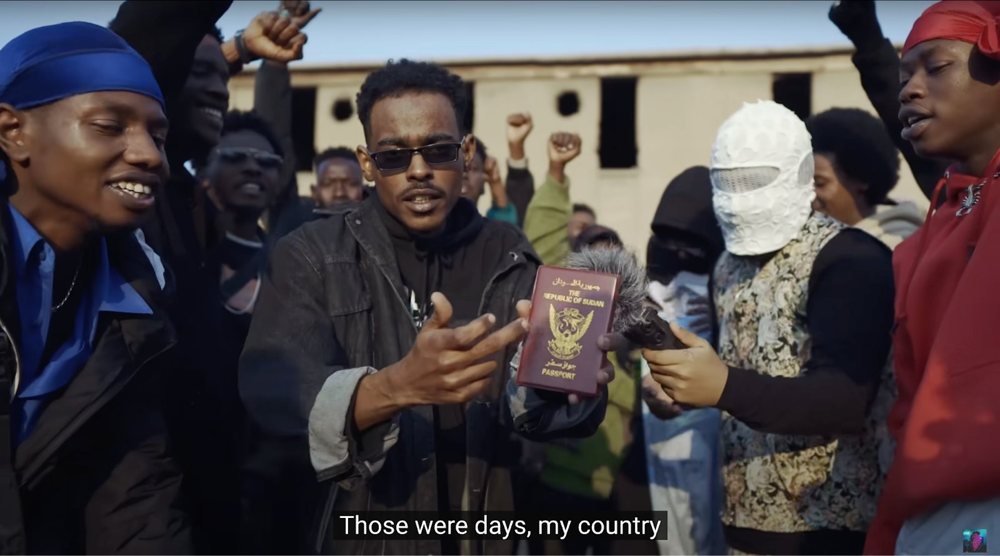
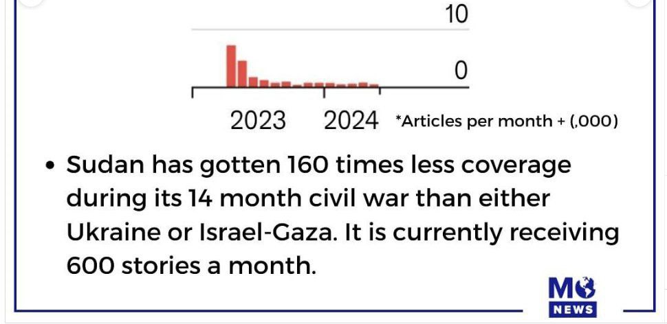
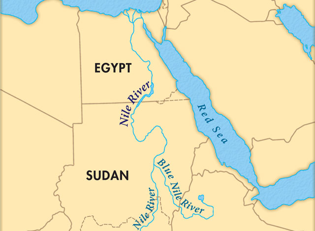
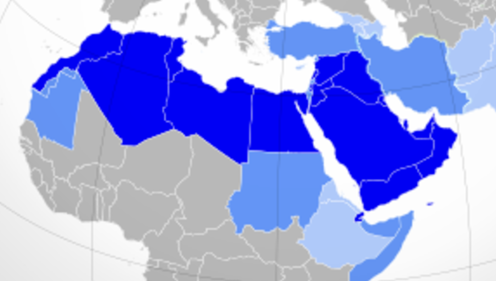
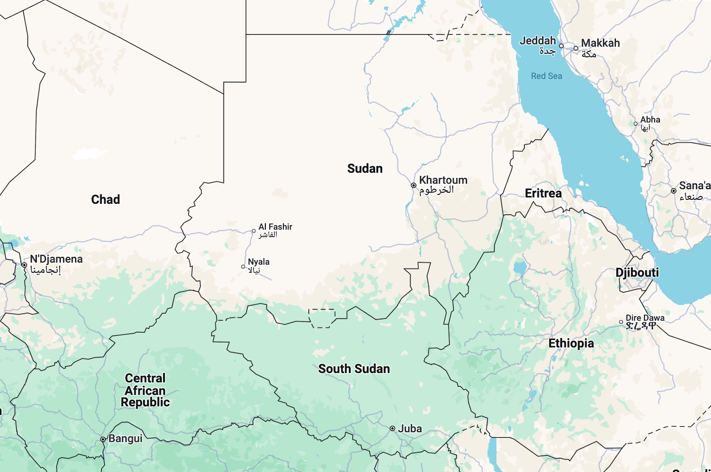
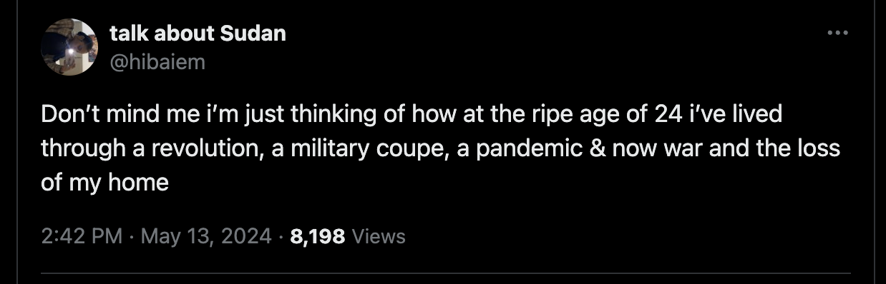
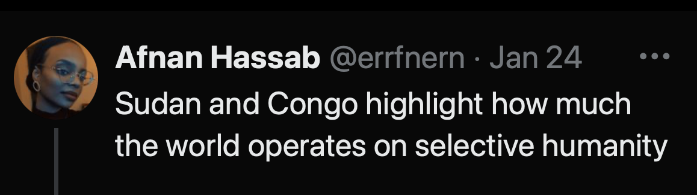

My friend enjoys the way I write about music, so every year, I write a blog post for his birthday. This time it turned out to be about more than just songs.

In January 2024, I visited Cairo as a tourist, saw the Egyptian pyramids and Tahrir square. Later, I came across a video from Cairo that was also posted that January but had a very different tone. An Egyptian YouTube channel called "Street Rap" had brought together artists from war-torn Sudan to shoot a [video](https://www.youtube.com/watch?v=zZq1L8lw5nM) featuring their songs.

One of the song titles, "Aza and Gaza", highlights how selective the world's attention is: one of those words was everywhere back then, while the other one was almost nowhere to be seen.

https://www.youtube.com/watch?v=Jyxj1mgVttU

"Aza" is an informal name of Sudan. In Arabic, it's written almost the same way as the Gaza strip: عزة (Aza) and غزة (Gaza). Both places share a border with Egypt, both have been war-torn since 2023 (though two conflicts are very different), and civilians from both regions flee to Cairo if they can. So it's no surprise they were both mentioned at the Cairo event.

But the world treated these two situations like opposites. One received all the attention. The other was almost entirely ignored, even though it's possibly the largest ongoing humanitarian crisis in the world.

Sudanese people are calling on the world to pay attention, using the hashtag #KeepEyesOnSudan. And for a while, I did just that. I also started listening to Sudanese music, which turned out to be quite interesting. Since so few people talk about that, I decided to write about it all: the music, the country, the current events, and the selective attention we all have.

Let's start from the very beginning. But first, a disclaimer: I'm no expert, I've never been to Sudan, I barely know any Arabic, so I'm pretty sure I got some things wrong.

---

## Part 1: History

What's the first thing to understand about Sudan? It's situated on the Nile, just like Egypt: the river flows through both countries.

It's well-known how important the Nile was for Ancient Egypt. The fertile soil allowed people to build a great civilization despite the surrounding desert. Thousands of years later, the Nile remains vital. Life in modern Egypt is still concentrated around the river (with few exceptions, like the Red Sea resorts), while the surrounding areas remain mostly lifeless desert.

The river is important for Sudan, too. Two rivers, actually: White Nile and Blue Nile merge together in Khartoum, Sudan's capital. That's why a prominent Sudanese music compilation is called «[Two Niles to Sing a Melody](https://rateyourmusic.com/release/comp/various-artists/two-niles-to-sing-a-melody-the-violins-and-synths-of-sudan/)».

The proximity to Egypt has played a role for thousands of years ago. Long before there was Sudan state, the Nubia region — where two countries now border each other — was home to ancient kingdoms lile Kerma and Kush. To these kingdoms, Ancient Egypt was both a rival and a partner. Nubia even has its own pyramids:

Later, during the Muslim conquests of North Africa, Arabization spread through Egypt into the lands of modern Sudan.

In 1899, when Egypt was a British colony, Sudan came under joint British-Egyptian rule. Though this era is gone, the country's official languages remain Arabic and English.

Sudan gained independence in 1956, and that means a lot to its citizens. Many Sudanese songs are patriotic. Here's one of the most well-known ones, "My Homeland" (""Ya watani",  "يا وطني"):

https://www.youtube.com/watch?v=2egwHLRKDsQ

This video is from «[The Sounds of Sudan](https://www.youtube.com/@TheSoundsofSudan)» YouTube channel — a treasure trove where someone uploads important Sudanese songs with English subtitles.

If we asked a random person, "What does Sudanese music sound like?" stereotypes might suggest "well, it's a relatively poor African country, so probably some folk songs accompanied by tamtams". And this video is the opposite: a full ensemble with a star singer, studio recording, European instruments, and performers in suits and ties.

Of course, Sudanese folk songs exist, too. But as I have learned recenly, 20th century saw the emergence of a rich music scene in Khartoum. It blended Sudanese motifs with classical music and jazz, creating a fusion of diverse traditions. The government sometimes supported the musicians, especially during the rule of Gaafar Nimeiry (1971-1985). That period, fondly remembered by many musicians, was the artistic pinnacle, when music became one of Sudan's largest exports, and international stars like Louis Armstrong performed at Sudanese festivals.

In addition to foreign influences, Sudan has plenty of its own. It's a very diverse country with plenty of regional cultures, like zagawa people with their own [songs](https://www.youtube.com/playlist?list=PLHZJjjmHEDrLz9sv7ATwjJDPs8vtLlzH-).

This diversity has lots of curious local details. I've barely scratched the surface, but here's a simple example. Massive Moon-shaped earrings called "Gamar Boba" ("The Glowing Moon", "القمر بوبا") are typical in Sudan, and one of the popular songs by Mohammed Wardi is inspired by them.

Wardi is arguably the most important person in Sudanese music history. Here's a story that I can't verify, but it reflects his status in Africa anyway: "Once a man from a village in Mali walked thousands of kilometers to Khartoum by foot. He explained that he wanted to marry, but the bride's father will only bless the union if he brought back Mohammad Wardi's autograph".

In "Gamar Boba", the protagonist praises his beloved in various ways. And the chorus states: "she's so delicate, even the Gamar Boba earrings are too heavy for her".

https://www.youtube.com/watch?v=9UGJfDszLdw

Most Sudanese songs are in Arabic, but the sound is different from the stereotypical "Arab music". This country is localed between central Africa and arabized North Africa. When people draw the borders of the Arab-Muslim MENA region, Sudan is sometimes included and sometimes not. So it's influenced both by MENA and central Africa.

These influences have evolved over time. Following the "music pinnacle" of 1970s, Sudan experienced an Islamist period during which music faced significant challenges.

"A woman on stage" was especially controversial, and female singers encountered great obstacles during the period. But historically Sudan has a long-standing tradition of women's music called "aghani albanat", performed at weddings and other social gatherings.

Nowadays the Sudanese-American singer Alsarah highlights this tradition in her music. In the description of one of her videos, she notes that "aghani albanat" gave Sudanese women a rare opportunity to express romantic feelings publicly. That led to a whole array of danceable songs with flirty lyrics. She says that male musicians of the time often dismissed this music as "artistically lacking" and didn't take it seriously. But she values that part of her culture and wants to preserve it, so she records those songs in modern studios. Here's one example: "Oh, my lover, come to me" ("Habibi Taal", " حبيبي تعال").

https://www.youtube.com/watch?v=LkVe0cyqHjo

More aghani albanat songs can be found in The Sounds of Sudan [playlist](https://www.youtube.com/playlist?list=PLHZJjjmHEDrIVkPrdCsaBxZWvduKOtZHD).

---

## Part 2: Sudan and South Sudan

Another significant chapter in Sudan's history is the separation of the country in two.

Historically, Sudan was the largest African country, a mosaic of regions, peoples and languages with complex interactions and internal conflicts. But all this diversity was also clearly "split in two". It's even visible on the map: one part is "desert", another one (which became a separate country) is "green".

This climatic difference led to a social one. Long time ago, people moving from Egypt reached more swampy areas of the South and stopped going further. As a result, the societies in the two regions turned out to be quite different.

The northern part became mostly Muslim and Arabized, much like Egypt. The southern part is mostly Christian and more dark-skinned. This split fueled civil wars between North and South, ultimately leading to the separation of South. That's how the youngest country on Earth, South Sudan, was created in 2011.

Music of Sudan and South Sudan also differs. Here's a song from Sudan, "The Lemon of Baara" ("ليمون بارا") by Abdel Gadir Salim:

https://www.youtube.com/watch?v=oZ4PIpGiDow

He was born in Kordofan province, where the town of Baara is known for its lemons. And the song compares the lover to such a beautiful lemon. The instruments and arrangement resemble other Sudanese songs mentioned earlier.

In contrast, South Sudanese musician Emmanuel Jal has a very different sound. His music videos may remind non-Africans of "Hakuna Matata" song: they are colourful, positive, exotic, danceable. In his songs, English (with a distinct accent) blends with African languages like Swahili.

https://www.youtube.com/watch?v=wvlmPNL2Kq4

But there's more to his music than dances. Emmanuel has a dramatic life story. As a child, he did not just witness the horrors of a civll war — he participated in it as a child soldier. Back then, he was eager to blindly hate everyone born in the North, just as people around him did.

But later a humanitarian worker showed him it's possible to see the world in a different way. Eventually he turned from a soldier into a peace activist, arguing that people should stop the bloodshed. And his songs are very pro-peace. He told his story as [a TED Talk](https://www.ted.com/talks/emmanuel_jal_the_music_of_a_war_child).

In 2005, a very unusual record was released. Abdel Gadir Salim and Emmanuel Jal, mentioned above, recorded a collaboration album "Ceasefire". So two singers from opposing worlds joined forces to advocate for peace.

This album blends together two different musical traditions. It received favorable reviews from outlets such as [Pitchfork](https://pitchfork.com/reviews/albums/4364-ceasefire/), and the "Baai" song was featured in the film "Blood Diamond" starring Leonardo DiCaprio. Here's a live performance of the song:

https://www.youtube.com/watch?v=ZOlmRlez6tY

These peacekeeping efforts could not prevent Sudan's eventual split in 2011. And right now, in January 2025, there's a curfew imposed in South Sudan because of new clashes between Sudanese and South Sudanese groups. Well, maybe we can say that at least a full-blown war between two nations has ceased?

---

## Part 3: The times of Al-Bashir

In 1989, a military coup brought Omar Al-Bashir to power, and he ruled Sudan for 30 years. His reign was so harsh that events in the Darfur region in 2003 are often described as "the first genocide of the 21st century".

In 2010s, during the Arab Spring, protests emerged in Sudan. Initially they were unsuccessful and sometimes met with violent crackdowns. That's reflected in a 2019 song "Madaniya, horreya, salam" ("مدنية حرية وسلام").

https://www.youtube.com/watch?v=HHIP-SLs-SQ

The words "horreya" ("freedom") and "salam" ("peace") are easy to translate, while "madaniya" is trickier: it's something akin to "civility". These three words together form a popular protest slogan of the times.

*This protest photo instantly became iconic*

Another 2019 song about the Al-Bashir rule is a track by several rappers who are of Sudanese origin but live abroad. Sudan has a large diaspora all over the world, so the label "Sudanese music" can often be applied to songs that were recorded outside of the country. And since this particular song was created by diaspora, it's a blend of Sudanese tradition with Western hip-hop.

https://www.youtube.com/watch?v=cY0LtpIch-A

The chorus is sung in Arabic, while the English verses include dirty punchlines ("you'll never see me coming, like lesbian porn") and reference American realities ("hashtags matter, black lives don't": lots of people use #BlackLivesMatter hashtag, but few care about black Sudanese lives).

Hip-hop tracks are often about rough life, some rappers even exaggerate their hardships to look more tough. Life in Sudan during Al-Bashir was more than rough, so this subject fits hip-hop. The lyrics are harsh, and it may seem like all of its artists are aggressive persons. But listening to other songs by one of the participants, Aidyproof, shows how different his attitude is. Most of his music is chill, he loves Bob Marley. Here's one of his tracks, which may be summarized as, "there's a lot of struggle, but I wish you all the best":

https://www.youtube.com/watch?v=09kCQSbtsZ8

Aidyproof not only creates his own music, but also helps the whole diaspora by releasing compilations like "[A 249 Experience](https://soundcloud.com/smallaxeinc/sets/a-249-experience-vol1)". The number 249 is the phone code of Sudan, and it's holds symbolic meaning for Sudanese people. If you see someone online with the username ending in 249, the person is probably Sudanese (and if the username ends in 239, it's probably a Russian who studied at Physics and Mathematics Lyceum No. 239, but that's another story.)

---

## Part 4: Current situation

In the end, protests succeeded in ousting Omar Al-Bashir. But Sudan's civil society was soon overshadowed by other forces.

Al-Bashir had two armies, Sudanese Armed Forces (SAF) and Rapid Support Forces (RSF). After his fall, two generals leading those armies turned against each other. In the Spring of 2023, they rivalry escalated into a full-scale war, a conflict that continues to devastate Sudan to this day.

If I understand correctly, the current situation may be the worst on the planet for civilians:

- 25 million people face hunger
- 9 million people have fled their homes
- There's almost no jobs or money
- There's little humanitarian aid
- It's hard for the aid to get inside the country
- It's hard for people to get out of the country
- Even if you manage to escape it, being a refugee in Africa is a challenge
- Soldiers of both armies sometimes do horrific things to civilians
- Most Sudanese think there's no "good army" (only "bad and worse"), so there is no "good scenario" to hope for (just a "less bad" one)
- And the world doesn't care, so there's nowhere to get help from

Sudanese-American rapper Bas is mostly known for carefree upbeat music. And he became successful in US, his hit song "[Tribe](https://www.youtube.com/watch?v=OA8aw07dpg0)" has more than 80 million views on YouTube. But his relatives were still in Sudan when the war broke out. And he wrote a song "Khartoum" with much darker verses than his usual style.

https://www.youtube.com/watch?v=IBtB4pn3XZQ

In "Khartoum", he describes the horrors unfolding in Sudan and criticizes the world: why do other conflicts get covered in the media, and this one doesn't?

This sentiment is echoed by many Sudanese people. They describe the situation all over the social media in eloquent English, it's open to the whole world, but almost no one reads it. Meanwhile, things like celebrity gossip get thousands of times more views. It feels like screaming into the void.

World attention matters because it can possibly change the situation. There's gold in Sudan, and foreign countries are reportedly funding SAF and RSF to gain access to it. According to many Sudanese people (and a Foreign Policy [article](https://foreignpolicy.com/2024/08/29/sudan-war-rsf-saf-uae-arms-hemeti-burhan/)), the UAE is the primary funder. Some argue the conflict could end if the UAE stopped its involvement.

Because of that, some Sudanese activists are calling for international pressure on the UAE: advocating for sanctions, boycotts, and public shaming of those who travels to Dubai (I've been there, so by that standard I'm complicit, too). Not everyone holds the same view, though: a Sudanese singer Nancy Ajaj flew to Dubai herself to [hold](https://www.youtube.com/watch?v=TdbECL9oYa0) a concert "Let's sing for Sudan".

I'm no expert, so I'm not sure what the best course of action for the international community would be. But at the very least I'd like to see a public discussion about that, where experts better than me are heard. The world not only lacks action on Sudan but even meaningful dialogue about it. And without that, how can right actions be taken?

Here's another song of this war, with a chorus that might sound familiar:

https://www.youtube.com/watch?v=Lx3RM6UtxKM

In the start of this post I've shared an old song "My homeland". And here we can hear the same chorus, translating to "Those were the days, my country / Just like the dreams, my country".

Decades and generations have passed since that original song, but the sentiment remains. Sudanese keep praising the country where many of them endure an insane amount of suffering and are often forced to flee. I'm reminded of a Reddit thread for people in the MENA region, where someone asked "What do you feel about your country?" The top responce was something like this: "I'm willing to give my life for it, but at the same time, I want to leave it desperately."

"My Homeland" has one more modern reinterpretation. The Cairo video with Sudanese rappers, which I mentioned at the very beginning, has young artist Hyper249 performing his hip-hop song. The verses are very critical of Sudan's elites, and when he gets to the classical chorus, everyone happily sings "Those were the days, my country".

https://www.youtube.com/watch?v=yAbMYLPdyKI

---

What conclusions can we draw from that?

Of course, I can't solve global problems by writing a blog post. I have no idea how to change the humanity for the better and stop the wars. But I do have a more specific thought.

Our attention tends to follow the news cycle. When a tragedy like an earthquake dominates the headlines, we feel empathy, discuss the events, and sometimes even donate.

So we spend our limited psychological and financial resources on the most hyped situations.

But sometimes it feels more reasonable for me to do the opposite: spend the resources on the "anti-hype" stories. On the situations when someone is struggling, and no one even notices that.

In highly publicized tragedies, victims receive empathy and donations from lots of people, and my participation won't change much for them. But when people feel they are screaming into the void, even small things can mean a great deal. One of the things they want is just to be noticed.

That's one of the reasons I chose this "anti-hype" topic for my yearly music post. I have no idea how to fix the situation in Sudan. The only thing I know in life is how to put words together. But I see that sometimes even the words matter.

The last song in this post is a non-Sudanese one that comes to my mind: "Not Alone" by The Indelicates. It seems fitting for all the situations when you see people in horrific obstacles, and you can't fix the situation, and you can't even offer no hope, but you want them to know that at least they are seen. Several times in my life I've sent this song to someone struggling, maybe it'll be of use for you too.

https://www.youtube.com/watch?v=_6NWGkRvMck

> And the dark, the dark is calling  
> And the well, the well is deep  
> And the walls, the walls are jagged  
> And the angle is too steep

> And I have no ladder  
> And I have no rope  
> I can’t see where the sun is rising  
> I can offer no hope

> But I see you  
> Yeah I see you  
> Yes I see you  
> And you’re not alone

Finally, here are some threads by Sudanese people on Twitter:

- [Explaning Sudan war](https://x.com/missinchident/status/1735888234167537845?s=20)
- [How to help Sudan](https://x.com/Kandakat_alhqq/status/1761816806866506193)
- And this thread that resonates with me, because I see the same pattern over and over again all around the planet: people often can be both hurt and hurtful, stuck in a cycle of pain and violence.

*This post was originally written* [*in Russian*](https://telegra.ph/sudan-12-13-3)*.* *If you have any feedback (a correction, a question, whatsoever), you can reach me* [*via Telegram*](https://t.me/expectfun)*.*
