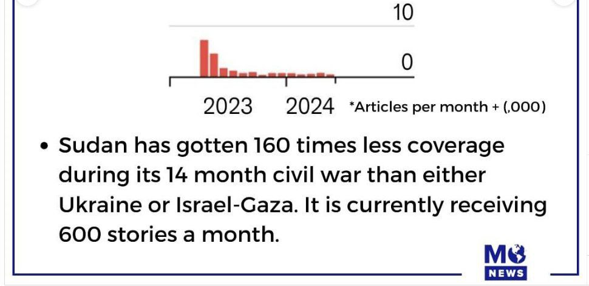
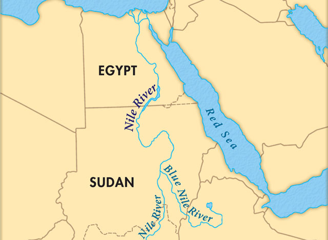
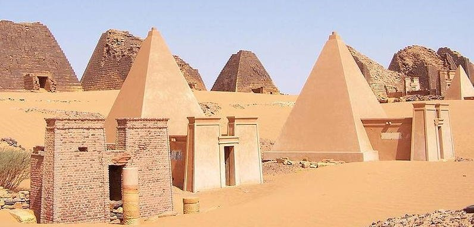
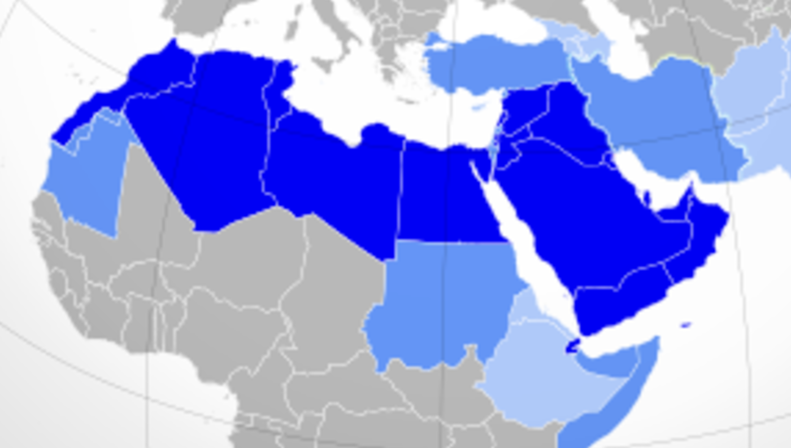
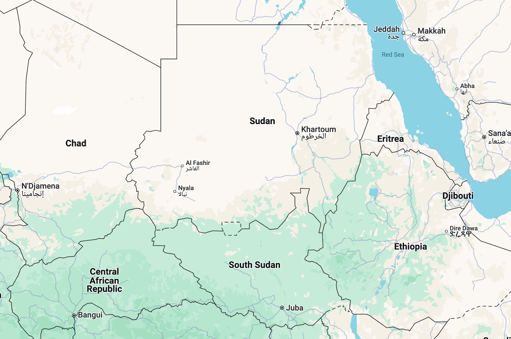
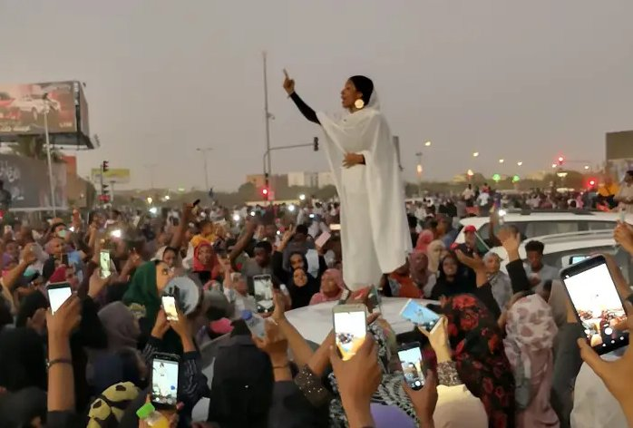
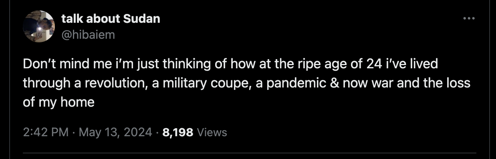
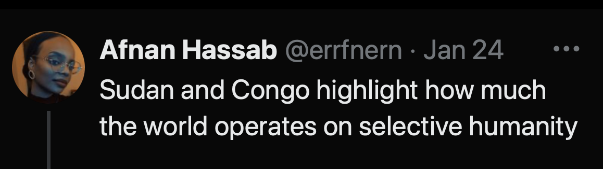
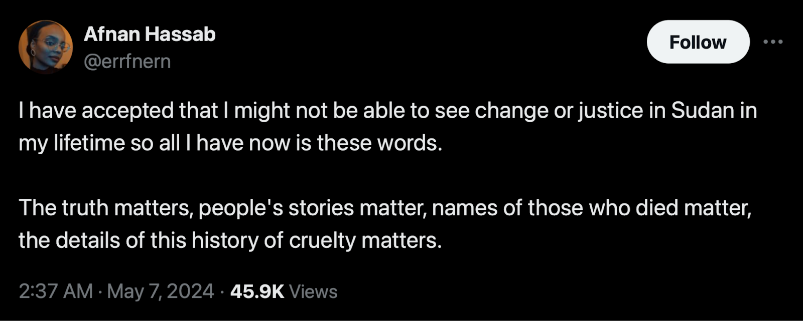
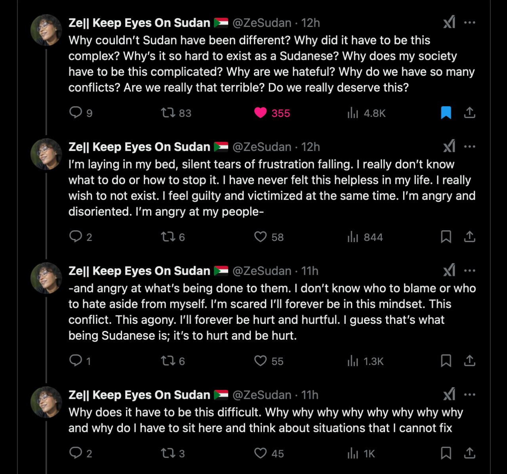

Привет, Саша. Традиционный «деньрожденный музыкальный текст» опять получился, помимо музыки, ещё и о мрачных событиях. Но часть песен жизнеутверждающая, так что надеюсь, что после него не захочется повеситься!

Год назад на новогодних праздниках я впервые побывал в Каире, увидел египетские пирамиды и площадь Тахрир. А позже обнаружил, что в том же январе каирский ютуб-канал «Уличный рэп» собрал вместе выходцев из разодранного войной Судана и выпустил [видео](https://www.youtube.com/watch?v=zZq1L8lw5nM) с их песнями. И по названию одной из них, «Аза и Газа», хорошо заметно, насколько неравномерно в мире обращают внимание на разные события: одно из этих слов в последний год звучало почти везде, а другое почти нигде.

https://www.youtube.com/watch?v=Jyxj1mgVttU

«Аза» — это сленговое название Судана. В арабском написании оно всего лишь одной точкой отличается от названия сектора Газа: عزة и غزة. Оба этих места граничат с Египтом, в обоих с 2023-го воюют (хотя и при очень разных обстоятельствах), из обоих люди при возможности бегут в Каир. Неудивительно, что на каирском мероприятии прозвучала песня, где эти названия оказались срифмованы.

Но вот мир на эти две ситуации реагировал противоположным образом: одной уделил максимум внимания, а другой минимум. Хотя вторая, возможно, является самым масштабным гуманитарным кризисом из всего происходящего сейчас на планете.

При этом сами суданцы просят всех обратить внимание и ставят хэштег #KeepEyesOnSudan. Ну, я и обратил. Заодно вслушался в суданскую музыку, а она оказалась интересной. И раз почти никто не пишет про всё это — напишу тогда я.

Пойдём с самого начала. Дисклеймер: я не эксперт, никогда не был в Судане, почти не знаю арабского, наверняка что-то понимаю неправильно.

---

## Часть 1: Предыстория

Что стоит понять о Судане для начала? Они с Египтом «соседи по Нилу»: река протекает через обе этих страны.

Хорошо известно, насколько важен был Нил для Древнего Египта, когда его разливы с плодородным илом позволили людям жить посреди пустыни и создать масштабную цивилизацию. Спустя тысячи лет он остаётся важен: жизнь в современном Египте по-прежнему сосредоточена вдоль его русла (за отдельными исключениями вроде курортов на Красном море), а вокруг по-прежнему почти безжизненная пустыня.

И для Судана река тоже важна. Даже две реки: суданская столица Хартум расположена в месте, где в основной «Белый Нил» впадает приток Голубой Нил. Поэтому, например, хороший сборник суданской музыки называется «[Two Niles to Sing a Melody](https://rateyourmusic.com/release/comp/various-artists/two-niles-to-sing-a-melody-the-violins-and-synths-of-sudan/)».

В этих местах соседство с Египтом давало о себе знать ещё тысячи лет назад, когда никакого государства Судан ещё не было. В регионе Нубия, где сегодня две страны граничат, тогда возникали различные царства (сначала Керма, затем Куш), для которых Древний Египет оказывался и соперником, и партнёром, и культурным влиянием. В Нубии даже появились свои пирамиды:

Гораздо позже, когда происходили мусульманские завоевания Северной Африки, арабизация через Египет добралась и до территории нынешнего Судана.

В 1899 году, когда Египет был британской колонией, в Судане установилось совместное британско-египетское правление. Сейчас его уже нет, но государственными языками остались арабский и английский.

А в 1956-м Судан получил независимость — и для его жителей это очень важно. Среди суданских песен много патриотических. Вот одна из самых известных, «Моя родина» («Йа уотани», "يا وطني"):

https://www.youtube.com/watch?v=2egwHLRKDsQ

Видео с YouTube-канала «[The Sounds of Sudan](https://www.youtube.com/@TheSoundsofSudan)» — настоящей сокровищницы, где кто-то заботливо проставил важным суданским песням перевод на английский и пояснения в описаниях. Не знаю, как у тебя сейчас работает YouTube, но вряд ли кто-то выложит всё это на VK Видео, так что альтернатив тут особо нет.

По-моему, интересно вот что. Если спросить случайного человека «как звучит музыка Судана», стереотипы могут подсказывать «ну это небогатая африканская страна — наверное, там народные песни под тамтам». А тут всё наоборот: большой ансамбль, привычные нам инструменты, студийная запись, костюмы с галстуками, солист-звезда.

Народные песни, конечно, тоже есть. Но, как я сам узнал только теперь, в XX веке в Хартуме возникла масштабная музыкальная сцена, которая впитала и суданские мотивы, и мировую классику, и джаз, образовав сплав разных традиций. Власть порой благоволила музыкантам, особенно во времена Дафара Нимейри (с 1971 по 1985), которые теперь вспоминают с ностальгией. Это был период максимального творческого расцвета, когда музыка стала главным экспортом страны, а на местный фестиваль мог приехать Луи Армстронг.

Помимо влияний со стороны, внутри самого Судана смешивается много собственных. Это очень разношёрстная страна, где есть разные региональные культуры — вот, например, [песни народа загава](https://www.youtube.com/playlist?list=PLHZJjjmHEDrLz9sv7ATwjJDPs8vtLlzH-).

Во всём этом многообразии встречается множество интересных местных деталей. Я прошёлся по верхам и успел понять довольно мало, но вот просто для примера. В Судане распространены массивные серьги под названием «гамар боба» («القمر بوبا») , что значит «светящаяся луна», и одна из популярных песен связана с ними.

Её исполнитель Мохаммед Варди — вероятно, главный певец в истории Судана. История, которую не могу проверить, но которая иллюстрирует его статус в Африке: «Однажды в Хартум пришёл человек из деревни в Мали. Он сказал, что прошёл пешком тысячи километров, потому что хочет жениться, но отец невесты готов дать благословение только в случае, если он принесёт автограф Варди».

Песня называется как раз «Гамар боба». В тексте герой восхваляет возлюбленную на разные лады. И главный комплимент звучит так: она такая утончённая, что даже серьги «гамар боба» для неё слишком массивные.

https://www.youtube.com/watch?v=9UGJfDszLdw

Чаще всего в Судане поют на арабском языке, но песни заметно отличаются от того, что мы привыкли ассоциировать с «арабской музыкой».

Неудивительно, если учесть, что страна находится между центральной Африкой и арабизированной Северной Африкой. Когда очерчивают границы арабо-мусульманского региона MENA, Судан то включают, то нет. То есть с одной стороны тут влияет арабо-мусульманский мир, а с другой Африка, не имеющая отношения к этому миру.

Разные влияния менялись со временем. И после музыкального расцвета 70-х был период жёсткого исламизма с нападками на музыку.

«Женщина на сцене» тогда было особенно спорной ситуацией, певицы сталкивались с большими трудностями. Однако вдали от телекамер женская музыка, конечно, существовала. В Судане давно есть целая музыкальная традиция aghani albanat с «женскими песнями», исполнявшимися на свадьбах и других мероприятиях.

И теперь суданско-американская певица Alsarah («Аль-Сара») в описании клипа пишет, что эта традиция была редкой для женщин возможностью публично высказывать свои романтические желания. В результате возникли «флиртующие» танцевальные песни. По её словам, в те времена мужчины-музыканты смотрели свысока на эту «простецкую музыку». А она считает важным сохранить этот культурный пласт, поэтому записывает эти песни в современных студиях. Вот одна из них в её исполнении — «Любимый, приходи» («Хабиби таал», حبيبي تعال):

https://www.youtube.com/watch?v=LkVe0cyqHjo

Ещё несколько песен aghani albanat есть в [плейлисте](https://www.youtube.com/playlist?list=PLHZJjjmHEDrIVkPrdCsaBxZWvduKOtZHD) на том же YouTube-канале The Sounds of Sudan.

---

## Часть 2: Судан и Южный Судан

Отдельная история — то, как страна разделилась на две.

Исторически Судан был самой большой по площади страной в Африке, представляя собой громадное «лоскутное одеяло» из различных регионов, этносов и языков. Но в этом многообразии было и ощутимое разделение «пополам». Его хорошо видно даже по карте: одна часть «пустынная», другая (ставшая отдельной страной) — «зелёная».

Эта климатическая разница давно превратилась в социальную. Когда-то люди, продвигавшиеся со стороны Египта, доходили до более топких мест, увязали и не заходили дальше. А в итоге и общество в двух частях оказалось очень разным.

Северная «пустынная» часть — как и Египет, преимущественно мусульманская и арабизированная. Южная «зелёная» — преимущественно христианская и более темнокожая. Эта расколотость общества приводила к гражданским войнам между севером и югом, а впоследствии — к отделению юга. Так в 2011-м возникло самое молодое государство в мире Южный Судан.

Музыка Судана и Южного Судана тоже ощутимо различается. Вот песня суданского музыканта Абдель Гадира Салима «Лимон Баары» ("ليمون بارا"):

https://www.youtube.com/watch?v=oZ4PIpGiDow

Он родился в суданской провинции Кордофан, где есть город Баара, известный большими красивыми лимонами. И герой песни сравнивает возлюбленную с таким лимоном. Инструменты и аранжировка в ту же степь, что и у приведённых выше других певцов.

Совсем иначе звучит южносуданский музыкант Эммануэль Джал. Отчасти его клипы — это такая Африка, какой её представляют по диснеевской песне «Акуна матата»: разноцветная, оптимистичная, экзотичная, танцевальная. В его песнях английский (с сильным акцентом) встречается с африканскими языками вроде суахили.

https://www.youtube.com/watch?v=wvlmPNL2Kq4

Но тут важны не только экзотика и танцевальность. Эммануэль — человек сложной судьбы. Его детство происходило на фоне гражданской войны, и он сам ещё ребёнком оказался в армии, сражавшейся на стороне южных суданцев против северных. Тогда он вместе с окружающими слепо ненавидел сразу «всех этих ужасных северян».

Но позже благодаря гуманитарной работнице он обнаружил, что можно смотреть на мир иначе. И в итоге из солдата превратился в мирного активиста, выступающего за жизнь без кровопролития. Теперь этому посвящены и многие из его песен. Свою историю он озвучивал [в формате TED Talk](https://www.ted.com/talks/emmanuel_jal_the_music_of_a_war_child).

А в 2005 году вышел очень необычный альбом. Абдель Гадир Салим и Эммануэль Джал, которых я привёл выше, объединили усилия для выпуска совместной записи «Ceasefire» с песнями обоих. То есть два музыканта из враждующих миров сошлись вместе, чтобы совместным творчеством призвать к миру.

Альбом интересно звучит: там сошлись не просто два человека с очень разными бэкграундами, а ещё и две разных музыкальных традиции. На него публиковали хвалебную [рецензию](https://pitchfork.com/reviews/albums/4364-ceasefire/) в Pitchfork, а песня «Baai» попала в фильм «Кровавый алмаз» с Ди Каприо.

А вот как выглядело живое исполнение этой песни:

https://www.youtube.com/watch?v=ZOlmRlez6tY

Эти миротворческие усилия не удержали две части Судана от разделения в 2011-м — но разделение хотя бы предполагалось без дальнейшего кровопролития.

---

## Часть 3: времена Аль-Башира

В 1989-м произошёл военный переворот, и власть на 30 лет занял Омар аль-Башир. Степень жёсткости его правления: реакция на повстанцев в регионе Дарфур в 2003-м была такой, что зачастую её классифицируют как «первый геноцид XXI века».

В 2010-х на волне «Арабской весны» протесты возникли и в Судане, поначалу безуспешные, и при их подавлении некоторые протестующие погибали. Этому посвящена песня 2019 года «Мадания, хоррея, салам» («مدنية حرية وسلام»):

https://www.youtube.com/watch?v=HHIP-SLs-SQ

Слова «хоррея» («свобода») и «салам» («мир») переводятся легко, а вот с «мадания» хитрее: насколько понимаю, у этого понятия нет строгого соответствия в русском, но оно означает что-то вроде «цивилизованность». Вместе эти три слова образуют популярный протестный слоган тех времён, с которым выходили на улицы.

*Фотография, ставшая символом тех протестов*

У Судана большая диаспора по всему миру, так что суданской музыкой можно назвать не только ту, которая появляется непосредственно в стране. Пример зарубежной — совместный трек нескольких рэперов суданского происхождения, также посвящённый ситуации с Аль-Баширом:

https://www.youtube.com/watch?v=cY0LtpIch-A

Поскольку песня сделана диаспорой, снова получается сплав разных культур: в этот раз суданской и западного хип-хопа. Припев певучий на арабском, а вот в куплетах на английском есть и грязные панчи («you'll never see me coming, like lesbian porn»), и обыгрывание американских реалий («hashtags matter, black lives don't»: мол, все охотно ставят хэштег #BlackLivesMatter, но жизни чернокожих людей в Судане никого не волнуют).

Многие рэперы бахвалятся «я с жёстких улиц», когда на самом деле выросли в благополучных условиях. А вот здесь текст о по-настоящему жестоких улицах, и хип-хоп как форма хорошо этому соответствует. Из-за жёсткости песни может показаться «какие эти исполнители агрессивные». Но если послушать другие песни одного из участников, Aidyproof, они чуть ли не противоположны по настрою: его творчество очень чилльное, он поклонник Боба Марли. Вот песня с посылом «сколько же боли у всех, но я желаю тебе самого лучшего»:

https://www.youtube.com/watch?v=09kCQSbtsZ8

Aidyproof не только записывает собственные песни, но и помогает всей суданской диаспоре, выпуская сборники «[A 249 Experience](https://soundcloud.com/smallaxeinc/sets/a-249-experience-vol1)». Число из названия — телефонный код страны, ставший для суданцев символом. Если у кого-то в интернете юзернейм заканчивается на «239», обычно это петербуржец, учившийся в физико-математическом лицее 239, а если на «249» — обычно это суданец.

---

## Часть 4: текущее положение дел

В итоге протестующим всё же удалось добиться ухода Аль-Башира. Однако гражданское общество вскоре оказалось сметено другими силами.

Поскольку диктатора всегда может предать армия, у Аль-Башира их было сразу две. После его ухода два генерала, возглавляющие эти армии, начали конкурировать за власть. И весной 2023-го они развязали полномасштабную войну друг с другом, которая идёт до сих пор.

Если правильно всё понимаю, то для мирных жителей возникла худшая ситуация на планете:

- 25 миллионов голодают
- 9 миллионов вынужденно покинули дома
- работы и денег почти нет
- гуманитарной помощи мало и ей сложно попасть внутрь страны
- а людям сложно выбраться из страны наружу
- если и выберешься, быть беженцем в Африке — отдельное испытание
- солдаты обеих армий порой чудовищно поступают с гражданскими
- по мнению большинства суданцев, обе армии «плохие» (разве что одна «ещё хуже»), так что нет даже надежды на «хороший исход» (только на «менее плохой»)
- а миру наплевать на происходящее, помощи ждать неоткуда

Рэпер суданского происхождения Bas, живущий в США, обычно исполняет беззаботную музыку и пришёл с ней к успеху: у его песни с Джей Коулом «[Tribe](https://www.youtube.com/watch?v=OA8aw07dpg0)» больше 80 миллионов просмотров. Но его родственники оставались в Судане, и в 2023-м он записал песню «Khartoum», где куплеты куда мрачнее.

https://www.youtube.com/watch?v=IBtB4pn3XZQ

В них не только описывается происходящее в стране, но и звучат упрёки миру: «Почему другие конфликты в медиа показывают, а нас нет?»

Это его ощущение разделяют многие суданцы. Они подробно описывают в интернете происходящее на хорошем английском, но их почти никто не читает, пока в соседнем треде в сто раз активнее обсуждают мелочи из других стран. Это ощущается криком в пустоту.

При этом, если бы мировое сообщество обратило внимание, гипотетически оно могло бы изменить ситуацию. Из-за добычи суданского золота обе армии получают помощь от государств, стремящихся извлечь выгоду из происходящего. По мнению многих суданцев (и автора [статьи](https://foreignpolicy.com/2024/08/29/sudan-war-rsf-saf-uae-arms-hemeti-burhan/) в издании Foreign Policy), наибольшую роль играют ОАЭ, и без их участия война бы уже могла закончиться.

Поэтому часть суданцев призывает давить на ОАЭ: угрожать санкциями, бойкотировать страну, стыдить всех летающих в Дубай. Впрочем, есть и другие взгляды: суданская певица Нэнси Агаг, напротив, сама полетела в Дубай и [провела](https://www.youtube.com/watch?v=TdbECL9oYa0) там концерт «Споём для Судана».

Я недостаточно эксперт, чтобы уверенно сказать, какими действиями мир мог бы изменить ситуацию. Но скажу так: хотел бы видеть в мире хотя бы заметную общественную дискуссию, где об этом громко высказывались бы эксперты лучше меня. И проблему вижу в том, что отсутствуют не только действия, а даже дискуссия о них.

Вот ещё одна песня этой войны, исполнительница сейчас вроде бы тоже в Дубае:

https://www.youtube.com/watch?v=Lx3RM6UtxKM

В начале текста я приводил старую песню «Моя родина». И здесь снова использован её припев: «Ох, были дни, страна моя / Они как сны, страна моя».

Спустя десятилетия и поколения суданцы снова воспевают страну, в которой претерпевают какое-то запредельное количество боли и из которой зачастую вынужденно уезжают. Вспоминается, как на Reddit в сообществе региона MENA спросили «что вы чувствуете к своей стране». Больше всего плюсов набрал такой комментарий: «Я одновременно готов отдать за неё свою жизнь и хочу поскорее из неё свалить».

У песни «Моя родина» есть ещё одно современное переосмысление. На той видеозаписи с суданскими рэперами, которую сделали в Каире, молодой рэпер Hyper249 исполнил свою хип-хоп-версию. В куплетах он напрямую посылает элиты, а затем доходит до «классического» припева и все радостно подпевают «Ох, были дни, страна моя». В конце достаёт из широких штанин суданский паспорт.

https://www.youtube.com/watch?v=yAbMYLPdyKI

---

Какие выводы можно сделать?

Конечно, глобально ничего тут текстом разрулить не могу. Понятия не имею, как человечеству научиться жить иначе и остановить войны. Но возникла другая мысль, не только про Судан.

Наше внимание по умолчанию следует за инфополем. Когда происходит резонансная трагедия вроде «произошло ужасное землетрясение» и о ней говорит весь мир, мы сочувствуем жертвам, иногда пишем о произошедшем, иногда даже донатим.

То есть мы тратим свои ограниченные моральные и материальные ресурсы на самые «хайповые» ситуации.

А сейчас ощущаю для себя лично, что в некоторых случаях логично делать наоборот: тратить его на «антихайповые». На те, где кому-то плохо, а никто этого не замечает.

Потому что в резонансных случаях, где жертвы получают сочувствие и донаты от многих людей сразу, конкретно от моего внимания для них уже мало что изменится. А вот когда у людей ощущение, что они кричат в пустоту, для них начинают играть большую роль даже мелочи. В числе прочего им важно попросту быть замеченными.

Поэтому последняя песня в этом посте — не суданская, а посвящённая как раз таким ситуациям: когда видишь кого-то в адских условиях, не можешь их исправить, не видишь даже поводов обнадёжить, но можешь хотя бы сказать «я вижу». Раньше в отдельных случаях уже вспоминал эту песню и отправлял кому-то.

https://www.youtube.com/watch?v=_6NWGkRvMck

> And the dark, the dark is calling  
> And the well, the well is deep  
> And the walls, the walls are jagged  
> And the angle is too steep

> And I have no ladder  
> And I have no rope  
> I can’t see where the sun is rising  
> I can offer no hope

> But I see you  
> Yeah I see you  
> Yes I see you  
> And you’re not alone

Отчасти из таких соображений и выбрал в этом году для поста антихайповую тему. Мало что в жизни умею, кроме складывания слов в предложения, но тут людям бывают важны даже слова. Попробовал перевести их [на английский](https://telegra.ph/sudan-01-25), чтобы могли прочесть и сами суданцы — вдруг кому-то немного поможет.

*Напоследок ссылки на треды от суданцев:*

- *«[Объясняю суданскую войну](https://x.com/missinchident/status/1735888234167537845?s=20)»*
- *«[Чем можно помочь Судану](https://x.com/Kandakat_alhqq/status/1761816806866506193)»*
- И тред, который считаю важным, причём применимым далеко не только к Судану:

