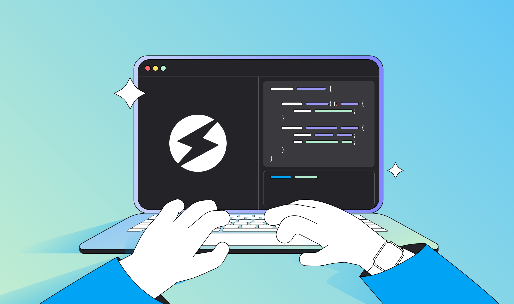
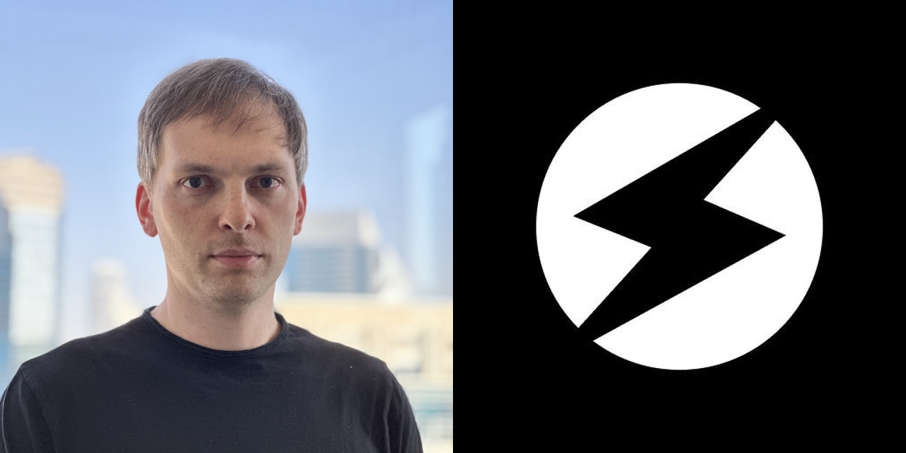
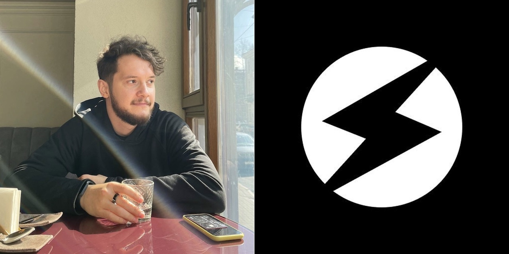

В экосистеме TON недавно произошло несколько важных событий, связанных с языком [Tact](https://tact-lang.org):

* Вышел Tact 1.0: компилятор получил базовый набор возможностей, при котором на Tact можно полагаться как на полноценный язык. Стоит отметить, что компилятор всё ещё проходит ревью и аудиты безопасности.

* Появился Tact Software Foundation. Это сообщество не входит в TON Foundation, но TON Foundation его поддерживает и направляет. Tact Software Foundation управляют четыре основателя, очень активных в сообществе TON: **Олег Андреев**, **Стив Коршаков**, **Таль Коль** и **Кирилл Емельяненко**. Есть и два советника: **Кирилл Малев** и **Любовь Шомбина**.

* Возникли новые проекты в экосистеме, например сайт [Tact by Example](https://tact-by-example.org), который сделал Таль Коль.

Так что Tact вышел на новый уровень зрелости, и многим разработчикам в экосистеме TON пора к нему присмотреться.

Но зачем TON понадобился ещё один язык, если есть FunC и Fift? С чего всё началось? И как дошло до нынешнего состояния? Чтобы ответить на это, я обратился к нескольким ключевым людям, причастным к Tact, и они рассказали, как это видели они.

## Олег Андреев

_В сообществе TON Олег известен прежде всего работой над Tonkeeper, но занимается не только им: среди прочего, он первым возглавил разработку Tact._

Когда я только пришёл в экосистему TON, я начал писать на FunC, и иногда мне казалось, что он не очень подходит для задачи. Мне не хватало каких-то возможностей и абстракций. Я обратился к Кириллу Емельяненко из core-команды TON. Он сказал, что новый язык в помощь разработчикам может быть хорошей идеей. И даже сказал, что называться он должен Tact.

Название Tact означает «TON Actors», то есть модель акторов, на которой построен TON. Эта асинхронная модель немного хаотична, в ней могут возникать вещи вроде состояний гонки, так что работая с ней, нужно очень хорошо всё проектировать. TON — мощная технология, но чтобы использовать всю эту мощь, разработчику нужны абстракции поверх TON. Так что идея Tact (как и некоторых других вещей, например TON API) была в том, чтобы высвободить эту мощь TON и сделать её полезнее для людей.

Я начал работать над этим с двумя другими разработчиками, опытными в дизайне языков программирования: Cxmog и Дмитрием Полуниным. На первом этапе у нас были идеи, но не было цельного видения Tact. Так что это был итеративный R&D-процесс. Мы пробовали разное, изучали, как работает TVM, особенности TON и что стоит спрятать от разработчиков. Мы сделали сайт, показывающий возможности Tact, и многие говорили, что такой инструмент нужен.

Нам понадобилось несколько месяцев, чтобы понять кое-что о том, как вообще надо писать смарт-контракты на TON. В начале TON их в основном писали классическим способом, как в Ethereum. Но уникальность TON в том, что он толком не даёт разработчику работать с массивами. Все языки программирования и компьютеры устроены так, чтобы эффективно перебирать данные — лежат ли они в словарях, массивах, базах данных или векторах. А TON говорит: «Эй, не используйте массивы». Циклы есть, но они толком не масштабируются. Создание базы данных открывает вектор для DoS-атаки.

Так как с этим быть и создавать сложные системы, которым нужны списки? Например, если есть DAO и в нём много участников, как их хранить? Я думаю, что вместо списков в контрактах нужно делать по контракту на каждого участника. И вот тут с FunC становится сложно. Здесь-то Tact и должен облегчить разработчику жизнь и сделать создание таких сложных систем удобным.

У нас была эта идея, и мы начали её исследовать. Но цельного видения Tact у нас всё ещё не было: оставались другие вопросы и нерешённые проблемы. И в какой-то момент проект поставили на паузу, пока мы не поймём лучше, что с ними делать.

Тут на сцену выходит Стив Коршаков. В конце 2022 года он ушёл из TON Whales, так что у него было достаточно свободного времени, и он хотел что-то сделать с Tact. Мы поговорили, я объяснил своё видение Tact, и он взялся за работу.

Он переписал язык почти с нуля, так что сегодняшний Tact сильно отличается от того, над которым работал я. Но прогресс очевиден. И даже в некоторых случаях, когда я сначала был не согласен со Стивом, после подробных технических обсуждений я приходил к выводу, что его видение оригинально и разумно и решает проблему. Я по-прежнему участвую в Tact в роли своего рода советника: руками я больше не работаю, но обсуждаю со Стивом развитие языка и могу что-то предложить. Так что я вполне доволен тем, как всё сложилось.

## Стив Коршаков

_Стив стал известен в сообществе TON как сооснователь TON Whales, а сейчас он разрабатывает Tact._

В экосистему TON я пришёл сначала как сооснователь TON Whales. И я часто слышал о Tact как о «том языке, который решит наши сегодняшние проблемы». Разрабатывая на TON в Whales, я сам столкнулся со множеством проблем. Обновлять контракт, на котором лежат миллионы, было страшно. Приходилось выделять полдня, чтобы убедиться, что я ничего не сломаю и не заблокирую все эти деньги. И я надеялся, что Tact всё это упростит, но он всё никак не выходил.

В конце 2022 года я продал свою долю в Whales и стал думать, чем заняться дальше. Раньше я делал стартапы, но у меня всегда был бизнес-сооснователь, а тут я действовал один. Что может сделать инженер-одиночка? Написать что-то полезное. Я заметил, что разработка Tact тогда не шла активно, и подумал, что было бы здорово этим заняться.

Я связался с Олегом, и мы обсудили, как мне действовать. Я узнал видение Олега и увидел, что успела сделать его команда. Но моё видение несколько отличается и опирается на то, что я понял, работая с TON в Whales.

В основном я вижу Tact прагматичным языком. Те, кто создаёт новые языки программирования, иногда строят «воздушные замки». У них большое видение, куча идей, и языки могут получиться красивыми, но редко используются для настоящей работы. Tact, наоборот, весь про реальные нужды разработчиков.

Этот подход похож на язык Kotlin от JetBrains. Это отличный язык, но прежде всего это язык, чтобы делать настоящие вещи в реальном мире; он не просто хорош ради того, чтобы быть хорошим. В нём нет культа вроде «мы занимаемся только чистым функциональным программированием» или «мы используем только табы». Я раньше работал в JetBrains — не над самим Kotlin, но имел дело с его компилятором в TS. Мне нравится их подход с Kotlin, и я стараюсь сделать что-то похожее для экосистемы TON.

Поэтому многое в Tact сделано очень просто и прямолинейно. Иногда люди смотрят на код компилятора Tact и говорят мне: «О, он выглядит гораздо проще, чем я ожидал». Но в этом и смысл: я не хочу, чтобы он был слишком сложным. Он нужен, чтобы писать смарт-контракты, а они сравнительно простые: строк кода в них гораздо меньше, чем, скажем, в мессенджере вроде Telegram. Так что язык для смарт-контрактов может быть гораздо проще языка для вещей вроде мессенджеров.

И поэтому же Tact вышел так быстро после того, как я за него взялся, за считанные месяцы. Над ним легко было бы работать годами. Но если выпустить рано и потом итерировать, язык может помогать людям решать их проблемы сегодня, а не когда-нибудь в будущем.

Сейчас над самим языком я работаю в основном один, но другие люди помогают с другими вещами в экосистеме. Например, Таль Коль, который сделал [Tact by Example](https://tact-by-example.org): он отчасти вдохновлён «Solidity by Example», но и добавляет многое сверх того. Этот сайт меня очень впечатляет, я бы так хорошо не сделал.

## Таль Коль

_Таль делает для сообщества TON массу всего: сайты, туториалы, посты в блогах и многое другое. Неудивительно, что он создал целый сайт, помогающий изучать Tact. Вопрос только в том, когда он спит?_

Когда Олег начал работать над Tact, я услышал об этом и о его видении модели акторов. И должен сказать, что поначалу я не очень понял.

Я думал, что проблему FunC можно решить более сильной стандартной библиотекой. FunC — очень низкоуровневый язык: например, разбирая сообщения, нужно знать, какой бит отвечает за bounce (или за что-то ещё). И я думал, что можно сделать библиотеку, которая абстрагирует внутренности и даёт разработчикам на FunC API более высокого уровня. И я не был уверен, что создание нового языка стоит всех этих усилий.

Пока Олег и его команда работали над Tact, я на него особо не смотрел, потому что у них не было публичной версии, готовой для всех. Я начал вникать в Tact, только когда за него взялся Стив. И должен сказать, как только я увидел кое-что из того, что там происходит, я убедился, что такой язык нам нужен.

Думаю, лучший пример того, чем Tact важен для меня, — контракт мультиподписи. Мультиподпись очень важна, потому что если у вас есть казна, лучше, чтобы ею владел не один человек. Такой контракт реализован на FunC, но он довольно сложный. И когда я обсуждал с TON Foundation перевод выплат грантов на мультиподпись, из-за этой сложности мы двигались очень медленно.

Когда я посмотрел, как Стив [реализовал](https://github.com/tact-lang/tact/blob/main/examples/multisig.tact) контракт мультиподписи на Tact, я увидел, что это красиво. Коротко, просто, и при этом он делает очень сложные вещи вроде того, что контракт деплоит другой контракт, так что каждая транзакция мультиподписи — это субконтракт. И всё равно очень элегантно.

Это меня и убедило. Потому что когда ты контролируешь язык, ты контролируешь гораздо больше, чем просто стандартную библиотеку. Думаю, библиотекой мы могли бы улучшить FunC на 50%. Но мы никогда не смогли бы упростить взаимодействие контракт–контракт или контракт–пользователь до уровня, когда разработчик вообще о нём не думает: всё делается под капотом самим языком. Так я уверовал в Tact.

Теперь я один из основателей Tact Software Foundation, и думаю, что мой вклад особенно важен в трёх областях.

Во-первых, я пришёл из Web3, последние пять лет работал с Ethereum, и децентрализация для меня очень важна. Когда кто-то говорит «это недостаточно децентрализовано», обычно это я. И Tact даёт мне для этого много возможностей, например поддержкой ABI. Добавить ABI придумал Стив, и я считаю, что это очень-очень важно для децентрализации. ABI позволяет обращаться к контрактам без клиента. Это уменьшает зависимость от разработчиков клиентов, и даже если клиенты закроют, у пользователей останется доступ к их деньгам.

Вторая область — снижение порога входа для новичков. Мы задумываем TON как блокчейн для массового использования. Для этого нужно и массовое пришествие разработчиков. А сейчас TON очень сложный. Если подумать о людях, которые придумали TON, например о духовном отце Николае Дурове, — он очень-очень умный человек, но ему, наверное, трудно смотреть на мир глазами обычных людей. И то, что он создал, потрясающе, но не очень доступно. Сделать TON доступным — большая задача. И в неё я вкладываю много времени и очень ею увлечён, с вещами вроде [tact-by-example.org](https://tact-by-example.org/).

И третье, что я привношу, — улаживание конфликтов и умение заставить всех работать вместе. Многие, кто работает над TON, давно знают друг друга. И их совместная работа не всегда шла гладко. Если посмотреть на историю, споров было много. А когда конфликты обостряются, это подрывает доверие сообщества: «Если эти люди ссорятся, что будет с инструментами, которые нам нужны?» Так что я считаю очень важным создать что-то стабильное, на что люди смогут опираться долго. И в это я вкладываю много сил. И мне кажется, я привношу что-то, что помогает людям ладить и понимать, что в конечном счёте у всех нас одна цель — успех TON.

Главное, чего Tact сейчас не хватает, чтобы считаться готовым к продакшену, — тщательного аудита безопасности. Не думаю, что это очень опасно, но есть гипотетическая возможность уязвимостей, ведущих к бэкдорам в смарт-контрактах. Так что его нужно тщательно проверить и одобрить, и я думаю, мы к этому придём, но это займёт несколько месяцев, не завтра. Поэтому сейчас я советую разработчикам реалистично оценить, сколькими деньгами будет управлять ваш контракт. Если больше 10 000 долларов (например, вы делаете DEX), я бы сказал, пока пишите на FunC. Но если вы представляете, что сумма будет меньше 10 000 долларов (например, проект для хакатона или небольшая игра), на Tact можно писать уже сейчас.

Если вы сегодня пишете контракт, на котором будет больше 10 000 долларов, и очень хотите использовать Tact, — можно, но проводите аудит сгенерированного кода на FunC, а не исходного кода на Tact. Компилятор Tact выдаёт код на FunC. Этот FunC вполне читаемый, и его можно проаудировать. Аудит FunC позволит не ждать полного аудита компилятора Tact.

Если вы разработчик и хотите помочь Tact развиваться, есть два способа. Для тех, кто хочет «потрогать ядро» и повозиться с самим языком: в репозитории есть [issues](https://github.com/tact-lang/tact/issues), и некоторые помечены как «good first issue». Мы оставили их открытыми специально для вас, чтобы вы могли внести в Tact что-то значимое, но не слишком сложное.

А для тех, кто не хочет трогать ядро Tact: больше всего помогли бы видео, где вы что-то строите и объясняете, что делаете. Можно сделать простой проект вроде игры в крестики-нолики на двух игроков, где каждый отправляет по одной монете TON, а победитель забирает обе. На мой взгляд, учить других реализовывать что-то на Tact и думать на нём — самое важное для нашей экосистемы. Я написал много материала на tact-by-example.org — помогать с его переводом тоже приглашаю.

## Кирилл Емельяненко

_Кирилл в core-команде TON, и именно он когда-то предложил Олегу идею Tact._

FunC — очень мощный язык для экспериментов: он достаточно выразителен, чтобы писать на нём сложные системы, и позволяет спуститься до уровня TVM и делать совершенно новые вещи.

Так что он совершенно незаменим при рождении экосистемы, когда непонятно, как должны работать контракты и какие возможности и паттерны использовать. И он важен до сих пор, потому что многие возможности TVM ещё не исследованы (никто не задействовал всю мощь Merkle-доказательств и хранения кода на стеке).

Однако у возможности контролировать все мелкие детали есть обратная сторона: разработчикам приходится прописывать все эти детали и проверять их на возможные ошибки. А теперь, когда паттерны программирования смарт-контрактов для TON сложились, кажется хорошей идеей спрятать детали «под капот» в типичных случаях, чтобы разработчикам не приходилось с ними возиться.

Так и возникла идея Tact. В начале 2022 года я написал несколько примеров того, как мог бы выглядеть язык, мы обсудили это с Олегом, и он, найдя хороших разработчиков, взялся это реализовать. То, что должно быть «спрятано под капот», я сформулировал так:

**Что нам нужно?**

Нам нужен язык, знакомый разработчикам, привыкшим к другим языкам, таким как JS, Python и Solidity.

Нам нужен язык, ориентированный на лучшие практики и безопасность, а не на эксперименты.

Нам нужен язык, дающий безопасные высокоуровневые абстракции над сложным устройством блокчейна TON.

Нам нужен язык, не требующий шаблонного кода для типичных паттернов.

**Почему FunC недостаточно?**

У FunC есть ряд ограничений, которые мы надеемся решить в новом языке:

1. Отсутствие нативных типов структур данных.
2. Неудобная работа с хранилищем: изменение его структуры требует от разработчика просмотреть и обновить весь код контракта.
3. Нет механизма, гарантирующего безопасность расхода газа и его пределов.
4. Неудобное взаимодействие между контрактами из-за отсутствия строго типизированных интерфейсов и требований к расходу газа.

***

В этом списке первые два пункта самые простые, третий сложнее, а четвёртый самый сложный, но и самый важный.

Команда Олега решила, что начинать с самого простого — плохая идея, потому что потом не получится реализовать хорошие интерфейсы и сделать взаимодействие между контрактами удобным. Поэтому, чтобы решить главную проблему, они решили создать мощную систему типов, проходящую через весь язык и позволяющую выразить что угодно (включая интерфейсы).

Мы с Анатолием Макосовым поддержали эту затею и обеспечили финансирование. К сожалению, после полугода разработки стало ясно, что мощная система типов появилась, а взаимодействия между контрактами не видно. Более того, язык начал выглядеть в чём-то академично — повышая порог входа вместо того, чтобы его снижать. Увы, стало ясно, что это тупик.

Разработку остановили. Позже, осенью 2022 года, Стив заинтересовался и решил действовать практично: сделать то, что можно сделать, а сложности оставить на потом. Так Tact и пришёл к нынешнему состоянию: языку, в котором меньше шаблонного кода и который привычнее разработчикам, пишущим на популярных языках.

Но некоторые проблемы ещё предстоит решить: безопасность газа и безопасное взаимодействие между контрактами через интерфейсы — огромные вызовы. Какие-то шаги в эту сторону, например ABI, сделаны, но впереди долгий путь.

Свою нынешнюю роль в Tact я вижу как роль советника, который помогает в двух вещах:

1. Техническая экспертиза (у нас в TON Foundation её больше, чем у кого-либо, хотя мы вкладываем много сил в документацию и объяснения).

2. Фокус на самом важном. Легко создать красивый и простой язык, сильно ограничив его пользователей. Но чтобы экосистема была успешной, нужно сделать из смарт-контрактов «Лего». Чтобы любая деталь (смарт-контракт) подходила к другим. Нужно реализовать сценарии, где один жетон можно обменять на другой, чтобы сразу совершить действие в игре, получить в результате NFT, проголосовать этим NFT, обновить состояние следующего контракта, выпустить новые жетоны и положить их в протокол кредитования. Такое «Лего» создаёт сетевой эффект не только на уровне пользователей (когда ценность сети пропорциональна n^2, где n — число пользователей), но и на уровне контрактов (когда ценность пропорциональна n^2*m^2, где m — число контрактов).

## Кирилл Малев

_Кирилл работает в First Stage Labs, компании, которая инвестирует в стартапы экосистемы TON. Так что вот от него «взгляд венчурного капитала»._

Я мыслю категориями способных и опытных команд, выбирающих TON основным блокчейном для своих проектов. Допустим, 100 команд впервые пробуют разрабатывать на TON. Сколько из них решат остаться в экосистеме? И как сделать это число больше?

Я обсуждал эти вопросы с людьми вроде Антона Циварева (сейчас он отвечает за developer relations в TON Foundation). И оказалось, что одна из важных вещей — более дружелюбный к новичкам и современно выглядящий язык программирования. Язык, который снижает порог входа и делает кривую обучения менее крутой, может привести больше разработчиков, привыкших к Swift, Rust или JavaScript.

Смысл был не в том, чтобы уменьшить число людей, пишущих на FunC. FunC — хороший надёжный язык для создания быстрых и эффективных смарт-контрактов и децентрализованных приложений на блокчейне TON. Смысл был в том, чтобы дать людям с бэкграундом, отличным от C или C++, выбор: начать строить на TON с чего-то более привычного. У FunC есть преимущества, но лучше всего он подходит C-разработчикам, которые любят копать глубоко. А многие разработчики другие. Они привыкли к языкам вроде JavaScript и Swift. Хардкорные низкоуровневые оптимизации им не очень интересны. Так что нужен язык, который дал бы им привычный синтаксис, спрятал бы кое-что из нижележащего и позволил бы удобно создавать сложные системы.

С того момента, как я услышал о таком языке, я был в деле. Когда разработку Tact возглавлял Олег Андреев, я участвовал во внутренних обсуждениях: например, что считать «Definition of Done», оценивая зрелость языка? Мы решили, что это будет, когда на новом языке появится dApp, которым неделю подряд будут пользоваться 1000 активных пользователей в день. Этот день ещё не настал, но теперь, с релизом 1.0, он ближе.

Ещё мы поняли, что недостаточно просто создать язык, то есть написать компилятор и выложить его на GitHub. Чтобы создать язык, которым люди действительно будут пользоваться, нужно сделать гораздо больше: подсветку синтаксиса в популярных редакторах кода, курсы, статьи, документацию… Чтобы стать успешным, Tact должен был получить все эти элементы экосистемы. Одним из них стал сайт tact-lang.org, показывающий новый язык. Он имел успех, и сообщество его оценило.

Но потом разработка остановилась, и для меня это был облом: я рассчитывал, что Tact приведёт в экосистему новых разработчиков. Поэтому когда появилась возможность, что Стив продолжит работу, я снова подключился, чтобы этому помочь. Я составил документ с видением Tact у разных заинтересованных сторон и помог согласовать видение Олега, Стива и всех заинтересованных лиц, о которых мы смогли вспомнить. Кроме самого языка, нужно было поработать и над организационной структурой: кто за что отвечает и как всё это устроено? Так появился Tact Software Foundation, где я советник.

У разработки языков свои сложности. Если вы хотите сделать что-то вроде мобильного приложения, легко найти много опытных разработчиков. Но людей, создавших свои языки программирования, в мире гораздо меньше, так что знания в этой области куда реже. Так что если вы один из таких людей, мы бы хотели с вами связаться. Возможно, мы оба сможем рассказать друг другу что-то интересное.

Для меня участие в работе над Tact было и остаётся огромным удовольствием.
